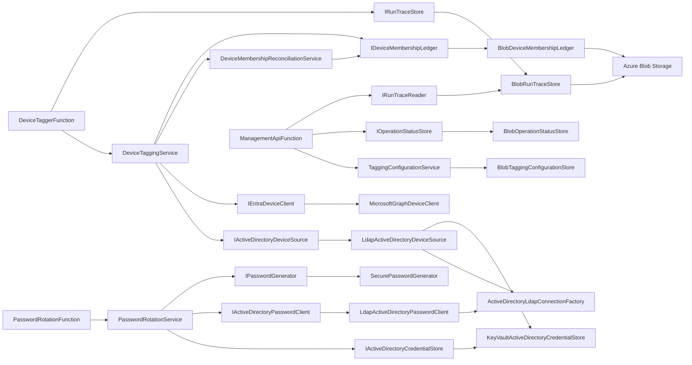
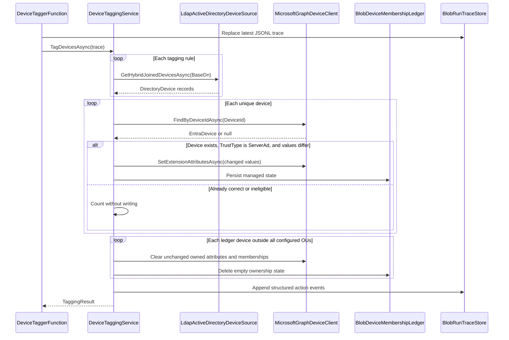
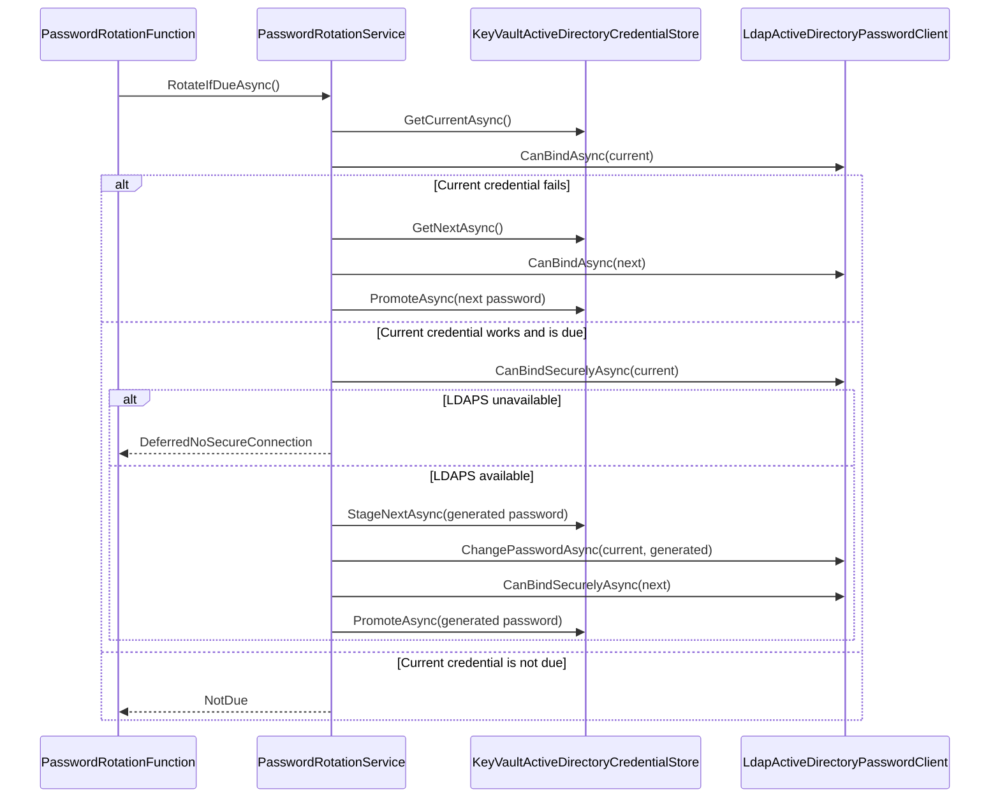

# HybridDeviceTagger Code Documentation

## Purpose

HybridDeviceTagger is a .NET 8 Azure Functions v4 isolated-worker application. It identifies synchronized domain-joined computers by `userCertificate` and connects them to their Microsoft Entra device objects by mapping the AD `objectGUID` to the Entra `deviceId`. It manages two scheduled workflows:

1. **Device tagging** discovers computers in configured Active Directory OU subtrees and writes configured `extensionAttribute1` through `extensionAttribute15` values to matching hybrid-joined Entra devices.
2. **Password rotation** rotates the Active Directory service-account password and keeps the Active Directory and Azure Key Vault states recoverable if a run is interrupted.

The application separates trigger, management API, orchestration, directory, Graph, credential-storage, and operational-state concerns. Interfaces isolate external systems so the orchestration services can be tested without Active Directory, Key Vault, Microsoft Graph, or App Service Authentication.

## Runtime Architecture

### Startup and dependency injection

`Program.cs` is the composition root. It:

- creates the isolated Functions host;
- binds and validates all option classes during startup;
- configures OpenTelemetry and enables the Azure Monitor exporter when an Application Insights connection string is available;
- registers `DefaultAzureCredential` for Key Vault and Microsoft Graph authentication;
- constructs the Key Vault `SecretClient`;
- maps every service interface to its production implementation;
- configures the Graph `HttpClient` with `https://graph.microsoft.com/v1.0/` as its base address.
- creates Blob clients for the private membership ledger and latest-run trace containers.

The Azure clients, LDAP adapters, credential store, dynamic rule provider, operation status store, password generator, and `TimeProvider` are singletons. The workflow orchestrators and management API are transient. `MicrosoftGraphDeviceClient` is created through `HttpClientFactory`.

## Management API

`ManagementApiFunction` exposes seven HTTP operations for complete rule replacement, named-rule upsert and removal, current rule retrieval, both latest-run statuses, and streamed latest-trace download. The HTTP triggers are anonymous at the Functions host layer because App Service Easy Auth authenticates the Entra token first and restricts access to configured principal object IDs. `EasyAuthPrincipalValidator` then requires one valid AAD `X-MS-CLIENT-PRINCIPAL` header as defense in depth.

`BlobTaggingConfigurationStore` stores `tagging-configuration.json` in the private `run-traces` container. Before its first API mutation, `OptionsTaggingRuleProvider` supplies the validated `Tagging__RulesJson` startup fallback. Mutations normalize and validate the complete result and use Blob ETags. API clients can send the ETag returned by `GET` in `If-Match`; a stale write returns HTTP `409`.

`BlobOperationStatusStore` writes separate JSON documents for device tagging and password rotation. Timer entry points record `Running`, then `Succeeded` or a sanitized `Failed` state. Password status preserves the timestamp of the last actual password change across checks that do not rotate. Status persistence failures are warnings and do not fail the directory workflow.

`Deployment/Show-HybridDeviceTaggerApi.ps1` is the read-only operational client. Its mutually exclusive `ShowRules`, `ShowStatus`, and `ShowTrace` parameter sets accept the REST API base URI and Entra API client ID directly, obtain a delegated token through Azure CLI, and emit structured PowerShell objects. It does not query Azure Resource Manager or require subscription metadata. Trace mode parses each JSONL record independently rather than returning an opaque download.

## Device Tagging Workflow

Rules may overlap. Assignments for different extension attributes are merged for the same device. If two matching rules assign different values to the same attribute, the run fails instead of applying an order-dependent result. Graph PATCH requests contain only attributes whose current values differ, making repeated runs idempotent. The ownership ledger records managed attribute values and memberships created by the application. When a device leaves all configured OUs, only attributes that still match their recorded value and memberships proven to be application-owned are removed.

An OU-only path is resolved in every forest domain by reading cross-reference objects from the forest configuration partition. A full distinguished name containing `DC=` targets only that domain. Searches use subtree scope and LDAP paging, so nested OUs and large result sets are supported.

## Password Rotation Workflow

The new password is stored as the `next` secret before Active Directory is changed. It is promoted to `current` only after a successful LDAPS bind. If execution stops after the directory change, a later run can authenticate with `next` and promote it. Password modification never uses the LDAP fallback.

## Function Entry Points

### `DeviceTaggerFunction`

The timer-trigger entry point for device tagging. Its schedule comes from `%TaggingSchedule%`. It replaces the latest-run trace, delegates all work to `DeviceTaggingService`, records success or structured exception details, and logs the aggregate `TaggingResult`. The class is intentionally thin so scheduling remains independent from business logic.

### `PasswordRotationFunction`

The timer-trigger entry point for password maintenance. Its schedule comes from `%PasswordRotationSchedule%`. It calls `PasswordRotationService` and logs only the outcome and known password age.

## Orchestration Services

### `DeviceTaggingService`

Coordinates one complete tagging run. It asks the Active Directory source for every configured rule, deduplicates devices by `DeviceId`, merges non-conflicting attribute assignments, looks up each device in Graph, verifies `TrustType == "ServerAd"`, calculates changed values, and patches only those values. It reconciles group and administrative-unit memberships, removes owned state for devices outside all configured OUs, and emits ordered trace events around every external action and decision. It returns counts for discovered, updated, unchanged, missing, non-hybrid, and cleaned devices.

The private nested `DeviceTagAssignment` record groups one `DirectoryDevice` with the mutable, case-insensitive set of desired attributes accumulated from all matching rules.

### `PasswordRotationService`

Implements age-based rotation and interrupted-run recovery. It first tests `current`; if that credential fails, it attempts recovery from `next`. If `current` works and has not reached `RotateAfterDays`, it returns without changing state. A due rotation proceeds only when secure LDAPS works. It then generates, stages, applies, validates, and promotes a new password in that order.

`TimeProvider` is injected so age calculations are deterministic in tests. A missing Key Vault creation timestamp produces an unknown age and causes a rotation attempt rather than silently keeping a potentially old password.

## Active Directory Services

### `ActiveDirectoryLdapConnectionFactory`

Creates authenticated LDAP v3 connections with a 30-second timeout. Normal connections try Basic authentication over LDAPS first. For connection-availability errors only, and only when configured, they fall back to Negotiate authentication on LDAP with signing and sealing enabled. Authentication errors do not trigger fallback. `CreateSecureBoundConnection` never falls back and is used for password changes.

The caller owns the returned connection. A failed bind disposes the connection before rethrowing the error.

### `ActiveDirectorySearchPath`

An internal static helper for distinguished-name handling. It determines whether a path is forest-relative, validates that a relative path contains only `OU=` components, appends a domain naming context, and converts `DC=` components into a DNS domain name. Source-generated regular expressions handle unescaped DN separators.

### `LdapActiveDirectoryDeviceSource`

Implements `IActiveDirectoryDeviceSource`. For OU-only rules, it reads the configuration naming context and queries `CN=Partitions` for forest domain cross-references. It then searches the resolved OU in each domain. Domains without that OU are skipped; if no domain contains the OU, the operation fails.

Each subtree search selects computer objects with a populated `userCertificate` and requests `objectGUID`, `name`, and `distinguishedName` using server-side paging. The binary AD `objectGUID` is the value that Entra Connect maps to the Entra `deviceId`. Entries without a valid GUID are ignored, and results are deduplicated by device ID. If binding with `current` fails, the source tries `next`, which allows device discovery to continue after an interrupted rotation.

The private nested `SearchTarget` record holds the DNS server name and complete base DN for one domain search.

### `LdapActiveDirectoryPasswordClient`

Implements `IActiveDirectoryPasswordClient`. Bind checks return `false` for LDAP errors rather than treating expected credential failures as exceptions. Secure bind checks always use LDAPS. Password changes send one atomic `ModifyRequest` against the configured service-account DN: delete the quoted UTF-16LE old `unicodePwd` value and add the quoted UTF-16LE new value.

## Azure Services

### `KeyVaultActiveDirectoryCredentialStore`

Implements `IActiveDirectoryCredentialStore` using `SecretClient`. It reads the required `current` secret, optionally reads `next`, writes staged passwords, and promotes validated passwords by creating a new `current` secret version. A missing `next` secret is represented as `null`; a missing `current` secret remains an error.

The LDAP username comes from `ActiveDirectoryOptions`; only passwords are stored as secret values. New secret versions receive the configured expiry interval, and Key Vault creation metadata supplies the rotation age.

### `MicrosoftGraphDeviceClient`

Implements `IEntraDeviceClient`. It obtains an application token for the Graph `.default` scope through the injected `TokenCredential`. Device lookup filters by the shared `deviceId` and selects object ID, display name, trust type, and all extension attributes. Updates PATCH the Entra object ID with only the attribute dictionary supplied by the orchestrator.

The Function managed identity therefore needs the Microsoft Graph application permission `Device.ReadWrite.All`.

### `BlobDeviceMembershipLedger`

Implements `IDeviceMembershipLedger` in the private `membership-ledger` container. One JSON document per hybrid device records the Entra object ID, managed extension-attribute values, and memberships that HybridDeviceTagger created. Empty records are deleted. Enumeration lets the orchestrator identify devices that were managed previously but are no longer returned by any configured OU rule.

### `BlobRunTraceStore`

Implements `IRunTraceStore` and `IRunTraceReader` with the private `run-traces` container. Starting an invocation replaces `device-tagger-last-run.jsonl`; each event is then appended immediately as one compact JSON object and receives a UTC timestamp, sequence, invocation ID, severity, phase, action, outcome, details, and optional exception data. Append failures disable tracing for that invocation and produce a normal application warning instead of interrupting device tagging. The reader streams the private Blob through the authenticated API. Attribute values are represented only by SHA-256 fingerprints, and credentials or tokens are never supplied to the trace API.

## Service Interfaces

### `IActiveDirectoryCredentialStore`

Defines access to the active and staged credentials: read `current`, read optional `next`, stage a new password, and promote a validated password. It keeps Key Vault details out of orchestration code and enables in-memory test doubles.

### `IActiveDirectoryDeviceSource`

Defines device discovery beneath a full DN or forest-relative OU path. It separates LDAP and forest-discovery behavior from tagging decisions.

### `IActiveDirectoryPasswordClient`

Defines normal bind validation, secure bind validation, and password modification. The separate secure operation lets the rotation service explicitly enforce LDAPS.

### `IEntraDeviceClient`

Defines lookup by hybrid device ID and extension-attribute updates by Entra object ID. It isolates HTTP, token acquisition, and Graph JSON from the tagging service.

### `IDeviceMembershipLedger`

Defines loading, enumerating, persisting, and deleting managed Entra ownership state independently from Blob Storage.

### `IRunTraceStore` and `IRunTraceSession`

`IRunTraceStore` starts the latest-run artifact for one invocation. The returned `IRunTraceSession` accepts structured events without exposing Blob APIs to workflow code. `RunTrace.None` keeps orchestration tests and alternate hosts independent from diagnostic storage.

### `IPasswordGenerator`

Defines password generation independently from the rotation workflow. Tests can inject deterministic values while production uses cryptographic randomness.

## Password Generation

### `SecurePasswordGenerator`

Implements `IPasswordGenerator` with `RandomNumberGenerator`. Every password contains at least one uppercase character, lowercase character, digit, and symbol. Remaining positions use the combined character set, and a cryptographic Fisher-Yates shuffle removes the predictable category order. Visually ambiguous characters are excluded. Lengths below four are rejected; production length constraints are stricter through `PasswordRotationOptions`.

## Configuration Classes

All option classes are bound and validated during host startup. Invalid configuration prevents the Function host from accepting invocations.

### `ActiveDirectoryOptions`

Holds the primary server, LDAPS port, fallback policy and port, bind username, service-account DN, and LDAP page size. `UseSsl` must remain enabled because credential and password operations require a secure primary channel. When fallback is enabled, its port must differ from the LDAPS port.

### `TaggingOptions`

Holds tagging rules either as a normal configuration collection or as `RulesJson`, which supports deployment systems that cannot represent arrays conveniently. Validation requires at least one rule, a unique non-empty rule name, a description, valid full-DN or OU-only paths, at least one attribute per rule, names from `extensionAttribute1` through `extensionAttribute15`, and non-empty values.

### `TaggingRuleOptions`

Represents one named and described OU subtree and its desired extension attributes. `Name` is the case-insensitive operational identifier used for logging and configuration updates. `BaseDn` may be a full domain-specific DN or an OU-only forest-relative path. Attribute keys are case-insensitive.

### `KeyVaultOptions`

Holds the vault URI and the names of the `current` and `next` password secrets. Keeping names configurable allows isolated environments and controlled secret migration without changing code.

### `PasswordRotationOptions`

Defines `RotateAfterDays`, generated `PasswordLength`, and `SecretExpiryDays`. Validation requires secret expiry to be later than the rotation threshold so recovery material does not expire before the normal rotation window.

## Data Models

### `DirectoryDevice`

An immutable Active Directory computer projection containing the hybrid device GUID, computer name, and distinguished name. `DeviceId` is the join key used to locate the corresponding Entra object.

### `EntraDevice`

An immutable Graph projection containing the Entra object ID, shared device GUID, optional display name and trust type, and current extension-attribute values. The object ID is used for PATCH requests; the trust type protects non-`ServerAd` devices from modification.

### `StoredDirectoryCredential`

An in-memory value containing the configured LDAP username, secret password, and optional Key Vault creation timestamp. It is passed only to the credential store and LDAP services and must never be logged or serialized.

### `TaggingResult`

The aggregate result of one tagging run: `Discovered`, `Updated`, `Unchanged`, `NotFound`, and `NotHybridJoined`. It allows useful operational telemetry without exposing credentials.

### `PasswordRotationOutcome`

Describes the rotation decision:

- `NotDue`: the active password is still within policy;
- `Rotated`: staging, AD update, validation, and promotion succeeded;
- `RecoveredFromNext`: `current` failed and a valid staged password was promoted;
- `DeferredNoSecureConnection`: rotation was due but LDAPS was unavailable.

### `PasswordRotationResult`

Combines `PasswordRotationOutcome` with the known current password age in days. Age is nullable because older or externally created secret versions may not expose usable creation metadata.

## Security and Failure Behavior

- Application credentials are obtained through `DefaultAzureCredential`; no Azure credential is stored in application settings.
- Active Directory passwords are read from Key Vault and held only in memory.
- LDAP fallback uses Negotiate with signing and sealing and is limited to bind/read paths. Password modification is LDAPS-only.
- A generated password is recoverable from `next` before Active Directory is modified.
- Non-hybrid Entra devices are never patched.
- Conflicting tagging rules fail explicitly instead of producing order-dependent updates.
- Graph and LDAP transport errors propagate to the Functions runtime so failed invocations remain observable and retryable according to platform policy.
- Timer entry points log aggregate results. Exceptional tagging cases may log computer names, device IDs, or trust types for diagnosis; passwords and directory credentials are never logged.

## Tests

The test project mirrors the production boundaries:

- `ActiveDirectorySearchPathTests` verifies OU-path and distinguished-name handling.
- `DeviceTaggingServiceTests` uses service doubles to verify matching, idempotency, forest/rule behavior, skip decisions, and conflict detection.
- `PasswordRotationServiceTests` uses deterministic credentials, time, and passwords to verify not-due, rotation, recovery, and secure-connection deferral paths.

These tests focus on orchestration and parsing behavior. Live LDAP, Key Vault, Graph, private networking, and managed-identity permissions are validated by the deployment workflow rather than unit tests.