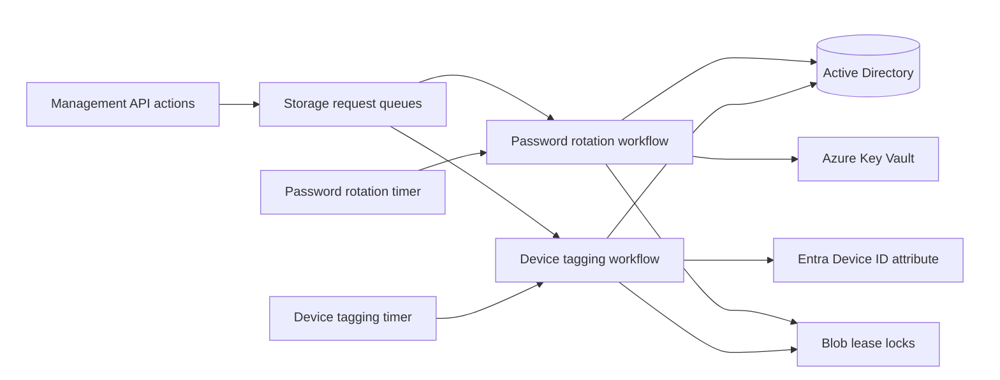
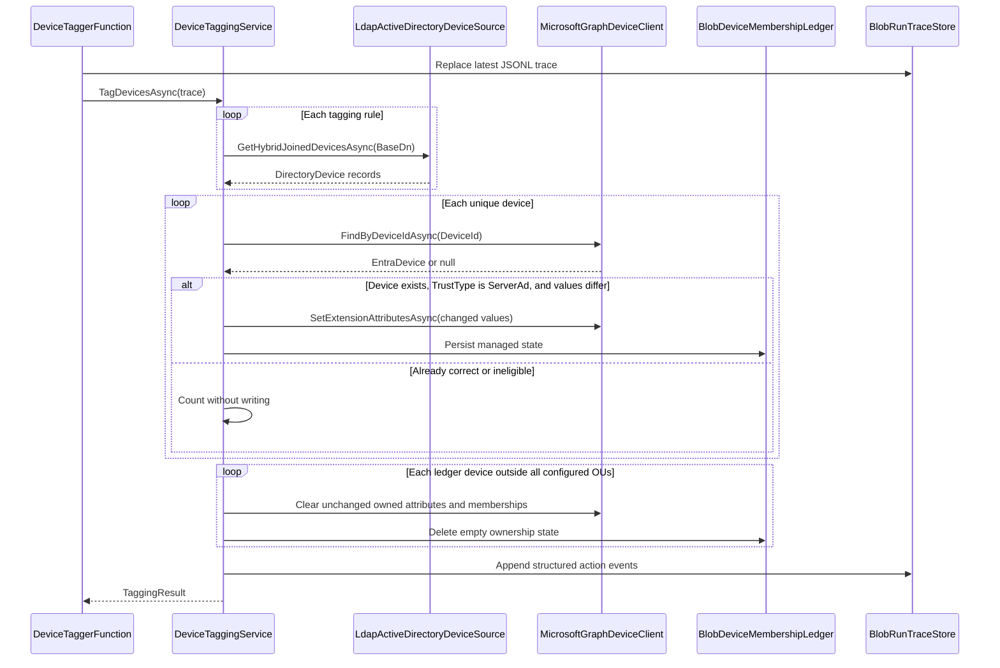
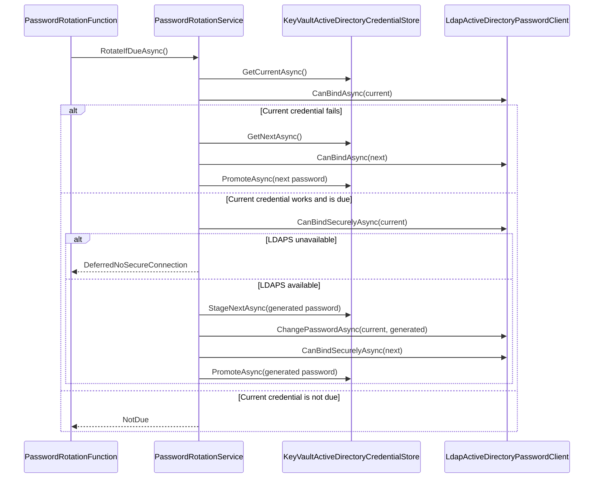

# Developer information

## Code Documentation

The following reference describes the architecture, workflows, class responsibilities, and interactions between classes.

### Purpose

HybridDeviceTagger is a .NET 8 Azure Functions v4 isolated-worker application. It identifies synchronized domain-joined computers by `userCertificate` and connects them to their Microsoft Entra device objects by mapping the AD `objectGUID` to the Entra `deviceId`. It manages two scheduled workflows:

1. **Device tagging** discovers computers in configured Active Directory OU subtrees and writes configured `extensionAttribute1` through `extensionAttribute15` values to matching hybrid-joined Entra devices.
2. **Password rotation** rotates the Active Directory service-account password and keeps the Active Directory and Azure Key Vault states recoverable if a run is interrupted.

The application separates trigger, management API, orchestration, directory, Graph, credential-storage, and operational-state concerns. Interfaces isolate external systems so the orchestration services can be tested without Active Directory, Key Vault, Microsoft Graph, or App Service Authentication.

### Repository Structure

```text
.
|-- .azure/                         Deployment planning and validation records
|-- .githooks/                      Repository-local Git hooks
|-- .github/                        GitHub Actions and Copilot instructions
|-- artifacts/                      Package build output (not tracked)
|-- assets/                         Project logo
|-- docs/
|   `-- management-api.openapi.yaml    Management API contract
|-- installationspackage/             All files required for an installation
|   |-- function/                      Prebuilt Function package (build output, not tracked)
|   |-- HybridDeviceTagger.Management/ PowerShell management module
|   |-- Install.ps1                    Guided installation entry point
|   |-- Install-HybridDeviceTagger.ps1 Validation and installation engine
|   |-- main.bicep                     Azure infrastructure definition
|   |-- key-vault-role-assignment.bicep
|   |                                  Placeholder secrets and secret-scoped Key Vault role assignments
|   `-- README.md                      Installation reference
|-- scripts/
|   |-- Assert-CommitMetadata.ps1      Changelog and file-header commit guard
|   |-- Build-InstallationPackage.ps1  Test, publish, stamp, and archive an installation package
|   |-- Get-ProductVersion.ps1         Tag-based product version calculation
|   `-- Update-ReadmeVersion.ps1       README version badge update and verification
|-- src/
|   `-- HybridDeviceTagger/            Azure Functions application
|-- tests/
|   `-- HybridDeviceTagger.Tests/      Unit and entry-point tests
|-- CHANGELOG.md                       Version history
|-- Directory.Build.props              Shared package metadata (no version)
|-- Directory.Build.targets            Product version resolution for every build
`-- HybridDeviceTagger.sln             Build and test solution
```

Installation assets live only in `installationspackage`. `Install.ps1` collects all parameters interactively and drives `Install-HybridDeviceTagger.ps1`, which validates prerequisites, deploys `main.bicep`, and publishes the prebuilt `function/HybridDeviceTagger.zip`. The engine no longer builds the Function from source; `scripts/Build-InstallationPackage.ps1` creates that package. `installationspackage/function`, `installationspackage/version.json`, and `installationspackage/installation-settings.json` are local or build output and are not tracked.

Before code upload, custom VNet DNS servers must resolve the deployed private endpoints. Failed checks report observed answers or query errors and print the concrete private-zone. A records for Blob, Queue, and a newly created Key Vault. Interactive installation pauses for user confirmation after checking each endpoint/server once. Enter resumes without rechecking and explicitly warns that DNS remains independently unverified; unattended failures
remain terminating errors. No DNS records are edited automatically.

### Versioning and Release Build

The product version has the format `<YYYY><MM>.<counter>` and is never stored in a file. `scripts/Get-ProductVersion.ps1` derives it from Git: a release tag `v<YYYY><MM>.<counter>` on `HEAD` defines the version and never receives a suffix; otherwise the counter is the highest release counter of the current month plus one. Outside `main`, the sanitized branch name is appended (`202611.1-dev`).

`Directory.Build.targets` runs the script for every build unless `ProductVersion` is passed explicitly; `Directory.Build.props` no longer contains a version. `InformationalVersion` carries the full product version. Because .NET assembly version parts are limited to 65535, `AssemblyVersion` and `FileVersion` are `<YYYY>.<M>.<counter>.0`.

PowerShell sources carry `# Project-Version: source`, and the module manifest contains `ModuleVersion = '0.0'`. `scripts/Build-InstallationPackage.ps1` runs the tests (unless `-SkipTests`), publishes the Function with the product version to `installationspackage/function/HybridDeviceTagger.zip`, writes `version.json`, stages `artifacts/HybridDeviceTagger-<version>/` with the version stamped into the scripts and the manifest (plus a `Prerelease` label outside `main`) and `LICENSE`, and creates `artifacts/HybridDeviceTagger-<version>.zip`. `-Release` additionally requires `main`, a clean working tree, and a `## [<version>] - <yyyy-MM-dd>` section in `CHANGELOG.md`, and creates the annotated tag `v<version>`. After a prepared dev PR is merged, the release workflow finalizes the main badges, runs that release build, and publishes the tag and installation ZIP automatically; see [Creating a Release](#creating-a-release).

`scripts/Assert-CommitMetadata.ps1`, run by the `.githooks/pre-commit` hook, requires a `CHANGELOG.md` entry below `## [Unreleased]` (or a release section) for every change, the version marker and author header in changed production files, and version badges in both `README.md` and `README.de.md` that match `Get-ProductVersion.ps1 -NextCommit`. The `pre-commit` and `pre-merge-commit` hooks first update both staged badges with `scripts/Update-ReadmeVersion.ps1 -Staged`; `-Release` verifies that both badges show the release version. The commit guard also rejects one-sided README content changes.

### Runtime Architecture



#### Startup and dependency injection

`Program.cs` is the composition root. It:

- creates the isolated Functions host;
- binds and validates all option classes during startup;
- configures OpenTelemetry and enables the Azure Monitor exporter when an Application Insights connection string is available;
- registers `DefaultAzureCredential` for Key Vault and Microsoft Graph authentication;
- constructs the Key Vault `SecretClient`;
- maps every service interface to its production implementation;
- configures the Graph `HttpClient` with `https://graph.microsoft.com/v1.0/` as its base address.
- creates Blob clients for the private membership ledger and latest-run trace containers;
- creates a Base64-encoding `QueueServiceClient` for management-API run requests.

The Azure clients, LDAP adapters, credential store, dynamic rule provider, operation status store, password generator, and `TimeProvider` are singletons. The workflow orchestrators and management API are transient. `MicrosoftGraphDeviceClient` is created through `HttpClientFactory`.

### Management API

`ManagementApiFunction` exposes ten protected HTTP operations for rule management, both latest-run statuses, streamed latest-trace download, queued immediate tagging, queued forced password rotation, and initial AD-credential initialization. `ManagementApiAuthenticationFunction` exposes the non-secret delegated token scope at `GET /api/management/authentication`, the only path excluded from Easy Auth. The HTTP triggers are anonymous at the Functions host layer because App Service Easy Auth authenticates and validates the Entra token first. `ManagementApiAuthorizer` requires one valid AAD `X-MS-CLIENT-PRINCIPAL` header and first evaluates its `roles` claims. For rule and password administration it additionally queries effective Azure RBAC assignments at the Function App scope. Missing authentication returns HTTP `401`; an authenticated principal without an accepted application role or RBAC assignment receives HTTP `403`.

The API app registration defines `HybridDeviceTagger.Reader`, `HybridDeviceTagger.RuleAdministrator`, `HybridDeviceTagger.TaggingOperator`, and `HybridDeviceTagger.PasswordRotationAdministrator`. The retired `HybridDeviceTagger.CertificateAdministrator` role is unassigned, disabled, and deleted by the installer. For a new Function App, the installer creates the single-tenant registration, identifier URI, service principal, and roles automatically after approval; updates reuse an explicitly supplied existing client ID. The installer assigns approved users, groups, or service principals. `appRoleAssignmentRequired` remains disabled so Function App Owners and Contributors can obtain an API token. Effective direct, transitive-group, or inherited `Owner` and `Contributor` assignments grant rule administration, tagging operation, and password administration, but not the Reader role. Only assignments whose scope is the Function App, one of its parents, or a management group count; child-resource scopes are ignored. Rule mutations by callers without Owner/Contributor access may not introduce Entra group or administrative-unit IDs that no stored rule uses yet (`allowNewMembershipTargets`), because the managed identity can manage every group membership in the tenant. The Function managed identity receives `Reader` on its own Function App to perform this runtime ARM lookup.

The two action endpoints do not execute the workflow inside the HTTP request. They return HTTP `409` when `IOperationLock` reports an active run; otherwise they record a `Queued` status, enqueue an `OperationRequest` through `IOperationRequestQueue` into the private Storage queue `device-tagging-requests` or `password-rotation-requests`, and return HTTP `202` with `{ invocationId, state, statusUri }` and the status URI in the `Location` header. `DeviceTaggingRequestFunction` and `PasswordRotationRequestFunction` are queue triggers in the same classes as the timers, so timer and requested runs share orchestration, status persistence, and trace behavior. `host.json` sets `maxDequeueCount` to `1`, so a failed requested run is moved to the poison queue instead of being retried. Forced rotation bypasses only the password-age gate. Credential verification, secure LDAP, next-secret staging, changed-credential validation, and promotion remain mandatory.

`BlobOperationLock` serializes each operation across all instances with a 60-second Blob lease on `run-traces/locks/<queue>.lock` that is renewed every 20 seconds. Flex Consumption scales timer, queue, and HTTP functions in separate instance groups, so an in-process lock is insufficient. Each renewal call has a 10-second timeout. A watchdog cancels the run 45 seconds after the last successful renewal, which is before the 60-second lease can expire, even if a renewal call hangs. A timer run that cannot acquire the lease is skipped with a warning; a requested run that cannot acquire it marks its own still-queued status as failed. `maximumInstanceCount` defaults to `1` per scale group.

`BlobTaggingConfigurationStore` stores `tagging-configuration.json` in the private `run-traces` container. Before its first API mutation, `OptionsTaggingRuleProvider` supplies the validated `Tagging__RulesJson` startup fallback. Mutations normalize and validate the complete result and use Blob ETags. API clients can send the ETag returned by `GET` in `If-Match`; a stale write returns HTTP `409`.

`BlobTrustedCertificateStore` provides the LDAP trust anchors for every new connection. The installer no longer requires a certificate: normally the first anchor is added after installation through the configuration portal or `Add-HybridDeviceTaggerTrustedCertificate`. Until the first management change, the store returns the DER or PEM file packaged by the installer only when `-ActiveDirectoryTrustedCertificatePath` was supplied for pre-seeding (`ActiveDirectory__TrustedCertificatePath`); without a packaged or managed file, the operating system trust store applies. A certificate packaged by an earlier installer is not contained in a new package when the parameter is omitted; the installer warns, and unless the certificate is already managed in Blob it must be added again. The portal routes `management/portal/certificates` (used by the portal and the module) add, replace, or remove anchors in `run-traces/active-directory-trust-anchors.json` with Blob ETags; the first change copies the packaged certificate, if any. Only public, unexpired, non-duplicate certificates are accepted, at most 20, and the last anchor cannot be removed. Because a substituted anchor would let its author impersonate a domain controller and capture the service-account password, only Function App Owners and Contributors may manage anchors; those principals already control the Function code and settings, and the Storage account is private. `ActiveDirectoryLdapConnectionFactory` validates the DNS name against every subject alternative DNS name, the chain, the server-authentication EKU, and online revocation. A rejected certificate becomes an `ActiveDirectoryLdapException` with result code `-2` and a concrete reason (name mismatch, chain status, revocation failure), and the factory then tries the next domain controller instead of surfacing a raw `AuthenticationException`. Windows validates through `System.DirectoryServices.Protocols`. Linux LDAPS and StartTLS use `Novell.Directory.Ldap.NETStandard`, whose certificate callback runs on the same TLS session that carries the bind.

### Configuration portal and activity log

`PortalFunction` serves the embedded `Portal/index.html`, `app.js`, and `app.css` and the public sign-in settings `config.json` at `/api/portal`. These six static paths are excluded from Easy Auth and carry a strict Content Security Policy (`script-src 'self'`, `connect-src 'self'` plus the Entra sign-in host, `frame-ancestors 'none'`). The page signs in with the authorization code flow and PKCE against the management API app registration (SPA redirect URI `/api/portal`, scope `access_as_user`) and sends the access token to the management API. All server data is rendered through `textContent`.

`PortalApiFunction` exposes `/api/management/portal/*` for the session check, activity query, effective AD configuration, LDAP validation, service-account change, trust-anchor management, and the rule editor's Entra search (`directory/groups`, `directory/administrative-units`, `directory/resolve`). `GraphEntraDirectorySearch` uses the existing `GroupMember.ReadWrite.All` and `AdministrativeUnit.ReadWrite.All` permissions, searches by display-name prefix, and marks dynamic, mail-enabled, or on-premises synchronized groups and dynamic administrative units as not assignable. Every endpoint calls `IManagementApiAuthorizer.AuthorizeFunctionAppAdministratorAsync`, which accepts only effective Owner or Contributor assignments on the Function App and ignores application roles. Lookup results are cached per principal for 60 seconds; the authorizer is therefore a singleton. The portal reuses the existing rule, forest-domain, credential-initialization, rotation, and status endpoints, whose RBAC substitution already admits Owners and Contributors.

`ActiveDirectoryAccountService` changes the service account only after `IActiveDirectoryPasswordClient.ValidateAccessAsync` binds successfully with the new UPN and password. It holds the password-rotation lock, stores the new password as `current`, writes the UPN and optional DN override to `run-traces/active-directory-configuration.json` (preserving the forest domain), restores the previous password if that write fails, and replaces `next` with a placeholder. The configuration blob is read in both its legacy string form and the current object form; `ActiveDirectoryConfigurationSnapshot.GetServiceAccount` falls back to `ActiveDirectory__BindUsername` and `ActiveDirectory__BindUserDistinguishedName` when no override exists. The credential store, initializer, and password client use this effective account.

`LoggerActivityLog` writes activities through the logger category `HybridDeviceTagger.Activity` with the properties `ActivityCategory`, `ActivityAction`, `ActivityOutcome`, `ActivityActor`, `ActivityTarget`, and `ActivityDetails`; OpenTelemetry exports them to `AppTraces` in the Application Insights workspace with Entra authentication (`APPLICATIONINSIGHTS_AUTHENTICATION_STRING=Authorization=AAD`, `Monitoring Metrics Publisher`); local authentication is disabled so the connection string alone cannot forge activity entries. Configuration mutations, queued runs, credential operations, LDAP validation, portal sign-ins, denied requests, completed tagging runs, every changed device (attribute names and membership counts only), and non-trivial rotation outcomes are recorded. Passwords and attribute values are never recorded. `LogAnalyticsActivityLogReader` runs a resource-centric query against `Monitoring__ApplicationInsightsResourceId` with the managed identity, which receives `Monitoring Reader` on the Application Insights component. Filters are allow-listed values only, so user input never reaches the KQL text.

`KeyVaultActiveDirectoryCredentialStore` treats secrets with content type `application/vnd.hybriddevicetagger.placeholder` as absent. The deployment creates such placeholders for missing password secrets in an existing Key Vault so the managed identity can receive `Key Vault Secrets Officer` on those two secrets only. `ActiveDirectoryCredentialInitializer` replaces only a missing secret or a placeholder and rejects initialization when a real password exists.

`BlobOperationStatusStore` writes separate JSON documents for device tagging and password rotation. Requested runs start as `Queued`; timer and queue entry points record `Running`, then `Succeeded` or a sanitized `Failed` state. Password status preserves the timestamp of the last actual password change across checks that do not rotate. Status persistence failures are warnings and do not fail the directory workflow.

`installationspackage/HybridDeviceTagger.Management` owns the REST client. `Connect-HybridDeviceTagger` stores the API URI, audience, token, and expiry in module scope and refreshes the token from Azure CLI when required. Public cmdlets cover rules, both statuses, parsed trace events, the forest domain, LDAP trust anchors (`Get-`, `Add-`, `Remove-HybridDeviceTaggerTrustedCertificate`), the service account (`Set-HybridDeviceTaggerServiceAccount`), credential initialization, queued immediate tagging, and queued forced password rotation. The trust-anchor and service-account cmdlets call the portal routes `management/portal/certificates` and `management/portal/active-directory/account` and therefore require effective Function App Owner/Contributor access; `Add-HybridDeviceTaggerTrustedCertificate` rejects files with a private key and expired certificates locally. The two action cmdlets return the accepted request or, with `-Wait`, poll the status endpoint until that invocation finishes (`-TimeoutSeconds`, defaults 1,800 and 600 seconds). `Add-HybridDeviceTaggerRule` performs the named single-rule upsert. `Get-HybridDeviceTaggerTrace` prepends the `HybridDeviceTagger.TraceEvent` type name to each parsed event. The module format file renders that type as the concise six-field trace line by default without converting the pipeline value to text. Mutations use `ShouldProcess`, ETag-protected writes, and high confirmation impact for destructive rule replacement, removal, password rotation, service-account changes, and trust-anchor changes. The complete command, security, data-flow, error, and internal implementation reference is maintained in [installationspackage/HybridDeviceTagger.Management/README.md](installationspackage/HybridDeviceTagger.Management/README.md). No standalone REST wrapper scripts are required.

The GitHub Actions workflow [`.github/workflows/publish-powershell-module.yml`](.github/workflows/publish-powershell-module.yml) publishes the module to PowerShell Gallery for non-prerelease GitHub Releases whose commit belongs to `main`. The release tag must be the `v<YYYY><MM>.<counter>` release tag of the checked-out commit. The workflow runs `scripts/Build-InstallationPackage.ps1`, verifies that the stamped manifest version matches the product version, and publishes the stamped module from `artifacts/HybridDeviceTagger-<version>/HybridDeviceTagger.Management` using the repository secret `HYBRIDDEVICETAGGER_PSMODUL`. Existing Gallery versions are detected and skipped, making workflow reruns idempotent.

### Device Tagging Workflow



Rules may overlap. Assignments for different extension attributes are merged for the same device. If two matching rules assign different values to the same attribute, the run fails instead of applying an order-dependent result. Graph PATCH requests contain only attributes whose current values differ, making repeated runs idempotent. The ownership ledger records managed attribute values and memberships created by the application. When a device leaves all configured OUs, only attributes that still match their recorded value and memberships proven to be application-owned are removed.

An OU-only path is resolved in every forest domain by reading cross-reference objects from the forest configuration partition through the statically configured domain controller. A full distinguished name containing `DC=` targets only that domain and is accepted only when its derived DNS name exactly matches an advertised forest `dnsRoot`. Rule mutations perform this check before persistence, and the LDAP source repeats it before deriving any rule-controlled endpoint. Searches use subtree scope and LDAP paging, so nested OUs and large result sets are supported.

### Password Rotation Workflow



The new password is stored as the `next` secret before Active Directory is changed. It is promoted to `current` only after a successful LDAPS bind. If execution stops after the directory change, a later run can authenticate with `next` and promote it. Password modification never uses the LDAP fallback.

### Function Entry Points

#### `DeviceTaggerFunction`

The timer-trigger entry point for device tagging. The timer ticks every five minutes (`0 */5 * * * *`) and runs only when `IOperationScheduleStore` reports that the tagging interval has elapsed since the last recorded start (one minute tolerance for timer jitter). The interval is stored in `run-traces/operation-schedule.json`, edited in the configuration portal, and defaults to `Tagging__IntervalMinutes`. Requested runs bypass the interval. It replaces the latest-run trace, delegates all work to `DeviceTaggingService`, records success or structured exception details, and logs the aggregate `TaggingResult`. The class is intentionally thin so scheduling remains independent from business logic. The same class contains `DeviceTaggingRequestFunction`, the queue trigger for `device-tagging-requests`. Both entry points acquire the device-tagging Blob lease before running; a timer run without the lease is skipped with a warning.

#### `PasswordRotationFunction`

The timer-trigger entry point for password maintenance. It ticks hourly (`0 0 * * * *`); `PasswordRotationService` rotates once the password age reaches the runtime rotation interval from `IOperationScheduleStore` (default `PasswordRotation__RotateAfterDays`, at most 29 days and below `SecretExpiryDays`). It calls `PasswordRotationService` and logs only the outcome and known password age. The same class contains `PasswordRotationRequestFunction`, the queue trigger for `password-rotation-requests` that runs a forced rotation under the password-rotation Blob lease.

### Orchestration Services

#### `DeviceTaggingService`

Coordinates one complete tagging run. It asks the Active Directory source for every configured rule, deduplicates devices by `DeviceId`, merges non-conflicting attribute assignments, looks up each device in Graph, verifies `TrustType == "ServerAd"`, calculates changed values, and patches only those values. It reconciles group and administrative-unit memberships, removes owned state for devices outside all configured OUs, and emits ordered trace events around every external action and decision. It returns counts for discovered, updated, unchanged, missing, non-hybrid, and cleaned devices.

The private nested `DeviceTagAssignment` record groups one `DirectoryDevice` with the mutable, case-insensitive set of desired attributes accumulated from all matching rules.

#### `PasswordRotationService`

Implements age-based rotation and interrupted-run recovery. It first tests `current`; if that credential fails, it attempts recovery from `next`. If `current` works and has not reached `RotateAfterDays`, it returns without changing state. A due rotation proceeds only when secure LDAPS works. It then generates, stages, applies, validates, and promotes a new password in that order.

`TimeProvider` is injected so age calculations are deterministic in tests. A missing Key Vault creation timestamp produces an unknown age and causes a rotation attempt rather than silently keeping a potentially old password.

### Active Directory Services

#### `ActiveDirectoryLdapConnectionFactory`

Resolves domain controllers from `_ldap._tcp.dc._msdcs.<domain>` DNS SRV records and creates authenticated LDAP v3 connections with a 30-second timeout. Connections try Basic authentication over LDAPS first and, for connection-availability errors only, fall back to Basic authentication after upgrading LDAP with StartTLS. Authentication errors do not trigger transport fallback. Both transports support password changes because credentials and LDAP operations remain inside validated TLS.

The caller owns the returned connection. A failed bind disposes the connection before rethrowing the error.

#### `ActiveDirectorySearchPath`

An internal static helper for distinguished-name handling. It determines whether a path is forest-relative, validates that a relative path contains only `OU=` components, appends a domain naming context, and converts `DC=` components into a DNS domain name. Source-generated regular expressions handle unescaped DN separators.

#### `LdapActiveDirectoryDeviceSource`

Implements `IActiveDirectoryDeviceSource` and `IActiveDirectoryRuleValidator`. It always discovers forest domains through the configured server before processing a domain-specific rule and rejects a `BaseDn` whose DNS domain is not an exact forest `dnsRoot`. The configuration service invokes the validator before every replace, upsert, or removal is persisted. For OU-only rules, the source reads the configuration naming context and queries `CN=Partitions` for forest domain cross-references. It then searches the resolved OU in each domain. Domains without that OU are skipped; if no domain contains the OU, the operation fails.

Each subtree search selects computer objects with a populated `userCertificate` and requests `objectGUID`, `name`, and `distinguishedName` using server-side paging. The binary AD `objectGUID` is the value that Entra Connect maps to the Entra `deviceId`. Entries without a valid GUID are ignored, and results are deduplicated by device ID. If binding with `current` fails, the source tries `next`, which allows device discovery to continue after an interrupted rotation.

The private nested `SearchTarget` record holds the DNS server name and complete base DN for one domain search.

#### `LdapActiveDirectoryPasswordClient`

Implements `IActiveDirectoryPasswordClient`. Bind checks return `false` for LDAP errors rather than treating expected credential failures as exceptions. Secure bind checks always use LDAPS. Password changes send one atomic `ModifyRequest` against the configured service-account DN: delete the quoted UTF-16LE old `unicodePwd` value and add the quoted UTF-16LE new value.

### Azure Services

#### `KeyVaultActiveDirectoryCredentialStore`

Implements `IActiveDirectoryCredentialStore` using `SecretClient`. It reads the required `current` secret, optionally reads `next`, writes staged passwords, and promotes validated passwords by creating a new `current` secret version. A missing `next` secret is represented as `null`; a missing `current` secret remains an error.

The LDAP username comes from `ActiveDirectoryOptions`; only passwords are stored as secret values. New secret versions receive the configured expiry interval, and Key Vault creation metadata supplies the rotation age.

#### `MicrosoftGraphDeviceClient`

Implements `IEntraDeviceClient`. It obtains an application token for the Graph `.default` scope through the injected `TokenCredential`. Device lookup filters by the shared `deviceId` and selects object ID, display name, trust type, and all extension attributes. Updates PATCH the Entra object ID with only the attribute dictionary supplied by the orchestrator.

The Function managed identity therefore needs the Microsoft Graph application permission `Device.ReadWrite.All`.

#### `BlobDeviceMembershipLedger`

Implements `IDeviceMembershipLedger` in the private `membership-ledger` container. One JSON document per hybrid device records the Entra object ID, managed extension-attribute values, and memberships that HybridDeviceTagger created. Empty records are deleted. Enumeration lets the orchestrator identify devices that were managed previously but are no longer returned by any configured OU rule.

#### `BlobRunTraceStore`

Implements `IRunTraceStore` and `IRunTraceReader` with the private `run-traces` container. Starting an invocation replaces `device-tagger-last-run.jsonl`; each event is then appended immediately as one compact JSON object and receives a UTC timestamp, sequence, invocation ID, severity, phase, action, outcome, details, and optional exception data. Append failures disable tracing for that invocation and produce a normal application warning instead of interrupting device tagging. The reader streams the private Blob through the authenticated API. Attribute values are represented only by SHA-256 fingerprints, and credentials or tokens are never supplied to the trace API.

### Service Interfaces

#### `IActiveDirectoryCredentialStore`

Defines access to the active and staged credentials: read `current`, read optional `next`, stage a new password, and promote a validated password. It keeps Key Vault details out of orchestration code and enables in-memory test doubles.

#### `IActiveDirectoryDeviceSource`

Defines device discovery beneath a full DN or forest-relative OU path. It separates LDAP and forest-discovery behavior from tagging decisions.

#### `IActiveDirectoryPasswordClient`

Defines normal bind validation, secure bind validation, and password modification. The separate secure operation lets the rotation service explicitly enforce LDAPS.

#### `IEntraDeviceClient`

Defines lookup by hybrid device ID and extension-attribute updates by Entra object ID. It isolates HTTP, token acquisition, and Graph JSON from the tagging service.

#### `IDeviceMembershipLedger`

Defines loading, enumerating, persisting, and deleting managed Entra ownership state independently from Blob Storage.

#### `IRunTraceStore` and `IRunTraceSession`

`IRunTraceStore` starts the latest-run artifact for one invocation. The returned `IRunTraceSession` accepts structured events without exposing Blob APIs to workflow code. `RunTrace.None` keeps orchestration tests and alternate hosts independent from diagnostic storage.

#### `IPasswordGenerator`

Defines password generation independently from the rotation workflow. Tests can inject deterministic values while production uses cryptographic randomness.

### Password Generation

#### `SecurePasswordGenerator`

Implements `IPasswordGenerator` with `RandomNumberGenerator`. Every password contains at least one uppercase character, lowercase character, digit, and symbol. Remaining positions use the combined character set, and a cryptographic Fisher-Yates shuffle removes the predictable category order. Visually ambiguous characters are excluded. Lengths below four are rejected; production length constraints are stricter through `PasswordRotationOptions`.

### Configuration Classes

All option classes are bound and validated during host startup. Invalid configuration prevents the Function host from accepting invocations.

#### `ActiveDirectoryOptions`

Holds the forest domain, primary server, LDAPS port, fallback policy and port, bind username, service-account DN, and LDAP page size. `Domain` and `BindUsername` are optional because the installer deploys the Function without directory settings; both are configured after installation through the portal or the management module. `UseSsl` must remain enabled because credential and password operations require a secure primary channel. When fallback is enabled, its port must differ from the LDAPS port.

The service-account DN is optional when installing without internal AD DNS. Before rotation,
`LdapActiveDirectoryDeviceSource` resolves it from the UPN across the forest's advertised domains;
zero or multiple matches fail explicitly. `BlobActiveDirectoryConfigurationStore` stores an
ETag-protected forest DNS override in `run-traces/active-directory-configuration.json`, using the
application setting only until the first management write. Forest connections read it on demand,
without process-local caching. Configuration reads and writes never require LDAP or a credential,
so administrators can repair the domain before credential initialization.

While the forest domain or the service account is missing, the Function is unconfigured.
`ActiveDirectoryConfigurationSnapshot.GetMissingConfiguration` reports the missing setting, and
`ActiveDirectoryNotConfiguredException` in `Services/BlobActiveDirectoryConfigurationStore.cs` is
thrown when an LDAP connection or the effective service account is requested. The management and
portal APIs map it to HTTP `409` with a "not configured" message; `GET management/active-directory`
returns source `notConfigured` with an empty domain. `DeviceTaggerFunction` and
`PasswordRotationFunction` skip scheduled runs with an information log entry until both values are
configured.

#### `TaggingOptions`

Holds tagging rules either as a normal configuration collection or as `RulesJson`, which supports deployment systems that cannot represent arrays conveniently. Validation requires at least one rule, a unique non-empty rule name, a description, valid full-DN or OU-only paths, at least one attribute per rule, names from `extensionAttribute1` through `extensionAttribute15`, and non-empty values.

#### `TaggingRuleOptions`

Represents one named and described OU subtree and its desired extension attributes. `Name` is the case-insensitive operational identifier used for logging and configuration updates. `BaseDn` may be a full domain-specific DN or an OU-only forest-relative path. Attribute keys are case-insensitive.

#### `KeyVaultOptions`

Holds the vault URI and the names of the `current` and `next` password secrets. Keeping names configurable allows isolated environments and controlled secret migration without changing code.

#### `PasswordRotationOptions`

Defines `RotateAfterDays`, generated `PasswordLength`, and `SecretExpiryDays`. Validation requires secret expiry to be later than the rotation threshold so recovery material does not expire before the normal rotation window.

### Data Models

#### `DirectoryDevice`

An immutable Active Directory computer projection containing the hybrid device GUID, computer name, and distinguished name. `DeviceId` is the join key used to locate the corresponding Entra object.

#### `EntraDevice`

An immutable Graph projection containing the Entra object ID, shared device GUID, optional display name and trust type, and current extension-attribute values. The object ID is used for PATCH requests; the trust type protects non-`ServerAd` devices from modification.

#### `StoredDirectoryCredential`

An in-memory value containing the configured LDAP username, secret password, and optional Key Vault creation timestamp. It is passed only to the credential store and LDAP services and must never be logged or serialized.

#### `TaggingResult`

The aggregate result of one tagging run: `Discovered`, `Updated`, `Unchanged`, `NotFound`, and `NotHybridJoined`. It allows useful operational telemetry without exposing credentials.

#### `PasswordRotationOutcome`

Describes the rotation decision:

- `NotDue`: the active password is still within policy;
- `Rotated`: staging, AD update, validation, and promotion succeeded;
- `RecoveredFromNext`: `current` failed and a valid staged password was promoted;
- `DeferredNoSecureConnection`: rotation was due but LDAPS was unavailable.

#### `PasswordRotationResult`

Combines `PasswordRotationOutcome` with the known current password age in days. Age is nullable because older or externally created secret versions may not expose usable creation metadata.

### Security and Failure Behavior

- Application credentials are obtained through `DefaultAzureCredential`; no Azure credential is stored in application settings.
- Active Directory passwords are read from Key Vault and held only in memory.
- LDAP fallback uses StartTLS and supports the same bind, read, and password-modification operations as LDAPS.
- A generated password is recoverable from `next` before Active Directory is modified.
- Non-hybrid Entra devices are never patched.
- Conflicting tagging rules fail explicitly instead of producing order-dependent updates.
- Graph and LDAP transport errors propagate to the Functions runtime so failed invocations remain observable and retryable according to platform policy.
- Unconfigured Active Directory settings skip timer runs and return HTTP `409` for requested runs instead of failing.
- Timer entry points log aggregate results. Exceptional tagging cases may log computer names, device IDs, or trust types for diagnosis; passwords and directory credentials are never logged.

### Tests

The test project mirrors the production boundaries:

- `ActiveDirectorySearchPathTests` verifies OU-path and distinguished-name handling.
- `DeviceTaggingServiceTests` uses service doubles to verify matching, idempotency, forest/rule behavior, skip decisions, and conflict detection.
- `PasswordRotationServiceTests` uses deterministic credentials, time, and passwords to verify not-due, rotation, recovery, and secure-connection deferral paths.

These tests focus on orchestration and parsing behavior. Live LDAP, Key Vault, Graph, private networking, and managed-identity permissions are validated by the deployment workflow rather than unit tests.

## Management REST API

The Function App exposes a single-tenant, Entra-protected management API at `/api/management`. App Service Easy Auth rejects unauthenticated requests with HTTP `401`. The Function also validates the principal header and returns HTTP `403` if neither an Entra application role accepted by the endpoint nor an eligible Azure RBAC assignment is present. **Assignment required** remains disabled on the enterprise application so that Function App Owners and Contributors can obtain an API token. Direct Owner/Contributor assignments, assignments effective through security groups, and assignments inherited from parent scopes grant rule and password administration and permission to start tagging runs, but not the Reader role. No Function keys or client secrets are required. Only `GET /api/management/authentication` is excluded from Easy Auth and returns the deployment's non-secret token scope.

| Method and path | Function | Required role |
| --- | --- | --- |
| `GET /api/management/authentication` | Read the deployment-specific Entra token scope | none |
| `GET /api/management/active-directory` | Read the effective forest domain and version without an AD connection | `Reader`, `RuleAdministrator`, or `PasswordRotationAdministrator` |
| `PUT /api/management/active-directory` | Validate the forest domain syntax and save a versioned configuration | effective Function App Owners/Contributors only |
| `GET /api/management/tagging-rules` | Read the current rules, ETag, modification time, and source | `Reader` or `RuleAdministrator` |
| `PUT /api/management/tagging-rules` | Replace the complete validated rule set | `RuleAdministrator` |
| `PUT /api/management/tagging-rules/{ruleName}` | Add a complete rule or replace it case-insensitively | `RuleAdministrator` |
| `DELETE /api/management/tagging-rules/{ruleName}` | Remove a rule; at least one rule must remain | `RuleAdministrator` |
| `GET /api/management/status/device-tagging` | Read the status and result counters of the latest tagging run | `Reader` or `TaggingOperator` |
| `GET /api/management/status/password-rotation` | Read the status of the latest check and the timestamp of the last actual password change | `Reader` or `PasswordRotationAdministrator` |
| `GET /api/management/traces/device-tagging/latest` | Download the latest JSONL trace | `Reader` or `TaggingOperator` |
| `POST /api/management/actions/device-tagging` | Queue a tagging run for immediate execution (HTTP `202`) | `TaggingOperator` |
| `POST /api/management/actions/password-rotation` | Queue a secure rotation of the AD service-account password regardless of its age (HTTP `202`) | `PasswordRotationAdministrator` |
| `POST /api/management/actions/initialize-ad-credential` | Validate the initial AD service-account password and store it in Key Vault through the managed identity; replaces only a missing secret or a placeholder | `PasswordRotationAdministrator` |

All full role values start with `HybridDeviceTagger.`, for example `HybridDeviceTagger.Reader`. Without explicit engine parameters, the installer assigns no bootstrap roles; Owner/Contributor assignments authorize administration. An explicit bootstrap list is assigned all four roles; four role-specific principal parameters are available for least-privilege assignments. Security groups are preferred for ongoing administration. The former `HybridDeviceTagger.CertificateAdministrator` role and its endpoints for runtime management of LDAPS trust certificates have been removed; trust anchors and the service account are managed exclusively through the Owner/Contributor-protected portal routes `management/portal/certificates` and `management/portal/active-directory/account`.

Until the forest domain and service account are configured after installation, actions and endpoints that require Active Directory return HTTP `409` with a "not configured" message; `GET /api/management/active-directory` returns the source `notConfigured` and an empty domain.

### Managing API Roles After Installation

Roles can be assigned to users and security groups in the Entra admin center:

1. Open **Identity** > **Applications** > **Enterprise applications**.
2. Select the enterprise application for the HybridDeviceTagger Management API.
3. Select **Users and groups** > **Add user/group**.
4. Select the user or security group, then select only the required role.
5. Confirm the assignment. Multiple roles are added as separate assignments.

Microsoft Graph PowerShell can be used for scripted management and service principals. The executing Entra identity needs a role such as `Privileged Role Administrator` and must be able to consent to the requested Graph permissions:

```powershell
Install-Module Microsoft.Graph.Authentication -Scope CurrentUser
Connect-MgGraph -Scopes 'Application.Read.All', 'AppRoleAssignment.ReadWrite.All'

$apiClientId = '5e324803-5aed-4e5d-b49f-a4bfceddcda8'
$principalObjectId = '<object ID of the user, group, or service principal>'
$roleValue = 'HybridDeviceTagger.Reader'

$api = Invoke-MgGraphRequest -Method GET -Uri (
	"https://graph.microsoft.com/v1.0/servicePrincipals?`$filter=appId eq '$apiClientId'&`$select=id,appRoles"
)
$apiServicePrincipal = @($api.value)[0]
$appRole = @($apiServicePrincipal.appRoles | Where-Object value -eq $roleValue)[0]

$assignmentUri = "https://graph.microsoft.com/v1.0/servicePrincipals/$($apiServicePrincipal.id)/appRoleAssignedTo"
$assignments = @(Invoke-MgGraphRequest -Method GET -Uri $assignmentUri).value
$assignment = @($assignments | Where-Object {
	$_.principalId -eq $principalObjectId -and $_.appRoleId -eq $appRole.id
})[0]

if (-not $assignment) {
	$assignment = Invoke-MgGraphRequest -Method POST -Uri $assignmentUri -Body (@{
		principalId = $principalObjectId
		resourceId = $apiServicePrincipal.id
		appRoleId = $appRole.id
	} | ConvertTo-Json)
}
```

List existing assignments and remove a specific assignment:

```powershell
$assignments = @(Invoke-MgGraphRequest -Method GET -Uri $assignmentUri).value

$assignments |
	Where-Object principalId -eq $principalObjectId |
	Select-Object id, principalDisplayName, principalType, appRoleId

$assignmentToRemove = @($assignments | Where-Object {
	$_.principalId -eq $principalObjectId -and $_.appRoleId -eq $appRole.id
})[0]
if (-not $assignmentToRemove) {
	throw "The selected principal does not have role '$roleValue'."
}

Invoke-MgGraphRequest -Method DELETE -Uri (
	"$assignmentUri/$($assignmentToRemove.id)"
)
```

After a role change, any previously issued access token must be refreshed. Reconnect the management module; if Azure CLI still returns a cached token, sign in again:

```powershell
Disconnect-MgGraph
az logout
az login --tenant d89a354d-2bce-44ed-b802-8f8600689247
Connect-HybridDeviceTagger
```

`Assignment required` must remain disabled on the enterprise application so that the Function can check effective Owner/Contributor assignments itself. All other API permissions still require explicit application roles.

The API stores dynamic rules as `tagging-configuration.json` in the private `run-traces` container. Until the API saves its first change, it uses `Tagging__RulesJson` as a fallback. Each tagging run reads exactly one current snapshot at startup; configuration changes do not require a Function restart. ETags prevent concurrent changes from silently overwriting one another. The complete OpenAPI 3.0 specification is available in [docs/management-api.openapi.yaml](docs/management-api.openapi.yaml).

The `installationspackage/HybridDeviceTagger.Management` module retains the REST connection established by `Connect-HybridDeviceTagger` for subsequent cmdlets. It uses the existing `az login` session; no subscription, resource group, or ARM queries are required:

```powershell
Import-Module ./installationspackage/HybridDeviceTagger.Management
Connect-HybridDeviceTagger
Get-HybridDeviceTaggerRule
Get-HybridDeviceTaggerLastRunStatus
Add-HybridDeviceTaggerRule -Rule $rule -WhatIf
Invoke-HybridDeviceTagging -Wait
Invoke-HybridDeviceTaggerPasswordRotation -Wait -Confirm
```

`Invoke-HybridDeviceTaggerPasswordRotation` bypasses only the age check. Current-credential bind, LDAPS, staging, validation, and promotion remain mandatory. Both actions immediately return HTTP `202`, `{ invocationId, state: Queued, statusUri }`, and the status URI in the `Location` header. A queue-triggered Function executes the run and records the same status as the timer (`Queued` → `Running` → `Succeeded`/`Failed`). Failed requested runs are not retried automatically. If the operation is already running, the API returns HTTP `409`. With `-Wait`, the module polls the status until that specific run finishes; `-TimeoutSeconds` limits the wait time.

Read operations are available directly in the module:

```powershell
Get-HybridDeviceTaggerRule
Get-HybridDeviceTaggerLastRunStatus | Format-List
Get-HybridDeviceTaggerPasswordRotationStatus | Format-List
Get-HybridDeviceTaggerTrace
```

`Get-HybridDeviceTaggerTrace` displays each trace event as one logical line in the format `<Time>,<Severity>,<Phase>,<Status>,<Action>,<Details>`, but returns complete `HybridDeviceTagger.TraceEvent` objects to the pipeline. This supports assignment, `Where-Object`, `Select-Object`, `ConvertTo-Json`, and `Export-Csv` without losing information.

After installation, Function App Owners and Contributors manage LDAPS trust anchors in the configuration portal at `/api/portal` or with `Add-`, `Get-`, and `Remove-HybridDeviceTaggerTrustedCertificate`. The installer packages an initial certificate only when optional pre-seeding with `-ActiveDirectoryTrustedCertificatePath` is used; without a packaged or managed certificate, the operating system trust store applies.

A bearer token must have the configured API app ID or `api://<client-id>` as its audience:

```powershell
$headers = @{ Authorization = "Bearer $accessToken" }
Invoke-RestMethod `
	-Uri 'https://func-hybriddevicetagger.azurewebsites.net/api/management/status/device-tagging' `
	-Headers $headers

Invoke-WebRequest `
	-Uri 'https://func-hybriddevicetagger.azurewebsites.net/api/management/traces/device-tagging/latest' `
	-Headers $headers `
	-OutFile '.\device-tagger-last-run.jsonl'
```

## Rotation Process

Rotation checks the current secret daily and normally rotates it once it is 25 days old:

1. Store a new random password as `next` in Key Vault.
2. Change the account's own AD password over LDAPS using a combined `unicodePwd` delete/add operation.
3. Validate an LDAP bind with `next`.
4. Store the validated password as a new version of `current`.

If `current` no longer works after an interrupted run, the Function first tests `next` and promotes it to `current` on success. Device discovery also uses this fallback. Placeholder secrets created by the deployment are never used as passwords.

Each operation acquires a renewable Blob lease (`run-traces/locks/*.lock`) before starting. This prevents duplicate concurrent tagging or rotation runs across all instances; in particular, a second rotation run cannot overwrite the staged `next` secret.

Password changes through `unicodePwd` and subsequent validation always require LDAPS. If rotation is due but LDAPS is unavailable, it is deferred with `DeferredNoSecureConnection` without creating a new `next` secret or changing AD. The next scheduled run attempts rotation again.

## Configuration

| App Setting | Description | Default |
| --- | --- | --- |
| `Tagging__IntervalMinutes` | Initial tagging interval in minutes (5–1440); the portal can override it at runtime | `15` |
| `ActiveDirectory__Domain` | AD DNS domain for SRV-based domain-controller discovery; initial value overridden by a domain saved in the portal or with `Set-HybridDeviceTaggerActiveDirectoryConfiguration` | optional; empty after a fresh installation |
| `ActiveDirectory__Port` | LDAP port | `636` |
| `ActiveDirectory__UseSsl` | Enable LDAPS | `true` |
| `ActiveDirectory__AllowLdapFallback` | Allow LDAP with StartTLS when LDAPS is unavailable | `true` |
| `ActiveDirectory__LdapFallbackPort` | Port for LDAP with StartTLS | `389` |
| `ActiveDirectory__TrustedCertificatePath` | Path to the packaged root-CA or self-signed lab certificate; initial value for trust anchors managed in the portal | the installer packages the certificate as PEM only during pre-seeding; when empty, managed trust anchors or the operating system trust store are used |
| `ActiveDirectory__BindUsername` | Service-account UPN; initial value overridden by an account saved in the portal or with `Set-HybridDeviceTaggerServiceAccount` | optional; empty after a fresh installation |
| `ActiveDirectory__BindUserDistinguishedName` | Optional service-account DN for `unicodePwd`; when empty, the Function resolves it from the UPN across the forest | optional |
| `ActiveDirectory__PageSize` | LDAP page size | `500` |
| `KeyVault__VaultUri` | Key Vault URI | must be configured |
| `KeyVault__CurrentPasswordSecretName` | Currently used password | `hybrid-device-tagger-ad-password-current` |
| `KeyVault__NextPasswordSecretName` | Staging and recovery password | `hybrid-device-tagger-ad-password-next` |
| `PasswordRotation__RotateAfterDays` | Initial password-rotation interval in days (1–29); the portal can override it at runtime | `25` |
| `PasswordRotation__PasswordLength` | Length of the generated password | `40` |
| `PasswordRotation__SecretExpiryDays` | Secret-version expiry interval | `35` |
| `ManagementAuthorization__FunctionAppResourceId` | Azure resource ID of the Function App for runtime checks of effective Owner/Contributor assignments | set by the Bicep deployment |
| `ManagementApi__TenantId` | Entra tenant for configuration portal sign-in | set by the Bicep deployment |
| `ManagementApi__AuthorityHost` | Entra sign-in host for the cloud environment | `https://login.microsoftonline.com` |
| `Monitoring__ApplicationInsightsResourceId` | Application Insights resource from which the portal reads the activity log; an empty value disables the query | set by the Bicep deployment |
| `Tagging__Rules__<n>__Name` | Unique, case-insensitive rule name for management and logging | required |
| `Tagging__Rules__<n>__Description` | Human-readable description of the purpose | required |
| `Tagging__Rules__<n>__BaseDn` | OU-only path for all forest domains or a full domain-specific DN | required |
| `Tagging__Rules__<n>__ExtensionAttributes__extensionAttribute<m>` | Target value for attribute 1 through 15 | optional |
| `Tagging__Rules__<n>__EntraGroupIds__<m>` | Object ID of a static Entra security group | optional, maximum 50 |
| `Tagging__Rules__<n>__AdministrativeUnitIds__<m>` | Object ID of a regular or restricted management administrative unit | optional, maximum 50 |

Each rule requires at least one action from these three target types. Membership targets from all matching rules are combined. HybridDeviceTagger stores managed extension attributes with their last assigned values and only memberships it created itself in the private `membership-ledger` Blob container. If a computer leaves all configured target OUs or an action is removed from all matching rules, the Function removes managed attributes that still have their recorded values and its own group, AU, and RMAU memberships. Attributes manually changed in the meantime and memberships that already existed through manual assignment or other systems are not removed.

The application discovers domain controllers through AD DNS SRV records. The service account primarily uses Basic bind over LDAPS. If LDAPS is unavailable because of a connection, TLS, or availability error, LDAP on port 389 is upgraded to TLS with StartTLS before binding. Invalid credentials do not trigger a transport switch. Certificate and DNS-name validation are identical for both transports; unencrypted Basic bind is never allowed.

For private PKIs, add the public root-CA certificate in DER or PEM format after installation through the configuration portal or `Add-HybridDeviceTaggerTrustedCertificate`; during optional pre-seeding, the installer can import it with `-ActiveDirectoryTrustedCertificatePath`. For a lab DC, its directly self-signed server certificate is also allowed. A certificate imported by the installer is written to the Function package as PEM without a private key. The application accepts only certificates with a valid chain to this trust anchor, the Server Authentication EKU, and the DNS name of the LDAP target.

Example local app settings:

```text
Tagging__Rules__0__Name=Tier 0 workstations
Tagging__Rules__0__Description=Tags privileged administrative workstations.
Tagging__Rules__0__BaseDn=OU=Tier0,OU=Admin
Tagging__Rules__0__ExtensionAttributes__extensionAttribute1=PAW
Tagging__Rules__0__ExtensionAttributes__extensionAttribute2=Tier0
Tagging__Rules__1__Name=Tier 1 servers
Tagging__Rules__1__Description=Tags server devices as Tier 1.
Tagging__Rules__1__BaseDn=OU=Server
Tagging__Rules__1__ExtensionAttributes__extensionAttribute2=Tier1
```

If `BaseDn` contains only OU components, for example `OU=Tier0,OU=Admin`, the Function reads domain cross-references from the forest configuration partition and searches for that OU path in every domain. A domain without the path is skipped; if the path exists in no domain, the rule fails. A full DN such as `OU=Tier0,OU=Admin,DC=child,DC=example,DC=com` restricts the rule to that specific domain. Its derived DNS domain must exactly match a `dnsRoot` advertised in the forest; this check runs before saving and again before the LDAP bind.

Each resolved OU is searched with LDAP `SearchScope.Subtree`, covering computers directly in the base OU and all descendant OUs. Rules may overlap; assignments for different attributes are merged for each device. If overlapping rules assign different values to the same attribute, the run fails with a configuration error instead of writing an order-dependent value.

## Running Locally

1. Copy `src/HybridDeviceTagger/local.settings.example.json` to `src/HybridDeviceTagger/local.settings.json` and adjust the domain controller, user DN, and vault URI.
2. Start Azurite or set `AzureWebJobsStorage` to a development storage connection.
3. Store the existing AD password as the `current` secret in Key Vault.
4. Provide a local Azure sign-in with secret read and write permissions that `DefaultAzureCredential` can use.
5. Run `func start` in `src/HybridDeviceTagger`.

`local.settings.json` is excluded from Git. Never add credentials to the example configuration or the repository.

## Build and Tests

```powershell
dotnet build HybridDeviceTagger.sln --configuration Release
dotnet test HybridDeviceTagger.sln --configuration Release
```

The unit tests cover device matching, rotation due-date checks, normal rotation, recovery, and password composition.

The GitHub Actions workflow [ci.yml](.github/workflows/ci.yml) runs for pull requests to `main` and can also be started manually. It checks out the complete Git history (`fetch-depth: 0`), builds, tests, and packages with `scripts/Build-InstallationPackage.ps1`, and uploads the installation archive as the `installation-package` artifact. The repository is public and uses GitHub-hosted Windows runners. The required `build-and-test` check must pass before promotion.

## Troubleshooting

### Latest Tagging Run Trace

Starting any tagging run, whether scheduled or requested, replaces `device-tagger-last-run.jsonl` in the private `run-traces` Blob container. Each processing step is written immediately as a separate JSON line. This preserves the trace written so far if an exception occurs or the process terminates. The file includes the UTC timestamp, increasing sequence number, invocation ID, phase, action, outcome, device and target IDs, and, for errors, the exception type, message, and stack trace. Passwords, tokens, and extension-attribute values are not stored; attribute comparisons contain only SHA-256 fingerprints.

The file deliberately uses JSON Lines. Copilot can analyze individual lines independently, filter by `invocationId`, `phase`, `action`, `outcome`, `deviceId`, or `targetId`, and identify the last successful step immediately before an error. Because the file contains device and Entra object IDs and infrastructure paths, it must be treated as confidential even though it contains no secrets.

### Exporting the Trace and Opening It in VS Code

Downloading requires the signed-in account to have `Storage Blob Data Reader` or a higher data role and network access to the private Blob endpoint:

```powershell
az storage blob download `
	--account-name '<storage-account>' `
	--container-name 'run-traces' `
	--name 'device-tagger-last-run.jsonl' `
	--file '.\device-tagger-last-run.jsonl' `
	--auth-mode login

code '.\device-tagger-last-run.jsonl'
```

The exported trace can then be opened directly in VS Code and provided to Copilot for troubleshooting.

## Versioning and Author

The product version uses the format `<YYYY><MM>.<counter>`, for example `202611.3`. It is not maintained in files; `scripts/Get-ProductVersion.ps1` calculates it from Git release tags named `v<YYYY><MM>.<counter>`. A tagged commit uses that exact version without a suffix; otherwise, the counter is the highest release counter of the current month plus one. Outside `main`, the branch name is appended, for example `202611.1-dev`. `Directory.Build.targets` applies the version to every build; `Directory.Build.props` no longer contains a version. `AssemblyVersion` and `FileVersion` use `<YYYY>.<M>.<counter>.0` because CLR version segments cannot exceed 65535. A version can be set explicitly:

```powershell
./scripts/Get-ProductVersion.ps1 -Detailed
dotnet build HybridDeviceTagger.sln --configuration Release -p:ProductVersion=202611.3
```

PowerShell sources carry `# Project-Version: source`, and the module manifest contains `ModuleVersion = '0.0'`. Both are replaced only during the package build; outside `main`, the module also receives a prerelease label.

The author and contact is Andreas Lucas (aka Kili), `andreas.lucas@outlook.com`.

### Building the Installation Package

```powershell
./scripts/Build-InstallationPackage.ps1
```

The script runs the tests, publishes the Function with the calculated version as `installationspackage/function/HybridDeviceTagger.zip`, creates `version.json`, assembles `artifacts/HybridDeviceTagger-<Version>/` with version-stamped scripts and module manifest plus `LICENSE`, and creates the release archive `artifacts/HybridDeviceTagger-<Version>.zip`. Use `-SkipTests` to skip the tests. The CI workflow ([.github/workflows/ci.yml](.github/workflows/ci.yml)) checks out the complete history, builds the package, and uploads the ZIP as an artifact.

### Creating a Release

1. Work on `dev` and describe all changes under `## [Unreleased]` in [CHANGELOG.md](CHANGELOG.md). Fetch current tags before preparing the release:

   ```powershell
   git fetch origin --tags
   ./scripts/Prepare-Release.ps1
   ```

2. Commit the prepared changelog on `dev`; the hooks keep both README badges at the `-dev` version. Open a PR from `dev` in this repository to `main`.
3. Wait for `dev-promotion` and `build-and-test`, then merge the PR. The trusted [promotion-policy.yml](.github/workflows/promotion-policy.yml) workflow runs from the base branch, never executes PR code, and checks that the source is `dev`, the changelog changed, Unreleased is empty, and the first release section has the next Git-derived main version, a valid date, and release entries.
4. [release.yml](.github/workflows/release.yml) verifies the merged PR, finalizes only both README badges and the changelog metadata on `main`, and creates a metadata commit. It runs `scripts/Build-InstallationPackage.ps1 -Release` with all tests, pushes the annotated version tag, and publishes the stable GitHub Release only after uploading `HybridDeviceTagger-<Version>.zip` and its `.sha256` checksum. The ZIP includes the precompiled Function, installation scripts, infrastructure, management module, version metadata, and license; it excludes local installation answers.
5. Synchronize `main` back into `dev` before the next development cycle so the release section and metadata are retained. A new development commit gets the next `-dev` badge version automatically.

`main` requires a PR with zero mandatory approvals (single-maintainer operation), resolved conversations, and both checks; users, including administrators, have no bypass. Deletion and force pushes are blocked separately with no exception. The release workflow uses a dedicated writable deploy key stored only in the repository's `RELEASE_DEPLOY_KEY` Actions secret for its metadata commit and tag push. The built-in GitHub Actions app cannot be added as a ruleset bypass actor in this repository.

GitHub's deploy-key bypass applies to all repository deploy keys, not a particular key or individual files. There were no other deploy keys when this exception was configured. Do not add another writable key without reviewing that privilege. The trusted release workflow enforces the `README.md`, `README.de.md`, and `CHANGELOG.md` allowlist and does not push application changes; metadata pushes are excluded from automatic release runs to prevent recursion. Treat changes to workflows that can access this secret as privileged changes. The `dev-promotion` status is trusted only from the GitHub Actions app.

If a release run fails, correct the cause and run **Release installation package** manually on current `main`. Metadata finalization is idempotent; the workflow can rebuild an existing tag and finish uploading a draft release. Runs are serialized and a queued run rejects a stale main checkout. Do not merge another prepared release until the current release has completed. Real Azure deployment still requires the installation prerequisites and cannot be verified by the package build alone.

The release workflow explicitly dispatches [publish-powershell-module.yml](.github/workflows/publish-powershell-module.yml), because a release created with `GITHUB_TOKEN` does not trigger another automatic workflow. Manual stable releases still trigger Gallery publication via the release event. The Gallery workflow requires an existing published stable release on `main` and the `HYBRIDDEVICETAGGER_PSMODUL` secret in the `psgallery` environment.

### Commit Conventions

Every development commit describes its changes under `## [Unreleased]` in [CHANGELOG.md](CHANGELOG.md). Release preparation moves those entries into the release section on `dev`; the main metadata commit records its badge change in that prepared section. Changed PowerShell files must contain the version marker and author line; changed C# and Bicep files must contain the author line. The version badges in both README languages show the branch version, for example `202611.2-dev` on `dev` and `202611.2` for the finalized release commit on `main`. The `pre-commit` and `pre-merge-commit` hooks update them automatically in the staged content through [scripts/Update-ReadmeVersion.ps1](scripts/Update-ReadmeVersion.ps1), using the version from `Get-ProductVersion.ps1 -NextCommit`; the commit guard rejects mismatched badges, and `-Release` requires the release version. If the hook is not enabled, run `./scripts/Update-ReadmeVersion.ps1 -Staged` before committing. Immediately after a PR merge, `main` briefly retains the source badge until the release bot commits the main metadata.

[README.md](README.md) is the English version and [README.de.md](README.de.md) is the German version. Before every commit, translate content changes from either file into the other language, including headings, navigation, diagrams, examples, and language-specific heading links. Copilot follows this rule through the repository instructions. Stage both translations together. The commit guard compares staged content with `HEAD`, ignoring generated badge values, and rejects a content change in only one language. It does not generate translations or verify semantic equivalence; contributors remain responsible for accurate translations. Unstaged translation edits do not satisfy the staged check.

Enable the repository hooks once per clone:

```powershell
git config core.hooksPath .githooks
```

After staging, the same check can be run manually:

```powershell
pwsh -NoProfile -File scripts/Assert-CommitMetadata.ps1 -Staged
```

## Development Prerequisites

- .NET 8 SDK for building, testing, and creating the installation package
- PowerShell 7.2 or later and Git with release tags for version calculation
- Azure Functions Core Tools v4 for running the Function App locally
- Azure Storage or local Azurite for timer and queue triggers

Create the complete installation package under `artifacts` with:

```powershell
pwsh -NoProfile -File scripts/Build-InstallationPackage.ps1
```

Preconfigured defaults:

- Rules: multiple OU subtrees, each with one or more extension attributes
- Device matching: every 15 minutes
- Password check: daily; rotation after 25 days
