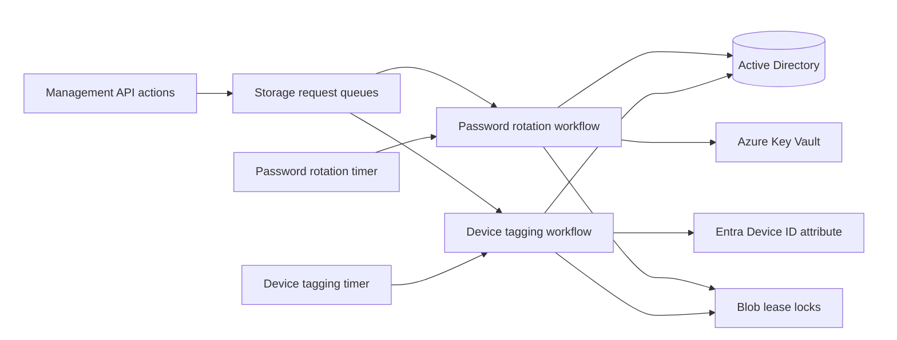
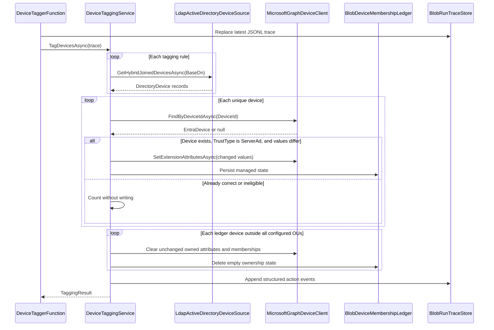
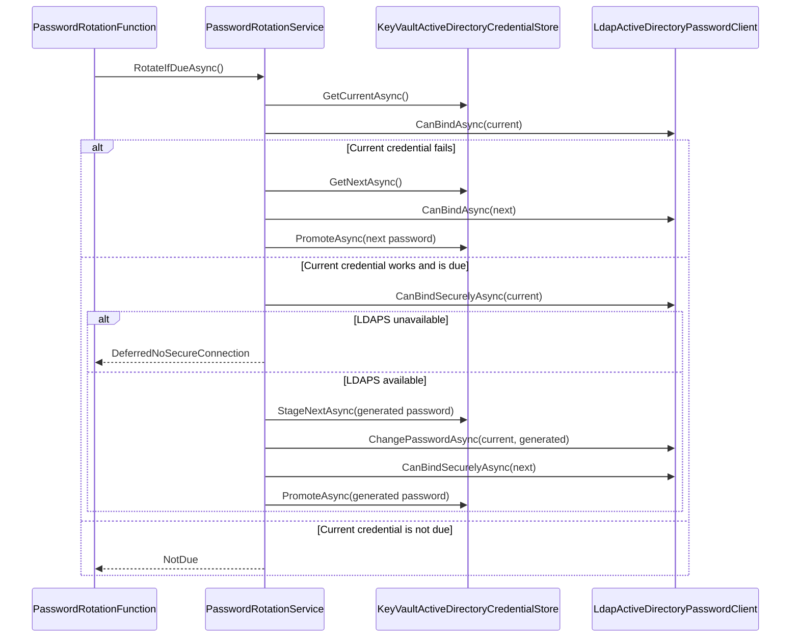

# Developer information

## Code-Dokumentation

Die folgende englischsprachige Referenz beschreibt Architektur, Abläufe sowie Verantwortlichkeiten und Zusammenarbeit der Klassen.

### Purpose

HybridDeviceTagger is a .NET 8 Azure Functions v4 isolated-worker application. It identifies synchronized domain-joined computers by `userCertificate` and connects them to their Microsoft Entra device objects by mapping the AD `objectGUID` to the Entra `deviceId`. It manages two scheduled workflows:

1. **Device tagging** discovers computers in configured Active Directory OU subtrees and writes configured `extensionAttribute1` through `extensionAttribute15` values to matching hybrid-joined Entra devices.
2. **Password rotation** rotates the Active Directory service-account password and keeps the Active Directory and Azure Key Vault states recoverable if a run is interrupted.

The application separates trigger, management API, orchestration, directory, Graph, credential-storage, and operational-state concerns. Interfaces isolate external systems so the orchestration services can be tested without Active Directory, Key Vault, Microsoft Graph, or App Service Authentication.

### Repository Structure

```text
.
|-- .azure/                         Deployment planning and validation records
|-- .githooks/                      Repository-local Git hooks
|-- .github/                        GitHub Actions and Copilot instructions
|-- artifacts/                      Package build output (not tracked)
|-- assets/                         Project logo
|-- docs/
|   `-- management-api.openapi.yaml    Management API contract
|-- installationspackage/             All files required for an installation
|   |-- function/                      Prebuilt Function package (build output, not tracked)
|   |-- HybridDeviceTagger.Management/ PowerShell management module
|   |-- Install.ps1                    Guided installation entry point
|   |-- Install-HybridDeviceTagger.ps1 Validation and installation engine
|   |-- main.bicep                     Azure infrastructure definition
|   |-- key-vault-role-assignment.bicep
|   |                                  Placeholder secrets and secret-scoped Key Vault role assignments
|   `-- README.md                      Installation reference
|-- scripts/
|   |-- Assert-CommitMetadata.ps1      Changelog and file-header commit guard
|   |-- Build-InstallationPackage.ps1  Test, publish, stamp, and archive an installation package
|   |-- Get-ProductVersion.ps1         Tag-based product version calculation
|   `-- Update-ReadmeVersion.ps1       README version badge update and verification
|-- src/
|   `-- HybridDeviceTagger/            Azure Functions application
|-- tests/
|   `-- HybridDeviceTagger.Tests/      Unit and entry-point tests
|-- CHANGELOG.md                       Version history
|-- Directory.Build.props              Shared package metadata (no version)
|-- Directory.Build.targets            Product version resolution for every build
`-- HybridDeviceTagger.sln             Build and test solution
```

Installation assets live only in `installationspackage`. `Install.ps1` collects all parameters interactively and drives `Install-HybridDeviceTagger.ps1`, which validates prerequisites, deploys `main.bicep`, and publishes the prebuilt `function/HybridDeviceTagger.zip`. The engine no longer builds the Function from source; `scripts/Build-InstallationPackage.ps1` creates that package. `installationspackage/function`, `installationspackage/version.json`, and `installationspackage/installation-settings.json` are local or build output and are not tracked.

Before code upload, custom VNet DNS servers must resolve the deployed private endpoints.
Failed checks report observed answers or query errors and print the concrete private-zone
A records for Blob, Queue, and a newly created Key Vault. Interactive installation pauses
for user confirmation after checking each endpoint/server once. Enter resumes without
rechecking and explicitly warns that DNS remains independently unverified; unattended failures
remain terminating errors. No DNS records are edited automatically.

### Versioning and Release Build

The product version has the format `<YYYY><MM>.<counter>` and is never stored in a file. `scripts/Get-ProductVersion.ps1` derives it from Git: a release tag `v<YYYY><MM>.<counter>` on `HEAD` defines the version and never receives a suffix; otherwise the counter is the highest release counter of the current month plus one. Outside `main`, the sanitized branch name is appended (`202611.1-dev`).

`Directory.Build.targets` runs the script for every build unless `ProductVersion` is passed explicitly; `Directory.Build.props` no longer contains a version. `InformationalVersion` carries the full product version. Because .NET assembly version parts are limited to 65535, `AssemblyVersion` and `FileVersion` are `<YYYY>.<M>.<counter>.0`.

PowerShell sources carry `# Project-Version: source`, and the module manifest contains `ModuleVersion = '0.0'`. `scripts/Build-InstallationPackage.ps1` runs the tests (unless `-SkipTests`), publishes the Function with the product version to `installationspackage/function/HybridDeviceTagger.zip`, writes `version.json`, stages `artifacts/HybridDeviceTagger-<version>/` with the version stamped into the scripts and the manifest (plus a `Prerelease` label outside `main`) and `LICENSE`, and creates `artifacts/HybridDeviceTagger-<version>.zip`. `-Release` additionally requires `main`, a clean working tree, and a `## [<version>] - <yyyy-MM-dd>` section in `CHANGELOG.md`, and creates the annotated tag `v<version>`, which is then pushed with `git push origin v<version>`. The CI workflow checks out the full history (`fetch-depth: 0`), builds the package, and uploads the ZIP.

`scripts/Assert-CommitMetadata.ps1`, run by the `.githooks/pre-commit` hook, requires a `CHANGELOG.md` entry below `## [Unreleased]` (or a release section) for every change, the version marker and author header in changed production files, and a README version badge that matches `Get-ProductVersion.ps1 -NextCommit`. The `pre-commit` and `pre-merge-commit` hooks first update the staged badge with `scripts/Update-ReadmeVersion.ps1 -Staged`; `-Release` verifies that the badge shows the release version.

### Runtime Architecture



#### Startup and dependency injection

`Program.cs` is the composition root. It:

- creates the isolated Functions host;
- binds and validates all option classes during startup;
- configures OpenTelemetry and enables the Azure Monitor exporter when an Application Insights connection string is available;
- registers `DefaultAzureCredential` for Key Vault and Microsoft Graph authentication;
- constructs the Key Vault `SecretClient`;
- maps every service interface to its production implementation;
- configures the Graph `HttpClient` with `https://graph.microsoft.com/v1.0/` as its base address.
- creates Blob clients for the private membership ledger and latest-run trace containers;
- creates a Base64-encoding `QueueServiceClient` for management-API run requests.

The Azure clients, LDAP adapters, credential store, dynamic rule provider, operation status store, password generator, and `TimeProvider` are singletons. The workflow orchestrators and management API are transient. `MicrosoftGraphDeviceClient` is created through `HttpClientFactory`.

### Management API

`ManagementApiFunction` exposes ten protected HTTP operations for rule management, both latest-run statuses, streamed latest-trace download, queued immediate tagging, queued forced password rotation, and initial AD-credential initialization. `ManagementApiAuthenticationFunction` exposes the non-secret delegated token scope at `GET /api/management/authentication`, the only path excluded from Easy Auth. The HTTP triggers are anonymous at the Functions host layer because App Service Easy Auth authenticates and validates the Entra token first. `ManagementApiAuthorizer` requires one valid AAD `X-MS-CLIENT-PRINCIPAL` header and first evaluates its `roles` claims. For rule and password administration it additionally queries effective Azure RBAC assignments at the Function App scope. Missing authentication returns HTTP `401`; an authenticated principal without an accepted application role or RBAC assignment receives HTTP `403`.

The API app registration defines `HybridDeviceTagger.Reader`, `HybridDeviceTagger.RuleAdministrator`, `HybridDeviceTagger.TaggingOperator`, and `HybridDeviceTagger.PasswordRotationAdministrator`. The retired `HybridDeviceTagger.CertificateAdministrator` role is unassigned, disabled, and deleted by the installer. For a new Function App, the installer creates the single-tenant registration, identifier URI, service principal, and roles automatically after approval; updates reuse an explicitly supplied existing client ID. The installer assigns approved users, groups, or service principals. `appRoleAssignmentRequired` remains disabled so Function App Owners and Contributors can obtain an API token. Effective direct, transitive-group, or inherited `Owner` and `Contributor` assignments grant rule administration, tagging operation, and password administration, but not the Reader role. Only assignments whose scope is the Function App, one of its parents, or a management group count; child-resource scopes are ignored. Rule mutations by callers without Owner/Contributor access may not introduce Entra group or administrative-unit IDs that no stored rule uses yet (`allowNewMembershipTargets`), because the managed identity can manage every group membership in the tenant. The Function managed identity receives `Reader` on its own Function App to perform this runtime ARM lookup.

The two action endpoints do not execute the workflow inside the HTTP request. They return HTTP `409` when `IOperationLock` reports an active run; otherwise they record a `Queued` status, enqueue an `OperationRequest` through `IOperationRequestQueue` into the private Storage queue `device-tagging-requests` or `password-rotation-requests`, and return HTTP `202` with `{ invocationId, state, statusUri }` and the status URI in the `Location` header. `DeviceTaggingRequestFunction` and `PasswordRotationRequestFunction` are queue triggers in the same classes as the timers, so timer and requested runs share orchestration, status persistence, and trace behavior. `host.json` sets `maxDequeueCount` to `1`, so a failed requested run is moved to the poison queue instead of being retried. Forced rotation bypasses only the password-age gate. Credential verification, secure LDAP, next-secret staging, changed-credential validation, and promotion remain mandatory.

`BlobOperationLock` serializes each operation across all instances with a 60-second Blob lease on `run-traces/locks/<queue>.lock` that is renewed every 20 seconds. Flex Consumption scales timer, queue, and HTTP functions in separate instance groups, so an in-process lock is insufficient. Each renewal call has a 10-second timeout. A watchdog cancels the run 45 seconds after the last successful renewal, which is before the 60-second lease can expire, even if a renewal call hangs. A timer run that cannot acquire the lease is skipped with a warning; a requested run that cannot acquire it marks its own still-queued status as failed. `maximumInstanceCount` defaults to `1` per scale group.

`BlobTaggingConfigurationStore` stores `tagging-configuration.json` in the private `run-traces` container. Before its first API mutation, `OptionsTaggingRuleProvider` supplies the validated `Tagging__RulesJson` startup fallback. Mutations normalize and validate the complete result and use Blob ETags. API clients can send the ETag returned by `GET` in `If-Match`; a stale write returns HTTP `409`.

`BlobTrustedCertificateStore` provides the LDAP trust anchors for every new connection. The installer no longer requires a certificate: normally the first anchor is added after installation through the configuration portal or `Add-HybridDeviceTaggerTrustedCertificate`. Until the first management change, the store returns the DER or PEM file packaged by the installer only when `-ActiveDirectoryTrustedCertificatePath` was supplied for pre-seeding (`ActiveDirectory__TrustedCertificatePath`); without a packaged or managed file, the operating system trust store applies. A certificate packaged by an earlier installer is not contained in a new package when the parameter is omitted; the installer warns, and unless the certificate is already managed in Blob it must be added again. The portal routes `management/portal/certificates` (used by the portal and the module) add, replace, or remove anchors in `run-traces/active-directory-trust-anchors.json` with Blob ETags; the first change copies the packaged certificate, if any. Only public, unexpired, non-duplicate certificates are accepted, at most 20, and the last anchor cannot be removed. Because a substituted anchor would let its author impersonate a domain controller and capture the service-account password, only Function App Owners and Contributors may manage anchors; those principals already control the Function code and settings, and the Storage account is private. `ActiveDirectoryLdapConnectionFactory` validates the DNS name against every subject alternative DNS name, the chain, the server-authentication EKU, and online revocation. A rejected certificate becomes an `ActiveDirectoryLdapException` with result code `-2` and a concrete reason (name mismatch, chain status, revocation failure), and the factory then tries the next domain controller instead of surfacing a raw `AuthenticationException`. Windows validates through `System.DirectoryServices.Protocols`. Linux LDAPS and StartTLS use `Novell.Directory.Ldap.NETStandard`, whose certificate callback runs on the same TLS session that carries the bind.

### Configuration portal and activity log

`PortalFunction` serves the embedded `Portal/index.html`, `app.js`, and `app.css` and the public sign-in settings `config.json` at `/api/portal`. These six static paths are excluded from Easy Auth and carry a strict Content Security Policy (`script-src 'self'`, `connect-src 'self'` plus the Entra sign-in host, `frame-ancestors 'none'`). The page signs in with the authorization code flow and PKCE against the management API app registration (SPA redirect URI `/api/portal`, scope `access_as_user`) and sends the access token to the management API. All server data is rendered through `textContent`.

`PortalApiFunction` exposes `/api/management/portal/*` for the session check, activity query, effective AD configuration, LDAP validation, service-account change, trust-anchor management, and the rule editor's Entra search (`directory/groups`, `directory/administrative-units`, `directory/resolve`). `GraphEntraDirectorySearch` uses the existing `GroupMember.ReadWrite.All` and `AdministrativeUnit.ReadWrite.All` permissions, searches by display-name prefix, and marks dynamic, mail-enabled, or on-premises synchronized groups and dynamic administrative units as not assignable. Every endpoint calls `IManagementApiAuthorizer.AuthorizeFunctionAppAdministratorAsync`, which accepts only effective Owner or Contributor assignments on the Function App and ignores application roles. Lookup results are cached per principal for 60 seconds; the authorizer is therefore a singleton. The portal reuses the existing rule, forest-domain, credential-initialization, rotation, and status endpoints, whose RBAC substitution already admits Owners and Contributors.

`ActiveDirectoryAccountService` changes the service account only after `IActiveDirectoryPasswordClient.ValidateAccessAsync` binds successfully with the new UPN and password. It holds the password-rotation lock, stores the new password as `current`, writes the UPN and optional DN override to `run-traces/active-directory-configuration.json` (preserving the forest domain), restores the previous password if that write fails, and replaces `next` with a placeholder. The configuration blob is read in both its legacy string form and the current object form; `ActiveDirectoryConfigurationSnapshot.GetServiceAccount` falls back to `ActiveDirectory__BindUsername` and `ActiveDirectory__BindUserDistinguishedName` when no override exists. The credential store, initializer, and password client use this effective account.

`LoggerActivityLog` writes activities through the logger category `HybridDeviceTagger.Activity` with the properties `ActivityCategory`, `ActivityAction`, `ActivityOutcome`, `ActivityActor`, `ActivityTarget`, and `ActivityDetails`; OpenTelemetry exports them to `AppTraces` in the Application Insights workspace with Entra authentication (`APPLICATIONINSIGHTS_AUTHENTICATION_STRING=Authorization=AAD`, `Monitoring Metrics Publisher`); local authentication is disabled so the connection string alone cannot forge activity entries. Configuration mutations, queued runs, credential operations, LDAP validation, portal sign-ins, denied requests, completed tagging runs, every changed device (attribute names and membership counts only), and non-trivial rotation outcomes are recorded. Passwords and attribute values are never recorded. `LogAnalyticsActivityLogReader` runs a resource-centric query against `Monitoring__ApplicationInsightsResourceId` with the managed identity, which receives `Monitoring Reader` on the Application Insights component. Filters are allow-listed values only, so user input never reaches the KQL text.

`KeyVaultActiveDirectoryCredentialStore` treats secrets with content type `application/vnd.hybriddevicetagger.placeholder` as absent. The deployment creates such placeholders for missing password secrets in an existing Key Vault so the managed identity can receive `Key Vault Secrets Officer` on those two secrets only. `ActiveDirectoryCredentialInitializer` replaces only a missing secret or a placeholder and rejects initialization when a real password exists.

`BlobOperationStatusStore` writes separate JSON documents for device tagging and password rotation. Requested runs start as `Queued`; timer and queue entry points record `Running`, then `Succeeded` or a sanitized `Failed` state. Password status preserves the timestamp of the last actual password change across checks that do not rotate. Status persistence failures are warnings and do not fail the directory workflow.

`installationspackage/HybridDeviceTagger.Management` owns the REST client. `Connect-HybridDeviceTagger` stores the API URI, audience, token, and expiry in module scope and refreshes the token from Azure CLI when required. Public cmdlets cover rules, both statuses, parsed trace events, the forest domain, LDAP trust anchors (`Get-`, `Add-`, `Remove-HybridDeviceTaggerTrustedCertificate`), the service account (`Set-HybridDeviceTaggerServiceAccount`), credential initialization, queued immediate tagging, and queued forced password rotation. The trust-anchor and service-account cmdlets call the portal routes `management/portal/certificates` and `management/portal/active-directory/account` and therefore require effective Function App Owner/Contributor access; `Add-HybridDeviceTaggerTrustedCertificate` rejects files with a private key and expired certificates locally. The two action cmdlets return the accepted request or, with `-Wait`, poll the status endpoint until that invocation finishes (`-TimeoutSeconds`, defaults 1,800 and 600 seconds). `Add-HybridDeviceTaggerRule` performs the named single-rule upsert. `Get-HybridDeviceTaggerTrace` prepends the `HybridDeviceTagger.TraceEvent` type name to each parsed event. The module format file renders that type as the concise six-field trace line by default without converting the pipeline value to text. Mutations use `ShouldProcess`, ETag-protected writes, and high confirmation impact for destructive rule replacement, removal, password rotation, service-account changes, and trust-anchor changes. The complete command, security, data-flow, error, and internal implementation reference is maintained in [installationspackage/HybridDeviceTagger.Management/README.md](installationspackage/HybridDeviceTagger.Management/README.md). No standalone REST wrapper scripts are required.

The GitHub Actions workflow [`.github/workflows/publish-powershell-module.yml`](.github/workflows/publish-powershell-module.yml) publishes the module to PowerShell Gallery for non-prerelease GitHub Releases whose commit belongs to `main`. The release tag must be the `v<YYYY><MM>.<counter>` release tag of the checked-out commit. The workflow runs `scripts/Build-InstallationPackage.ps1`, verifies that the stamped manifest version matches the product version, and publishes the stamped module from `artifacts/HybridDeviceTagger-<version>/HybridDeviceTagger.Management` using the repository secret `HYBRIDDEVICETAGGER_PSMODUL`. Existing Gallery versions are detected and skipped, making workflow reruns idempotent.

### Device Tagging Workflow



Rules may overlap. Assignments for different extension attributes are merged for the same device. If two matching rules assign different values to the same attribute, the run fails instead of applying an order-dependent result. Graph PATCH requests contain only attributes whose current values differ, making repeated runs idempotent. The ownership ledger records managed attribute values and memberships created by the application. When a device leaves all configured OUs, only attributes that still match their recorded value and memberships proven to be application-owned are removed.

An OU-only path is resolved in every forest domain by reading cross-reference objects from the forest configuration partition through the statically configured domain controller. A full distinguished name containing `DC=` targets only that domain and is accepted only when its derived DNS name exactly matches an advertised forest `dnsRoot`. Rule mutations perform this check before persistence, and the LDAP source repeats it before deriving any rule-controlled endpoint. Searches use subtree scope and LDAP paging, so nested OUs and large result sets are supported.

### Password Rotation Workflow



The new password is stored as the `next` secret before Active Directory is changed. It is promoted to `current` only after a successful LDAPS bind. If execution stops after the directory change, a later run can authenticate with `next` and promote it. Password modification never uses the LDAP fallback.

### Function Entry Points

#### `DeviceTaggerFunction`

The timer-trigger entry point for device tagging. The timer ticks every five minutes (`0 */5 * * * *`) and runs only when `IOperationScheduleStore` reports that the tagging interval has elapsed since the last recorded start (one minute tolerance for timer jitter). The interval is stored in `run-traces/operation-schedule.json`, edited in the configuration portal, and defaults to `Tagging__IntervalMinutes`. Requested runs bypass the interval. It replaces the latest-run trace, delegates all work to `DeviceTaggingService`, records success or structured exception details, and logs the aggregate `TaggingResult`. The class is intentionally thin so scheduling remains independent from business logic. The same class contains `DeviceTaggingRequestFunction`, the queue trigger for `device-tagging-requests`. Both entry points acquire the device-tagging Blob lease before running; a timer run without the lease is skipped with a warning.

#### `PasswordRotationFunction`

The timer-trigger entry point for password maintenance. It ticks hourly (`0 0 * * * *`); `PasswordRotationService` rotates once the password age reaches the runtime rotation interval from `IOperationScheduleStore` (default `PasswordRotation__RotateAfterDays`, at most 29 days and below `SecretExpiryDays`). It calls `PasswordRotationService` and logs only the outcome and known password age. The same class contains `PasswordRotationRequestFunction`, the queue trigger for `password-rotation-requests` that runs a forced rotation under the password-rotation Blob lease.

### Orchestration Services

#### `DeviceTaggingService`

Coordinates one complete tagging run. It asks the Active Directory source for every configured rule, deduplicates devices by `DeviceId`, merges non-conflicting attribute assignments, looks up each device in Graph, verifies `TrustType == "ServerAd"`, calculates changed values, and patches only those values. It reconciles group and administrative-unit memberships, removes owned state for devices outside all configured OUs, and emits ordered trace events around every external action and decision. It returns counts for discovered, updated, unchanged, missing, non-hybrid, and cleaned devices.

The private nested `DeviceTagAssignment` record groups one `DirectoryDevice` with the mutable, case-insensitive set of desired attributes accumulated from all matching rules.

#### `PasswordRotationService`

Implements age-based rotation and interrupted-run recovery. It first tests `current`; if that credential fails, it attempts recovery from `next`. If `current` works and has not reached `RotateAfterDays`, it returns without changing state. A due rotation proceeds only when secure LDAPS works. It then generates, stages, applies, validates, and promotes a new password in that order.

`TimeProvider` is injected so age calculations are deterministic in tests. A missing Key Vault creation timestamp produces an unknown age and causes a rotation attempt rather than silently keeping a potentially old password.

### Active Directory Services

#### `ActiveDirectoryLdapConnectionFactory`

Resolves domain controllers from `_ldap._tcp.dc._msdcs.<domain>` DNS SRV records and creates authenticated LDAP v3 connections with a 30-second timeout. Connections try Basic authentication over LDAPS first and, for connection-availability errors only, fall back to Basic authentication after upgrading LDAP with StartTLS. Authentication errors do not trigger transport fallback. Both transports support password changes because credentials and LDAP operations remain inside validated TLS.

The caller owns the returned connection. A failed bind disposes the connection before rethrowing the error.

#### `ActiveDirectorySearchPath`

An internal static helper for distinguished-name handling. It determines whether a path is forest-relative, validates that a relative path contains only `OU=` components, appends a domain naming context, and converts `DC=` components into a DNS domain name. Source-generated regular expressions handle unescaped DN separators.

#### `LdapActiveDirectoryDeviceSource`

Implements `IActiveDirectoryDeviceSource` and `IActiveDirectoryRuleValidator`. It always discovers forest domains through the configured server before processing a domain-specific rule and rejects a `BaseDn` whose DNS domain is not an exact forest `dnsRoot`. The configuration service invokes the validator before every replace, upsert, or removal is persisted. For OU-only rules, the source reads the configuration naming context and queries `CN=Partitions` for forest domain cross-references. It then searches the resolved OU in each domain. Domains without that OU are skipped; if no domain contains the OU, the operation fails.

Each subtree search selects computer objects with a populated `userCertificate` and requests `objectGUID`, `name`, and `distinguishedName` using server-side paging. The binary AD `objectGUID` is the value that Entra Connect maps to the Entra `deviceId`. Entries without a valid GUID are ignored, and results are deduplicated by device ID. If binding with `current` fails, the source tries `next`, which allows device discovery to continue after an interrupted rotation.

The private nested `SearchTarget` record holds the DNS server name and complete base DN for one domain search.

#### `LdapActiveDirectoryPasswordClient`

Implements `IActiveDirectoryPasswordClient`. Bind checks return `false` for LDAP errors rather than treating expected credential failures as exceptions. Secure bind checks always use LDAPS. Password changes send one atomic `ModifyRequest` against the configured service-account DN: delete the quoted UTF-16LE old `unicodePwd` value and add the quoted UTF-16LE new value.

### Azure Services

#### `KeyVaultActiveDirectoryCredentialStore`

Implements `IActiveDirectoryCredentialStore` using `SecretClient`. It reads the required `current` secret, optionally reads `next`, writes staged passwords, and promotes validated passwords by creating a new `current` secret version. A missing `next` secret is represented as `null`; a missing `current` secret remains an error.

The LDAP username comes from `ActiveDirectoryOptions`; only passwords are stored as secret values. New secret versions receive the configured expiry interval, and Key Vault creation metadata supplies the rotation age.

#### `MicrosoftGraphDeviceClient`

Implements `IEntraDeviceClient`. It obtains an application token for the Graph `.default` scope through the injected `TokenCredential`. Device lookup filters by the shared `deviceId` and selects object ID, display name, trust type, and all extension attributes. Updates PATCH the Entra object ID with only the attribute dictionary supplied by the orchestrator.

The Function managed identity therefore needs the Microsoft Graph application permission `Device.ReadWrite.All`.

#### `BlobDeviceMembershipLedger`

Implements `IDeviceMembershipLedger` in the private `membership-ledger` container. One JSON document per hybrid device records the Entra object ID, managed extension-attribute values, and memberships that HybridDeviceTagger created. Empty records are deleted. Enumeration lets the orchestrator identify devices that were managed previously but are no longer returned by any configured OU rule.

#### `BlobRunTraceStore`

Implements `IRunTraceStore` and `IRunTraceReader` with the private `run-traces` container. Starting an invocation replaces `device-tagger-last-run.jsonl`; each event is then appended immediately as one compact JSON object and receives a UTC timestamp, sequence, invocation ID, severity, phase, action, outcome, details, and optional exception data. Append failures disable tracing for that invocation and produce a normal application warning instead of interrupting device tagging. The reader streams the private Blob through the authenticated API. Attribute values are represented only by SHA-256 fingerprints, and credentials or tokens are never supplied to the trace API.

### Service Interfaces

#### `IActiveDirectoryCredentialStore`

Defines access to the active and staged credentials: read `current`, read optional `next`, stage a new password, and promote a validated password. It keeps Key Vault details out of orchestration code and enables in-memory test doubles.

#### `IActiveDirectoryDeviceSource`

Defines device discovery beneath a full DN or forest-relative OU path. It separates LDAP and forest-discovery behavior from tagging decisions.

#### `IActiveDirectoryPasswordClient`

Defines normal bind validation, secure bind validation, and password modification. The separate secure operation lets the rotation service explicitly enforce LDAPS.

#### `IEntraDeviceClient`

Defines lookup by hybrid device ID and extension-attribute updates by Entra object ID. It isolates HTTP, token acquisition, and Graph JSON from the tagging service.

#### `IDeviceMembershipLedger`

Defines loading, enumerating, persisting, and deleting managed Entra ownership state independently from Blob Storage.

#### `IRunTraceStore` and `IRunTraceSession`

`IRunTraceStore` starts the latest-run artifact for one invocation. The returned `IRunTraceSession` accepts structured events without exposing Blob APIs to workflow code. `RunTrace.None` keeps orchestration tests and alternate hosts independent from diagnostic storage.

#### `IPasswordGenerator`

Defines password generation independently from the rotation workflow. Tests can inject deterministic values while production uses cryptographic randomness.

### Password Generation

#### `SecurePasswordGenerator`

Implements `IPasswordGenerator` with `RandomNumberGenerator`. Every password contains at least one uppercase character, lowercase character, digit, and symbol. Remaining positions use the combined character set, and a cryptographic Fisher-Yates shuffle removes the predictable category order. Visually ambiguous characters are excluded. Lengths below four are rejected; production length constraints are stricter through `PasswordRotationOptions`.

### Configuration Classes

All option classes are bound and validated during host startup. Invalid configuration prevents the Function host from accepting invocations.

#### `ActiveDirectoryOptions`

Holds the forest domain, primary server, LDAPS port, fallback policy and port, bind username, service-account DN, and LDAP page size. `Domain` and `BindUsername` are optional because the installer deploys the Function without directory settings; both are configured after installation through the portal or the management module. `UseSsl` must remain enabled because credential and password operations require a secure primary channel. When fallback is enabled, its port must differ from the LDAPS port.

The service-account DN is optional when installing without internal AD DNS. Before rotation,
`LdapActiveDirectoryDeviceSource` resolves it from the UPN across the forest's advertised domains;
zero or multiple matches fail explicitly. `BlobActiveDirectoryConfigurationStore` stores an
ETag-protected forest DNS override in `run-traces/active-directory-configuration.json`, using the
application setting only until the first management write. Forest connections read it on demand,
without process-local caching. Configuration reads and writes never require LDAP or a credential,
so administrators can repair the domain before credential initialization.

While the forest domain or the service account is missing, the Function is unconfigured.
`ActiveDirectoryConfigurationSnapshot.GetMissingConfiguration` reports the missing setting, and
`ActiveDirectoryNotConfiguredException` in `Services/BlobActiveDirectoryConfigurationStore.cs` is
thrown when an LDAP connection or the effective service account is requested. The management and
portal APIs map it to HTTP `409` with a "not configured" message; `GET management/active-directory`
returns source `notConfigured` with an empty domain. `DeviceTaggerFunction` and
`PasswordRotationFunction` skip scheduled runs with an information log entry until both values are
configured.

#### `TaggingOptions`

Holds tagging rules either as a normal configuration collection or as `RulesJson`, which supports deployment systems that cannot represent arrays conveniently. Validation requires at least one rule, a unique non-empty rule name, a description, valid full-DN or OU-only paths, at least one attribute per rule, names from `extensionAttribute1` through `extensionAttribute15`, and non-empty values.

#### `TaggingRuleOptions`

Represents one named and described OU subtree and its desired extension attributes. `Name` is the case-insensitive operational identifier used for logging and configuration updates. `BaseDn` may be a full domain-specific DN or an OU-only forest-relative path. Attribute keys are case-insensitive.

#### `KeyVaultOptions`

Holds the vault URI and the names of the `current` and `next` password secrets. Keeping names configurable allows isolated environments and controlled secret migration without changing code.

#### `PasswordRotationOptions`

Defines `RotateAfterDays`, generated `PasswordLength`, and `SecretExpiryDays`. Validation requires secret expiry to be later than the rotation threshold so recovery material does not expire before the normal rotation window.

### Data Models

#### `DirectoryDevice`

An immutable Active Directory computer projection containing the hybrid device GUID, computer name, and distinguished name. `DeviceId` is the join key used to locate the corresponding Entra object.

#### `EntraDevice`

An immutable Graph projection containing the Entra object ID, shared device GUID, optional display name and trust type, and current extension-attribute values. The object ID is used for PATCH requests; the trust type protects non-`ServerAd` devices from modification.

#### `StoredDirectoryCredential`

An in-memory value containing the configured LDAP username, secret password, and optional Key Vault creation timestamp. It is passed only to the credential store and LDAP services and must never be logged or serialized.

#### `TaggingResult`

The aggregate result of one tagging run: `Discovered`, `Updated`, `Unchanged`, `NotFound`, and `NotHybridJoined`. It allows useful operational telemetry without exposing credentials.

#### `PasswordRotationOutcome`

Describes the rotation decision:

- `NotDue`: the active password is still within policy;
- `Rotated`: staging, AD update, validation, and promotion succeeded;
- `RecoveredFromNext`: `current` failed and a valid staged password was promoted;
- `DeferredNoSecureConnection`: rotation was due but LDAPS was unavailable.

#### `PasswordRotationResult`

Combines `PasswordRotationOutcome` with the known current password age in days. Age is nullable because older or externally created secret versions may not expose usable creation metadata.

### Security and Failure Behavior

- Application credentials are obtained through `DefaultAzureCredential`; no Azure credential is stored in application settings.
- Active Directory passwords are read from Key Vault and held only in memory.
- LDAP fallback uses StartTLS and supports the same bind, read, and password-modification operations as LDAPS.
- A generated password is recoverable from `next` before Active Directory is modified.
- Non-hybrid Entra devices are never patched.
- Conflicting tagging rules fail explicitly instead of producing order-dependent updates.
- Graph and LDAP transport errors propagate to the Functions runtime so failed invocations remain observable and retryable according to platform policy.
- Unconfigured Active Directory settings skip timer runs and return HTTP `409` for requested runs instead of failing.
- Timer entry points log aggregate results. Exceptional tagging cases may log computer names, device IDs, or trust types for diagnosis; passwords and directory credentials are never logged.

### Tests

The test project mirrors the production boundaries:

- `ActiveDirectorySearchPathTests` verifies OU-path and distinguished-name handling.
- `DeviceTaggingServiceTests` uses service doubles to verify matching, idempotency, forest/rule behavior, skip decisions, and conflict detection.
- `PasswordRotationServiceTests` uses deterministic credentials, time, and passwords to verify not-due, rotation, recovery, and secure-connection deferral paths.

These tests focus on orchestration and parsing behavior. Live LDAP, Key Vault, Graph, private networking, and managed-identity permissions are validated by the deployment workflow rather than unit tests.

## Management REST API

Die Function App stellt eine Single-Tenant-Entra-geschützte Verwaltungs-API unter `/api/management` bereit. App Service Easy Auth lehnt nicht authentifizierte Aufrufe mit HTTP `401` ab. Die Function validiert zusätzlich den Principal Header und antwortet mit HTTP `403`, wenn weder eine für den Endpunkt zugelassene Entra-Anwendungsrolle noch eine zulässige Azure-RBAC-Zuweisung vorhanden ist. **Assignment required** bleibt auf der Enterprise Application deaktiviert, damit Function-App-Owner und -Contributors ein API-Token erhalten können. Direkte, über Sicherheitsgruppen wirksame oder von übergeordneten Scopes geerbte Owner-/Contributor-Zuweisungen gewähren Regel- und Kennwortadministration sowie das Starten von Tagging-Läufen, jedoch keine Leserrolle. Es werden keine Function Keys oder Client Secrets benötigt. Nur `GET /api/management/authentication` ist von Easy Auth ausgenommen und liefert den nicht geheimen Token-Scope der Installation.

| Methode und Pfad | Funktion | Erforderliche Rolle |
| --- | --- | --- |
| `GET /api/management/authentication` | Deployment-spezifischen Entra-Token-Scope lesen | keine |
| `GET /api/management/active-directory` | Wirksame Forest-Domäne und Version ohne AD-Verbindung lesen | `Reader`, `RuleAdministrator` oder `PasswordRotationAdministrator` |
| `PUT /api/management/active-directory` | Forest-Domäne syntaktisch validieren und versioniert speichern | nur wirksame Owner/Contributor der Function App |
| `GET /api/management/tagging-rules` | Aktuelle Regeln, ETag, Änderungszeit und Quelle lesen | `Reader` oder `RuleAdministrator` |
| `PUT /api/management/tagging-rules` | Den vollständigen validierten Regelsatz ersetzen | `RuleAdministrator` |
| `PUT /api/management/tagging-rules/{ruleName}` | Eine vollständige Regel hinzufügen oder case-insensitiv ersetzen | `RuleAdministrator` |
| `DELETE /api/management/tagging-rules/{ruleName}` | Eine Regel entfernen; mindestens eine Regel muss verbleiben | `RuleAdministrator` |
| `GET /api/management/status/device-tagging` | Status und Ergebniszähler des letzten Tagging-Laufs lesen | `Reader` oder `TaggingOperator` |
| `GET /api/management/status/password-rotation` | Status des letzten Checks und Zeitpunkt des letzten tatsächlichen Kennwortwechsels lesen | `Reader` oder `PasswordRotationAdministrator` |
| `GET /api/management/traces/device-tagging/latest` | Letzten JSONL-Trace als Download abrufen | `Reader` oder `TaggingOperator` |
| `POST /api/management/actions/device-tagging` | Einen Tagging-Lauf zur sofortigen Ausführung einreihen (HTTP `202`) | `TaggingOperator` |
| `POST /api/management/actions/password-rotation` | Eine sichere, altersunabhängige Rotation des AD-Servicekonto-Kennworts einreihen (HTTP `202`) | `PasswordRotationAdministrator` |
| `POST /api/management/actions/initialize-ad-credential` | Initiales AD-Servicekonto-Kennwort validieren und über die Managed Identity im Key Vault speichern; ersetzt nur ein fehlendes Secret oder einen Platzhalter | `PasswordRotationAdministrator` |

Die vollständigen Rollenwerte beginnen jeweils mit `HybridDeviceTagger.`, beispielsweise `HybridDeviceTagger.Reader`. Ohne explizite Engine-Parameter vergibt der Installer keine Bootstrap-Rollen; Owner-/Contributor-Zuweisungen berechtigen zur Administration. Eine explizite Bootstrap-Liste wird allen vier Rollen zugewiesen; für Least Privilege stehen vier rollenbezogene Principal-Parameter zur Verfügung. Sicherheitsgruppen sind für die laufende Administration vorzuziehen. Die frühere Rolle `HybridDeviceTagger.CertificateAdministrator` und ihre Endpunkte zur Laufzeitverwaltung von LDAPS-Vertrauenszertifikaten wurden entfernt; Vertrauensanker und Servicekonto werden ausschließlich über die Owner-/Contributor-geschützten Portal-Routen `management/portal/certificates` und `management/portal/active-directory/account` verwaltet.

Solange Forest-Domäne oder Servicekonto nach der Installation noch nicht konfiguriert sind, antworten Aktionen und Endpunkte, die Active Directory benötigen, mit HTTP `409` und einer „not configured“-Meldung; `GET /api/management/active-directory` liefert dann die Quelle `notConfigured` und eine leere Domäne.

### API-Rollen nach der Installation verwalten

Für Benutzer und Sicherheitsgruppen können Rollen im Entra Admin Center zugewiesen werden:

1. **Identität** > **Anwendungen** > **Unternehmensanwendungen** öffnen.
2. Die Enterprise Application der HybridDeviceTagger Management API auswählen.
3. **Benutzer und Gruppen** > **Benutzer/Gruppe hinzufügen** wählen.
4. Benutzer oder Sicherheitsgruppe und anschließend genau die benötigte Rolle auswählen.
5. Die Zuweisung bestätigen. Mehrere Rollen werden als einzelne Zuweisungen angelegt.

Für skriptbare Verwaltung und Service Principals kann Microsoft Graph PowerShell verwendet werden. Die ausführende Entra-Identität benötigt eine Rolle wie `Privileged Role Administrator` und muss den angeforderten Graph-Berechtigungen zustimmen können:

```powershell
Install-Module Microsoft.Graph.Authentication -Scope CurrentUser
Connect-MgGraph -Scopes 'Application.Read.All', 'AppRoleAssignment.ReadWrite.All'

$apiClientId = '5e324803-5aed-4e5d-b49f-a4bfceddcda8'
$principalObjectId = '<Objekt-ID des Benutzers, der Gruppe oder des Service Principals>'
$roleValue = 'HybridDeviceTagger.Reader'

$api = Invoke-MgGraphRequest -Method GET -Uri (
	"https://graph.microsoft.com/v1.0/servicePrincipals?`$filter=appId eq '$apiClientId'&`$select=id,appRoles"
)
$apiServicePrincipal = @($api.value)[0]
$appRole = @($apiServicePrincipal.appRoles | Where-Object value -eq $roleValue)[0]

$assignmentUri = "https://graph.microsoft.com/v1.0/servicePrincipals/$($apiServicePrincipal.id)/appRoleAssignedTo"
$assignments = @(Invoke-MgGraphRequest -Method GET -Uri $assignmentUri).value
$assignment = @($assignments | Where-Object {
	$_.principalId -eq $principalObjectId -and $_.appRoleId -eq $appRole.id
})[0]

if (-not $assignment) {
	$assignment = Invoke-MgGraphRequest -Method POST -Uri $assignmentUri -Body (@{
		principalId = $principalObjectId
		resourceId = $apiServicePrincipal.id
		appRoleId = $appRole.id
	} | ConvertTo-Json)
}
```

Vorhandene Zuweisungen anzeigen und eine konkrete Zuweisung wieder entfernen:

```powershell
$assignments = @(Invoke-MgGraphRequest -Method GET -Uri $assignmentUri).value

$assignments |
	Where-Object principalId -eq $principalObjectId |
	Select-Object id, principalDisplayName, principalType, appRoleId

$assignmentToRemove = @($assignments | Where-Object {
	$_.principalId -eq $principalObjectId -and $_.appRoleId -eq $appRole.id
})[0]
if (-not $assignmentToRemove) {
	throw "The selected principal does not have role '$roleValue'."
}

Invoke-MgGraphRequest -Method DELETE -Uri (
	"$assignmentUri/$($assignmentToRemove.id)"
)
```

Nach einer Rollenänderung muss ein bereits ausgestelltes Zugriffstoken erneuert werden. Für das Management-Modul dazu die Verbindung neu aufbauen; bei einem weiterhin zwischengespeicherten Azure-CLI-Token ist eine erneute Anmeldung erforderlich:

```powershell
Disconnect-MgGraph
az logout
az login --tenant d89a354d-2bce-44ed-b802-8f8600689247
Connect-HybridDeviceTagger
```

`Assignment required` muss auf der Enterprise Application deaktiviert bleiben, damit die Function effektive Owner-/Contributor-Zuweisungen selbst prüfen kann. Alle anderen API-Berechtigungen erfordern weiterhin explizite Anwendungsrollen.

Die API speichert dynamische Regeln als `tagging-configuration.json` im privaten Container `run-traces`. Solange die API noch keine Änderung gespeichert hat, verwendet sie `Tagging__RulesJson` als Fallback. Jeder Tagging-Lauf liest zu Beginn genau einen aktuellen Snapshot; ein Function-Restart ist nach Änderungen nicht erforderlich. ETags verhindern, dass parallele Änderungen unbemerkt überschrieben werden. Die vollständige OpenAPI-3.0-Spezifikation steht in [docs/management-api.openapi.yaml](docs/management-api.openapi.yaml).

Das Modul `installationspackage/HybridDeviceTagger.Management` hält die mit `Connect-HybridDeviceTagger` aufgebaute REST-Verbindung für nachfolgende Cmdlets. Es verwendet die bestehende Anmeldung von `az login`; Subscription, Resource Group und ARM-Abfragen sind nicht erforderlich:

```powershell
Import-Module ./installationspackage/HybridDeviceTagger.Management
Connect-HybridDeviceTagger
Get-HybridDeviceTaggerRule
Get-HybridDeviceTaggerLastRunStatus
Add-HybridDeviceTaggerRule -Rule $rule -WhatIf
Invoke-HybridDeviceTagging -Wait
Invoke-HybridDeviceTaggerPasswordRotation -Wait -Confirm
```

`Invoke-HybridDeviceTaggerPasswordRotation` umgeht ausschließlich die Altersprüfung. Aktueller Bind, LDAPS, Staging, Validierung und Promotion bleiben verpflichtend. Beide Aktionen antworten sofort mit HTTP `202`, `{ invocationId, state: Queued, statusUri }` und dem Status-URI im `Location`-Header. Eine Queue-getriggerte Function führt den Lauf aus und schreibt denselben Status wie der Timer (`Queued` → `Running` → `Succeeded`/`Failed`). Fehlgeschlagene angeforderte Läufe werden nicht automatisch wiederholt. Läuft die Operation bereits, antwortet die API mit HTTP `409`. Mit `-Wait` fragt das Modul den Status ab, bis genau dieser Lauf beendet ist; `-TimeoutSeconds` begrenzt die Wartezeit.

Die Leseoperationen stehen direkt im Modul zur Verfügung:

```powershell
Get-HybridDeviceTaggerRule
Get-HybridDeviceTaggerLastRunStatus | Format-List
Get-HybridDeviceTaggerPasswordRotationStatus | Format-List
Get-HybridDeviceTaggerTrace
```

`Get-HybridDeviceTaggerTrace` zeigt jedes Trace-Ereignis als eine logische Zeile im Format `<Zeit>,<Severity>,<Phase>,<Status>,<Action>,<Details>` an, liefert in der Pipeline aber vollständige `HybridDeviceTagger.TraceEvent`-Objekte. Dadurch funktionieren beispielsweise Zuweisung, `Where-Object`, `Select-Object`, `ConvertTo-Json` und `Export-Csv` ohne Informationsverlust.

LDAPS-Vertrauensanker werden nach der Installation von Owner und Contributor der Function App im Konfigurationsportal unter `/api/portal` oder mit `Add-`, `Get-` und `Remove-HybridDeviceTaggerTrustedCertificate` verwaltet. Nur beim optionalen Pre-Seeding mit `-ActiveDirectoryTrustedCertificatePath` paketiert der Installer ein erstes Zertifikat; ohne paketiertes oder verwaltetes Zertifikat gilt der Zertifikatsspeicher des Betriebssystems.

Ein Bearer-Token muss als Audience die konfigurierte API-App-ID oder `api://<client-id>` besitzen:

```powershell
$headers = @{ Authorization = "Bearer $accessToken" }
Invoke-RestMethod `
	-Uri 'https://func-hybriddevicetagger.azurewebsites.net/api/management/status/device-tagging' `
	-Headers $headers

Invoke-WebRequest `
	-Uri 'https://func-hybriddevicetagger.azurewebsites.net/api/management/traces/device-tagging/latest' `
	-Headers $headers `
	-OutFile '.\device-tagger-last-run.jsonl'
```

## Rotationsablauf

Die Rotation prüft das aktuelle Secret täglich und rotiert regulär ab einem Alter von 25 Tagen:

1. Neues zufälliges Kennwort als `next` in Key Vault speichern.
2. Eigenes AD-Kennwort über LDAPS mit einer kombinierten `unicodePwd`-Delete/Add-Operation ändern.
3. LDAP-Bind mit `next` validieren.
4. Das validierte Kennwort als neue Version von `current` speichern.

Wenn `current` nach einem unterbrochenen Lauf nicht mehr funktioniert, testet die Function zuerst `next` und übernimmt es bei Erfolg als `current`. Auch die Geräteabfrage verwendet diesen Fallback. Vom Deployment angelegte Platzhalter-Secrets werden dabei nie als Kennwort verwendet.

Jede Operation erwirbt vor dem Lauf eine erneuerbare Blob-Lease (`run-traces/locks/*.lock`). Dadurch laufen Tagging beziehungsweise Rotation über alle Instanzen hinweg nie doppelt; ein zweiter Rotationslauf kann insbesondere das gestagte `next`-Secret nicht überschreiben.

Kennwortänderungen über `unicodePwd` und die anschließende Validierung bleiben immer LDAPS-pflichtig. Ist eine Rotation fällig, aber LDAPS nicht verfügbar, wird sie mit `DeferredNoSecureConnection` ohne neues `next`-Secret und ohne Änderung in AD zurückgestellt. Der nächste geplante Lauf versucht die Rotation erneut.

## Konfiguration

| App Setting | Beschreibung | Vorgabe |
| --- | --- | --- |
| `Tagging__IntervalMinutes` | Startwert des Tagging-Intervalls in Minuten (5–1440); das Portal kann ihn zur Laufzeit überschreiben | `15` |
| `ActiveDirectory__Domain` | AD-DNS-Domäne für die SRV-basierte Domain-Controller-Ermittlung; Startwert, den eine im Portal oder mit `Set-HybridDeviceTaggerActiveDirectoryConfiguration` gespeicherte Domäne überschreibt | optional; nach einer Neuinstallation leer |
| `ActiveDirectory__Port` | LDAP-Port | `636` |
| `ActiveDirectory__UseSsl` | LDAPS aktivieren | `true` |
| `ActiveDirectory__AllowLdapFallback` | Bei nicht verfügbarem LDAPS LDAP mit StartTLS erlauben | `true` |
| `ActiveDirectory__LdapFallbackPort` | Port für LDAP mit StartTLS | `389` |
| `ActiveDirectory__TrustedCertificatePath` | Pfad zum paketierten Root-CA- oder selbstsignierten Lab-Zertifikat; Startwert der im Portal verwalteten Vertrauensanker | nur beim Pre-Seeding paketiert der Installer das Zertifikat als PEM; leer verwendet die verwalteten Vertrauensanker beziehungsweise den Zertifikatsspeicher des Betriebssystems |
| `ActiveDirectory__BindUsername` | UPN des Servicekontos; Startwert, den ein im Portal oder mit `Set-HybridDeviceTaggerServiceAccount` gespeichertes Konto überschreibt | optional; nach einer Neuinstallation leer |
| `ActiveDirectory__BindUserDistinguishedName` | Optionaler DN des Servicekontos für `unicodePwd`; leer ermittelt die Function ihn aus der UPN im Forest | optional |
| `ActiveDirectory__PageSize` | LDAP-Seitengröße | `500` |
| `KeyVault__VaultUri` | URI des Key Vaults | muss angepasst werden |
| `KeyVault__CurrentPasswordSecretName` | Aktuell verwendetes Kennwort | `hybrid-device-tagger-ad-password-current` |
| `KeyVault__NextPasswordSecretName` | Staging- und Recovery-Kennwort | `hybrid-device-tagger-ad-password-next` |
| `PasswordRotation__RotateAfterDays` | Startwert des Kennwortwechsel-Intervalls in Tagen (1–29); das Portal kann ihn zur Laufzeit überschreiben | `25` |
| `PasswordRotation__PasswordLength` | Länge des generierten Kennworts | `40` |
| `PasswordRotation__SecretExpiryDays` | Ablauf einer Secret-Version | `35` |
| `ManagementAuthorization__FunctionAppResourceId` | Azure-Ressourcen-ID der Function App für die Laufzeitprüfung effektiver Owner-/Contributor-Zuweisungen | wird vom Bicep-Deployment gesetzt |
| `ManagementApi__TenantId` | Entra-Mandant für die Anmeldung am Konfigurationsportal | wird vom Bicep-Deployment gesetzt |
| `ManagementApi__AuthorityHost` | Entra-Anmeldehost der Cloud-Umgebung | `https://login.microsoftonline.com` |
| `Monitoring__ApplicationInsightsResourceId` | Application-Insights-Ressource, aus der das Portal das Aktivitätsprotokoll liest; leer deaktiviert die Abfrage | wird vom Bicep-Deployment gesetzt |
| `Tagging__Rules__<n>__Name` | Eindeutiger, case-insensitiver Regelname für Verwaltung und Logs | erforderlich |
| `Tagging__Rules__<n>__Description` | Lesbare Beschreibung des Zwecks | erforderlich |
| `Tagging__Rules__<n>__BaseDn` | OU-only-Pfad für alle Forest-Domains oder vollständiger domainspezifischer DN | erforderlich |
| `Tagging__Rules__<n>__ExtensionAttributes__extensionAttribute<m>` | Zielwert für Attribut 1 bis 15 | optional |
| `Tagging__Rules__<n>__EntraGroupIds__<m>` | Object ID einer statischen Entra-Sicherheitsgruppe | optional, maximal 50 |
| `Tagging__Rules__<n>__AdministrativeUnitIds__<m>` | Object ID einer normalen oder eingeschränkten administrativen Einheit | optional, maximal 50 |

Jede Regel benötigt mindestens eine Aktion aus diesen drei Zielarten. Die Mitgliedschaftsziele aller passenden Regeln werden vereinigt. HybridDeviceTagger speichert verwaltete Extension-Attribute mit ihrem zuletzt gesetzten Wert sowie ausschließlich selbst erzeugte Mitgliedschaften im privaten Blob-Container `membership-ledger`. Verlässt ein Computer alle konfigurierten Ziel-OUs oder entfällt eine Aktion aus allen passenden Regeln, entfernt die Function die noch unveränderten verwalteten Attribute und ihre eigenen Gruppen-, AU- und RMAU-Mitgliedschaften. Zwischenzeitlich manuell geänderte Attribute sowie bereits vorher manuell oder durch andere Systeme vorhandene Mitgliedschaften werden nicht entfernt.

Die Anwendung ermittelt Domain Controller über AD-DNS-SRV-Records. Primär verwendet das Servicekonto Basic Bind über LDAPS. Ist LDAPS wegen eines Verbindungs-, TLS- oder Verfügbarkeitsfehlers nicht erreichbar, wird LDAP auf Port 389 vor dem Bind mit StartTLS auf TLS hochgestuft. Ungültige Anmeldedaten lösen keinen Transportwechsel aus. Zertifikats- und DNS-Namensprüfung sind für beide Transportarten identisch; ein unverschlüsselter Basic Bind ist ausgeschlossen.

Für private PKIs wird das öffentliche Root-CA-Zertifikat im DER- oder PEM-Format nach der Installation im Konfigurationsportal oder mit `Add-HybridDeviceTaggerTrustedCertificate` hinterlegt; beim optionalen Pre-Seeding kann der Installer es mit `-ActiveDirectoryTrustedCertificatePath` übernehmen. Für einen Lab-DC darf dies auch dessen direkt selbstsigniertes Serverzertifikat sein. Ein vom Installer übernommenes Zertifikat wird ohne privaten Schlüssel als PEM in das Function-Paket geschrieben. Die Anwendung akzeptiert nur Zertifikate, die eine gültige Kette zu diesem Trust Anchor, die EKU Server Authentication und den DNS-Namen des LDAP-Ziels besitzen.

Beispiel für lokale App Settings:

```text
Tagging__Rules__0__Name=Tier 0 workstations
Tagging__Rules__0__Description=Tags privileged administrative workstations.
Tagging__Rules__0__BaseDn=OU=Tier0,OU=Admin
Tagging__Rules__0__ExtensionAttributes__extensionAttribute1=PAW
Tagging__Rules__0__ExtensionAttributes__extensionAttribute2=Tier0
Tagging__Rules__1__Name=Tier 1 servers
Tagging__Rules__1__Description=Tags server devices as Tier 1.
Tagging__Rules__1__BaseDn=OU=Server
Tagging__Rules__1__ExtensionAttributes__extensionAttribute2=Tier1
```

Enthält `BaseDn` nur OU-Komponenten, beispielsweise `OU=Tier0,OU=Admin`, liest die Function die Domain-CrossRefs aus der Forest-Konfigurationspartition und sucht diesen OU-Pfad in jeder Domain. Eine Domain, in der der Pfad nicht existiert, wird übersprungen; existiert er in keiner Domain, schlägt die Regel fehl. Ein vollständiger DN wie `OU=Tier0,OU=Admin,DC=child,DC=example,DC=com` begrenzt die Regel dagegen auf genau diese Domain. Die daraus abgeleitete DNS-Domain muss exakt als `dnsRoot` im Forest veröffentlicht sein; diese Prüfung erfolgt vor dem Speichern und erneut vor dem LDAP-Bind.

Jede konkrete OU wird mit LDAP `SearchScope.Subtree` durchsucht und erfasst damit Computer direkt in der Basis-OU und in allen darunterliegenden OUs. Regeln dürfen sich überlappen; Zuweisungen unterschiedlicher Attribute werden für ein Gerät zusammengeführt. Weisen überlappende Regeln demselben Attribut unterschiedliche Werte zu, wird der Lauf mit einem Konfigurationsfehler beendet, statt einen reihenfolgeabhängigen Wert zu schreiben.

## Lokal ausführen

1. `src/HybridDeviceTagger/local.settings.example.json` nach `src/HybridDeviceTagger/local.settings.json` übertragen und Domain Controller, Benutzer-DN sowie Vault-URI anpassen.
2. Azurite starten oder `AzureWebJobsStorage` auf eine Entwicklungs-Storage-Verbindung setzen.
3. Das bestehende AD-Kennwort als `current`-Secret im Key Vault anlegen.
4. Eine lokale Azure-Anmeldung mit Secret-Lese- und Schreibrechten bereitstellen, die über `DefaultAzureCredential` verwendet werden kann.
5. In `src/HybridDeviceTagger` den Befehl `func start` ausführen.

`local.settings.json` ist von Git ausgeschlossen. Zugangsdaten dürfen nicht in die Beispielkonfiguration oder das Repository eingetragen werden.

## Build und Tests

```powershell
dotnet build HybridDeviceTagger.sln --configuration Release
dotnet test HybridDeviceTagger.sln --configuration Release
```

Die Unit-Tests prüfen Geräteabgleich, Fälligkeit, reguläre Rotation, Recovery und Kennwortzusammensetzung.

Der GitHub-Actions-Workflow `ci.yml` wird nur manuell über `workflow_dispatch` gestartet. Er checkt die vollständige Git-Historie aus (`fetch-depth: 0`), damit die Release-Tags zur Versionsberechnung verfügbar sind, baut, testet und paketiert mit `scripts/Build-InstallationPackage.ps1` und lädt das Installationsarchiv als Artefakt `installation-package` hoch. Automatische Läufe bei Pushes und Pull Requests sind deaktiviert, weil die Enterprise-Richtlinie dieses privaten Repositorys keine GitHub-hosted Runner zulässt. Für automatische CI muss ein freigegebener Self-hosted Runner eingerichtet und im Workflow als `runs-on` eingetragen werden.

## Versionierung und Autor

Die Produktversion hat das Format `<YYYY><MM>.<counter>`, zum Beispiel `202611.3`. Sie wird nicht in Dateien gepflegt, sondern von `scripts/Get-ProductVersion.ps1` aus den Git-Release-Tags `v<YYYY><MM>.<counter>` berechnet. Ein getaggter Commit verwendet genau diese Version ohne Suffix; sonst ist der Zähler die höchste Release-Nummer des aktuellen Monats plus 1. Außerhalb von `main` wird der Branchname angehängt, zum Beispiel `202611.1-dev`. `Directory.Build.targets` übernimmt die Version in jeden Build; `Directory.Build.props` enthält keine Version mehr. `AssemblyVersion` und `FileVersion` lauten `<YYYY>.<M>.<counter>.0`, weil CLR-Versionen je Segment höchstens 65535 erlauben. Eine Version kann explizit gesetzt werden:

```powershell
./scripts/Get-ProductVersion.ps1 -Detailed
dotnet build HybridDeviceTagger.sln --configuration Release -p:ProductVersion=202611.3
```

PowerShell-Quellen tragen `# Project-Version: source`, das Modul-Manifest `ModuleVersion = '0.0'`. Beides ersetzt erst der Paket-Build; außerhalb von `main` erhält das Modul zusätzlich ein Prerelease-Label.

Vor jedem Commit muss die Änderung unter `## [Unreleased]` in [CHANGELOG.md](CHANGELOG.md) beschrieben werden. Das eingecheckte Prüfskript validiert den Changelog-Eintrag, Versionsmarkierung und Autorzeile geänderter Produktionsdateien sowie das Versions-Badge der README, das die Hooks vorher automatisch auf die Version des neuen Commits setzen. Die Repository-Hooks werden einmalig pro Clone aktiviert:

```powershell
git config core.hooksPath .githooks
```

Nach dem Staging kann dieselbe Prüfung manuell ausgeführt werden:

```powershell
pwsh -NoProfile -File scripts/Assert-CommitMetadata.ps1 -Staged
```

Ein Release entsteht auf `main`: Einträge unter `## [Unreleased]` in einen Abschnitt `## [<Version>] - <yyyy-MM-dd>` verschieben, committen, anschließend:

```powershell
./scripts/Build-InstallationPackage.ps1 -Release
git push origin v<Version>
```

Autor und Ansprechpartner ist Andreas Lucas (aka Kili), `andreas.lucas@outlook.com`.

## Entwicklungsvoraussetzungen

- .NET 8 SDK zum Bauen, Testen und Erzeugen des Installationspakets
- PowerShell 7.2 oder neuer und Git mit den Release-Tags für die Versionsberechnung
- Azure Functions Core Tools v4 zum lokalen Starten der Function App
- Azure Storage oder lokal Azurite für Timer- und Queue-Trigger

Das vollständige Installationspaket wird mit folgendem Befehl unter `artifacts` erzeugt:

```powershell
pwsh -NoProfile -File scripts/Build-InstallationPackage.ps1
```

Vorkonfiguriert sind:

- Regeln: mehrere OU-Teilbäume mit jeweils einem oder mehreren Extension-Attributen
- Geräteabgleich: alle 15 Minuten
- Kennwortprüfung: täglich; Rotation nach 25 Tagen
