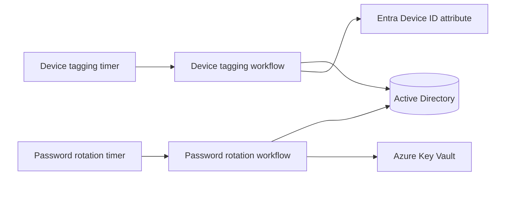
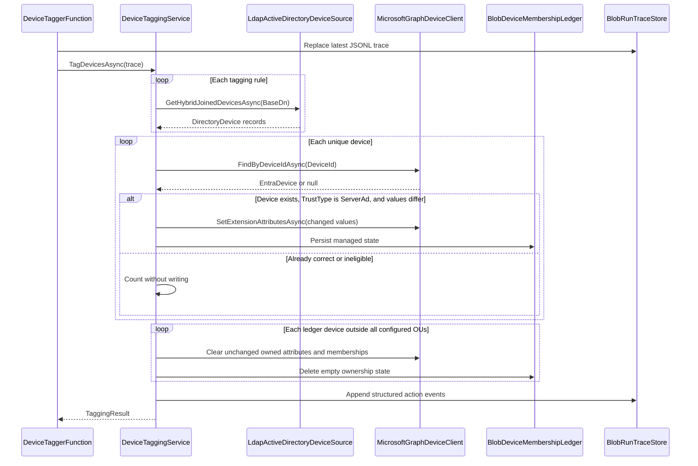
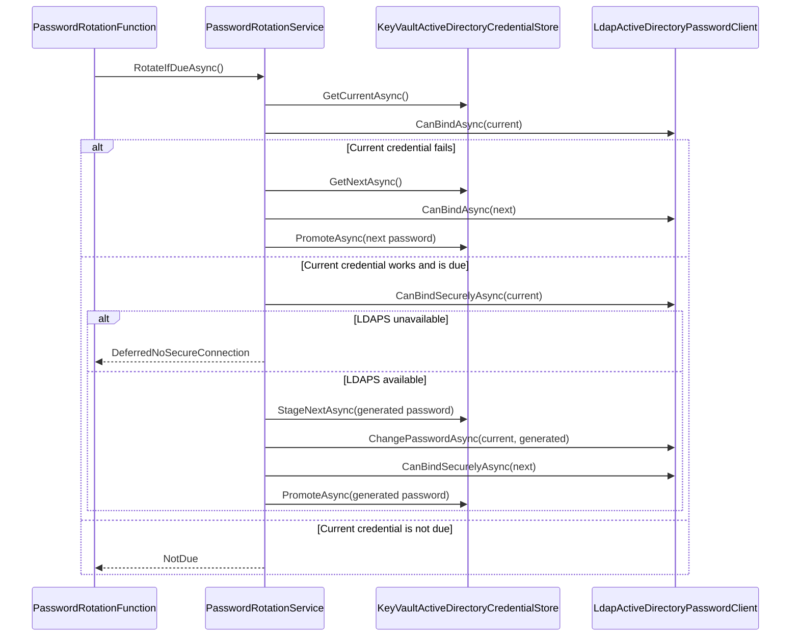

# Developer information

## Code-Dokumentation

Die folgende englischsprachige Referenz beschreibt Architektur, Abläufe sowie Verantwortlichkeiten und Zusammenarbeit der Klassen.

### Purpose

HybridDeviceTagger is a .NET 8 Azure Functions v4 isolated-worker application. It identifies synchronized domain-joined computers by `userCertificate` and connects them to their Microsoft Entra device objects by mapping the AD `objectGUID` to the Entra `deviceId`. It manages two scheduled workflows:

1. **Device tagging** discovers computers in configured Active Directory OU subtrees and writes configured `extensionAttribute1` through `extensionAttribute15` values to matching hybrid-joined Entra devices.
2. **Password rotation** rotates the Active Directory service-account password and keeps the Active Directory and Azure Key Vault states recoverable if a run is interrupted.

The application separates trigger, management API, orchestration, directory, Graph, credential-storage, and operational-state concerns. Interfaces isolate external systems so the orchestration services can be tested without Active Directory, Key Vault, Microsoft Graph, or App Service Authentication.

### Runtime Architecture



#### Startup and dependency injection

`Program.cs` is the composition root. It:

- creates the isolated Functions host;
- binds and validates all option classes during startup;
- configures OpenTelemetry and enables the Azure Monitor exporter when an Application Insights connection string is available;
- registers `DefaultAzureCredential` for Key Vault and Microsoft Graph authentication;
- constructs the Key Vault `SecretClient`;
- maps every service interface to its production implementation;
- configures the Graph `HttpClient` with `https://graph.microsoft.com/v1.0/` as its base address.
- creates Blob clients for the private membership ledger and latest-run trace containers.

The Azure clients, LDAP adapters, credential store, dynamic rule provider, operation status store, password generator, and `TimeProvider` are singletons. The workflow orchestrators and management API are transient. `MicrosoftGraphDeviceClient` is created through `HttpClientFactory`.

### Management API

`ManagementApiFunction` exposes twelve HTTP operations for rule management, trusted LDAPS certificate management, both latest-run statuses, streamed latest-trace download, immediate tagging, and forced password rotation. The HTTP triggers are anonymous at the Functions host layer because App Service Easy Auth authenticates and validates the Entra token first. `ManagementApiAuthorizer` requires one valid AAD `X-MS-CLIENT-PRINCIPAL` header and first evaluates its `roles` claims. For rule and password administration it additionally queries effective Azure RBAC assignments at the Function App scope. Missing authentication returns HTTP `401`; an authenticated principal without an accepted application role or RBAC assignment receives HTTP `403`.

The API app registration defines `HybridDeviceTagger.Reader`, `HybridDeviceTagger.RuleAdministrator`, `HybridDeviceTagger.TaggingOperator`, `HybridDeviceTagger.PasswordRotationAdministrator`, and `HybridDeviceTagger.CertificateAdministrator`. For a new Function App, the installer creates the single-tenant registration, identifier URI, service principal, and roles automatically after approval; updates reuse an explicitly supplied existing client ID. The installer assigns approved users, groups, or service principals. `appRoleAssignmentRequired` remains disabled so Function App Owners and Contributors can obtain an API token. Effective direct, transitive-group, or inherited `Owner` and `Contributor` assignments grant rule and password administration only. The Function managed identity receives `Reader` on its own Function App to perform this runtime ARM lookup.

The two action endpoints reuse `IDeviceTaggingRunner` and `IPasswordRotationRunner`, so timer and HTTP execution share orchestration, status persistence, trace behavior, and non-blocking operation locks. Forced rotation bypasses only the password-age gate. Credential verification, secure LDAP, next-secret staging, changed-credential validation, and promotion remain mandatory. A concurrent invocation returns HTTP `409`.

`BlobTaggingConfigurationStore` stores `tagging-configuration.json` in the private `run-traces` container. Before its first API mutation, `OptionsTaggingRuleProvider` supplies the validated `Tagging__RulesJson` startup fallback. Mutations normalize and validate the complete result and use Blob ETags. API clients can send the ETag returned by `GET` in `If-Match`; a stale write returns HTTP `409`.

`BlobActiveDirectoryTrustStore` stores public DER certificates as base64 in `run-traces/active-directory-trust-certificates.json`. It exposes metadata only through the API, uses the packaged certificate before the first mutation, rejects an empty resulting collection, and applies Blob ETags to concurrent changes. `ActiveDirectoryLdapConnectionFactory` reads the current set for every new connection. Windows validates through `System.DirectoryServices.Protocols`. Linux LDAPS and StartTLS use `Novell.Directory.Ldap.NETStandard`, whose certificate callback validates custom trust, DNS name, server-authentication EKU, and online revocation on the same TLS session that carries the bind.

`BlobOperationStatusStore` writes separate JSON documents for device tagging and password rotation. Timer entry points record `Running`, then `Succeeded` or a sanitized `Failed` state. Password status preserves the timestamp of the last actual password change across checks that do not rotate. Status persistence failures are warnings and do not fail the directory workflow.

`Deployment/HybridDeviceTagger.Management` owns the REST client. `Connect-HybridDeviceTagger` stores the API URI, audience, token, and expiry in module scope and refreshes the token from Azure CLI when required. Public cmdlets cover rules, trusted LDAPS certificates, both statuses, parsed trace events, immediate tagging, and forced password rotation. `Add-HybridDeviceTaggerRule` performs the named single-rule upsert. `Get-HybridDeviceTaggerTrace` prepends the `HybridDeviceTagger.TraceEvent` type name to each parsed event. The module format file renders that type as the concise six-field trace line by default without converting the pipeline value to text. Mutations use `ShouldProcess`, ETag-protected writes, and high confirmation impact for destructive rule replacement, removal, and password rotation. The complete command, security, data-flow, error, and internal implementation reference is maintained in [Deployment/HybridDeviceTagger.Management/README.md](Deployment/HybridDeviceTagger.Management/README.md). No standalone REST wrapper scripts are required.

The GitHub Actions workflow [`.github/workflows/publish-powershell-module.yml`](.github/workflows/publish-powershell-module.yml) publishes the module to PowerShell Gallery for non-prerelease GitHub Releases whose commit belongs to `main`. Publishing requires the release tag `v<ModuleVersion>`, an exact match between the manifest and project version, and the repository secret `HYBRIDDEVICETAGGER_PSMODUL`. Existing Gallery versions are detected and skipped, making workflow reruns idempotent.

### Device Tagging Workflow



Rules may overlap. Assignments for different extension attributes are merged for the same device. If two matching rules assign different values to the same attribute, the run fails instead of applying an order-dependent result. Graph PATCH requests contain only attributes whose current values differ, making repeated runs idempotent. The ownership ledger records managed attribute values and memberships created by the application. When a device leaves all configured OUs, only attributes that still match their recorded value and memberships proven to be application-owned are removed.

An OU-only path is resolved in every forest domain by reading cross-reference objects from the forest configuration partition through the statically configured domain controller. A full distinguished name containing `DC=` targets only that domain and is accepted only when its derived DNS name exactly matches an advertised forest `dnsRoot`. Rule mutations perform this check before persistence, and the LDAP source repeats it before deriving any rule-controlled endpoint. Searches use subtree scope and LDAP paging, so nested OUs and large result sets are supported.

### Password Rotation Workflow



The new password is stored as the `next` secret before Active Directory is changed. It is promoted to `current` only after a successful LDAPS bind. If execution stops after the directory change, a later run can authenticate with `next` and promote it. Password modification never uses the LDAP fallback.

### Function Entry Points

#### `DeviceTaggerFunction`

The timer-trigger entry point for device tagging. Its schedule comes from `%TaggingSchedule%`. It replaces the latest-run trace, delegates all work to `DeviceTaggingService`, records success or structured exception details, and logs the aggregate `TaggingResult`. The class is intentionally thin so scheduling remains independent from business logic.

#### `PasswordRotationFunction`

The timer-trigger entry point for password maintenance. Its schedule comes from `%PasswordRotationSchedule%`. It calls `PasswordRotationService` and logs only the outcome and known password age.

### Orchestration Services

#### `DeviceTaggingService`

Coordinates one complete tagging run. It asks the Active Directory source for every configured rule, deduplicates devices by `DeviceId`, merges non-conflicting attribute assignments, looks up each device in Graph, verifies `TrustType == "ServerAd"`, calculates changed values, and patches only those values. It reconciles group and administrative-unit memberships, removes owned state for devices outside all configured OUs, and emits ordered trace events around every external action and decision. It returns counts for discovered, updated, unchanged, missing, non-hybrid, and cleaned devices.

The private nested `DeviceTagAssignment` record groups one `DirectoryDevice` with the mutable, case-insensitive set of desired attributes accumulated from all matching rules.

#### `PasswordRotationService`

Implements age-based rotation and interrupted-run recovery. It first tests `current`; if that credential fails, it attempts recovery from `next`. If `current` works and has not reached `RotateAfterDays`, it returns without changing state. A due rotation proceeds only when secure LDAPS works. It then generates, stages, applies, validates, and promotes a new password in that order.

`TimeProvider` is injected so age calculations are deterministic in tests. A missing Key Vault creation timestamp produces an unknown age and causes a rotation attempt rather than silently keeping a potentially old password.

### Active Directory Services

#### `ActiveDirectoryLdapConnectionFactory`

Resolves domain controllers from `_ldap._tcp.dc._msdcs.<domain>` DNS SRV records and creates authenticated LDAP v3 connections with a 30-second timeout. Connections try Basic authentication over LDAPS first and, for connection-availability errors only, fall back to Basic authentication after upgrading LDAP with StartTLS. Authentication errors do not trigger transport fallback. Both transports support password changes because credentials and LDAP operations remain inside validated TLS.

The caller owns the returned connection. A failed bind disposes the connection before rethrowing the error.

#### `ActiveDirectorySearchPath`

An internal static helper for distinguished-name handling. It determines whether a path is forest-relative, validates that a relative path contains only `OU=` components, appends a domain naming context, and converts `DC=` components into a DNS domain name. Source-generated regular expressions handle unescaped DN separators.

#### `LdapActiveDirectoryDeviceSource`

Implements `IActiveDirectoryDeviceSource` and `IActiveDirectoryRuleValidator`. It always discovers forest domains through the configured server before processing a domain-specific rule and rejects a `BaseDn` whose DNS domain is not an exact forest `dnsRoot`. The configuration service invokes the validator before every replace, upsert, or removal is persisted. For OU-only rules, the source reads the configuration naming context and queries `CN=Partitions` for forest domain cross-references. It then searches the resolved OU in each domain. Domains without that OU are skipped; if no domain contains the OU, the operation fails.

Each subtree search selects computer objects with a populated `userCertificate` and requests `objectGUID`, `name`, and `distinguishedName` using server-side paging. The binary AD `objectGUID` is the value that Entra Connect maps to the Entra `deviceId`. Entries without a valid GUID are ignored, and results are deduplicated by device ID. If binding with `current` fails, the source tries `next`, which allows device discovery to continue after an interrupted rotation.

The private nested `SearchTarget` record holds the DNS server name and complete base DN for one domain search.

#### `LdapActiveDirectoryPasswordClient`

Implements `IActiveDirectoryPasswordClient`. Bind checks return `false` for LDAP errors rather than treating expected credential failures as exceptions. Secure bind checks always use LDAPS. Password changes send one atomic `ModifyRequest` against the configured service-account DN: delete the quoted UTF-16LE old `unicodePwd` value and add the quoted UTF-16LE new value.

### Azure Services

#### `KeyVaultActiveDirectoryCredentialStore`

Implements `IActiveDirectoryCredentialStore` using `SecretClient`. It reads the required `current` secret, optionally reads `next`, writes staged passwords, and promotes validated passwords by creating a new `current` secret version. A missing `next` secret is represented as `null`; a missing `current` secret remains an error.

The LDAP username comes from `ActiveDirectoryOptions`; only passwords are stored as secret values. New secret versions receive the configured expiry interval, and Key Vault creation metadata supplies the rotation age.

#### `MicrosoftGraphDeviceClient`

Implements `IEntraDeviceClient`. It obtains an application token for the Graph `.default` scope through the injected `TokenCredential`. Device lookup filters by the shared `deviceId` and selects object ID, display name, trust type, and all extension attributes. Updates PATCH the Entra object ID with only the attribute dictionary supplied by the orchestrator.

The Function managed identity therefore needs the Microsoft Graph application permission `Device.ReadWrite.All`.

#### `BlobDeviceMembershipLedger`

Implements `IDeviceMembershipLedger` in the private `membership-ledger` container. One JSON document per hybrid device records the Entra object ID, managed extension-attribute values, and memberships that HybridDeviceTagger created. Empty records are deleted. Enumeration lets the orchestrator identify devices that were managed previously but are no longer returned by any configured OU rule.

#### `BlobRunTraceStore`

Implements `IRunTraceStore` and `IRunTraceReader` with the private `run-traces` container. Starting an invocation replaces `device-tagger-last-run.jsonl`; each event is then appended immediately as one compact JSON object and receives a UTC timestamp, sequence, invocation ID, severity, phase, action, outcome, details, and optional exception data. Append failures disable tracing for that invocation and produce a normal application warning instead of interrupting device tagging. The reader streams the private Blob through the authenticated API. Attribute values are represented only by SHA-256 fingerprints, and credentials or tokens are never supplied to the trace API.

### Service Interfaces

#### `IActiveDirectoryCredentialStore`

Defines access to the active and staged credentials: read `current`, read optional `next`, stage a new password, and promote a validated password. It keeps Key Vault details out of orchestration code and enables in-memory test doubles.

#### `IActiveDirectoryDeviceSource`

Defines device discovery beneath a full DN or forest-relative OU path. It separates LDAP and forest-discovery behavior from tagging decisions.

#### `IActiveDirectoryPasswordClient`

Defines normal bind validation, secure bind validation, and password modification. The separate secure operation lets the rotation service explicitly enforce LDAPS.

#### `IEntraDeviceClient`

Defines lookup by hybrid device ID and extension-attribute updates by Entra object ID. It isolates HTTP, token acquisition, and Graph JSON from the tagging service.

#### `IDeviceMembershipLedger`

Defines loading, enumerating, persisting, and deleting managed Entra ownership state independently from Blob Storage.

#### `IRunTraceStore` and `IRunTraceSession`

`IRunTraceStore` starts the latest-run artifact for one invocation. The returned `IRunTraceSession` accepts structured events without exposing Blob APIs to workflow code. `RunTrace.None` keeps orchestration tests and alternate hosts independent from diagnostic storage.

#### `IPasswordGenerator`

Defines password generation independently from the rotation workflow. Tests can inject deterministic values while production uses cryptographic randomness.

### Password Generation

#### `SecurePasswordGenerator`

Implements `IPasswordGenerator` with `RandomNumberGenerator`. Every password contains at least one uppercase character, lowercase character, digit, and symbol. Remaining positions use the combined character set, and a cryptographic Fisher-Yates shuffle removes the predictable category order. Visually ambiguous characters are excluded. Lengths below four are rejected; production length constraints are stricter through `PasswordRotationOptions`.

### Configuration Classes

All option classes are bound and validated during host startup. Invalid configuration prevents the Function host from accepting invocations.

#### `ActiveDirectoryOptions`

Holds the primary server, LDAPS port, fallback policy and port, bind username, service-account DN, and LDAP page size. `UseSsl` must remain enabled because credential and password operations require a secure primary channel. When fallback is enabled, its port must differ from the LDAPS port.

#### `TaggingOptions`

Holds tagging rules either as a normal configuration collection or as `RulesJson`, which supports deployment systems that cannot represent arrays conveniently. Validation requires at least one rule, a unique non-empty rule name, a description, valid full-DN or OU-only paths, at least one attribute per rule, names from `extensionAttribute1` through `extensionAttribute15`, and non-empty values.

#### `TaggingRuleOptions`

Represents one named and described OU subtree and its desired extension attributes. `Name` is the case-insensitive operational identifier used for logging and configuration updates. `BaseDn` may be a full domain-specific DN or an OU-only forest-relative path. Attribute keys are case-insensitive.

#### `KeyVaultOptions`

Holds the vault URI and the names of the `current` and `next` password secrets. Keeping names configurable allows isolated environments and controlled secret migration without changing code.

#### `PasswordRotationOptions`

Defines `RotateAfterDays`, generated `PasswordLength`, and `SecretExpiryDays`. Validation requires secret expiry to be later than the rotation threshold so recovery material does not expire before the normal rotation window.

### Data Models

#### `DirectoryDevice`

An immutable Active Directory computer projection containing the hybrid device GUID, computer name, and distinguished name. `DeviceId` is the join key used to locate the corresponding Entra object.

#### `EntraDevice`

An immutable Graph projection containing the Entra object ID, shared device GUID, optional display name and trust type, and current extension-attribute values. The object ID is used for PATCH requests; the trust type protects non-`ServerAd` devices from modification.

#### `StoredDirectoryCredential`

An in-memory value containing the configured LDAP username, secret password, and optional Key Vault creation timestamp. It is passed only to the credential store and LDAP services and must never be logged or serialized.

#### `TaggingResult`

The aggregate result of one tagging run: `Discovered`, `Updated`, `Unchanged`, `NotFound`, and `NotHybridJoined`. It allows useful operational telemetry without exposing credentials.

#### `PasswordRotationOutcome`

Describes the rotation decision:

- `NotDue`: the active password is still within policy;
- `Rotated`: staging, AD update, validation, and promotion succeeded;
- `RecoveredFromNext`: `current` failed and a valid staged password was promoted;
- `DeferredNoSecureConnection`: rotation was due but LDAPS was unavailable.

#### `PasswordRotationResult`

Combines `PasswordRotationOutcome` with the known current password age in days. Age is nullable because older or externally created secret versions may not expose usable creation metadata.

### Security and Failure Behavior

- Application credentials are obtained through `DefaultAzureCredential`; no Azure credential is stored in application settings.
- Active Directory passwords are read from Key Vault and held only in memory.
- LDAP fallback uses StartTLS and supports the same bind, read, and password-modification operations as LDAPS.
- A generated password is recoverable from `next` before Active Directory is modified.
- Non-hybrid Entra devices are never patched.
- Conflicting tagging rules fail explicitly instead of producing order-dependent updates.
- Graph and LDAP transport errors propagate to the Functions runtime so failed invocations remain observable and retryable according to platform policy.
- Timer entry points log aggregate results. Exceptional tagging cases may log computer names, device IDs, or trust types for diagnosis; passwords and directory credentials are never logged.

### Tests

The test project mirrors the production boundaries:

- `ActiveDirectorySearchPathTests` verifies OU-path and distinguished-name handling.
- `DeviceTaggingServiceTests` uses service doubles to verify matching, idempotency, forest/rule behavior, skip decisions, and conflict detection.
- `PasswordRotationServiceTests` uses deterministic credentials, time, and passwords to verify not-due, rotation, recovery, and secure-connection deferral paths.

These tests focus on orchestration and parsing behavior. Live LDAP, Key Vault, Graph, private networking, and managed-identity permissions are validated by the deployment workflow rather than unit tests.

## Management REST API

Die Function App stellt eine Single-Tenant-Entra-geschützte Verwaltungs-API unter `/api/management` bereit. App Service Easy Auth lehnt nicht authentifizierte Aufrufe mit HTTP `401` ab. Die Function validiert zusätzlich den Principal Header und antwortet mit HTTP `403`, wenn weder eine für den Endpunkt zugelassene Entra-Anwendungsrolle noch eine zulässige Azure-RBAC-Zuweisung vorhanden ist. **Assignment required** bleibt auf der Enterprise Application deaktiviert, damit Function-App-Owner und -Contributors ein API-Token erhalten können. Direkte, über Sicherheitsgruppen wirksame oder von übergeordneten Scopes geerbte Owner-/Contributor-Zuweisungen gewähren Regel- und Kennwortadministration, jedoch keine Tagging-Operator- oder Zertifikatsadministratorrechte. Es werden keine Function Keys oder Client Secrets benötigt.

| Methode und Pfad | Funktion | Erforderliche Rolle |
| --- | --- | --- |
| `GET /api/management/tagging-rules` | Aktuelle Regeln, ETag, Änderungszeit und Quelle lesen | `Reader` oder `RuleAdministrator` |
| `PUT /api/management/tagging-rules` | Den vollständigen validierten Regelsatz ersetzen | `RuleAdministrator` |
| `PUT /api/management/tagging-rules/{ruleName}` | Eine vollständige Regel hinzufügen oder case-insensitiv ersetzen | `RuleAdministrator` |
| `DELETE /api/management/tagging-rules/{ruleName}` | Eine Regel entfernen; mindestens eine Regel muss verbleiben | `RuleAdministrator` |
| `GET /api/management/status/device-tagging` | Status und Ergebniszähler des letzten Tagging-Laufs lesen | `Reader` oder `TaggingOperator` |
| `GET /api/management/status/password-rotation` | Status des letzten Checks und Zeitpunkt des letzten tatsächlichen Kennwortwechsels lesen | `Reader` oder `PasswordRotationAdministrator` |
| `GET /api/management/traces/device-tagging/latest` | Letzten JSONL-Trace als Download abrufen | `Reader` oder `TaggingOperator` |
| `POST /api/management/actions/device-tagging` | Einen Tagging-Lauf sofort ausführen | `TaggingOperator` |
| `POST /api/management/actions/password-rotation` | Das AD-Servicekonto-Kennwort sofort und unabhängig vom Alter sicher rotieren | `PasswordRotationAdministrator` |
| `POST /api/management/actions/initialize-ad-credential` | Initiales AD-Servicekonto-Kennwort validieren und über die Managed Identity im Key Vault speichern | `PasswordRotationAdministrator` |
| `GET /api/management/trusted-certificates` | Metadaten der aktuellen LDAPS-Vertrauenszertifikate lesen | `Reader` oder `CertificateAdministrator` |
| `POST /api/management/trusted-certificates` | Ein öffentliches DER-/PEM-Zertifikat hinzufügen | `CertificateAdministrator` |
| `DELETE /api/management/trusted-certificates/{thumbprint}` | Ein Zertifikat entfernen; mindestens eines muss verbleiben | `CertificateAdministrator` |

Die vollständigen Rollenwerte beginnen jeweils mit `HybridDeviceTagger.`, beispielsweise `HybridDeviceTagger.Reader`. Der Installer weist die bisherige Bootstrap-Liste standardmäßig allen fünf Rollen zu; für Least Privilege stehen fünf rollenbezogene Principal-Parameter zur Verfügung. Sicherheitsgruppen sind für die laufende Administration vorzuziehen.

### API-Rollen nach der Installation verwalten

Für Benutzer und Sicherheitsgruppen können Rollen im Entra Admin Center zugewiesen werden:

1. **Identität** > **Anwendungen** > **Unternehmensanwendungen** öffnen.
2. Die Enterprise Application der HybridDeviceTagger Management API auswählen.
3. **Benutzer und Gruppen** > **Benutzer/Gruppe hinzufügen** wählen.
4. Benutzer oder Sicherheitsgruppe und anschließend genau die benötigte Rolle auswählen.
5. Die Zuweisung bestätigen. Mehrere Rollen werden als einzelne Zuweisungen angelegt.

Für skriptbare Verwaltung und Service Principals kann Microsoft Graph PowerShell verwendet werden. Die ausführende Entra-Identität benötigt eine Rolle wie `Privileged Role Administrator` und muss den angeforderten Graph-Berechtigungen zustimmen können:

```powershell
Install-Module Microsoft.Graph.Authentication -Scope CurrentUser
Connect-MgGraph -Scopes 'Application.Read.All', 'AppRoleAssignment.ReadWrite.All'

$apiClientId = '5e324803-5aed-4e5d-b49f-a4bfceddcda8'
$principalObjectId = '<Objekt-ID des Benutzers, der Gruppe oder des Service Principals>'
$roleValue = 'HybridDeviceTagger.CertificateAdministrator'

$api = Invoke-MgGraphRequest -Method GET -Uri (
	"https://graph.microsoft.com/v1.0/servicePrincipals?`$filter=appId eq '$apiClientId'&`$select=id,appRoles"
)
$apiServicePrincipal = @($api.value)[0]
$appRole = @($apiServicePrincipal.appRoles | Where-Object value -eq $roleValue)[0]

$assignmentUri = "https://graph.microsoft.com/v1.0/servicePrincipals/$($apiServicePrincipal.id)/appRoleAssignedTo"
$assignments = @(Invoke-MgGraphRequest -Method GET -Uri $assignmentUri).value
$assignment = @($assignments | Where-Object {
	$_.principalId -eq $principalObjectId -and $_.appRoleId -eq $appRole.id
})[0]

if (-not $assignment) {
	$assignment = Invoke-MgGraphRequest -Method POST -Uri $assignmentUri -Body (@{
		principalId = $principalObjectId
		resourceId = $apiServicePrincipal.id
		appRoleId = $appRole.id
	} | ConvertTo-Json)
}
```

Vorhandene Zuweisungen anzeigen und eine konkrete Zuweisung wieder entfernen:

```powershell
$assignments = @(Invoke-MgGraphRequest -Method GET -Uri $assignmentUri).value

$assignments |
	Where-Object principalId -eq $principalObjectId |
	Select-Object id, principalDisplayName, principalType, appRoleId

$assignmentToRemove = @($assignments | Where-Object {
	$_.principalId -eq $principalObjectId -and $_.appRoleId -eq $appRole.id
})[0]
if (-not $assignmentToRemove) {
	throw "The selected principal does not have role '$roleValue'."
}

Invoke-MgGraphRequest -Method DELETE -Uri (
	"$assignmentUri/$($assignmentToRemove.id)"
)
```

Nach einer Rollenänderung muss ein bereits ausgestelltes Zugriffstoken erneuert werden. Für das Management-Modul dazu die Verbindung neu aufbauen; bei einem weiterhin zwischengespeicherten Azure-CLI-Token ist eine erneute Anmeldung erforderlich:

```powershell
Disconnect-MgGraph
az logout
az login --tenant d89a354d-2bce-44ed-b802-8f8600689247
Connect-HybridDeviceTagger
```

`Assignment required` muss auf der Enterprise Application deaktiviert bleiben, damit die Function effektive Owner-/Contributor-Zuweisungen selbst prüfen kann. Alle anderen API-Berechtigungen erfordern weiterhin explizite Anwendungsrollen.

Die API speichert dynamische Regeln als `tagging-configuration.json` im privaten Container `run-traces`. Solange die API noch keine Änderung gespeichert hat, verwendet sie `Tagging__RulesJson` als Fallback. Jeder Tagging-Lauf liest zu Beginn genau einen aktuellen Snapshot; ein Function-Restart ist nach Änderungen nicht erforderlich. ETags verhindern, dass parallele Änderungen unbemerkt überschrieben werden. Die vollständige OpenAPI-3.0-Spezifikation steht in [docs/management-api.openapi.yaml](docs/management-api.openapi.yaml).

Das Modul `Deployment/HybridDeviceTagger.Management` hält die mit `Connect-HybridDeviceTagger` aufgebaute REST-Verbindung für nachfolgende Cmdlets. Es verwendet die bestehende Anmeldung von `az login`; Subscription, Resource Group und ARM-Abfragen sind nicht erforderlich:

```powershell
Import-Module ./Deployment/HybridDeviceTagger.Management
Connect-HybridDeviceTagger
Get-HybridDeviceTaggerRule
Get-HybridDeviceTaggerLastRunStatus
Add-HybridDeviceTaggerRule -Rule $rule -WhatIf
Invoke-HybridDeviceTagging
Invoke-HybridDeviceTaggerPasswordRotation -Confirm
Get-HybridDeviceTaggerTrustedCertificate
Add-HybridDeviceTaggerTrustedCertificate -Path ./contoso-root-ca.cer
Remove-HybridDeviceTaggerTrustedCertificate -CertificateThumbprint $oldThumbprint -Confirm
```

`Invoke-HybridDeviceTaggerPasswordRotation` umgeht ausschließlich die Altersprüfung. Aktueller Bind, LDAPS, Staging, Validierung und Promotion bleiben verpflichtend. Beide Aktionen laufen synchron, schreiben denselben Status wie die Timer und antworten mit HTTP `409`, wenn die jeweilige Operation bereits läuft.

Die Leseoperationen stehen direkt im Modul zur Verfügung:

```powershell
Get-HybridDeviceTaggerRule
Get-HybridDeviceTaggerLastRunStatus | Format-List
Get-HybridDeviceTaggerPasswordRotationStatus | Format-List
Get-HybridDeviceTaggerTrace
```

`Get-HybridDeviceTaggerTrace` zeigt jedes Trace-Ereignis als eine logische Zeile im Format `<Zeit>,<Severity>,<Phase>,<Status>,<Action>,<Details>` an, liefert in der Pipeline aber vollständige `HybridDeviceTagger.TraceEvent`-Objekte. Dadurch funktionieren beispielsweise Zuweisung, `Where-Object`, `Select-Object`, `ConvertTo-Json` und `Export-Csv` ohne Informationsverlust.

Die Zertifikatsverwaltung speichert ausschließlich öffentliche DER-Daten im privaten Blob `run-traces/active-directory-trust-certificates.json`. Bis zur ersten API-Änderung dient das bei der Installation paketierte Zertifikat als Fallback. Jede neue LDAP-Verbindung verwendet den aktuellen Satz; doppelte Ergänzungen sind idempotent, parallele Änderungen ETag-geschützt und das Löschen des letzten Trust-Ankers ist gesperrt.

Ein Bearer-Token muss als Audience die konfigurierte API-App-ID oder `api://<client-id>` besitzen:

```powershell
$headers = @{ Authorization = "Bearer $accessToken" }
Invoke-RestMethod `
	-Uri 'https://func-hybriddevicetagger.azurewebsites.net/api/management/status/device-tagging' `
	-Headers $headers

Invoke-WebRequest `
	-Uri 'https://func-hybriddevicetagger.azurewebsites.net/api/management/traces/device-tagging/latest' `
	-Headers $headers `
	-OutFile '.\device-tagger-last-run.jsonl'
```

## Rotationsablauf

Die Rotation prüft das aktuelle Secret täglich und rotiert regulär ab einem Alter von 25 Tagen:

1. Neues zufälliges Kennwort als `next` in Key Vault speichern.
2. Eigenes AD-Kennwort über LDAPS mit einer kombinierten `unicodePwd`-Delete/Add-Operation ändern.
3. LDAP-Bind mit `next` validieren.
4. Das validierte Kennwort als neue Version von `current` speichern.

Wenn `current` nach einem unterbrochenen Lauf nicht mehr funktioniert, testet die Function zuerst `next` und übernimmt es bei Erfolg als `current`. Auch die Geräteabfrage verwendet diesen Fallback.

Kennwortänderungen über `unicodePwd` und die anschließende Validierung bleiben immer LDAPS-pflichtig. Ist eine Rotation fällig, aber LDAPS nicht verfügbar, wird sie mit `DeferredNoSecureConnection` ohne neues `next`-Secret und ohne Änderung in AD zurückgestellt. Der nächste geplante Lauf versucht die Rotation erneut.

## Konfiguration

| App Setting | Beschreibung | Vorgabe |
| --- | --- | --- |
| `TaggingSchedule` | NCRONTAB-Ausdruck mit Sekundenfeld | `0 */15 * * * *` |
| `PasswordRotationSchedule` | Tägliche Rotationsprüfung, standardmäßig 02:30 UTC | `0 30 2 * * *` |
| `ActiveDirectory__Domain` | AD-DNS-Domäne für die SRV-basierte Domain-Controller-Ermittlung | muss angepasst werden |
| `ActiveDirectory__Port` | LDAP-Port | `636` |
| `ActiveDirectory__UseSsl` | LDAPS aktivieren | `true` |
| `ActiveDirectory__AllowLdapFallback` | Bei nicht verfügbarem LDAPS LDAP mit StartTLS erlauben | `true` |
| `ActiveDirectory__LdapFallbackPort` | Port für LDAP mit StartTLS | `389` |
| `ActiveDirectory__TrustedCertificatePath` | Optionaler Pfad zu einem privaten Root-CA- oder selbstsignierten Lab-Zertifikat für LDAPS | leer; Installer paketiert das Zertifikat als PEM |
| `ActiveDirectory__BindUsername` | UPN des Servicekontos | `svc-HybridDeviceTagger@bloedgelaber.de` |
| `ActiveDirectory__BindUserDistinguishedName` | DN des Servicekontos für `unicodePwd` | muss angepasst werden |
| `ActiveDirectory__PageSize` | LDAP-Seitengröße | `500` |
| `KeyVault__VaultUri` | URI des Key Vaults | muss angepasst werden |
| `KeyVault__CurrentPasswordSecretName` | Aktuell verwendetes Kennwort | `hybrid-device-tagger-ad-password-current` |
| `KeyVault__NextPasswordSecretName` | Staging- und Recovery-Kennwort | `hybrid-device-tagger-ad-password-next` |
| `PasswordRotation__RotateAfterDays` | Alter bei regulärer Rotation | `25` |
| `PasswordRotation__PasswordLength` | Länge des generierten Kennworts | `40` |
| `PasswordRotation__SecretExpiryDays` | Ablauf einer Secret-Version | `35` |
| `ManagementAuthorization__FunctionAppResourceId` | Azure-Ressourcen-ID der Function App für die Laufzeitprüfung effektiver Owner-/Contributor-Zuweisungen | wird vom Bicep-Deployment gesetzt |
| `Tagging__Rules__<n>__Name` | Eindeutiger, case-insensitiver Regelname für Verwaltung und Logs | erforderlich |
| `Tagging__Rules__<n>__Description` | Lesbare Beschreibung des Zwecks | erforderlich |
| `Tagging__Rules__<n>__BaseDn` | OU-only-Pfad für alle Forest-Domains oder vollständiger domainspezifischer DN | erforderlich |
| `Tagging__Rules__<n>__ExtensionAttributes__extensionAttribute<m>` | Zielwert für Attribut 1 bis 15 | optional |
| `Tagging__Rules__<n>__EntraGroupIds__<m>` | Object ID einer statischen Entra-Sicherheitsgruppe | optional, maximal 50 |
| `Tagging__Rules__<n>__AdministrativeUnitIds__<m>` | Object ID einer normalen oder eingeschränkten administrativen Einheit | optional, maximal 50 |

Jede Regel benötigt mindestens eine Aktion aus diesen drei Zielarten. Die Mitgliedschaftsziele aller passenden Regeln werden vereinigt. HybridDeviceTagger speichert verwaltete Extension-Attribute mit ihrem zuletzt gesetzten Wert sowie ausschließlich selbst erzeugte Mitgliedschaften im privaten Blob-Container `membership-ledger`. Verlässt ein Computer alle konfigurierten Ziel-OUs oder entfällt eine Aktion aus allen passenden Regeln, entfernt die Function die noch unveränderten verwalteten Attribute und ihre eigenen Gruppen-, AU- und RMAU-Mitgliedschaften. Zwischenzeitlich manuell geänderte Attribute sowie bereits vorher manuell oder durch andere Systeme vorhandene Mitgliedschaften werden nicht entfernt.

Die Anwendung ermittelt Domain Controller über AD-DNS-SRV-Records. Primär verwendet das Servicekonto Basic Bind über LDAPS. Ist LDAPS wegen eines Verbindungs-, TLS- oder Verfügbarkeitsfehlers nicht erreichbar, wird LDAP auf Port 389 vor dem Bind mit StartTLS auf TLS hochgestuft. Ungültige Anmeldedaten lösen keinen Transportwechsel aus. Zertifikats- und DNS-Namensprüfung sind für beide Transportarten identisch; ein unverschlüsselter Basic Bind ist ausgeschlossen.

Für private PKIs kann der Installer mit `-ActiveDirectoryTrustedCertificatePath` ein öffentliches Root-CA-Zertifikat im DER- oder PEM-Format übernehmen. Für einen Lab-DC darf dies auch dessen direkt selbstsigniertes Serverzertifikat sein. Das validierte Zertifikat wird ohne privaten Schlüssel als PEM in das Function-Paket geschrieben. Die Anwendung akzeptiert nur Zertifikate, die eine gültige Kette zu diesem Trust Anchor, die EKU Server Authentication und den DNS-Namen des LDAP-Ziels besitzen.

Beispiel für lokale App Settings:

```text
Tagging__Rules__0__Name=Tier 0 workstations
Tagging__Rules__0__Description=Tags privileged administrative workstations.
Tagging__Rules__0__BaseDn=OU=Tier0,OU=Admin
Tagging__Rules__0__ExtensionAttributes__extensionAttribute1=PAW
Tagging__Rules__0__ExtensionAttributes__extensionAttribute2=Tier0
Tagging__Rules__1__Name=Tier 1 servers
Tagging__Rules__1__Description=Tags server devices as Tier 1.
Tagging__Rules__1__BaseDn=OU=Server
Tagging__Rules__1__ExtensionAttributes__extensionAttribute2=Tier1
```

Enthält `BaseDn` nur OU-Komponenten, beispielsweise `OU=Tier0,OU=Admin`, liest die Function die Domain-CrossRefs aus der Forest-Konfigurationspartition und sucht diesen OU-Pfad in jeder Domain. Eine Domain, in der der Pfad nicht existiert, wird übersprungen; existiert er in keiner Domain, schlägt die Regel fehl. Ein vollständiger DN wie `OU=Tier0,OU=Admin,DC=child,DC=example,DC=com` begrenzt die Regel dagegen auf genau diese Domain. Die daraus abgeleitete DNS-Domain muss exakt als `dnsRoot` im Forest veröffentlicht sein; diese Prüfung erfolgt vor dem Speichern und erneut vor dem LDAP-Bind.

Jede konkrete OU wird mit LDAP `SearchScope.Subtree` durchsucht und erfasst damit Computer direkt in der Basis-OU und in allen darunterliegenden OUs. Regeln dürfen sich überlappen; Zuweisungen unterschiedlicher Attribute werden für ein Gerät zusammengeführt. Weisen überlappende Regeln demselben Attribut unterschiedliche Werte zu, wird der Lauf mit einem Konfigurationsfehler beendet, statt einen reihenfolgeabhängigen Wert zu schreiben.

## Lokal ausführen

1. `src/HybridDeviceTagger/local.settings.example.json` nach `src/HybridDeviceTagger/local.settings.json` übertragen und Domain Controller, Benutzer-DN sowie Vault-URI anpassen.
2. Azurite starten oder `AzureWebJobsStorage` auf eine Entwicklungs-Storage-Verbindung setzen.
3. Das bestehende AD-Kennwort als `current`-Secret im Key Vault anlegen.
4. Eine lokale Azure-Anmeldung mit Secret-Lese- und Schreibrechten bereitstellen, die über `DefaultAzureCredential` verwendet werden kann.
5. In `src/HybridDeviceTagger` den Befehl `func start` ausführen.

`local.settings.json` ist von Git ausgeschlossen. Zugangsdaten dürfen nicht in die Beispielkonfiguration oder das Repository eingetragen werden.

## Build und Tests

```powershell
dotnet build HybridDeviceTagger.sln --configuration Release
dotnet test HybridDeviceTagger.sln --configuration Release
```

Die Unit-Tests prüfen Geräteabgleich, Fälligkeit, reguläre Rotation, Recovery und Kennwortzusammensetzung.

Der GitHub-Actions-Workflow wird nur manuell über `workflow_dispatch` gestartet. Automatische Läufe bei Pushes und Pull Requests sind deaktiviert, weil die Enterprise-Richtlinie dieses privaten Repositorys keine GitHub-hosted Runner zulässt. Für automatische CI muss ein freigegebener Self-hosted Runner eingerichtet und im Workflow als `runs-on` eingetragen werden.

## Versionierung und Autor

Das Projekt verwendet die Produktversion `<major>.<minor>.<yyyyMMdd>.<counter>`, aktuell `0.1.20261005.3`. Der Zähler beginnt für jede Veröffentlichung am selben Datum bei `1` und wird bei weiteren Veröffentlichungen an diesem Tag erhöht. Die zentrale Definition steht in `Directory.Build.props` und wird als Paket- und Informational-Version in die Build-Ausgabe übernommen.

Vor jedem Commit müssen die Version in `Directory.Build.props` erhöht und ein datierter Abschnitt für exakt diese Version in [CHANGELOG.md](CHANGELOG.md) ergänzt werden. Das eingecheckte Prüfskript validiert beide Bedingungen gegen `HEAD`. Der Repository-Hook wird einmalig pro Clone aktiviert:

```powershell
git config core.hooksPath .githooks
```

Nach dem Staging kann dieselbe Prüfung manuell ausgeführt werden:

```powershell
pwsh -NoProfile -File scripts/Assert-CommitMetadata.ps1 -Staged
```

Da CLR-Assembly- und Dateiversionen nur Zahlenwerte bis `65534` je Segment unterstützen, bleiben diese separat kompatibel: `AssemblyVersion` ist `0.1.0.0`, `FileVersion` ist `0.1.0.1`. Ein Build- oder Releaseprozess kann die Produktversion ohne Dateiänderung setzen:

```powershell
dotnet build HybridDeviceTagger.sln --configuration Release `
	-p:VersionMajor=0 `
	-p:VersionMinor=1 `
	-p:VersionDate=20260904 `
	-p:VersionCounter=2
```

Autor und Ansprechpartner ist Andreas Lucas (aka Kili), `andreas.lucas@outlook.com`.

## Entwicklungsvoraussetzungen

- .NET 8 SDK zum Bauen, Testen und Erzeugen des Installationspakets
- Azure Functions Core Tools v4 zum lokalen Starten der Function App
- Azure Storage oder lokal Azurite für den Timer Trigger

Das vollständige Installationspaket wird mit folgendem Befehl unter `artifacts` erzeugt:

```powershell
pwsh -NoProfile -File scripts/New-InstallationPackage.ps1
```

Vorkonfiguriert sind:

- Regeln: mehrere OU-Teilbäume mit jeweils einem oder mehreren Extension-Attributen
- Geräteabgleich: alle 15 Minuten
- Kennwortprüfung: täglich; Rotation nach 25 Tagen
