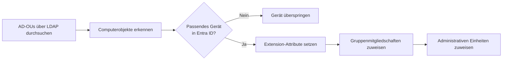
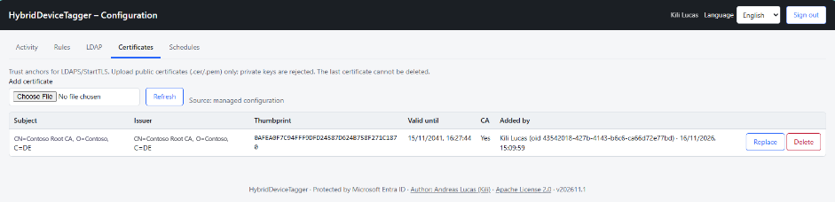
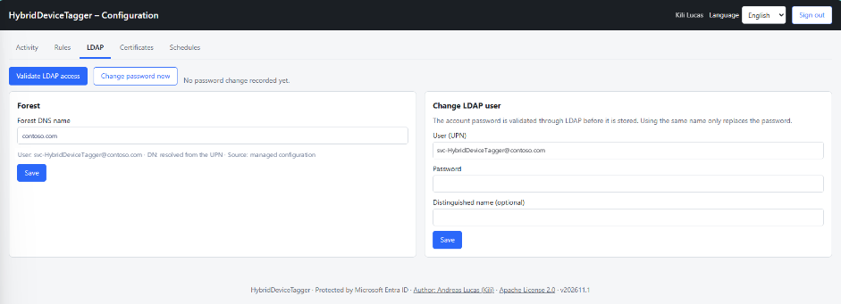
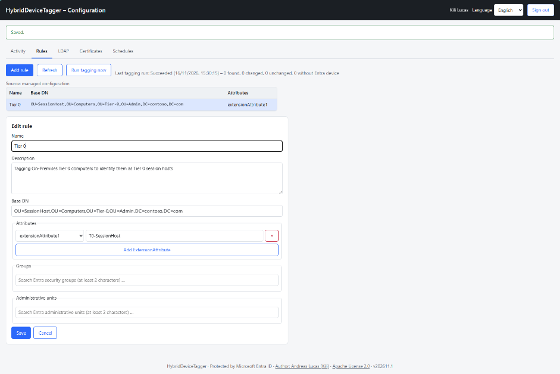

# HybridDeviceTagger

[English](README.md) | **Deutsch**

<p align="center"></p>
<p align="center"><strong>OU-basierte Kennzeichnung hybrider Geräte in Microsoft Entra ID</strong></p>
<p align="center"><a href="#versionierung-und-release"></a> <a href="./LICENSE"></a>   </p>

---

<p align="center"><a href="https://buymeacoffee.com/andreaslmuz"></a></p>

<br>

## In diesem Artikel

<p align="center"><a href="#überblick">Überblick</a> &bull; <a href="#funktionsweise">Funktionsweise</a> &bull; <a href="#installation">Installation</a> &bull; <a href="#administration">Administration</a> &bull; <a href="#troubleshooting">Troubleshooting</a></p>

## Überblick

Für die Umsetzung einer Zero-Trust-Strategie muss nicht nur die Identität eines Benutzers, sondern auch das verwendete Quellsystem zuverlässig bestimmt und bewertet werden. In Conditional-Access-Richtlinien lässt sich diese Einordnung bei Geräten üblicherweise über Extension Attributes abbilden. Damit kann beispielsweise geprüft werden, ob ein Quellsystem einer definierten Sicherheitsstufe entspricht.

Voraussetzung dafür ist ein in Microsoft Entra ID verfügbares Geräteobjekt, beispielsweise ein Microsoft-Entra-hybrid-joined Computer. Eine Bewertung allein anhand der Quelladresse reicht häufig nicht aus.

Im lokalen Active Directory kann diese Klassifizierung über die Verzeichnisstruktur und die Organisationseinheit eines Computerobjekts abgebildet werden. Beim Synchronisieren von Computerobjekten nach Microsoft Entra ID geht diese Information jedoch verloren, weil der Distinguished Name (DN) und damit die OU-Zuordnung nicht übernommen werden.

Genau hier setzt HybridDeviceTagger an. Er wertet die Position eines Computerobjekts im Active Directory aus, wendet darauf konfigurierbare Regeln an und überträgt die daraus abgeleitete Sicherheitsklassifizierung nach Microsoft Entra ID. Abhängig von dem Distinguished Name (DN) kann das

    - extensionAttribute1 bis extensionAttribute15 setzen,
    - das Gerät Entra-Sicherheitsgruppen hinzufügen und
    - das Gerät normalen oder eingeschränkten administrativen Einheiten zuordnen.

## Funktionsweise

HybridDeviceTagger durchsucht die konfigurierten OUs im Active Directory. Für jedes ind der OU gefundene Computerobjekt prüft er, ob ein zugehöriges Geräteobjekt in Entra ID vorhanden ist. Bei einer Übereinstimmung werden die für die jeweilige OU konfigurierten Extension-Attribute sowie Mitgliedschaften in Entra-Sicherheitsgruppen und administrativen Einheiten angewendet.



## Installation

HybridDeviceTagger kann 
    - interaktiv mit dem geführten Installer `Install.ps1` oder 
    - unbeaufsichtigt aus einer beliebigen CI/CD-Pipeline mit der Installations-Engine `Install-HybridDeviceTagger.ps1`. 
installiert werden.

### Das Installationspaket

Alle für die Installation notwendigen Dateien liegen im Verzeichnis [installationspackage](installationspackage). Ein Release-Paket `HybridDeviceTagger-<Version>.zip` enthält genau dieses Verzeichnis zuzüglich der vorkompilierten Function, `version.json` und der Lizenz:

Lade das Installations-ZIP und seine `.sha256`-Prüfsumme aus den [GitHub Releases](https://github.com/Kili69/HybridDeviceTagger/releases/latest) herunter, nicht das automatisch erzeugte Quellcodearchiv. Releases werden nach dem Merge eines vorbereiteten `dev`-Pull-Requests in die geschützte Branch `main` gebaut und getestet; siehe [Release erstellen](DEVELOPER.md#creating-a-release).

| Datei | Zweck |
| --- | --- |
| `Install.ps1` | Geführte Installation. Fragt alle Parameter ab und führt Validierung, What-if und Installation nacheinander aus. **Einstiegspunkt für die interaktive Installation.** |
| `Install-HybridDeviceTagger.ps1` | Installations-Engine. Wird von `Install.ps1` aufgerufen und für unbeaufsichtigte Installationen und Pipelines direkt mit Parametern verwendet. |
| `main.bicep`, `key-vault-role-assignment.bicep` | Azure-Infrastruktur als Code |
| `function/HybridDeviceTagger.zip` | Vorkompilierte Function App |
| `HybridDeviceTagger.Management/` | PowerShell-Modul für den Betrieb nach der Installation |
| `version.json` | Version, Branch und Commit des Pakets |
| `README.md` | Englische Installationsreferenz mit Berechtigungen, allen Engine-Parametern und Fehleranalyse |

### Interaktive Installation mit Install.ps1

Die geführte Installation eignet sich für die Erstbereitstellung, Updates, Testumgebungen und manuell kontrollierte Änderungen. `Install.ps1` prüft die lokalen Voraussetzungen, fragt alle Werte mit Vorschlägen und Formatprüfung ab, validiert die Umgebung und installiert erst nach Bestätigung.

### Automatische Installation mit Install-HybridDeviceTagger.ps1
Die automatische Installation eignet sich für wiederholbare Bereitstellungen, CI/CD-Pipelines und Szenarien, in denen keine interaktive Eingabe möglich ist. `Install-HybridDeviceTagger.ps1` wird direkt mit allen erforderlichen Parametern aufgerufen und führt Validierung, What-if und Installation aus.

#### Voraussetzungen

**Installationsrechner**

    - PowerShell 7.2 oder neuer
    - Azure CLI 2.60.0 oder neuer
    - Das entpackte Installationspaket einschließlich `function/HybridDeviceTagger.zip`

**Azure**

    - Azure Subscription mit Berechtigungen für die Bereitstellung von Ressourcen    
    - Bei einem vorhandenen Key Vault:
        - RBAC-Autorisierung, Soft Delete und Purge Protection aktiviert
        - Recht des Installationsbenutzers, Secrets und Rollenzuweisungen auf dem Vault anzulegen


**Netzwerk**

    - Vorhandenes virtuelles Netzwerk mit zwei Subnetzen:
        - Integrationssubnetz (Flex Consumption) für die Function, delegiert an `Microsoft.App/environments`, mindestens `/27` 
        - Subnetz für die privaten Endpunkte von Storage (Blob, Queue) und Key Vault

    - DNS im VNet:
        - Auflösung von 
            - `privatelink.blob.core.windows.net`
            - `privatelink.queue.core.windows.net` 
            - `privatelink.vaultcore.azure.net`; 
        - Auflösung der SRV-Einträge `_ldap._tcp.dc._msdcs` aller betroffenen Forest-Domains

    - Erreichbarkeit aus dem VNet der Function:
        - Domain Controller über LDAPS (Port 636) oder LDAP mit StartTLS (Port 389)
        - CRL- oder OCSP-Endpunkte der CA, die die DC-Zertifikate ausgestellt hat

##### Wofür die Function das VNet benötigt

- **Integrationssubnetz:** Über dieses Subnetz baut die Function ihre ausgehenden Verbindungen zu den lokalen Domain Controllern. 
- **Private-Endpoint-Subnetz:** Hier liegen die privaten Netzwerkadressen der drei Azure-Dienste, die nur intern erreichbar sind:
  - **Blob Storage:** Code-Paket der Function, Regeln, Konfiguration, Ablaufprotokolle und Sperren gegen parallele Läufe
  - **Queue Storage:** Warteschlangen für sofort angeforderte Läufe („Tagging jetzt ausführen“, „Kennwortwechsel auslösen“)
  - **Key Vault:** aktuelles und vorbereitetes Kennwort des AD-Servicekontos

Storage und Key Vault sind dadurch aus dem Internet nicht erreichbar; die Function greift ausschließlich über das private Netzwerk auf sie zu.

**Active Directory** 

    - Root-CA-Zertifikat (`.cer`/`.pem`) der Domain-Controller-Zertifikate
    - Vorhandenes AD-Benutzerkonto (Servicekonto) Mitglied in der Domain Users Gruppe ist ausreichend

#### Installation ausführen

Das Installationspaket entpacken, PowerShell 7 im entpackten Verzeichnis öffnen und bei Azure anmelden:

```powershell
az login
.\Install.ps1
```

- **Azure-Ziel:** 
    - Subscription (Vorschlag: aktuelle `az login`-Subscription), 
    - Ressourcengruppe (`rg-HybridDeviceTagger`, wird bei Bedarf angelegt), 
    - Region (`westeurope`) sowie 
    - Namen für Function App (`func-hybriddevicetagger`) und 
    - Storage Account
- **Netzwerk:** 
      - Subscription, Ressourcengruppe und Name: Diese drei Angaben bestimmen nur, wo das eine VNet liegt.
      - Integrationssubnetz in diesem VNet, delegiert an `Microsoft.App/environments`
      - Private-Endpoint-Subnetz in diesem VNet
- **Key Vault:** 
    Auswahl zwischen einem neuen privaten Vault und einem vorhandenen Vault; bei einem vorhandenen Vault zusätzlich Subscription und Ressourcengruppe; in beiden Fällen der Name
    - **Management API:** 
    optional die Client-ID der App-Registrierung. (Bleibt der Wert leer, erstellt der Installer bei einer Erstinstallation die single-tenant Entra-App-Registrierung und Enterprise Application automatisch beziehungsweise verwendet bei einem Update die Registrierung der vorhandenen Installation. Außerdem die Objekt-ID des Benutzers oder der Gruppe, die alle Rollen der Management API erhält (Vorschlag: angemeldeter Benutzer))
    - **Betrieb:** 
    Startwerte für das Tagging-Intervall in Minuten (5–1440, Vorschlag 15) und das Kennwortwechsel-Intervall in Tagen (1–29, Vorschlag 25) 


Danach wählt man die Aktion oder übergibt sie mit `-Mode`:

| Auswahl | `-Mode` | Aktion |
| --- | --- | --- |
| **[1] Install or update** | `Install` | Validierung ohne Änderungen, danach optional Azure What-if, danach nach Bestätigung die Installation. Empfohlen für Erstinstallation und Updates. |
| **[2] Validate only** | `Validate` | Prüft alle Voraussetzungen ohne Änderungen |
| **[3] Show Azure What-If only** | `WhatIf` | Zeigt die geplanten Azure-Änderungen ohne Änderungen |


Der Ablauf von **Install or update**:

1. **Validierung** ohne Änderungen. Geprüft werden unter anderem Ressourcenanbieter und Namen, VNet und Subnetze, Key Vault, DNS sowie das Bicep-Deployment; nur bei vorab übergebenen AD-Parametern zusätzlich LDAPS beziehungsweise StartTLS, Zertifikatskette, Forest und Servicekonto. Bei einem Fehler endet der Ablauf ohne Änderungen.
2. **Azure What-if** (optional): Anzeige der zu erstellenden oder zu ändernden Azure-Ressourcen. Eine für die Erstinstallation vorgesehene App-Registrierung wird dabei nur geplant und noch nicht erstellt.
3. **Rückfrage `Start the installation now?`**: Erst mit **y** beginnt die Installation.
4. **Installationszusammenfassung** der Engine mit allen Ressourcen, Rollen und Berechtigungen und der abschließenden Bestätigung **Execute the installation plan shown above**.

#### Active Directory nach der Installation konfigurieren

Die Konfiguration erfolgt nach der Installation im [Konfigurationsportal](#konfigurationsportal) unter `https://<function-app>.azurewebsites.net/api/portal`; Zugriff haben Benutzer mit der Rolle **Owner** oder **Contributor** an der Function App. Die Schritte bauen aufeinander auf und werden in dieser Reihenfolge ausgeführt:

1. **Root-Zertifikat hochladen**
   - Bereich **Certificates** (Zertifikate) öffnen und unter **Add certificate** das öffentliche Root-CA-Zertifikat (`.cer`, `.crt` oder `.pem`) auswählen, das die Zertifikate der Domain Controller ausgestellt hat.
   - Das Zertifikat ist der Vertrauensanker für LDAPS und StartTLS.

   <p align="center"></p>

2. **Forest konfigurieren**
   - Bereich **LDAP** öffnen, im Feld **Forest DNS name** den DNS-Namen des AD-Forests eintragen (zum Beispiel `contoso.com`) und mit **Save** speichern.

3. **Benutzer und Kennwort setzen**
   - Im Bereich **LDAP** unter **Set LDAP user** den UPN des Servicekontos (zum Beispiel `svc-HybridDeviceTagger@contoso.com`) und dessen aktuelles Kennwort eintragen.
   - **Validate LDAP access** prüft die Verbindung zu jedem Domain Controller.

   <p align="center"></p>

4. **Regeln erstellen**
   - Im Bereich **Rules** mit **Add rule** eine Regel anlegen:
     - Name und Beschreibung
     - **Base DN** der OU, zum Beispiel `OU=SessionHost,OU=Computers,OU=Tier-0,OU=Admin,DC=contoso,DC=com`
     - mindestens eine Aktion: ein ExtensionAttribute mit Wert, eine Entra-Sicherheitsgruppe oder eine administrative Einheit
   - Nach dem Speichern startet **Run tagging now** sofort einen Lauf; das Ergebnis erscheint neben der Schaltfläche und im Bereich **Activity**.
   - Details zu Regeln stehen unter [Tagging-Regeln verwalten](#tagging-regeln-verwalten).

   <p align="center"></p>

Dieselben Schritte sind mit dem [PowerShell-Management-Modul](installationspackage/HybridDeviceTagger.Management/README.md) möglich:

```powershell
Import-Module .\HybridDeviceTagger.Management
Connect-HybridDeviceTagger -ApiBaseUri 'https://<function-app>.azurewebsites.net/api/management' `
    -ClientId '<management-api-client-id>' -SkipValidation
Add-HybridDeviceTaggerTrustedCertificate -Path '.\Contoso-Root-CA.cer'
Set-HybridDeviceTaggerActiveDirectoryConfiguration -Domain 'contoso.com'
Set-HybridDeviceTaggerServiceAccount -Credential (Get-Credential 'svc-HybridDeviceTagger@contoso.com')
Add-HybridDeviceTaggerRule -Rule $rule
```

#### Automatisierte Installation

Alle Werte können als Parameter oder PowerShell-Splat übergeben und für Validierung, What-if und Installation wiederverwendet werden. 

```powershell
$parameters = @{
    SubscriptionId = '<Azure-Subscription-ID>'
    ResourceGroupName = 'rg-hybrid-device-tagger'
    Location = 'westeurope'
    FunctionAppName = 'func-hybrid-device-tagger'
    StorageAccountName = 'sthybriddevicetagger'
    CreateKeyVault = $true
    CreateResourceGroup = $true
    RegisterProviders = $true
    FunctionPackagePath = 'function/HybridDeviceTagger.zip'
    ActiveDirectoryForestDomain = '<AD-Forest-Domain>'
    ActiveDirectoryServer = '<AD-Server>'
    ActiveDirectoryTrustedCertificatePath = '<Path-to-Trusted-Certificate>'
    ADServiceAccount = '<AD-Service-Account>'
    ActiveDirectoryBindUserDistinguishedName = '<Bind-User-DN>'
    ADServiceAccountCredential = (Get-Credential '<AD User UPN>')
    SkipActiveDirectoryDirectoryChecks = $false

}

./installationspackage/Install-HybridDeviceTagger.ps1 @parameters -ValidateOnly
./installationspackage/Install-HybridDeviceTagger.ps1 @parameters -WhatIf
./installationspackage/Install-HybridDeviceTagger.ps1 @parameters
```

     - `-CreateKeyVault` wird ein neuer privater Key Vault in der Ziel-Ressourcengruppe erstellt; ohne diesen Schalter wird ein vorhandener Key Vault verwendet.
     - `-CreateResourceGroup` erstellt eine neue Ressourcengruppe, falls sie nicht bereits existiert,
     - `-RegisterProviders` registriert die erforderlichen Azure-Ressourcenanbieter, falls sie noch nicht registriert sind


### Pipeline-Installation

Die Pipeline-Installation verwendet dieselbe Installations-Engine im vollständig parametrisierten Noninteractive-Modus. Sie ist nicht an GitHub Actions, Azure DevOps oder ein anderes Pipeline-System gebunden.

#### Voraussetzungen

- Ein Runner mit PowerShell 7.2 und Azure CLI; 
- .NET 8 SDK und ein Checkout mit vollständiger Git-Historie einschließlich Tags, wenn das Installationspaket innerhalb der Pipeline erzeugt wird; die Installation selbst benötigt kein .NET SDK
- Eine nicht interaktive Azure-Anmeldung, vorzugsweise über Workload Identity Federation; alternativ kann ein Service Principal verwendet werden
- Dieselben Azure-, Entra- und Netzwerkberechtigungen wie bei der geführten Installation
- Optional ein geschütztes Pipeline-Secret für das bereits vorhandene AD-Servicekonto, wenn die AD-Anbindung vorab gesetzt werden soll
- Vollständig gesetzte Installer-Parameter; die Pipeline darf nicht von interaktiven Eingabeaufforderungen abhängen

Ein von einem Pipeline-Anbieter gehosteter Runner kann nur verwendet werden, wenn er die privaten DNS-Zonen und, bei vorab übergebenen AD-Anmeldedaten, die Domain Controller sicher erreichen kann. Für typische Hybridumgebungen ist daher ein selbst gehosteter Runner im verbundenen Netzwerk erforderlich.

#### Pipeline-Ablauf

Eine plattformneutrale Pipeline sollte die folgenden Stufen verwenden:

1. **Build, Tests und Paket:** Mit `scripts/Build-InstallationPackage.ps1` die Tests ausführen, die Function veröffentlichen und das Installationsarchiv `artifacts/HybridDeviceTagger-<Version>.zip` erzeugen und als Pipeline-Artefakt veröffentlichen.
2. **Authentifizieren:** Azure CLI noninteractive mit der Pipeline-Identität anmelden.
3. **Validieren:** Engine im entpackten Paket mit allen Parametern, `-ValidateOnly` und `-Force` ausführen.
4. **What-if:** Denselben Parametersatz mit `-WhatIf` und `-Force` ausführen.
5. **Bereitstellen:** Nach einer optionalen Pipeline-Freigabe denselben Parametersatz mit `-Force` ausführen.
6. **AD konfigurieren:** Ohne Pre-Seeding Root-Zertifikat, Forest-Domäne und Servicekonto wie unter [Active Directory nach der Installation konfigurieren](#active-directory-nach-der-installation-konfigurieren) beschrieben einrichten.

```powershell
# Build-Stufe (Checkout mit vollständiger Git-Historie)
./scripts/Build-InstallationPackage.ps1
# Ergebnis: artifacts/HybridDeviceTagger-<Version>.zip

# Deployment-Stufe im Verzeichnis des entpackten Pipeline-Artefakts
$parameters = @{
    SubscriptionId = $env:HDT_SUBSCRIPTION_ID
    ResourceGroupName = $env:HDT_RESOURCE_GROUP
    # Alle weiteren nicht vertraulichen Installerwerte aus Pipelinevariablen
}

# Optionales Pre-Seeding der AD-Anbindung; ohne diesen Block wird AD nach der Installation konfiguriert
if ($env:HDT_AD_USERNAME) {
    $parameters.ActiveDirectoryForestDomain = $env:HDT_AD_FOREST_DOMAIN
    $parameters.ActiveDirectoryTrustedCertificatePath = $env:HDT_ROOT_CA_CERTIFICATE_PATH
    $securePassword = ConvertTo-SecureString $env:HDT_AD_PASSWORD -AsPlainText -Force
    $parameters.ADServiceAccountCredential = [pscredential]::new(
        $env:HDT_AD_USERNAME,
        $securePassword
    )
}

./Install-HybridDeviceTagger.ps1 @parameters -ValidateOnly -Force
./Install-HybridDeviceTagger.ps1 @parameters -WhatIf -Force
./Install-HybridDeviceTagger.ps1 @parameters -Force
```

Pipeline-Secrets dürfen weder in Parameterdateien eingecheckt noch in Logs ausgegeben werden. `-Force` deaktiviert sämtliche Installer-Rückfragen und bricht bei fehlenden Angaben ab. Bei einem Fehler endet die Engine mit Exit-Code `1`, sodass die Pipeline den Fehlschlag erkennt. Die Linux-basierte Flex-Consumption-Function verwendet ausschließlich TLS-geschützte LDAP-Verbindungen: bevorzugt LDAPS, ersatzweise StartTLS. `ActiveDirectoryTrustedCertificatePath` ist optional und nur zusammen mit `ADServiceAccountCredential` erforderlich. Wird es angegeben, wird das öffentliche Root-CA-Zertifikat in das Azure-Function-Paket importiert; ein Import nur in den Zertifikatsspeicher des Installations-PCs reicht nicht. Ohne diesen Parameter wird das Zertifikat nach der Installation im Konfigurationsportal oder mit `Add-HybridDeviceTaggerTrustedCertificate` hinterlegt. Private Schlüssel dürfen nicht mitgegeben werden. Mit `-SkipCodeDeployment` können Infrastruktur- und Anwendungsdeployment in getrennte Pipeline-Stufen aufgeteilt werden.

### Gemeinsame Konfiguration

Beide Installationsarten verwenden dieselben Parameter und erzeugen dieselbe Zielkonfiguration.

#### Key Vault

Ein bestehender Key Vault ist optional. Ist keiner vorhanden, erstellt das Setup mit `-CreateKeyVault` (in `Install.ps1`: Antwort **Ja** auf die Key-Vault-Frage) einen neuen privaten Key Vault in der Ressourcengruppe der Function App. Dieser Vault ist HybridDeviceTagger vorbehalten; die Managed Identity erhält `Key Vault Secrets Officer` auf dem gesamten Vault. Ohne diesen Schalter wird ein vorhandener Vault über Subscription, Ressourcengruppe und Namen referenziert.

In einem vorhandenen, gegebenenfalls gemeinsam genutzten Key Vault erhält die Managed Identity `Key Vault Secrets Officer` ausschließlich auf den beiden Secrets `hybrid-device-tagger-ad-password-current` und `hybrid-device-tagger-ad-password-next`. Andere Secrets bleiben für die Function unerreichbar. Da eine Rollenzuweisung auf Secret-Ebene ein vorhandenes Secret voraussetzt, legt das Deployment fehlende Secrets als unbrauchbare Platzhalter mit dem Content Type `application/vnd.hybriddevicetagger.placeholder` an. Platzhalter werden nie als Anmeldedaten verwendet. Der Installationsbenutzer benötigt deshalb auf dem vorhandenen Vault Control-Plane-Rechte zum Anlegen von Secrets und Rollenzuweisungen. 

Das AD-Kennwort wird nicht durch die Installationsidentität in den Key Vault geschrieben. Es wird nach der Installation mit `Set-HybridDeviceTaggerServiceAccount` oder im Konfigurationsportal, beim Pre-Seeding durch den Installer, an die Entra-geschützte Management API übergeben; die Function validiert es und speichert es anschließend mit ihrer Managed Identity.

#### Berechtigungen für Regel- und Kennwortverwaltung

Regel- und Kennwortverwaltung werden durch Anwendungsrollen der Entra Enterprise Application für die HybridDeviceTagger Management API geschützt. Zusätzlich erhalten alle Principals mit der Azure-RBAC-Rolle `Owner` oder `Contributor` auf der Function App automatisch dieselben Rechte wie `HybridDeviceTagger.RuleAdministrator` und `HybridDeviceTagger.PasswordRotationAdministrator`. Das gilt auch für über Sicherheitsgruppen oder übergeordnete Scopes geerbte Zuweisungen; Zuweisungen auf untergeordneten Ressourcen der Function App (z. B. Slots) zählen nicht. Da die Managed Identity Mitgliedschaften beliebiger Gruppen und Verwaltungseinheiten ändern kann, dürfen nur Owner und Contributor neue Entra-Gruppen oder Verwaltungseinheiten als Ziel in Regeln aufnehmen; reine `RuleAdministrator` können bereits in Regeln verwendete Ziele wiederverwenden sowie Attribute und Filter ändern.

| Verwaltungsaufgabe | Erforderliche Anwendungsrolle | Installer-Parameter |
| --- | --- | --- |
| Tagging-Regeln lesen, erstellen, ändern und löschen | `HybridDeviceTagger.RuleAdministrator` | `ManagementApiRuleAdministratorPrincipalObjectId` |
| Initiales AD-Kennwort einrichten, Rotationsstatus lesen und Kennwortrotation erzwingen | `HybridDeviceTagger.PasswordRotationAdministrator` | `ManagementApiPasswordRotationAdministratorPrincipalObjectId` |

Die Parameter akzeptieren die Entra Object IDs von Benutzern, Sicherheitsgruppen oder Service Principals. Für die dauerhafte Administration sollten Sicherheitsgruppen verwendet und nach dem Least-Privilege-Prinzip nur der jeweils benötigten Rolle zugewiesen werden. Alternativ weist `ManagementApiAllowedPrincipalObjectId` einem Bootstrap-Principal alle vier Management-API-Rollen (`Reader`, `RuleAdministrator`, `TaggingOperator`, `PasswordRotationAdministrator`) zu. Diese breite Zuweisung eignet sich nur für Migration oder Ersteinrichtung; `Install.ps1` verwendet sie für den abgefragten Principal.

Kennwortadministratoren benötigen keinen direkten Key-Vault-Zugriff. Nach einer neuen API-Anwendungsrollenzuweisung muss das Zugriffstoken erneuert werden. Änderungen an Owner-/Contributor-Zuweisungen prüft die Function bei der nächsten API-Anfrage über Azure Resource Manager. Andere Azure-RBAC-Rollen berechtigen nicht zur Management API; Owner und Contributor dürfen zusätzlich Tagging-Läufe starten, erhalten aber keine Leserrolle.

#### Active Directory und Tagging-Regeln

Das Servicekonto muss forestweit die benötigten Computerobjekte lesen und sein eigenes Kennwort ändern dürfen. Kennwortänderungen erfolgen ausschließlich über LDAPS. Servicekonto, Forest-Domäne und Vertrauenszertifikat werden regulär nach der Installation eingerichtet. 

Der Installer richtet zunächst ausschließlich die Anwendung ein und erstellt keine Tagging-Regeln. 

#### PowerShell-Management-Modul nachinstallieren

Das PowerShell-Modul ist nicht für den Betrieb der Azure Function erforderlich. Es wird auf
Administrationsarbeitsplätzen oder Pipeline-Runnern installiert, von denen aus Regeln,
Statusinformationen und administrative Aktionen verwaltet werden sollen.

Sobald die erste Version auf PSGallery veröffentlicht wurde, kann das Modul unter PowerShell 7.2 oder
neuer für den aktuellen Benutzer installiert werden:

```powershell
Install-PSResource `
    -Name HybridDeviceTagger.Management `
    -Repository PSGallery `
    -Scope CurrentUser
```

Ist `Install-PSResource` auf dem System noch nicht verfügbar, kann alternativ PowerShellGet verwendet
werden:

```powershell
Install-Module `
    -Name HybridDeviceTagger.Management `
    -Repository PSGallery `
    -Scope CurrentUser
```

Eine bereits installierte Version wird mit dem zum Installationsweg passenden Befehl aktualisiert:

```powershell
Update-PSResource -Name HybridDeviceTagger.Management

# Alternative für eine Installation mit Install-Module
Update-Module -Name HybridDeviceTagger.Management
```

Anschließend das Modul importieren, die installierte Version prüfen und mit der Management API
verbinden:

```powershell
Import-Module HybridDeviceTagger.Management

Get-Module HybridDeviceTagger.Management -ListAvailable |
    Sort-Object Version -Descending |
    Select-Object -First 1 Name, Version, ModuleBase

az login
Connect-HybridDeviceTagger
Get-HybridDeviceTaggerRule
```

Für eine abweichende Bereitstellung werden deren API-URI und Entra-Client-ID angegeben:

```powershell
Connect-HybridDeviceTagger `
    -ApiBaseUri 'https://example.azurewebsites.net/api/management' `
    -ClientId '00000000-0000-0000-0000-000000000000'
```

Der angemeldete Benutzer benötigt die für die jeweilige Verwaltungsaufgabe dokumentierte Management-API-Anwendungsrolle oder eine wirksame Owner-/Contributor-Zuweisung auf der Function App. In abgeschotteten Umgebungen kann weiterhin das mit dem Installationspaket ausgelieferte Modul über
`Import-Module ./installationspackage/HybridDeviceTagger.Management` (im entpackten Paket: `Import-Module .\HybridDeviceTagger.Management`) geladen werden.

Alle Parameter, Berechtigungen und vollständigen Beispiele stehen in [installationspackage/README.md](installationspackage/README.md).

## Administration

### Konfigurationsportal

Nach der Installation steht unter `https://<function-app>.azurewebsites.net/api/portal` eine Konfigurationsseite zur Verfügung. Die Seite ist ausschließlich für Benutzer mit der Azure-Rolle **Owner** oder **Contributor** an der Function App zugänglich (direkt, über Gruppen oder geerbt). Rollen der Management API wie `RuleAdministrator` genügen für die Seite nicht. Die Anmeldung erfolgt mit Microsoft Entra ID (Authorization Code Flow mit PKCE, ohne Client-Secret und ohne externe Skripte); Rollenänderungen werden spätestens nach einer Minute wirksam.

| Bereich | Funktionen |
| --- | --- |
| **Aktivitäten** | Aktivitätsprotokoll der letzten 1 Stunde bis 30 Tage.Die Ansicht aktualisiert sich jede Minute und zeigt den Stand |
| **Regeln** | Regel in der Liste auswählen und vollständig anzeigen (Gruppen und Verwaltungseinheiten mit Namen), hinzufügen, bearbeiten und löschen. **Tagging jetzt ausführen** startet sofort einen Lauf und zeigt dessen Ergebnis. |
| **LDAP** | Schaltflächen **LDAP-Zugriff prüfen** und **Kennwortwechsel auslösen**, validiert den Zugriff aus das Active Directory über LDAP. Kennwortwechsel löst einen Passwortwechsel für den Benutzer aus. Bei einem Kennwortwechsel wird ein zufälliges Kennwort für dne Benutzer generiert |
| **Zertifikate** | LDAPS/StartTLS-Vertrauensanker anzeigen, hinzufügen, ersetzen und löschen |
| **Zeitpläne** | Tagging-Intervall (wie oft LDAP abgefragt wird, 5–1440 Minuten) und Kennwortwechsel-Intervall (1–29 Tage) ändern; wirksam ab dem nächsten Zeitgeber-Takt |

### Tagging-Regeln verwalten

Tagging-Regeln werden im Konfigurationsportal oder mit dem PowerShell-Modul `installationspackage/HybridDeviceTagger.Management` verwaltet. Zuerst das Modul importieren und mit der Management API verbinden:

```powershell
Import-Module ./installationspackage/HybridDeviceTagger.Management
Connect-HybridDeviceTagger
```

Eine Regel besteht aus folgenden Eigenschaften:

| Eigenschaft | Beschreibung |
| --- | --- |
| `name` | Eindeutiger, nicht zwischen Groß- und Kleinschreibung unterscheidender Regelname |
| `description` | Verständliche Beschreibung des Regelzwecks |
| `baseDn` | OU-Pfad für alle Forest-Domains oder vollständiger DN einer Domain des konfigurierten AD Forests |
| `extensionAttributes` | Zu setzende Werte für `extensionAttribute1` bis `extensionAttribute15` |
| `entraGroupIds` | Object IDs statischer Entra-Sicherheitsgruppen |
| `administrativeUnitIds` | Object IDs normaler oder eingeschränkter administrativer Einheiten |

Jede Regel benötigt mindestens eine Aktion in `extensionAttributes`, `entraGroupIds` oder `administrativeUnitIds`. Nicht verwendete Zielarten werden als leere Hashtable beziehungsweise leeres Array angegeben.

Vor dem Speichern einer vollständigen Domain-DN-Regel liest die Function die Domain-CrossRefs aus der Forest-Konfigurationspartition über den fest konfigurierten Domain Controller. Die aus `DC=` abgeleitete DNS-Domain muss exakt einem dort veröffentlichten `dnsRoot` entsprechen. Fremde, ähnlich benannte oder nur als Suffix passende Domains werden abgelehnt. OU-Pfade ohne `DC=` sind ebenfalls sicher begrenzt, weil die Function ihre LDAP-Ziele ausschließlich aus den ermittelten Forest-Domains erzeugt. Dieselbe Prüfung wird vor jedem Tagging-Lauf erneut durchgeführt, sodass auch ältere gespeicherte Regeln oder eine Startkonfiguration keinen LDAP-Bind zu einem Ziel außerhalb des Forests auslösen können.

#### Regeln anzeigen

```powershell
# Alle Regeln anzeigen
Get-HybridDeviceTaggerRule

# Eine bestimmte Regel anzeigen
Get-HybridDeviceTaggerRule -Name 'Kiosk devices'
```

#### Regel erstellen

Eine neue Regel wird als vollständige Hashtable angelegt. Mit `-WhatIf` lässt sich die Änderung vorab prüfen:

```powershell
$rule = @{
    name = 'Kiosk devices'
    description = 'Tags devices located in the kiosk OU.'
    baseDn = 'OU=Kiosks,OU=Workstations'
    extensionAttributes = @{
        extensionAttribute1 = 'Kiosk'
    }
    entraGroupIds = @()
    administrativeUnitIds = @()
}

Add-HybridDeviceTaggerRule -Rule $rule -WhatIf
Add-HybridDeviceTaggerRule -Rule $rule
```

#### Regel ändern

Zum Ändern wird die Regel vollständig mit demselben Namen erneut übergeben. Der Namensvergleich erfolgt ohne Beachtung der Groß- und Kleinschreibung; alle anderen Regeln bleiben unverändert:

```powershell
$updatedRule = @{
    name = 'Kiosk devices'
    description = 'Tags shared kiosk devices and assigns their security group.'
    baseDn = 'OU=Kiosks,OU=Workstations'
    extensionAttributes = @{
        extensionAttribute1 = 'Kiosk'
        extensionAttribute2 = 'Shared'
    }
    entraGroupIds = @(
        '<Entra-Gruppen-Object-ID>'
    )
    administrativeUnitIds = @()
}

Add-HybridDeviceTaggerRule -Rule $updatedRule -WhatIf
Add-HybridDeviceTaggerRule -Rule $updatedRule
```

#### Regel löschen

Eine Regel wird über ihren Namen entfernt. Der letzte verbliebene Regeleintrag kann nicht gelöscht werden:

```powershell
Remove-HybridDeviceTaggerRule -Name 'Kiosk devices' -WhatIf
Remove-HybridDeviceTaggerRule -Name 'Kiosk devices' -Confirm
```

Änderungen werden ohne Neustart der Function App wirksam. ETags schützen parallele Änderungen vor unbemerktem Überschreiben. Eine Konfiguration unterstützt maximal 100 Regeln; pro Regel sind bis zu 15 Extension Attributes und jeweils 50 eindeutige Gruppen- oder Administrative-Unit-IDs zulässig. Weitere Beispiele stehen in der [Installationsanleitung](installationspackage/README.md#updating-tagging-rules-after-installation) und in der integrierten Hilfe:

```powershell
Get-Help Add-HybridDeviceTaggerRule -Full
Get-Help Remove-HybridDeviceTaggerRule -Full
```

### Erstmalige Einrichtung des AD-Kennworts

`Das Kennwort wird durch die Function App verwaltet und regelmäßig geändert. Ein manuelles Setzen oder Ändern des Kennworts ist nicht erforderlich und wird von der Function App überschrieben.`

Servicekonto und initiales Kennwort werden nach der Installation über die Entra-geschützte Function API eingerichtet; der ausführende Benutzer benötigt dadurch keine Datenberechtigung auf dem Key Vault. Forest-Domäne und LDAP-Vertrauenszertifikat müssen vorher konfiguriert sein (siehe [Active Directory nach der Installation konfigurieren](#active-directory-nach-der-installation-konfigurieren)). Empfohlen ist `Set-HybridDeviceTaggerServiceAccount` oder der Bereich **LDAP** im Konfigurationsportal; beides erfordert Owner-/Contributor-Rechte an der Function App:

```powershell
Import-Module ./installationspackage/HybridDeviceTagger.Management
Connect-HybridDeviceTagger -SkipValidation
Set-HybridDeviceTaggerServiceAccount -Credential (Get-Credential 'svc-tagger@contoso.com') -Confirm
```

Die Function prüft den Bind über LDAPS beziehungsweise StartTLS, speichert das Kennwort mit ihrer Managed Identity als Secret `hybrid-device-tagger-ad-password-current` und anschließend das Konto. Ein vorhandenes Konto oder Kennwort wird dabei ersetzt.

Ist das Servicekonto bereits konfiguriert (etwa durch Pre-Seeding mit `ADServiceAccount`), kann alternativ nur das Kennwort mit der API-Rolle `HybridDeviceTagger.PasswordRotationAdministrator` initialisiert werden:

```powershell
$password = Read-Host 'AD-Servicekonto-Kennwort' -AsSecureString
Initialize-HybridDeviceTaggerActiveDirectoryCredential -Password $password -Confirm
```

Dabei werden nur ein fehlendes Secret oder ein vom Deployment angelegter Platzhalter ersetzt; ein vorhandenes echtes Kennwort wird nicht überschrieben, die API antwortet dann mit HTTP `409`. `next` wird ausschließlich von der Rotation mit einem echten Kennwort belegt.

Das Laufzeitkonto muss vor der Konfiguration existieren und bleibt reguläres Mitglied von `Domain Users`. Das Service Konto benötigt keine weiteren Berechtigungen im Active Directory.
Zusätzlich müssen auf dem Konto `SELF / Change Password` erlaubt, `User cannot change password` deaktiviert und **Benutzer muss Kennwort bei der nächsten Anmeldung ändern** ausgeschaltet sein. Das Laufzeitkonto benötigt weder administrative AD-Gruppen noch Reset-Password-Rechte. Der Installer erstellt das Konto nicht und setzt dessen Kennwort nicht administrativ zurück. Daher sind keine Berechtigungen im Active Directory erforderlich.

### LDAPS-Vertrauensanker verwalten

Die LDAPS/StartTLS-Vertrauensanker werden nach der Installation im Konfigurationsportal (Bereich **Zertifikate**) oder mit dem Management-Modul verwaltet. Owner und Contributor der Function App können Zertifikate hinzufügen, ersetzen (etwa bei einer CA-Erneuerung) oder löschen. Es muss nur das Root Zertifikat der Domain Controller Zertifikate importiert werden. Der Zertifikatspfad wird automatisch erstellt. Zwischenzertifikate müssen über HTTP abrufbar sein.

```powershell
Get-HybridDeviceTaggerTrustedCertificate
Add-HybridDeviceTaggerTrustedCertificate -Path '.\Contoso-Root-CA.cer' -Confirm
Remove-HybridDeviceTaggerTrustedCertificate -Thumbprint '<SHA-1-Fingerabdruck>' -Confirm
```

Akzeptiert werden ausschließlich gültige öffentliche X.509-Zertifikate als PEM oder DER (`.cer`). Dateien mit privatem Schlüssel, abgelaufene Zertifikate und Duplikate werden abgelehnt. Das letzte Zertifikat kann nicht gelöscht werden. 

Alternativ kann die Installation mit `-ActiveDirectoryTrustedCertificatePath` und einem neuen Zertifikat erneut ausgeführt werden. 

### PowerShell-Management-Modul

Das Modul `installationspackage/HybridDeviceTagger.Management` stellt folgende Funktionen für die Verwaltung des Hybrid Device Tagger bereit.
[Modulreferenz](installationspackage/HybridDeviceTagger.Management/README.md).

Das Modul aus der PowerShell Gallery installiert werden:

```powershell
Install-PSResource -Name HybridDeviceTagger.Management -Repository PSGallery
Import-Module HybridDeviceTagger.Management
```

| Funktion | Beschreibung |
| --- | --- |
| `Connect-HybridDeviceTagger` | Baut mit der vorhandenen Azure-CLI-Anmeldung die Verbindung zur Management API auf. Mit `-ApiBaseUri` und `-ClientId` kann eine andere Bereitstellung gewählt werden; `-PassThru` gibt nicht vertrauliche Verbindungsinformationen zurück. |
| `Get-HybridDeviceTaggerRule` | Gibt alle wirksamen Tagging-Regeln oder mit `-Name` eine bestimmte Regel zurück. Der Namensvergleich erfolgt ohne Beachtung der Groß- und Kleinschreibung. |
| `Get-HybridDeviceTaggerLastRunStatus` | Zeigt Status, Invocation-ID, Zeitstempel, Ergebniszähler und bereinigte Fehlerinformationen des letzten geplanten oder manuell gestarteten Tagging-Laufs. |
| `Get-HybridDeviceTaggerPasswordRotationStatus` | Zeigt den Status der letzten Kennwortprüfung beziehungsweise Rotation und den Zeitpunkt der letzten tatsächlichen Kennwortänderung. Kennwörter werden nicht zurückgegeben. |
| `Get-HybridDeviceTaggerTrace` | Lädt den letzten JSONL-Trace und gibt jedes Ereignis als strukturiertes `HybridDeviceTagger.TraceEvent`-Objekt für Filterung, Auswahl oder Export in der Pipeline aus. |
| `Add-HybridDeviceTaggerRule` | Fügt eine vollständige Regel hinzu oder ersetzt eine gleichnamige Regel. Akzeptiert über `-Rule` eine einzelne Regel oder ein Objekt mit einer `Rules`-Eigenschaft; alle übrigen Regeln bleiben erhalten. |
| `Remove-HybridDeviceTaggerRule` | Entfernt die mit `-Name` angegebene Regel. Die API verhindert, dass dadurch keine gültige Tagging-Regel mehr verbleibt. |
| `Get-HybridDeviceTaggerActiveDirectoryConfiguration` | Liest die wirksame Forest-Domäne mit ETag und Quelle, ohne Active Directory zu kontaktieren. |
| `Set-HybridDeviceTaggerActiveDirectoryConfiguration` | Setzt oder korrigiert mit `-Domain` den Forest-DNS-Namen, auch bei defekter AD-Verbindung. Neue Forest-Verbindungen verwenden die gespeicherte Änderung ohne Neustart. Erfordert Owner-/Contributor-Rechte. |
| `Get-HybridDeviceTaggerTrustedCertificate` | Listet die LDAP-Vertrauensanker mit Fingerabdruck, Antragsteller, Aussteller und Gültigkeit. Erfordert Owner-/Contributor-Rechte. |
| `Add-HybridDeviceTaggerTrustedCertificate` | Fügt mit `-Path` ein öffentliches Root-CA- oder selbstsigniertes DC-Zertifikat als Vertrauensanker hinzu. Dateien mit privatem Schlüssel und abgelaufene Zertifikate werden lokal abgelehnt. Erfordert Owner-/Contributor-Rechte. |
| `Remove-HybridDeviceTaggerTrustedCertificate` | Entfernt den Vertrauensanker mit dem SHA-1-Fingerabdruck `-Thumbprint`; der letzte Vertrauensanker kann nicht entfernt werden. Erfordert Owner-/Contributor-Rechte. |
| `Set-HybridDeviceTaggerServiceAccount` | Prüft mit `-Credential` (UPN und Kennwort) und optional `-DistinguishedName` den Bind über LDAPS beziehungsweise StartTLS, speichert das Kennwort durch die Managed Identity im Key Vault und danach das Konto. Ersetzt auch ein vorhandenes Konto oder Kennwort. Erfordert Owner-/Contributor-Rechte. |
| `Initialize-HybridDeviceTaggerActiveDirectoryCredential` | Validiert das mit `-Password` als `SecureString` übergebene initiale Kennwort des bereits konfigurierten AD-Servicekontos und lässt es durch die Managed Identity der Function im Key Vault speichern. Nur ein fehlendes Secret oder ein Platzhalter wird ersetzt. |
| `Invoke-HybridDeviceTagging` | Stellt denselben Geräteabgleich wie der Timer zur sofortigen Ausführung in die Warteschlange und gibt Invocation-ID, Status `Queued` und Status-URI zurück. Mit `-Wait` wartet das Kommando auf das Ende des Laufs und gibt den finalen Status zurück; `-TimeoutSeconds` begrenzt die Wartezeit (Standard 1.800 Sekunden). Ein laufender Tagging-Lauf führt zu einem Konflikt. |
| `Invoke-HybridDeviceTaggerPasswordRotation` | Stellt eine erzwungene Kennwortrotation unabhängig vom Kennwortalter in die Warteschlange. Prüfung des aktuellen Kennworts, LDAPS, Staging, Validierung und Promotion bleiben verpflichtend. `-Wait` und `-TimeoutSeconds` (Standard 600 Sekunden) wie oben. |

Zuerst muss `Connect-HybridDeviceTagger` ausgeführt werden; alle weiteren Funktionen verwenden diese Verbindung und erneuern das Zugriffstoken bei Bedarf. Schreibende Funktionen unterstützen `-WhatIf`. Das Setzen des Servicekontos, das Hinzufügen und Entfernen von Vertrauensankern, das Initialisieren des AD-Kennworts, das Entfernen von Regeln und die erzwungene Kennwortrotation erfordern standardmäßig eine Bestätigung mit hoher Auswirkung. Ausführliche Syntax, Parameter und Beispiele zeigt die integrierte Hilfe, beispielsweise mit `Get-Help Invoke-HybridDeviceTaggerPasswordRotation -Full`.

### Aktionen asynchron ausführen

Manuelle Läufe werden asynchron ausgeführt. Fehlgeschlagene angeforderte Läufe werden nicht automatisch wiederholt. Läuft die Operation bereits, antwortet die API mit HTTP `409`.

```powershell
$status = Invoke-HybridDeviceTagging -Wait -Confirm
$status | Format-List

Invoke-HybridDeviceTaggerPasswordRotation -WhatIf
Invoke-HybridDeviceTaggerPasswordRotation -Wait -Confirm
```

Ohne `-Wait` kann der Status später mit `Get-HybridDeviceTaggerLastRunStatus` beziehungsweise `Get-HybridDeviceTaggerPasswordRotationStatus` abgefragt werden.

## Versionierung und Release

Die Produktversion hat das Format `<YYYY><MM>.<counter>`, zum Beispiel `202611.3`. Sie wird nicht in Dateien gepflegt, sondern bei jedem Build von [scripts/Get-ProductVersion.ps1](scripts/Get-ProductVersion.ps1) aus den Git-Tags berechnet:

- Trägt der aktuelle Commit einen Release-Tag `v<YYYY><MM>.<counter>`, ist das die Version. Getaggte Commits erhalten nie einen Branch-Suffix.
- Sonst ist der Zähler die höchste Release-Nummer des aktuellen Monats plus 1, bzw. `1` für die erste Version im Monat.
- Außerhalb des Branches `main` wird der Branchname angehängt, zum Beispiel `202611.1-dev`. Nicht erlaubte Zeichen werden durch `-` ersetzt.

```powershell
./scripts/Get-ProductVersion.ps1            # z. B. 202611.1-dev
./scripts/Get-ProductVersion.ps1 -Detailed  # alle Bestandteile
```

Die Anleitungen zum [Bauen des Installationspakets](DEVELOPER.md#building-the-installation-package), zum [Erstellen eines Releases](DEVELOPER.md#creating-a-release) und die [Commit-Konventionen](DEVELOPER.md#commit-conventions) stehen in der Entwicklerdokumentation.

## Problembehandlung

### Ablauf- und Fehlerprotokolle

Die Anwendung sendet strukturierte OpenTelemetry-Logs, Exceptions sowie HTTP-Abhängigkeiten an das mit der Function App verbundene Application Insights. In Azure öffnen Sie `func-hybriddevicetagger-appi` und anschließend **Überwachung > Protokolle**. Jede Timer-Ausführung schreibt Start, Ergebnis oder Fehler mit derselben `InvocationId`. Geräteupdates enthalten nur die Device-ID und die Namen geänderter Attribute; Attributwerte und Kennwörter werden nicht protokolliert.

Bei direkter Abfrage des verbundenen Log-Analytics-Workspace `func-hybriddevicetagger-law` heißen die entsprechenden Tabellen `AppTraces`, `AppExceptions`, `AppRequests` und `AppDependencies`. Die folgenden Kurzformen `traces`, `exceptions`, `requests` und `dependencies` gelten im Protokollbereich der Application-Insights-Ressource.

Letzte Abläufe und ihre Ergebnisfelder:

```kusto
traces
| where timestamp > ago(24h)
| where cloud_RoleName == "func-hybriddevicetagger"
| where message has_any ("Device tagging", "Tagging rule", "Password rotation")
| project timestamp, severityLevel, message, operation_Id, customDimensions
| order by timestamp desc
```

Fehler einschließlich Stacktrace:

```kusto
exceptions
| where timestamp > ago(7d)
| where cloud_RoleName == "func-hybriddevicetagger"
| project timestamp, type, outerMessage, innermostMessage, operation_Id, details
| order by timestamp desc
```

Fehlgeschlagene Aufrufe an Microsoft Graph oder Key Vault:

```kusto
dependencies
| where timestamp > ago(7d)
| where cloud_RoleName == "func-hybriddevicetagger" and success == false
| project timestamp, target, name, resultCode, duration, operation_Id
| order by timestamp desc
```

Mit einer `operation_Id` aus einem Treffer lässt sich eine komplette Ausführung korrelieren:

```kusto
union traces, exceptions, requests, dependencies
| where operation_Id == "OPERATION_ID_EINSETZEN"
| order by timestamp asc
```

### Installationsprotokoll

Jeder Aufruf von `Install-HybridDeviceTagger.ps1`, auch über `Install.ps1`, ersetzt die Datei `HybridDeviceTagger-Install.log` im temporären Verzeichnis des aktuellen Benutzers. Das PowerShell-Transcript enthält die Konsolenausgaben aller Validierungs-, What-if- und Installationsschritte und wird auch bei einem Fehler oder frühen Abbruch sauber geschlossen.

```powershell
$installerLog = Join-Path ([System.IO.Path]::GetTempPath()) 'HybridDeviceTagger-Install.log'
code $installerLog
```

Das Transcript kann Benutzer-, Geräte-, Ressourcen- und Verzeichnisnamen enthalten und muss daher vertraulich behandelt werden. Kennwörter werden vom Skript nicht ausgegeben und dürfen auch bei manueller Fehleranalyse nicht in die Konsole geschrieben werden.

Informationen zum [Trace des letzten Tagging-Laufs](DEVELOPER.md#latest-tagging-run-trace) und zum [Exportieren und Öffnen in VS Code](DEVELOPER.md#exporting-the-trace-and-opening-it-in-vs-code) stehen in der Entwicklerdokumentation.

## Troubleshooting

Prüfen Sie bei einem fehlgeschlagenen Tagging-Lauf oder einer fehlgeschlagenen Kennwortrotation zuerst die [Ablauf- und Fehlerprotokolle](#ablauf--und-fehlerprotokolle). Im Konfigurationsportal können Sie im Bereich **LDAP** die Verbindung prüfen. Details zu einem Tagging-Lauf liefert außerdem der [Trace des letzten Tagging-Laufs](DEVELOPER.md#latest-tagging-run-trace).

### Bekanntes Problem: Kennwort des Servicekontos stimmt nicht mehr

Stimmt das in der Function hinterlegte Kennwort nicht mit dem Kennwort im Active Directory überein, schlägt die LDAP-Anmeldung fehl. Auch die automatische Kennwortrotation kann die Abweichung nicht beheben, da sie das aktuelle Kennwort benötigt.

1. Setzen Sie das Kennwort des Servicekontos mit einem dazu berechtigten Konto im Active Directory neu. **Benutzer muss Kennwort bei der nächsten Anmeldung ändern** muss deaktiviert bleiben.
2. Hinterlegen Sie dasselbe Kennwort anschließend in der Function: Öffnen Sie im Konfigurationsportal den Bereich **LDAP** und setzen Sie das Servicekonto mit dem neuen Kennwort erneut. Alternativ verwenden Sie nach der Verbindung mit dem Management-Modul:

   ```powershell
   Set-HybridDeviceTaggerServiceAccount -Credential (Get-Credential 'svc-tagger@contoso.com') -Confirm
   ```

3. Prüfen Sie danach die LDAP-Verbindung im Portal und den nächsten Tagging-Lauf.

Das erneute Setzen in der Function erfordert Owner-/Contributor-Rechte an der Function App. Verwenden Sie zur Korrektur eines vorhandenen Kennworts nicht `Initialize-HybridDeviceTaggerActiveDirectoryCredential`: Dieser Befehl ersetzt kein bereits gespeichertes echtes Kennwort. Im normalen Betrieb verwaltet und rotiert die Function das Kennwort weiterhin automatisch.

### Bekanntes Problem: LDAPS-Zertifikatsfehler

Mögliche Ursachen sind ein nicht mehr gültiges Root-CA-Zertifikat oder ein Zwischenzertifikat, das nicht über HTTP heruntergeladen werden kann. Dadurch lässt sich die Zertifikatskette des Domain Controllers nicht erfolgreich prüfen.

- **Root-CA-Zertifikat ungültig:** Erneuern Sie das Root-CA-Zertifikat und gegebenenfalls die davon abhängige Zertifikatskette des Domain Controllers. Hinterlegen Sie das gültige Root-Zertifikat anschließend im Konfigurationsportal unter **Zertifikate** oder über das [Management-Modul für LDAPS-Vertrauensanker](#ldaps-vertrauensanker-verwalten).
- **Zwischenzertifikat nicht abrufbar:** Stellen Sie sicher, dass die im Zertifikat hinterlegten HTTP-Adressen für **Authority Information Access (AIA)** aus dem Netzwerk der Function erreichbar sind und die benötigten Zwischenzertifikate bereitstellen. Prüfen Sie insbesondere DNS-Auflösung, Firewall und Routing; die Erreichbarkeit vom Administrations-PC allein reicht nicht aus.

Prüfen Sie nach der Korrektur die LDAP-Verbindung erneut. Deaktivieren Sie die Zertifikatsprüfung nicht als Umgehung.

## Entwicklerdokumentation

Ausführliche Informationen zur Architektur, Management API, Konfiguration, lokalen Entwicklung, Tests und Versionierung stehen in [DEVELOPER.md](DEVELOPER.md).

## Lizenz

Dieses Projekt ist unter der [Apache License 2.0](LICENSE) lizenziert.
