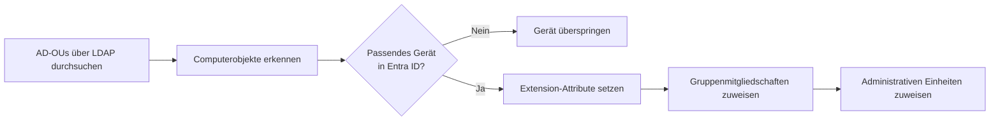
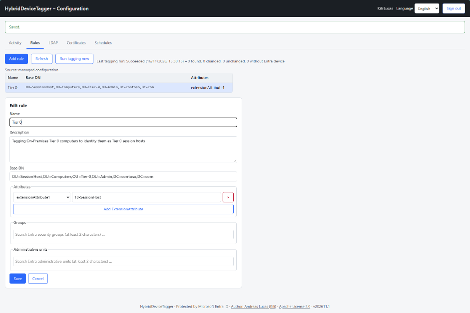

# HybridDeviceTagger

<p align="center"></p>
<p align="center"><strong>OU-basierte Kennzeichnung hybrider Geräte in Microsoft Entra ID</strong></p>
<p align="center"><a href="https://github.com/Kili69/HybridDeviceTagger/actions/workflows/ci.yml"></a> <a href="#versionierung-und-release"></a> <a href="./LICENSE"></a>   </p>

---

<p align="center"><a href="https://buymeacoffee.com/andreaslmuz"></a></p>

<br>

## In diesem Artikel

<p align="center"><a href="#überblick">Überblick</a> &bull; <a href="#funktionsweise">Funktionsweise</a> &bull; <a href="#installation">Installation</a> &bull; <a href="#administration">Administration</a> &bull; <a href="#azure-betrieb">Azure-Betrieb</a> &bull; <a href="#versionierung-und-release">Versionierung</a> &bull; <a href="#problembehandlung">Troubleshooting</a></p>

## Überblick

Für die Umsetzung einer Zero-Trust-Strategie muss nicht nur die Identität eines Benutzers, sondern auch das verwendete Quellsystem zuverlässig bestimmt und bewertet werden. In Conditional-Access-Richtlinien lässt sich diese Einordnung bei Geräten üblicherweise über Extension Attributes abbilden. Damit kann beispielsweise geprüft werden, ob ein Quellsystem einer definierten Sicherheitsstufe entspricht.

Voraussetzung dafür ist ein in Microsoft Entra ID verfügbares Geräteobjekt, beispielsweise ein Microsoft-Entra-hybrid-joined Computer. Eine Bewertung allein anhand der Quelladresse reicht häufig nicht aus: Conditional Access sieht in der Regel nur die öffentliche IP-Adresse des Zugriffs. Befinden sich mehrere Systeme hinter derselben öffentlichen Adresse, lässt sich daraus weder das konkrete Quellsystem noch dessen Sicherheitsklassifizierung ableiten.

Im lokalen Active Directory kann diese Klassifizierung über die Verzeichnisstruktur und die Organisationseinheit eines Computerobjekts abgebildet werden. Beim Synchronisieren von Computerobjekten nach Microsoft Entra ID geht diese Information jedoch verloren, weil der Distinguished Name (DN) und damit die OU-Zuordnung nicht übernommen werden.

Genau hier setzt HybridDeviceTagger an. Er wertet die Position eines Computerobjekts im Active Directory aus, wendet darauf konfigurierbare Regeln an und überträgt die daraus abgeleitete Sicherheitsklassifizierung nach Microsoft Entra ID. Abhängig von der AD-OU kann er:

- `extensionAttribute1` bis `extensionAttribute15` setzen,
- das Gerät Entra-Sicherheitsgruppen hinzufügen und
- das Gerät normalen oder eingeschränkten administrativen Einheiten zuordnen.

## Funktionsweise

HybridDeviceTagger durchsucht die konfigurierten OUs im Active Directory über LDAP. Für jedes gefundene Computerobjekt prüft er, ob ein zugehöriges Geräteobjekt in Entra ID vorhanden ist. Bei einer Übereinstimmung werden die für die jeweilige OU konfigurierten Extension-Attribute sowie Mitgliedschaften in Entra-Sicherheitsgruppen und administrativen Einheiten angewendet.



## Installation

HybridDeviceTagger wird aus dem Installationspaket installiert: interaktiv mit dem geführten Installer `Install.ps1` oder unbeaufsichtigt aus einer beliebigen CI/CD-Pipeline mit der Installations-Engine `Install-HybridDeviceTagger.ps1`. `Install.ps1` ruft dieselbe Engine auf; beide Varianten verwenden dieselben Bicep-Vorlagen. Dadurch entstehen unabhängig vom Ausführungsweg identische Azure-Ressourcen und Anwendungseinstellungen.

### Das Installationspaket

Alle für die Installation notwendigen Dateien liegen im Verzeichnis [installationspackage](installationspackage). Ein Release-Paket `HybridDeviceTagger-<Version>.zip` enthält genau dieses Verzeichnis zuzüglich der vorkompilierten Function, `version.json` und der Lizenz:

| Datei | Zweck |
| --- | --- |
| `Install.ps1` | Geführte Installation. Fragt alle Parameter ab und führt Validierung, What-if und Installation nacheinander aus. **Einstiegspunkt für die interaktive Installation.** |
| `Install-HybridDeviceTagger.ps1` | Installations-Engine. Wird von `Install.ps1` aufgerufen und für unbeaufsichtigte Installationen und Pipelines direkt mit Parametern verwendet. |
| `main.bicep`, `key-vault-role-assignment.bicep` | Azure-Infrastruktur als Code |
| `function/HybridDeviceTagger.zip` | Vorkompilierte Function App |
| `HybridDeviceTagger.Management/` | PowerShell-Modul für den Betrieb nach der Installation |
| `version.json` | Version, Branch und Commit des Pakets |
| `README.md` | Englische Installationsreferenz mit Berechtigungen, allen Engine-Parametern und Fehleranalyse |

Das Paket wird mit `scripts/Build-InstallationPackage.ps1` erstellt (siehe [Versionierung und Release](#versionierung-und-release)). Die Installations-Engine stellt standardmäßig `function/HybridDeviceTagger.zip` bereit und bricht ab, wenn diese Datei fehlt. Auf dem Installationsrechner wird deshalb kein .NET SDK benötigt. Wer direkt aus einem Repository-Checkout installiert, erzeugt das Function-Paket vorher mit `scripts/Build-InstallationPackage.ps1`.

### Geführte Installation mit Install.ps1

Die geführte Installation eignet sich für die Erstbereitstellung, Updates, Testumgebungen und manuell kontrollierte Änderungen. `Install.ps1` prüft die lokalen Voraussetzungen, fragt alle Werte mit Vorschlägen und Formatprüfung ab, validiert die Umgebung und installiert erst nach Bestätigung.

#### Voraussetzungen

**Installationsrechner**

- PowerShell 7.2 oder neuer (das ActiveDirectory-Modul/RSAT wird nicht benötigt)
- Azure CLI 2.60.0 oder neuer
- Das entpackte Installationspaket einschließlich `function/HybridDeviceTagger.zip`
- Keine Verbindung zum internen Netzwerk erforderlich

**Azure**

- Azure Subscription, in der der Installationsbenutzer
  - Ressourcen bereitstellen,
  - das vorhandene virtuelle Netzwerk einbinden und
  - RBAC-Rollenzuweisungen erstellen darf
- Bei einem vorhandenen Key Vault:
  - RBAC-Autorisierung, Soft Delete und Purge Protection aktiviert
  - Recht des Installationsbenutzers, Secrets und Rollenzuweisungen auf dem Vault anzulegen
- Die in der [Installationsanleitung](installationspackage/README.md#required-permissions) beschriebenen Azure-, Entra- und Active-Directory-Berechtigungen

**Netzwerk**

- Vorhandenes virtuelles Netzwerk mit zwei Subnetzen ([Details](installationspackage/README.md#existing-resource-requirements)):
  - Integrationssubnetz für die Function, delegiert an `Microsoft.App/environments`, mindestens `/27`; Service-Endpunkte meldet der Installer nur als Warnung, private Endpunkte sind nicht zulässig
  - Subnetz für die privaten Endpunkte von Storage (Blob, Queue) und Key Vault
- DNS im VNet:
  - Auflösung von `privatelink.blob.core.windows.net`, `privatelink.queue.core.windows.net` und `privatelink.vaultcore.azure.net`; vorhandene, mit dem VNet verknüpfte Zonen werden wiederverwendet, sonst legt das Deployment sie an
  - Bei eigenen DNS-Servern (zum Beispiel Domain Controllern): Weiterleitung dieser Zonen an Azure DNS `168.63.129.16`
  - Auflösung der SRV-Einträge `_ldap._tcp.dc._msdcs` aller betroffenen Forest-Domains
- Erreichbarkeit aus dem VNet der Function:
  - Domain Controller über LDAPS (Port 636) oder LDAP mit StartTLS (Port 389)
  - CRL- oder OCSP-Endpunkte der CA, die die DC-Zertifikate ausgestellt hat; ein nicht bestätigbarer Sperrstatus wird abgelehnt (bei AD-Pre-Seeding auch vom Installationsrechner)

**Active Directory** (wird erst [nach der Installation](#active-directory-nach-der-installation-konfigurieren) konfiguriert, nicht während der Installation abgefragt)

- Öffentliches Root-CA-Zertifikat (`.cer`/`.pem`) der Domain-Controller-Zertifikate
- Vorhandenes AD-Servicekonto, das
  - forestweit verwendbar ist,
  - Leserechte auf die konfigurierten OUs in allen Domains hat und
  - das eigene Kennwort ändern darf

#### Installation ausführen

Das Installationspaket entpacken, PowerShell 7 im entpackten Verzeichnis öffnen und bei Azure anmelden:

```powershell
az login
.\Install.ps1
```

Fehlt die Azure-CLI-Anmeldung, bietet `Install.ps1` `az login` selbst an. Vor der ersten Frage prüft das Skript Azure CLI, das vorkompilierte Function-Paket und die Anmeldung. Anschließend fragt es alle benötigten Werte ab. Vorschläge stehen in eckigen Klammern und werden mit **Enter** übernommen; ungültige Eingaben, etwa eine falsch formatierte GUID, werden sofort gemeldet und erneut abgefragt. Bei optionalen Werten löscht die Eingabe `-` einen gespeicherten Wert.

- **Azure-Ziel:** Subscription (Vorschlag: aktuelle `az login`-Subscription), Ressourcengruppe (`rg-HybridDeviceTagger`, wird bei Bedarf angelegt), Region (`westeurope`) sowie Namen für Function App (`func-hybriddevicetagger`) und Storage Account
- **Netzwerk:** Subscription und Ressourcengruppe des vorhandenen VNet, VNet-Name, an `Microsoft.App/environments` delegiertes Function-Integrationssubnetz und separates Private-Endpoint-Subnetz
- **Key Vault:** Auswahl zwischen einem neuen privaten Vault und einem vorhandenen Vault; bei einem vorhandenen Vault zusätzlich Subscription und Ressourcengruppe; in beiden Fällen der Name
- **Management API:** optional die Client-ID der App-Registrierung. Bleibt der Wert leer, erstellt der Installer bei einer Erstinstallation die single-tenant Entra-App-Registrierung und Enterprise Application automatisch beziehungsweise verwendet bei einem Update die Registrierung der vorhandenen Installation. Außerdem die Objekt-ID des Benutzers oder der Gruppe, die alle Rollen der Management API erhält (Vorschlag: angemeldeter Benutzer)
- **Betrieb:** Startwerte für das Tagging-Intervall in Minuten (5–1440, Vorschlag 15) und das Kennwortwechsel-Intervall in Tagen (1–29, Vorschlag 25) sowie ob fehlende Azure-Ressourcenanbieter automatisch registriert werden. Beide Intervalle lassen sich später im Konfigurationsportal (Bereich **Zeitpläne**) ohne Neustart ändern; die dort gespeicherten Werte bleiben bei einer erneuten Installation erhalten.

Active-Directory-Einstellungen (Forest-Domäne, Domain Controller, Servicekonto, Kennwort und LDAP-Vertrauenszertifikat) fragt `Install.ps1` nicht ab; sie werden nach der Installation im Konfigurationsportal oder mit dem Management-Modul eingerichtet (siehe [Active Directory nach der Installation konfigurieren](#active-directory-nach-der-installation-konfigurieren)).

Die Antworten werden ohne Kennwörter und ohne AD-Werte in `installation-settings.json` neben dem Skript gespeichert und beim nächsten Aufruf als Vorschläge angeboten. Mit `-UseSavedSettings` werden sie ohne erneute Abfrage übernommen, etwa für ein Update. Die Datei wird nie in ein Installationspaket übernommen.

Danach wählt man die Aktion oder übergibt sie mit `-Mode`:

| Auswahl | `-Mode` | Aktion |
| --- | --- | --- |
| **1 Install or update** | `Install` | Validierung ohne Änderungen, danach optional Azure What-if, danach nach Bestätigung die Installation. Empfohlen für Erstinstallation und Updates. |
| **2 Validate only** | `Validate` | Prüft alle Voraussetzungen ohne Änderungen |
| **3 Show Azure What-If only** | `WhatIf` | Zeigt die geplanten Azure-Änderungen ohne Änderungen |

```powershell
.\Install.ps1 -Mode Validate -UseSavedSettings
.\Install.ps1 -Mode WhatIf -UseSavedSettings
.\Install.ps1 -Mode Install -UseSavedSettings
```

Der Ablauf von **Install or update**:

1. **Validierung** ohne Änderungen. Geprüft werden unter anderem Ressourcenanbieter und Namen, VNet und Subnetze, Key Vault, DNS sowie das Bicep-Deployment; nur bei vorab übergebenen AD-Parametern zusätzlich LDAPS beziehungsweise StartTLS, Zertifikatskette, Forest und Servicekonto. Bei einem Fehler endet der Ablauf ohne Änderungen.
2. **Azure What-if** (optional): Anzeige der zu erstellenden oder zu ändernden Azure-Ressourcen. Eine für die Erstinstallation vorgesehene App-Registrierung wird dabei nur geplant und noch nicht erstellt.
3. **Rückfrage `Start the installation now?`**: Erst mit **y** beginnt die Installation.
4. **Installationszusammenfassung** der Engine mit allen Ressourcen, Rollen und Berechtigungen und der abschließenden Bestätigung **Execute the installation plan shown above**.

Danach führt die Engine ohne weitere Rückfragen aus:

1. fehlende Ressourcenanbieter registrieren und die Ressourcengruppe bei Bedarf anlegen;
2. die Management-API-App-Registrierung bei Bedarf erstellen und ihre vier Anwendungsrollen konfigurieren und zuweisen. Die frühere Rolle `HybridDeviceTagger.CertificateAdministrator` wird mitsamt ihren Zuweisungen entfernt;
3. Function App, Flex-Consumption-Plan, Storage Account mit Run-Request-Queues, Private Endpoints für Blob und Queue, Monitoring und gegebenenfalls den neuen privaten Key Vault bereitstellen oder aktualisieren;
4. in einem vorhandenen Key Vault fehlende Kennwort-Secrets als unbrauchbare Platzhalter anlegen und der Managed Identity `Key Vault Secrets Officer` nur auf diesen beiden Secrets zuweisen;
5. ersetzte Rollenzuweisungen der Managed Identity entfernen (`Storage Blob Data Owner` und bei einem vorhandenen Vault `Key Vault Secrets Officer` auf dem gesamten Key Vault);
6. die Microsoft-Graph-Berechtigungen der Managed Identity zuweisen;
7. die vorkompilierte Function aus `function/HybridDeviceTagger.zip` in die Function App hochladen, bei Angabe von `-ActiveDirectoryTrustedCertificatePath` ergänzt um dieses LDAPS-Root-Zertifikat;
8. nur wenn `ADServiceAccountCredential` übergeben wurde: das AD-Kennwort über die Function und deren Managed Identity im Key Vault initialisieren.

Ist LDAPS nicht verfügbar, verwendet der Installer automatisch LDAP mit StartTLS; Anmeldedaten werden niemals über eine ungeschützte LDAP-Verbindung übertragen. Die Installation ist idempotent; für ein Update wird sie mit einem neueren Paket und `-UseSavedSettings` erneut ausgeführt. Ein Update ohne AD-Parameter behält `ActiveDirectory__Domain`, `ActiveDirectory__BindUsername` und `ActiveDirectory__BindUserDistinguishedName` der vorhandenen Function App. Ein von einem früheren Installer paketiertes Zertifikat ist im neuen Paket ohne `-ActiveDirectoryTrustedCertificatePath` nicht mehr enthalten; der Installer warnt dann. Ist das Zertifikat nicht bereits im Konfigurationsportal verwaltet, muss es dort oder mit `Add-HybridDeviceTaggerTrustedCertificate` erneut hinzugefügt werden.

Nach einer erfolgreichen Installation startet die Function **unkonfiguriert**: Solange Forest-Domäne und Servicekonto fehlen, überspringen die Timer für Tagging und Kennwortrotation ihre Läufe mit einer Informationsmeldung, und angeforderte Läufe oder API-Aufrufe, die Active Directory benötigen, antworten mit HTTP `409` und einem Hinweis auf die fehlende Konfiguration. Ohne Tagging-Regeln bleibt die Function auch danach inaktiv.

#### Active Directory nach der Installation konfigurieren

Die Konfiguration erfolgt nach der Installation im [Konfigurationsportal](#konfigurationsportal) unter `https://<function-app>.azurewebsites.net/api/portal`; der Installer gibt die URL am Ende aus. Zugriff haben Benutzer mit der Rolle **Owner** oder **Contributor** an der Function App. Die Schritte bauen aufeinander auf und werden in dieser Reihenfolge ausgeführt:

1. **Root-Zertifikat hochladen**
   - Bereich **Certificates** (Zertifikate) öffnen und unter **Add certificate** das öffentliche Root-CA-Zertifikat (`.cer`, `.crt` oder `.pem`) auswählen, das die Zertifikate der Domain Controller ausgestellt hat.
   - Das Zertifikat ist der Vertrauensanker für LDAPS und StartTLS.
   - Es muss vor dem Servicekonto hinterlegt sein, weil dessen Kennwort bereits beim Speichern über eine TLS-geschützte LDAP-Verbindung geprüft wird.
   - Dateien mit privatem Schlüssel werden abgelehnt.

   <p align="center"></p>

2. **Forest konfigurieren**
   - Bereich **LDAP** öffnen, im Feld **Forest DNS name** den DNS-Namen des AD-Forests eintragen (zum Beispiel `contoso.com`) und mit **Save** speichern.
   - Gemeint ist der Forest-Name, nicht ein Domain Controller und nicht der SRV-Eintrag.
   - Die Function ermittelt die Domain Controller selbst über DNS-SRV-Einträge.

3. **Benutzer und Kennwort setzen**
   - Im Bereich **LDAP** unter **Set LDAP user** den UPN des Servicekontos (zum Beispiel `svc-HybridDeviceTagger@contoso.com`) und dessen aktuelles Kennwort eintragen.
   - Der Distinguished Name ist optional und wird sonst aus dem UPN ermittelt.
   - Beim Speichern prüft die Function das Kennwort mit einem LDAP-Bind, speichert es mit ihrer Managed Identity im Key Vault und übernimmt danach das Konto.
   - Anschließend zeigt der Forest-Bereich das gespeicherte Konto an, das Formular heißt **Change LDAP user** und der UPN ist vorausgefüllt.
   - **Validate LDAP access** prüft die Verbindung zu jedem Domain Controller.

   <p align="center"></p>

4. **Regeln erstellen**
   - Im Bereich **Rules** mit **Add rule** eine Regel anlegen:
     - Name und Beschreibung
     - **Base DN** der OU, zum Beispiel `OU=SessionHost,OU=Computers,OU=Tier-0,OU=Admin,DC=contoso,DC=com`
     - mindestens eine Aktion: ein ExtensionAttribute mit Wert, eine Entra-Sicherheitsgruppe oder eine administrative Einheit
   - Nach dem Speichern startet **Run tagging now** sofort einen Lauf; das Ergebnis erscheint neben der Schaltfläche und im Bereich **Activity**.
   - Details zu Regeln stehen unter [Tagging-Regeln verwalten](#tagging-regeln-verwalten).

   <p align="center"></p>

Bis Forest und Servicekonto gespeichert sind, überspringt die Function geplante Tagging- und Kennwortrotationsläufe. Neue Einträge im Bereich **Activity** erscheinen wegen der Log-Analytics-Verzögerung erst nach einigen Minuten.

Dieselben Schritte sind mit dem [PowerShell-Management-Modul](installationspackage/HybridDeviceTagger.Management/README.md) möglich:

```powershell
Import-Module .\HybridDeviceTagger.Management
Connect-HybridDeviceTagger -ApiBaseUri 'https://<function-app>.azurewebsites.net/api/management' `
    -ClientId '<management-api-client-id>' -SkipValidation
Add-HybridDeviceTaggerTrustedCertificate -Path '.\Contoso-Root-CA.cer'
Set-HybridDeviceTaggerActiveDirectoryConfiguration -Domain 'contoso.com'
Set-HybridDeviceTaggerServiceAccount -Credential (Get-Credential 'svc-HybridDeviceTagger@contoso.com')
Add-HybridDeviceTaggerRule -Rule $rule
```

Die ersten drei Befehle erfordern wirksame Owner-/Contributor-Rechte an der Function App und fragen wegen ihrer hohen Auswirkung standardmäßig nach einer Bestätigung. `Set-HybridDeviceTaggerServiceAccount` ersetzt auch ein vorhandenes Konto oder Kennwort; mit `-DistinguishedName` kann der DN des Kontos angegeben werden.

#### Wiederholbare Ausführung der Installations-Engine

Alternativ kann die Engine direkt aufgerufen werden. Alle Werte können als Parameter oder PowerShell-Splat übergeben und für Validierung, What-if und Installation wiederverwendet werden. Fehlende Pflichtwerte fragt die Engine interaktiv ab; AD-Werte werden nie abgefragt. Ein minimaler Aufruf enthält keine AD-Werte:

```powershell
$parameters = @{
    SubscriptionId = '<Azure-Subscription-ID>'
    ResourceGroupName = 'rg-hybrid-device-tagger'
    Location = 'westeurope'
    FunctionAppName = 'func-hybrid-device-tagger'
    StorageAccountName = 'sthybriddevicetagger'
    # Weitere Netzwerk-, Key-Vault- und Management-API-Parameter
}

./installationspackage/Install-HybridDeviceTagger.ps1 @parameters -ValidateOnly
./installationspackage/Install-HybridDeviceTagger.ps1 @parameters -WhatIf
./installationspackage/Install-HybridDeviceTagger.ps1 @parameters
```

Mit `-CreateKeyVault` wird ein neuer privater Key Vault in der Ziel-Ressourcengruppe erstellt; ohne diesen Schalter wird ein vorhandener Key Vault verwendet. `-CreateResourceGroup`, `-RegisterProviders` und die rollenbezogenen Management-API-Parameter steuern weitere Installationsoptionen. `-FunctionPackagePath` ist standardmäßig `function/HybridDeviceTagger.zip` neben der Engine.

Für unbeaufsichtigte Installationen kann die AD-Anbindung optional vorab gesetzt werden (Pre-Seeding). Die Parameter `ActiveDirectoryForestDomain`, `ActiveDirectoryServer`, `ActiveDirectoryTrustedCertificatePath`, `ADServiceAccount`, `ActiveDirectoryBindUserDistinguishedName`, `ADServiceAccountCredential` und `SkipActiveDirectoryDirectoryChecks` werden nie abgefragt. `ADServiceAccount`, `ADServiceAccountCredential`, `ActiveDirectoryBindUserDistinguishedName`, `ActiveDirectoryServer` und `SkipActiveDirectoryDirectoryChecks` erfordern `-ActiveDirectoryForestDomain`; `ADServiceAccountCredential` erfordert zusätzlich `-ActiveDirectoryTrustedCertificatePath`. Mit Anmeldedaten führt der Installer die lokale LDAP-Prüfung aus und initialisiert das Kennwort nach dem Deployment über die Function. Ein vollständiges Parameterbeispiel steht in der [erweiterten Installationsanleitung](installationspackage/README.md#validation).

### Pipeline-Installation

Die Pipeline-Installation verwendet dieselbe Installations-Engine im vollständig parametrisierten Noninteractive-Modus. Sie ist nicht an GitHub Actions, Azure DevOps oder ein anderes Pipeline-System gebunden.

#### Voraussetzungen

- Ein Runner mit PowerShell 7.2 und Azure CLI; das ActiveDirectory-Modul wird nicht benötigt. Netzwerkzugriff auf Active Directory ist nur erforderlich, wenn AD-Anmeldedaten vorab übergeben werden
- .NET 8 SDK und ein Checkout mit vollständiger Git-Historie einschließlich Tags, wenn das Installationspaket innerhalb der Pipeline erzeugt wird; die Installation selbst benötigt kein .NET SDK
- Eine nicht interaktive Azure-Anmeldung, vorzugsweise über Workload Identity Federation; alternativ kann ein Service Principal verwendet werden
- Dieselben Azure-, Entra- und Netzwerkberechtigungen wie bei der geführten Installation
- Optional ein geschütztes Pipeline-Secret für das bereits vorhandene AD-Servicekonto, wenn die AD-Anbindung vorab gesetzt werden soll
- Vollständig gesetzte Installer-Parameter; die Pipeline darf nicht von interaktiven Eingabeaufforderungen abhängen

Ein von einem Pipeline-Anbieter gehosteter Runner kann nur verwendet werden, wenn er die privaten DNS-Zonen und, bei vorab übergebenen AD-Anmeldedaten, die Domain Controller sicher erreichen kann. Für typische Hybridumgebungen ist daher ein selbst gehosteter Runner im verbundenen Netzwerk erforderlich.

#### Pipeline-Ablauf

Eine plattformneutrale Pipeline sollte die folgenden Stufen verwenden:

1. **Build, Tests und Paket:** Mit `scripts/Build-InstallationPackage.ps1` die Tests ausführen, die Function veröffentlichen und das Installationsarchiv `artifacts/HybridDeviceTagger-<Version>.zip` erzeugen und als Pipeline-Artefakt veröffentlichen.
2. **Authentifizieren:** Azure CLI noninteractive mit der Pipeline-Identität anmelden.
3. **Validieren:** Engine im entpackten Paket mit allen Parametern, `-ValidateOnly` und `-Force` ausführen.
4. **What-if:** Denselben Parametersatz mit `-WhatIf` und `-Force` ausführen.
5. **Bereitstellen:** Nach einer optionalen Pipeline-Freigabe denselben Parametersatz mit `-Force` ausführen.
6. **AD konfigurieren:** Ohne Pre-Seeding Root-Zertifikat, Forest-Domäne und Servicekonto wie unter [Active Directory nach der Installation konfigurieren](#active-directory-nach-der-installation-konfigurieren) beschrieben einrichten.

```powershell
# Build-Stufe (Checkout mit vollständiger Git-Historie)
./scripts/Build-InstallationPackage.ps1
# Ergebnis: artifacts/HybridDeviceTagger-<Version>.zip

# Deployment-Stufe im Verzeichnis des entpackten Pipeline-Artefakts
$parameters = @{
    SubscriptionId = $env:HDT_SUBSCRIPTION_ID
    ResourceGroupName = $env:HDT_RESOURCE_GROUP
    # Alle weiteren nicht vertraulichen Installerwerte aus Pipelinevariablen
}

# Optionales Pre-Seeding der AD-Anbindung; ohne diesen Block wird AD nach der Installation konfiguriert
if ($env:HDT_AD_USERNAME) {
    $parameters.ActiveDirectoryForestDomain = $env:HDT_AD_FOREST_DOMAIN
    $parameters.ActiveDirectoryTrustedCertificatePath = $env:HDT_ROOT_CA_CERTIFICATE_PATH
    $securePassword = ConvertTo-SecureString $env:HDT_AD_PASSWORD -AsPlainText -Force
    $parameters.ADServiceAccountCredential = [pscredential]::new(
        $env:HDT_AD_USERNAME,
        $securePassword
    )
}

./Install-HybridDeviceTagger.ps1 @parameters -ValidateOnly -Force
./Install-HybridDeviceTagger.ps1 @parameters -WhatIf -Force
./Install-HybridDeviceTagger.ps1 @parameters -Force
```

Pipeline-Secrets dürfen weder in Parameterdateien eingecheckt noch in Logs ausgegeben werden. `-Force` deaktiviert sämtliche Installer-Rückfragen und bricht bei fehlenden Angaben ab. Bei einem Fehler endet die Engine mit Exit-Code `1`, sodass die Pipeline den Fehlschlag erkennt. Die Linux-basierte Flex-Consumption-Function verwendet ausschließlich TLS-geschützte LDAP-Verbindungen: bevorzugt LDAPS, ersatzweise StartTLS. `ActiveDirectoryTrustedCertificatePath` ist optional und nur zusammen mit `ADServiceAccountCredential` erforderlich. Wird es angegeben, wird das öffentliche Root-CA-Zertifikat in das Azure-Function-Paket importiert; ein Import nur in den Zertifikatsspeicher des Installations-PCs reicht nicht. Ohne diesen Parameter wird das Zertifikat nach der Installation im Konfigurationsportal oder mit `Add-HybridDeviceTaggerTrustedCertificate` hinterlegt. Private Schlüssel dürfen nicht mitgegeben werden. Mit `-SkipCodeDeployment` können Infrastruktur- und Anwendungsdeployment in getrennte Pipeline-Stufen aufgeteilt werden.

### Gemeinsame Konfiguration

Beide Installationsarten verwenden dieselben Parameter und erzeugen dieselbe Zielkonfiguration.

#### Key Vault

Ein bestehender Key Vault ist optional. Ist keiner vorhanden, erstellt das Setup mit `-CreateKeyVault` (in `Install.ps1`: Antwort **Ja** auf die Key-Vault-Frage) einen neuen privaten Key Vault in der Ressourcengruppe der Function App. Dieser Vault ist HybridDeviceTagger vorbehalten; die Managed Identity erhält `Key Vault Secrets Officer` auf dem gesamten Vault. Ohne diesen Schalter wird ein vorhandener Vault über Subscription, Ressourcengruppe und Namen referenziert.

In einem vorhandenen, gegebenenfalls gemeinsam genutzten Key Vault erhält die Managed Identity `Key Vault Secrets Officer` ausschließlich auf den beiden Secrets `hybrid-device-tagger-ad-password-current` und `hybrid-device-tagger-ad-password-next`. Andere Secrets bleiben für die Function unerreichbar. Da eine Rollenzuweisung auf Secret-Ebene ein vorhandenes Secret voraussetzt, legt das Deployment fehlende Secrets als unbrauchbare Platzhalter mit dem Content Type `application/vnd.hybriddevicetagger.placeholder` an. Platzhalter werden nie als Anmeldedaten verwendet. Der Installationsbenutzer benötigt deshalb auf dem vorhandenen Vault Control-Plane-Rechte zum Anlegen von Secrets und Rollenzuweisungen. Eine frühere vault-weite Zuweisung der Managed Identity entfernt der Installer.

Das AD-Kennwort wird nicht durch die Installationsidentität in den Key Vault geschrieben. Es wird nach der Installation mit `Set-HybridDeviceTaggerServiceAccount` oder im Konfigurationsportal, beim Pre-Seeding durch den Installer, an die Entra-geschützte Management API übergeben; die Function validiert es und speichert es anschließend mit ihrer Managed Identity.

#### Berechtigungen für Regel- und Kennwortverwaltung

Regel- und Kennwortverwaltung werden durch Anwendungsrollen der Entra Enterprise Application für die HybridDeviceTagger Management API geschützt. Zusätzlich erhalten alle Principals mit der Azure-RBAC-Rolle `Owner` oder `Contributor` auf der Function App automatisch dieselben Rechte wie `HybridDeviceTagger.RuleAdministrator` und `HybridDeviceTagger.PasswordRotationAdministrator`. Das gilt auch für über Sicherheitsgruppen oder übergeordnete Scopes geerbte Zuweisungen; Zuweisungen auf untergeordneten Ressourcen der Function App (z. B. Slots) zählen nicht. Da die Managed Identity Mitgliedschaften beliebiger Gruppen und Verwaltungseinheiten ändern kann, dürfen nur Owner und Contributor neue Entra-Gruppen oder Verwaltungseinheiten als Ziel in Regeln aufnehmen; reine `RuleAdministrator` können bereits in Regeln verwendete Ziele wiederverwenden sowie Attribute und Filter ändern.

| Verwaltungsaufgabe | Erforderliche Anwendungsrolle | Installer-Parameter |
| --- | --- | --- |
| Tagging-Regeln lesen, erstellen, ändern und löschen | `HybridDeviceTagger.RuleAdministrator` | `ManagementApiRuleAdministratorPrincipalObjectId` |
| Initiales AD-Kennwort einrichten, Rotationsstatus lesen und Kennwortrotation erzwingen | `HybridDeviceTagger.PasswordRotationAdministrator` | `ManagementApiPasswordRotationAdministratorPrincipalObjectId` |

Die Parameter akzeptieren die Entra Object IDs von Benutzern, Sicherheitsgruppen oder Service Principals. Für die dauerhafte Administration sollten Sicherheitsgruppen verwendet und nach dem Least-Privilege-Prinzip nur der jeweils benötigten Rolle zugewiesen werden. Alternativ weist `ManagementApiAllowedPrincipalObjectId` einem Bootstrap-Principal alle vier Management-API-Rollen (`Reader`, `RuleAdministrator`, `TaggingOperator`, `PasswordRotationAdministrator`) zu. Diese breite Zuweisung eignet sich nur für Migration oder Ersteinrichtung; `Install.ps1` verwendet sie für den abgefragten Principal.

Kennwortadministratoren benötigen keinen direkten Key-Vault-Zugriff. Nach einer neuen API-Anwendungsrollenzuweisung muss das Zugriffstoken erneuert werden. Änderungen an Owner-/Contributor-Zuweisungen prüft die Function bei der nächsten API-Anfrage über Azure Resource Manager. Andere Azure-RBAC-Rollen berechtigen nicht zur Management API; Owner und Contributor dürfen zusätzlich Tagging-Läufe starten, erhalten aber keine Leserrolle.

#### Active Directory und Tagging-Regeln

Beide Installationsarten verwenden dasselbe AD-Servicekonto, dieselben Verbindungs- und Zertifikatseinstellungen sowie dieselben Tagging-Regeln. Das Servicekonto muss forestweit die benötigten Computerobjekte lesen und sein eigenes Kennwort ändern dürfen. Kennwortänderungen erfolgen ausschließlich über LDAPS. Servicekonto, Forest-Domäne und Vertrauenszertifikat werden regulär nach der Installation eingerichtet. Beim optionalen Pre-Seeding enthält der Installer-Parameter `ADServiceAccountCredential` UPN und Kennwort für den LDAP-Bind; der UPN wird aus `ADServiceAccountCredential.UserName` abgeleitet. `ADServiceAccount` und `ADServiceAccountCredential` schließen sich gegenseitig aus und dürfen nicht gemeinsam angegeben werden.

Der Installer richtet zunächst ausschließlich die Anwendung ein und erstellt keine Tagging-Regeln. Nach erfolgreicher Installation weist er auf die AD-Konfiguration und auf `Add-HybridDeviceTaggerRule` im PowerShell-Management-Modul hin. Servicekonto und Kennwort werden mit `Set-HybridDeviceTaggerServiceAccount` oder im Konfigurationsportal gesetzt. Die folgenden Abschnitte beschreiben die gemeinsame Administration nach beiden Installationsarten.

#### PowerShell-Management-Modul nachinstallieren

Das PowerShell-Modul ist nicht für den Betrieb der Azure Function erforderlich. Es wird auf
Administrationsarbeitsplätzen oder Pipeline-Runnern installiert, von denen aus Regeln,
Statusinformationen und administrative Aktionen verwaltet werden sollen.

Sobald die erste Version auf PSGallery veröffentlicht wurde, kann das Modul unter PowerShell 7.2 oder
neuer für den aktuellen Benutzer installiert werden:

```powershell
Install-PSResource `
    -Name HybridDeviceTagger.Management `
    -Repository PSGallery `
    -Scope CurrentUser
```

Ist `Install-PSResource` auf dem System noch nicht verfügbar, kann alternativ PowerShellGet verwendet
werden:

```powershell
Install-Module `
    -Name HybridDeviceTagger.Management `
    -Repository PSGallery `
    -Scope CurrentUser
```

Eine bereits installierte Version wird mit dem zum Installationsweg passenden Befehl aktualisiert:

```powershell
Update-PSResource -Name HybridDeviceTagger.Management

# Alternative für eine Installation mit Install-Module
Update-Module -Name HybridDeviceTagger.Management
```

Anschließend das Modul importieren, die installierte Version prüfen und mit der Management API
verbinden:

```powershell
Import-Module HybridDeviceTagger.Management

Get-Module HybridDeviceTagger.Management -ListAvailable |
    Sort-Object Version -Descending |
    Select-Object -First 1 Name, Version, ModuleBase

az login
Connect-HybridDeviceTagger
Get-HybridDeviceTaggerRule
```

Für eine abweichende Bereitstellung werden deren API-URI und Entra-Client-ID angegeben:

```powershell
Connect-HybridDeviceTagger `
    -ApiBaseUri 'https://example.azurewebsites.net/api/management' `
    -ClientId '00000000-0000-0000-0000-000000000000'
```

Der angemeldete Benutzer benötigt die für die jeweilige Verwaltungsaufgabe dokumentierte
Management-API-Anwendungsrolle oder eine wirksame Owner-/Contributor-Zuweisung auf der Function App.
In abgeschotteten Umgebungen kann weiterhin das mit dem Installationspaket ausgelieferte Modul über
`Import-Module ./installationspackage/HybridDeviceTagger.Management` (im entpackten Paket:
`Import-Module .\HybridDeviceTagger.Management`) geladen werden.

Alle Parameter, Berechtigungen und vollständigen Beispiele stehen in [installationspackage/README.md](installationspackage/README.md).

## Administration

### Konfigurationsportal

Nach der Installation steht unter `https://<function-app>.azurewebsites.net/api/portal` eine Konfigurationsseite zur Verfügung; der Installer gibt die URL am Ende aus. Der Aufruf von `https://<function-app>.azurewebsites.net` leitet dorthin weiter. Diese Weiterleitung ist nur für genau die Startadresse `/` von der App-Service-Authentifizierung ausgenommen; ihr Ziel ist fest vorgegeben, und sie liefert keine Daten. Alle anderen Pfade außer den statischen Portaldateien verlangen weiterhin eine Anmeldung. Die Seite ist zwischen **Deutsch** und **Englisch** umschaltbar und ausschließlich für Benutzer mit der Azure-Rolle **Owner** oder **Contributor** an der Function App zugänglich (direkt, über Gruppen oder geerbt). Rollen der Management API wie `RuleAdministrator` genügen für die Seite nicht. Die Anmeldung erfolgt mit Microsoft Entra ID (Authorization Code Flow mit PKCE, ohne Client-Secret und ohne externe Skripte); Rollenänderungen werden spätestens nach einer Minute wirksam.

| Bereich | Funktionen |
| --- | --- |
| **Aktivitäten** | Aktivitätsprotokoll der letzten 1 Stunde bis 30 Tage, filterbar nach Kategorie (Konfiguration, Tagging, Kennwort/LDAP, Zugriff), Ergebnis und Freitext. Die Ansicht aktualisiert sich jede Minute und zeigt den Stand; neue Einträge erscheinen wegen der Log-Analytics-Verzögerung erst nach einigen Minuten. |
| **Regeln** | Regel in der Liste auswählen und vollständig anzeigen (Gruppen und Verwaltungseinheiten mit Namen), hinzufügen, bearbeiten und löschen. Jedes ExtensionAttribute kann pro Regel nur einmal vergeben werden; Gruppen und Verwaltungseinheiten werden per Namenssuche in Entra ausgewählt (dynamische, mail-aktivierte und lokal synchronisierte Gruppen sowie dynamische Verwaltungseinheiten sind nicht auswählbar). **Tagging jetzt ausführen** startet sofort einen Lauf und zeigt dessen Ergebnis. |
| **LDAP** | Schaltflächen **LDAP-Zugriff prüfen** und **Kennwortwechsel auslösen** (mit Status und konkreter Fehlerursache des letzten Laufs), Forest-DNS-Namen korrigieren, LDAP-Zugriff mit dem gespeicherten Kennwort prüfen (je DC und Transport mit konkreter Fehlerursache, etwa Namensabweichung, nicht vertrauenswürdige Zertifizierungsstelle oder nicht erreichbare Sperrliste), LDAP-Benutzer festlegen oder ändern (UPN des gespeicherten Kontos ist vorausgefüllt; Kennwort wird vor dem Speichern per LDAP geprüft), Kennwortwechsel auslösen |
| **Zertifikate** | LDAPS/StartTLS-Vertrauensanker anzeigen, hinzufügen, ersetzen und löschen |
| **Zeitpläne** | Tagging-Intervall (wie oft LDAP abgefragt wird, 5–1440 Minuten) und Kennwortwechsel-Intervall (1–29 Tage) ändern; wirksam ab dem nächsten Zeitgeber-Takt |

Ein neuer LDAP-Benutzer wird nur zusammen mit seinem aktuellen Kennwort gespeichert, nachdem ein TLS-geschützter LDAP-Bind erfolgreich war. Während der Umstellung ist die Kennwortrotation gesperrt; ein vorbereitetes Rotationskennwort des bisherigen Kontos wird verworfen. Mit demselben Benutzernamen ersetzt die Funktion nur das gespeicherte Kennwort.

Alle Änderungen, ausgelösten Läufe, Kennwortaktionen, Portal-Anmeldungen und verweigerten Zugriffe werden mit ausführender Person im Aktivitätsprotokoll erfasst. Jedes geänderte Entra-Gerät erscheint mit Anzeigename und Objekt-ID; der Abschlusseintrag eines Tagging-Laufs nennt die Namen aller geänderten Geräte (bis zu 50). Kennwörter und Attributwerte werden nie protokolliert. Das Protokoll liegt im Log-Analytics-Workspace `<function-app>-law` (30 Tage Aufbewahrung, Tabelle `AppTraces`, Kategorie `HybridDeviceTagger.Activity`); neue Einträge erscheinen nach wenigen Minuten.

### Tagging-Regeln verwalten

Tagging-Regeln werden im Konfigurationsportal oder mit dem PowerShell-Modul `installationspackage/HybridDeviceTagger.Management` verwaltet. Zuerst das Modul importieren und mit der Management API verbinden:

```powershell
Import-Module ./installationspackage/HybridDeviceTagger.Management
Connect-HybridDeviceTagger
```

Eine Regel besteht aus folgenden Eigenschaften:

| Eigenschaft | Beschreibung |
| --- | --- |
| `name` | Eindeutiger, nicht zwischen Groß- und Kleinschreibung unterscheidender Regelname |
| `description` | Verständliche Beschreibung des Regelzwecks |
| `baseDn` | OU-Pfad für alle Forest-Domains oder vollständiger DN einer Domain des konfigurierten AD Forests |
| `extensionAttributes` | Zu setzende Werte für `extensionAttribute1` bis `extensionAttribute15` |
| `entraGroupIds` | Object IDs statischer Entra-Sicherheitsgruppen |
| `administrativeUnitIds` | Object IDs normaler oder eingeschränkter administrativer Einheiten |

Jede Regel benötigt mindestens eine Aktion in `extensionAttributes`, `entraGroupIds` oder `administrativeUnitIds`. Nicht verwendete Zielarten werden als leere Hashtable beziehungsweise leeres Array angegeben.

Vor dem Speichern einer vollständigen Domain-DN-Regel liest die Function die Domain-CrossRefs aus der
Forest-Konfigurationspartition über den fest konfigurierten Domain Controller. Die aus `DC=` abgeleitete
DNS-Domain muss exakt einem dort veröffentlichten `dnsRoot` entsprechen. Fremde, ähnlich benannte oder
nur als Suffix passende Domains werden abgelehnt. OU-Pfade ohne `DC=` sind ebenfalls sicher begrenzt,
weil die Function ihre LDAP-Ziele ausschließlich aus den ermittelten Forest-Domains erzeugt. Dieselbe
Prüfung wird vor jedem Tagging-Lauf erneut durchgeführt, sodass auch ältere gespeicherte Regeln oder
eine Startkonfiguration keinen LDAP-Bind zu einem Ziel außerhalb des Forests auslösen können.

#### Regeln anzeigen

```powershell
# Alle Regeln anzeigen
Get-HybridDeviceTaggerRule

# Eine bestimmte Regel anzeigen
Get-HybridDeviceTaggerRule -Name 'Kiosk devices'
```

#### Regel erstellen

Eine neue Regel wird als vollständige Hashtable angelegt. Mit `-WhatIf` lässt sich die Änderung vorab prüfen:

```powershell
$rule = @{
    name = 'Kiosk devices'
    description = 'Tags devices located in the kiosk OU.'
    baseDn = 'OU=Kiosks,OU=Workstations'
    extensionAttributes = @{
        extensionAttribute1 = 'Kiosk'
    }
    entraGroupIds = @()
    administrativeUnitIds = @()
}

Add-HybridDeviceTaggerRule -Rule $rule -WhatIf
Add-HybridDeviceTaggerRule -Rule $rule
```

#### Regel ändern

Zum Ändern wird die Regel vollständig mit demselben Namen erneut übergeben. Der Namensvergleich erfolgt ohne Beachtung der Groß- und Kleinschreibung; alle anderen Regeln bleiben unverändert:

```powershell
$updatedRule = @{
    name = 'Kiosk devices'
    description = 'Tags shared kiosk devices and assigns their security group.'
    baseDn = 'OU=Kiosks,OU=Workstations'
    extensionAttributes = @{
        extensionAttribute1 = 'Kiosk'
        extensionAttribute2 = 'Shared'
    }
    entraGroupIds = @(
        '<Entra-Gruppen-Object-ID>'
    )
    administrativeUnitIds = @()
}

Add-HybridDeviceTaggerRule -Rule $updatedRule -WhatIf
Add-HybridDeviceTaggerRule -Rule $updatedRule
```

#### Regel löschen

Eine Regel wird über ihren Namen entfernt. Der letzte verbliebene Regeleintrag kann nicht gelöscht werden:

```powershell
Remove-HybridDeviceTaggerRule -Name 'Kiosk devices' -WhatIf
Remove-HybridDeviceTaggerRule -Name 'Kiosk devices' -Confirm
```

Änderungen werden ohne Neustart der Function App wirksam. ETags schützen parallele Änderungen vor unbemerktem Überschreiben. Eine Konfiguration unterstützt maximal 100 Regeln; pro Regel sind bis zu 15 Extension Attributes und jeweils 50 eindeutige Gruppen- oder Administrative-Unit-IDs zulässig. Weitere Beispiele stehen in der [Installationsanleitung](installationspackage/README.md#updating-tagging-rules-after-installation) und in der integrierten Hilfe:

```powershell
Get-Help Add-HybridDeviceTaggerRule -Full
Get-Help Remove-HybridDeviceTaggerRule -Full
```

### Erstmalige Einrichtung des AD-Kennworts

Servicekonto und initiales Kennwort werden nach der Installation über die Entra-geschützte Function API eingerichtet; der ausführende Benutzer benötigt dadurch keine Datenberechtigung auf dem Key Vault. Forest-Domäne und LDAP-Vertrauenszertifikat müssen vorher konfiguriert sein (siehe [Active Directory nach der Installation konfigurieren](#active-directory-nach-der-installation-konfigurieren)). Empfohlen ist `Set-HybridDeviceTaggerServiceAccount` oder der Bereich **LDAP** im Konfigurationsportal; beides erfordert Owner-/Contributor-Rechte an der Function App:

```powershell
Import-Module ./installationspackage/HybridDeviceTagger.Management
Connect-HybridDeviceTagger -SkipValidation
Set-HybridDeviceTaggerServiceAccount -Credential (Get-Credential 'svc-tagger@contoso.com') -Confirm
```

Die Function prüft den Bind über LDAPS beziehungsweise StartTLS, speichert das Kennwort mit ihrer Managed Identity als Secret `hybrid-device-tagger-ad-password-current` und anschließend das Konto. Ein vorhandenes Konto oder Kennwort wird dabei ersetzt.

Ist das Servicekonto bereits konfiguriert (etwa durch Pre-Seeding mit `ADServiceAccount`), kann alternativ nur das Kennwort mit der API-Rolle `HybridDeviceTagger.PasswordRotationAdministrator` initialisiert werden:

```powershell
$password = Read-Host 'AD-Servicekonto-Kennwort' -AsSecureString
Initialize-HybridDeviceTaggerActiveDirectoryCredential -Password $password -Confirm
```

Dabei werden nur ein fehlendes Secret oder ein vom Deployment angelegter Platzhalter ersetzt; ein vorhandenes echtes Kennwort wird nicht überschrieben, die API antwortet dann mit HTTP `409`. `next` wird ausschließlich von der Rotation mit einem echten Kennwort belegt.

Das Laufzeitkonto muss vor der Konfiguration existieren und bleibt reguläres Mitglied von `Domain Users`. Zusätzlich müssen auf dem Konto `SELF / Change Password` erlaubt, `User cannot change password` deaktiviert und **Benutzer muss Kennwort bei der nächsten Anmeldung ändern** ausgeschaltet sein. Das Laufzeitkonto benötigt weder administrative AD-Gruppen noch Reset-Password-Rechte. Der Installer erstellt das Konto nicht und setzt dessen Kennwort nicht administrativ zurück.

### LDAPS-Vertrauensanker verwalten

Die LDAPS/StartTLS-Vertrauensanker werden nach der Installation im Konfigurationsportal (Bereich **Zertifikate**) oder mit dem Management-Modul verwaltet. Owner und Contributor der Function App können Zertifikate hinzufügen, ersetzen (etwa bei einer CA-Erneuerung) oder löschen. Die Liste liegt im privaten Storage-Blob `run-traces/active-directory-trust-anchors.json`; neue LDAP-Verbindungen verwenden sie sofort, ohne Neustart.

```powershell
Get-HybridDeviceTaggerTrustedCertificate
Add-HybridDeviceTaggerTrustedCertificate -Path '.\Contoso-Root-CA.cer' -Confirm
Remove-HybridDeviceTaggerTrustedCertificate -Thumbprint '<SHA-1-Fingerabdruck>' -Confirm
```

Nur beim optionalen Pre-Seeding mit `-ActiveDirectoryTrustedCertificatePath` wird ein Root-CA-Zertifikat in das Function-Paket übernommen; die erste Änderung kopiert es dann in die verwaltete Liste. Ein von einem früheren Installer paketiertes Zertifikat fehlt nach einem Update ohne diesen Parameter; ist es nicht bereits im Portal verwaltet, muss es erneut hinzugefügt werden.

Akzeptiert werden ausschließlich gültige öffentliche X.509-Zertifikate als PEM oder DER (`.cer`). Dateien mit privatem Schlüssel, abgelaufene Zertifikate und Duplikate werden abgelehnt, private Schlüssel und abgelaufene Zertifikate bereits lokal durch das Modul; das letzte Zertifikat kann nicht gelöscht werden. Wer einen Vertrauensanker einschleusen könnte, könnte einen Domain Controller vortäuschen und das Kennwort des Servicekontos beim Bind abgreifen. Deshalb ist die Verwaltung auf Owner und Contributor der Function App beschränkt, die ohnehin Code und Einstellungen der Function ändern können; der Storage Account ist nur privat erreichbar. Jede Änderung wird im Aktivitätsprotokoll erfasst.

Alternativ kann die Installation mit `-ActiveDirectoryTrustedCertificatePath` und einem neuen Zertifikat erneut ausgeführt werden. Ist bereits eine verwaltete Liste vorhanden, hat sie Vorrang vor dem paketierten Zertifikat. Die frühere Rolle `HybridDeviceTagger.CertificateAdministrator` bleibt entfernt; die Verwaltung erfolgt über die Azure-RBAC-Rollen.

### PowerShell-Management-Modul

Das Modul `installationspackage/HybridDeviceTagger.Management` stellt folgende Funktionen für die Entra-geschützte Management API bereit:

Eine vollständige Beschreibung der Voraussetzungen, Autorisierung, Datenmodelle, Befehle,
Nebenläufigkeitssteuerung, Fehlerbehandlung und internen Implementierung enthält die
[Modulreferenz](installationspackage/HybridDeviceTagger.Management/README.md).

Nach der ersten Veröffentlichung kann das Modul aus der PowerShell Gallery installiert werden:

```powershell
Install-PSResource -Name HybridDeviceTagger.Management -Repository PSGallery
Import-Module HybridDeviceTagger.Management
```

| Funktion | Beschreibung |
| --- | --- |
| `Connect-HybridDeviceTagger` | Baut mit der vorhandenen Azure-CLI-Anmeldung die Verbindung zur Management API auf. Mit `-ApiBaseUri` und `-ClientId` kann eine andere Bereitstellung gewählt werden; `-PassThru` gibt nicht vertrauliche Verbindungsinformationen zurück. |
| `Get-HybridDeviceTaggerRule` | Gibt alle wirksamen Tagging-Regeln oder mit `-Name` eine bestimmte Regel zurück. Der Namensvergleich erfolgt ohne Beachtung der Groß- und Kleinschreibung. |
| `Get-HybridDeviceTaggerLastRunStatus` | Zeigt Status, Invocation-ID, Zeitstempel, Ergebniszähler und bereinigte Fehlerinformationen des letzten geplanten oder manuell gestarteten Tagging-Laufs. |
| `Get-HybridDeviceTaggerPasswordRotationStatus` | Zeigt den Status der letzten Kennwortprüfung beziehungsweise Rotation und den Zeitpunkt der letzten tatsächlichen Kennwortänderung. Kennwörter werden nicht zurückgegeben. |
| `Get-HybridDeviceTaggerTrace` | Lädt den letzten JSONL-Trace und gibt jedes Ereignis als strukturiertes `HybridDeviceTagger.TraceEvent`-Objekt für Filterung, Auswahl oder Export in der Pipeline aus. |
| `Add-HybridDeviceTaggerRule` | Fügt eine vollständige Regel hinzu oder ersetzt eine gleichnamige Regel. Akzeptiert über `-Rule` eine einzelne Regel oder ein Objekt mit einer `Rules`-Eigenschaft; alle übrigen Regeln bleiben erhalten. |
| `Remove-HybridDeviceTaggerRule` | Entfernt die mit `-Name` angegebene Regel. Die API verhindert, dass dadurch keine gültige Tagging-Regel mehr verbleibt. |
| `Get-HybridDeviceTaggerActiveDirectoryConfiguration` | Liest die wirksame Forest-Domäne mit ETag und Quelle, ohne Active Directory zu kontaktieren. |
| `Set-HybridDeviceTaggerActiveDirectoryConfiguration` | Setzt oder korrigiert mit `-Domain` den Forest-DNS-Namen, auch bei defekter AD-Verbindung. Neue Forest-Verbindungen verwenden die gespeicherte Änderung ohne Neustart. Erfordert Owner-/Contributor-Rechte. |
| `Get-HybridDeviceTaggerTrustedCertificate` | Listet die LDAP-Vertrauensanker mit Fingerabdruck, Antragsteller, Aussteller und Gültigkeit. Erfordert Owner-/Contributor-Rechte. |
| `Add-HybridDeviceTaggerTrustedCertificate` | Fügt mit `-Path` ein öffentliches Root-CA- oder selbstsigniertes DC-Zertifikat als Vertrauensanker hinzu. Dateien mit privatem Schlüssel und abgelaufene Zertifikate werden lokal abgelehnt. Erfordert Owner-/Contributor-Rechte. |
| `Remove-HybridDeviceTaggerTrustedCertificate` | Entfernt den Vertrauensanker mit dem SHA-1-Fingerabdruck `-Thumbprint`; der letzte Vertrauensanker kann nicht entfernt werden. Erfordert Owner-/Contributor-Rechte. |
| `Set-HybridDeviceTaggerServiceAccount` | Prüft mit `-Credential` (UPN und Kennwort) und optional `-DistinguishedName` den Bind über LDAPS beziehungsweise StartTLS, speichert das Kennwort durch die Managed Identity im Key Vault und danach das Konto. Ersetzt auch ein vorhandenes Konto oder Kennwort. Erfordert Owner-/Contributor-Rechte. |
| `Initialize-HybridDeviceTaggerActiveDirectoryCredential` | Validiert das mit `-Password` als `SecureString` übergebene initiale Kennwort des bereits konfigurierten AD-Servicekontos und lässt es durch die Managed Identity der Function im Key Vault speichern. Nur ein fehlendes Secret oder ein Platzhalter wird ersetzt. |
| `Invoke-HybridDeviceTagging` | Stellt denselben Geräteabgleich wie der Timer zur sofortigen Ausführung in die Warteschlange und gibt Invocation-ID, Status `Queued` und Status-URI zurück. Mit `-Wait` wartet das Kommando auf das Ende des Laufs und gibt den finalen Status zurück; `-TimeoutSeconds` begrenzt die Wartezeit (Standard 1.800 Sekunden). Ein laufender Tagging-Lauf führt zu einem Konflikt. |
| `Invoke-HybridDeviceTaggerPasswordRotation` | Stellt eine erzwungene Kennwortrotation unabhängig vom Kennwortalter in die Warteschlange. Prüfung des aktuellen Kennworts, LDAPS, Staging, Validierung und Promotion bleiben verpflichtend. `-Wait` und `-TimeoutSeconds` (Standard 600 Sekunden) wie oben. |

Zuerst muss `Connect-HybridDeviceTagger` ausgeführt werden; alle weiteren Funktionen verwenden diese Verbindung und erneuern das Zugriffstoken bei Bedarf. Schreibende Funktionen unterstützen `-WhatIf`. Das Setzen des Servicekontos, das Hinzufügen und Entfernen von Vertrauensankern, das Initialisieren des AD-Kennworts, das Entfernen von Regeln und die erzwungene Kennwortrotation erfordern standardmäßig eine Bestätigung mit hoher Auswirkung. Ausführliche Syntax, Parameter und Beispiele zeigt die integrierte Hilfe, beispielsweise mit `Get-Help Invoke-HybridDeviceTaggerPasswordRotation -Full`.

### Aktionen asynchron ausführen

Manuelle Läufe werden asynchron ausgeführt, damit auch lange Läufe nicht am HTTP-Timeout scheitern. `POST /api/management/actions/device-tagging` und `POST /api/management/actions/password-rotation` antworten sofort mit HTTP `202`, dem Objekt `{ invocationId, state: Queued, statusUri }` und dem Status-URI im `Location`-Header. Die API legt dazu eine Nachricht in der privaten Storage-Queue `device-tagging-requests` beziehungsweise `password-rotation-requests` ab; die Queue-getriggerten Functions `DeviceTaggingRequestFunction` und `PasswordRotationRequestFunction` führen den Lauf aus und schreiben denselben Status wie der Timer (`Queued` → `Running` → `Succeeded` oder `Failed`). Fehlgeschlagene angeforderte Läufe werden nicht automatisch wiederholt. Läuft die Operation bereits, antwortet die API mit HTTP `409`.

```powershell
$status = Invoke-HybridDeviceTagging -Wait -Confirm
$status | Format-List

Invoke-HybridDeviceTaggerPasswordRotation -WhatIf
Invoke-HybridDeviceTaggerPasswordRotation -Wait -Confirm
```

Ohne `-Wait` kann der Status später mit `Get-HybridDeviceTaggerLastRunStatus` beziehungsweise `Get-HybridDeviceTaggerPasswordRotationStatus` abgefragt werden.

### Installation ohne lokales AD-DNS

Ohne vorab übergebene AD-Parameter benötigt der Installations-PC keinerlei Zugriff auf Active Directory oder internes AD-DNS; die AD-Anbindung wird erst nach der Installation über die Function konfiguriert. Die folgenden Hinweise betreffen das optionale Pre-Seeding.

Kann der Installations-PC beim Pre-Seeding den internen AD-SRV-Namen nicht auflösen, warnt der Installer und
verschiebt die lokalen AD-Prüfungen in die Function. Diese muss aus ihrem VNet weiterhin
DNS, Routing, TLS und den AD-Bind erfolgreich ausführen; echte Laufzeitfehler bleiben Fehler.
Ein fehlender Dienstkonto-DN wird vor der Kennwortrotation im Forest anhand der UPN ermittelt.
Die fehlende lokale Auflösung kann sowohl fehlenden internen DNS-Zugriff als auch einen Tippfehler bedeuten.
Andere Prüfungen, etwa gegen private VNet-DNS-Server, können weiterhin lokalen Netzwerkzugriff benötigen.
Bei fehlerhafter Private-Endpoint-Auflösung zeigt der Installer die konkreten A-Records für
Blob, Queue und einen neu erstellten Key Vault mit privaten IP-Adressen. Nach Korrektur der
DNS-Zonen bestätigt **Enter** die Eingaben des Anwenders und setzt die Installation ohne erneute
DNS-Prüfung fort. Eine Warnung kennzeichnet die DNS-Konfiguration als nicht unabhängig validiert.
Mit **A** kann abgebrochen werden. Unbeaufsichtigte Aufrufe scheitern weiterhin ohne Rückfrage.

Eine falsche oder fehlende Forest-Domäne lässt sich nach Bereitstellung im Konfigurationsportal oder per PowerShell setzen beziehungsweise korrigieren. Das ist nur Owner- und Contributor-Rechten an der Function App vorbehalten, weil die Domäne bestimmt, welche Server beim Bind das Kennwort des Dienstkontos erhalten:

```powershell
Connect-HybridDeviceTagger -ApiBaseUri 'https://<function-app>.azurewebsites.net/api/management' `
    -ClientId '<management-api-client-id>' -SkipValidation
Set-HybridDeviceTaggerActiveDirectoryConfiguration -Domain 'contoso.com' -Confirm
```

Falls die initiale Kennwortspeicherung fehlgeschlagen ist, danach
`Set-HybridDeviceTaggerServiceAccount` erneut ausführen.
Die Forest-Änderung wird dauerhaft gespeichert und hat Vorrang vor `ActiveDirectory__Domain`.

## Azure-Betrieb

Die Function App muss aus ihrem virtuellen Netzwerk die AD-SRV-Records der konfigurierten Forest-Domäne sowie der über Forest-CrossRefs ermittelten Domains auflösen können. Sie verbindet sich mit den gefundenen Domain Controllern bevorzugt per LDAPS auf Port 636 und ersatzweise per LDAP mit StartTLS auf Port 389, beispielsweise über Site-to-Site-VPN oder ExpressRoute. Legen Sie alle Werte aus der Konfiguration als Function-App-Settings an und aktivieren Sie Managed Identity. Weisen Sie deren Service Principal die drei beschriebenen Graph-App-Rollen, `Key Vault Secrets Officer` auf den beiden Kennwort-Secrets (bei einem dedizierten, mit `-CreateKeyVault` erstellten Vault auf dem Vault) sowie `Storage Blob Data Contributor` und `Storage Queue Data Contributor` auf dem Storage Account zu. Für Geräte in eingeschränkten administrativen Einheiten benötigt die Managed Identity zusätzlich die vom Installer erzeugte Least-Privilege-Rolle direkt am jeweiligen RMAU-Scope.

Bei CA-signierten LDAPS-Serverzertifikaten prüfen Installer und Function den Sperrstatus online und lehnen die Verbindung ab, wenn das Zertifikat gesperrt ist oder CRL beziehungsweise OCSP nicht innerhalb von zehn Sekunden erreichbar sind. Stellen Sie deshalb sicher, dass der Installationshost und das Function-Integrationssubnetz die im Zertifikat veröffentlichten Sperrinformations-Endpunkte erreichen. Für ein explizit als Vertrauensanker hinterlegtes selbstsigniertes Serverzertifikat entfällt die Sperrprüfung; Vertrauenskette, Servername, Gültigkeitszeitraum und Server-Authentication-EKU werden weiterhin geprüft.

Unter Linux verwendet die Function für LDAPS und StartTLS `Novell.Directory.Ldap.NETStandard`. Zertifikatprüfung, Bind, Suche und Kennwortänderung laufen dadurch über dieselbe TLS-Verbindung. Ein unverschlüsselter Basic Bind wird nicht unterstützt.

Geräte-Tagging und Kennwortrotation laufen über alle Instanzen hinweg jeweils höchstens einmal gleichzeitig. Jeder Lauf erwirbt vorher eine erneuerbare Blob-Lease (`run-traces/locks/*.lock`, 60 Sekunden, alle 20 Sekunden verlängert). Das gilt auch, wenn Flex Consumption Timer-, Queue- und HTTP-Functions auf getrennten Instanzen ausführt. Gelingt die Verlängerung 45 Sekunden lang nicht, bricht ein Watchdog den Lauf ab, bevor die Lease abläuft. Ein Timer-Lauf, der die Lease nicht erhält, wird mit einer Warnung übersprungen. Stürzt eine Instanz ab, läuft die Lease automatisch aus. Zusätzlich ist `maximumInstanceCount` standardmäßig auf `1` je Scale-Gruppe begrenzt.

Die Funktion markiert Geräte innerhalb der Ziel-OUs. Verlässt ein Computer alle konfigurierten Ziel-OUs, entfernt der nächste Lauf die noch unveränderten verwalteten Extension Attributes sowie die vom Tagger angelegten Gruppen-, AU- und RMAU-Mitgliedschaften.

Das Aktivitätsprotokoll wird als strukturierter Log mit der Kategorie `HybridDeviceTagger.Activity` über Application Insights in den Log-Analytics-Workspace geschrieben. Die Managed Identity erhält dafür `Monitoring Metrics Publisher` (Schreiben) und `Monitoring Reader` (Abfrage für das Portal) auf der Application-Insights-Ressource. Die lokale Authentifizierung von Application Insights ist deaktiviert, sodass nur Entra-authentifizierte Telemetrie angenommen wird und die Connection String allein keine Einträge fälschen kann. Direkt im Workspace:

```kusto
AppTraces
| where tostring(Properties.CategoryName) == "HybridDeviceTagger.Activity"
| project TimeGenerated, Category = tostring(Properties.ActivityCategory), Action = tostring(Properties.ActivityAction),
    Outcome = tostring(Properties.ActivityOutcome), Actor = tostring(Properties.ActivityActor),
    Target = tostring(Properties.ActivityTarget), Details = tostring(Properties.ActivityDetails)
| order by TimeGenerated desc
```

Für die Portal-Anmeldung registriert der Installer `https://<function-app>.azurewebsites.net/api/portal` als SPA-Redirect-URI der Management-API-App und erteilt mandantenweit die Zustimmung für deren Berechtigung `access_as_user`. Schlägt die Zustimmung mangels Berechtigung fehl, gibt der Installer nur eine Warnung aus; dann muss ein Administrator die Zustimmung im Microsoft Entra Admin Center erteilen, sofern Benutzer nicht selbst zustimmen dürfen. Die statischen Portaldateien unter `/api/portal` sind von der App-Service-Authentifizierung ausgenommen, enthalten aber keine Daten.

## Versionierung und Release

Die Produktversion hat das Format `<YYYY><MM>.<counter>`, zum Beispiel `202611.3`. Sie wird nicht in Dateien gepflegt, sondern bei jedem Build von [scripts/Get-ProductVersion.ps1](scripts/Get-ProductVersion.ps1) aus den Git-Tags berechnet:

- Trägt der aktuelle Commit einen Release-Tag `v<YYYY><MM>.<counter>`, ist das die Version. Getaggte Commits erhalten nie einen Branch-Suffix.
- Sonst ist der Zähler die höchste Release-Nummer des aktuellen Monats plus 1, bzw. `1` für die erste Version im Monat.
- Außerhalb des Branches `main` wird der Branchname angehängt, zum Beispiel `202611.1-dev`. Nicht erlaubte Zeichen werden durch `-` ersetzt.

```powershell
./scripts/Get-ProductVersion.ps1            # z. B. 202611.1-dev
./scripts/Get-ProductVersion.ps1 -Detailed  # alle Bestandteile
```

[Directory.Build.targets](Directory.Build.targets) übernimmt die Version automatisch in jeden `dotnet build`; `Directory.Build.props` enthält keine Version mehr. Die Informational-Version enthält die vollständige Produktversion. Da .NET-Assembly-Versionen pro Stelle höchstens 65535 erlauben, lauten `AssemblyVersion` und `FileVersion` `<YYYY>.<M>.<counter>.0`, zum Beispiel `2026.11.3.0`.

PowerShell-Dateien tragen im Quellcode die Markierung `# Project-Version: source` und das Modul-Manifest `ModuleVersion = '0.0'`. Der Paket-Build ersetzt beides durch die Produktversion; außerhalb von `main` erhält das Modul zusätzlich ein Prerelease-Label.

### Installationspaket bauen

```powershell
./scripts/Build-InstallationPackage.ps1
```

Das Skript führt die Tests aus, veröffentlicht die Function mit der berechneten Version als `installationspackage/function/HybridDeviceTagger.zip`, erzeugt `version.json`, stellt daraus `artifacts/HybridDeviceTagger-<Version>/` zusammen (mit gestempelten Versionen in Skripten und Modul-Manifest sowie `LICENSE`) und erstellt das Release-Archiv `artifacts/HybridDeviceTagger-<Version>.zip`. Mit `-SkipTests` werden die Tests übersprungen. Der CI-Workflow ([.github/workflows/ci.yml](.github/workflows/ci.yml)) checkt die vollständige Historie aus, baut das Paket und lädt das ZIP als Artefakt hoch.

### Release erstellen

1. Auf `main` die Einträge unter `## [Unreleased]` in [CHANGELOG.md](CHANGELOG.md) in einen Abschnitt `## [<Version>] - <yyyy-MM-dd>` verschieben. Die nächste Version zeigt `./scripts/Get-ProductVersion.ps1 -Branch main`.
2. Die Änderung committen.
3. Das Release bauen und taggen:

   ```powershell
   ./scripts/Build-InstallationPackage.ps1 -Release
   git push origin v<Version>
   ```

`-Release` verlangt den Branch `main`, ein sauberes Arbeitsverzeichnis, das Versions-Badge der Release-Version in der README und den passenden Changelog-Abschnitt und legt danach den annotierten Tag `v<Version>` an.

Wird zu diesem Tag ein GitHub Release veröffentlicht, das nicht als Vorabversion markiert ist, baut der Workflow [.github/workflows/publish-powershell-module.yml](.github/workflows/publish-powershell-module.yml) das Paket und veröffentlicht das gestempelte Modul aus `artifacts` in der PowerShell Gallery. Der Release-Tag muss `v<YYYY><MM>.<counter>` des ausgecheckten Commits entsprechen.

### Commit-Konventionen

Jeder Commit beschreibt seine Änderungen unter `## [Unreleased]` in [CHANGELOG.md](CHANGELOG.md). Geänderte PowerShell-Dateien müssen die Versionsmarkierung und die Autorzeile enthalten, geänderte C#- und Bicep-Dateien die Autorzeile. Das Versions-Badge in der README zeigt immer die Version des jeweiligen Commits, zum Beispiel `202611.2-dev` auf `dev` und `202611.2` für den Release-Commit auf `main`. Die Hooks `pre-commit` und `pre-merge-commit` setzen es über [scripts/Update-ReadmeVersion.ps1](scripts/Update-ReadmeVersion.ps1) (Version aus `Get-ProductVersion.ps1 -NextCommit`) automatisch im gestagten Stand; die Commit-Prüfung lehnt ein abweichendes Badge ab, und `-Release` verlangt die Release-Version. Ohne aktivierten Hook vor dem Commit `./scripts/Update-ReadmeVersion.ps1 -Staged` ausführen. Nach einem Fast-Forward-Merge zeigt `main` bis zum nächsten Commit noch die Version des Quellbranches. Die Repository-Hooks werden einmalig pro Clone aktiviert:

```powershell
git config core.hooksPath .githooks
```

Nach dem Staging kann dieselbe Prüfung manuell ausgeführt werden:

```powershell
pwsh -NoProfile -File scripts/Assert-CommitMetadata.ps1 -Staged
```

## Problembehandlung

### Ablauf- und Fehlerprotokolle

Die Anwendung sendet strukturierte OpenTelemetry-Logs, Exceptions sowie HTTP-Abhängigkeiten an das mit der Function App verbundene Application Insights. In Azure öffnen Sie `func-hybriddevicetagger-appi` und anschließend **Überwachung > Protokolle**. Jede Timer-Ausführung schreibt Start, Ergebnis oder Fehler mit derselben `InvocationId`. Geräteupdates enthalten nur die Device-ID und die Namen geänderter Attribute; Attributwerte und Kennwörter werden nicht protokolliert.

Bei direkter Abfrage des verbundenen Log-Analytics-Workspace `func-hybriddevicetagger-law` heißen die entsprechenden Tabellen `AppTraces`, `AppExceptions`, `AppRequests` und `AppDependencies`. Die folgenden Kurzformen `traces`, `exceptions`, `requests` und `dependencies` gelten im Protokollbereich der Application-Insights-Ressource.

Letzte Abläufe und ihre Ergebnisfelder:

```kusto
traces
| where timestamp > ago(24h)
| where cloud_RoleName == "func-hybriddevicetagger"
| where message has_any ("Device tagging", "Tagging rule", "Password rotation")
| project timestamp, severityLevel, message, operation_Id, customDimensions
| order by timestamp desc
```

Fehler einschließlich Stacktrace:

```kusto
exceptions
| where timestamp > ago(7d)
| where cloud_RoleName == "func-hybriddevicetagger"
| project timestamp, type, outerMessage, innermostMessage, operation_Id, details
| order by timestamp desc
```

Fehlgeschlagene Aufrufe an Microsoft Graph oder Key Vault:

```kusto
dependencies
| where timestamp > ago(7d)
| where cloud_RoleName == "func-hybriddevicetagger" and success == false
| project timestamp, target, name, resultCode, duration, operation_Id
| order by timestamp desc
```

Mit einer `operation_Id` aus einem Treffer lässt sich eine komplette Ausführung korrelieren:

```kusto
union traces, exceptions, requests, dependencies
| where operation_Id == "OPERATION_ID_EINSETZEN"
| order by timestamp asc
```

### Installationsprotokoll

Jeder Aufruf von `Install-HybridDeviceTagger.ps1`, auch über `Install.ps1`, ersetzt die Datei `HybridDeviceTagger-Install.log` im temporären Verzeichnis des aktuellen Benutzers. Das PowerShell-Transcript enthält die Konsolenausgaben aller Validierungs-, What-if- und Installationsschritte und wird auch bei einem Fehler oder frühen Abbruch sauber geschlossen.

```powershell
$installerLog = Join-Path ([System.IO.Path]::GetTempPath()) 'HybridDeviceTagger-Install.log'
code $installerLog
```

Das Transcript kann Benutzer-, Geräte-, Ressourcen- und Verzeichnisnamen enthalten und muss daher vertraulich behandelt werden. Kennwörter werden vom Skript nicht ausgegeben und dürfen auch bei manueller Fehleranalyse nicht in die Konsole geschrieben werden.

### Trace des letzten Tagging-Laufs

Jeder Start eines Tagging-Laufs, geplant oder angefordert, ersetzt die Datei `device-tagger-last-run.jsonl` im privaten Blob-Container `run-traces`. Jeder Arbeitsschritt wird sofort als einzelne JSON-Zeile geschrieben. Dadurch bleibt bei einer normalen Exception oder einem Prozessabbruch der bis dahin geschriebene Ablauf erhalten. Die Datei enthält unter anderem UTC-Zeit, laufende Sequenznummer, Invocation-ID, Phase, Aktion, Ergebnis, Device- und Ziel-IDs sowie bei Fehlern Exception-Typ, Meldung und Stacktrace. Kennwörter, Tokens und Extension-Attributwerte werden nicht gespeichert; für Attributvergleiche enthält der Trace nur SHA-256-Fingerprints.

Die Datei ist bewusst als JSON Lines aufgebaut. Copilot kann einzelne Zeilen unabhängig analysieren, nach `invocationId`, `phase`, `action`, `outcome`, `deviceId` oder `targetId` filtern und den letzten erfolgreichen Schritt unmittelbar vor einem Fehler bestimmen. Da Device- und Entra-Objekt-IDs sowie Infrastrukturpfade enthalten sind, muss die Datei trotz fehlender Geheimnisse vertraulich behandelt werden.

### Trace exportieren und in VS Code öffnen

Zum Herunterladen benötigt das angemeldete Konto `Storage Blob Data Reader` oder eine höherwertige Datenrolle und Netzwerkzugriff auf den privaten Blob-Endpunkt:

```powershell
az storage blob download `
	--account-name '<storage-account>' `
	--container-name 'run-traces' `
	--name 'device-tagger-last-run.jsonl' `
	--file '.\device-tagger-last-run.jsonl' `
	--auth-mode login

code '.\device-tagger-last-run.jsonl'
```

Der exportierte Trace kann anschließend direkt in VS Code geöffnet und Copilot zur Fehleranalyse übergeben werden.

## Entwicklerdokumentation

Ausführliche Informationen zur Architektur, Management API, Konfiguration, lokalen Entwicklung, Tests und Versionierung stehen in [DEVELOPER.md](DEVELOPER.md).

## Lizenz

Dieses Projekt ist unter der [Apache License 2.0](LICENSE) lizenziert.
