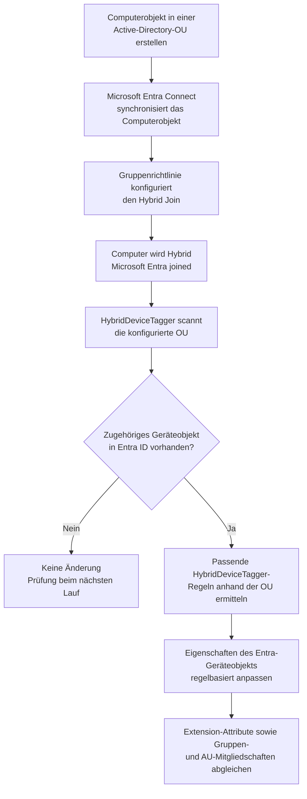

# HybridDeviceTagger

<p align="center"></p>
<p align="center"><strong>OU-basierte Kennzeichnung hybrider Geräte in Microsoft Entra ID</strong></p>
<p align="center"><a href="https://github.com/Kili69/HybridDeviceTagger/actions/workflows/ci.yml"></a> <a href="#versionierung-und-release"></a> <a href="./LICENSE"></a>   </p>

---

<p align="center"><a href="https://buymeacoffee.com/andreaslmuz"></a></p>

<br>

## In diesem Artikel

<p align="center"><a href="#überblick">Überblick</a> &bull; <a href="#die-lösung">Funktionsweise</a> &bull; <a href="#voraussetzungen">Voraussetzungen</a> &bull; <a href="#installation">Installation</a> &bull; <a href="#powershell-modul-verfügbare-kommandos">PowerShell-Modul</a> &bull; <a href="#monitoring-des-hybriddevicetagger">Monitoring</a> &bull; <a href="#management-rest-api">REST API</a> &bull; <a href="#versionierung-und-release">Versionierung</a> &bull; <a href="#troubleshooting">Troubleshooting</a></p>

## Überblick

Microsoft Entra Connect kann Computerobjekte aus einem lokalen Active Directory mit Microsoft Entra ID synchronisieren. Die hierarchische Struktur des Active Directory wird dabei jedoch nicht übernommen. In Entra ID werden Geräteobjekte flach verwaltet und enthalten keine Information darüber, aus welcher Organisationseinheit (Organizational Unit, OU) sie stammen.

Im Active Directory lässt sich aus dem Distinguished Name (DN) eines Computers beispielsweise dessen administrativer  Tier-Level ableiten. In Entra ID muss eine vergleichbare Einordnung über Extension-Attribute, Gruppenmitgliedschaften oder administrative Einheiten erfolgen. Zwar können Gruppen mit Entra Connect synchronisiert werden, für gerätespezifische Extension-Attribute und Restricted Management Administrative Units (RMAUs) gibt es jedoch keine entsprechende automatische Zuordnung anhand der lokalen OU-Struktur.

## Ein Beispiel

Ein Windows-Server befindet sich im Active Directory in der OU `OU=Computers,OU=Tier 0,OU=Admin,DC=contoso,DC=com` und ist dadurch als Tier-0-System eingeordnet. Nach der Synchronisierung als Hybrid Microsoft Entra joined Gerät ist diese OU-Zugehörigkeit am Entra-Geräteobjekt nicht erkennbar.

Ohne Automatisierung müsste ein Entra-Administrator diese Einordnung manuell nachbilden. Dazu wären beispielsweise ein passendes Extension-Attribut für einen Gerätefilter in einer Conditional-Access-Richtlinie sowie Mitgliedschaften in einer Entra-Sicherheitsgruppe und einer RMAU zu pflegen.

## Die Lösung

HybridDeviceTagger überträgt diese Informationen automatisiert aus der lokalen AD-Struktur nach Microsoft Entra ID. Die Lösung durchsucht regelmäßig die konfigurierten OU-Teilbäume und ordnet lokale Computerobjekte anhand ihrer AD-`objectGUID` den zugehörigen Entra-Geräteobjekten mit derselben `deviceId` zu. Verarbeitet werden ausschließlich Geräte, die als Hybrid Microsoft Entra joined erkannt wurden.

Für jedes gefundene Gerät wertet HybridDeviceTagger die zum Distinguished Name passenden Regeln aus. Abhängig von diesen Regeln kann die Lösung:

- `extensionAttribute1` bis `extensionAttribute15` setzen, beispielsweise zur Verwendung in Conditional-Access-Gerätefiltern,
- das Gerät Entra-Sicherheitsgruppen hinzufügen und
- das Gerät normalen oder eingeschränkten administrativen Einheiten (RMAUs) zuweisen.

Wird ein Computer in eine andere OU verschoben oder trifft eine Regel nicht mehr zu, bereinigt HybridDeviceTagger die von ihm selbst verwalteten Extension-Attribute und Mitgliedschaften. Manuell geänderte Attribute sowie bereits zuvor vorhandene Mitgliedschaften bleiben dabei erhalten. Die Lösung bildet damit eine automatisierte Brücke zwischen der lokalen OU-Struktur und der cloudbasierten Geräteverwaltung in Entra ID.



## Voraussetzungen

### Azure und Active Directory

- Eine Azure Subscription, in der die benötigten Ressourcen bereitgestellt werden können
- Ein vorhandenes Azure Virtual Network (VNet) mit einer Netzwerkverbindung zum lokalen Active Directory, beispielsweise über Site-to-Site-VPN oder ExpressRoute
- Funktionierende DNS-Namensauflösung aus dem VNet zu allen Active-Directory-Domänen und Domain Controllern im Forest
- Erreichbarkeit jedes Domain Controllers im Active-Directory-Forest aus dem VNet über LDAP auf Port 389 und LDAPS auf Port 636
- Ein gültiges LDAPS-Serverzertifikat auf jedem Domain Controller im Active-Directory-Forest; die Zertifikatskette muss von der Function App als vertrauenswürdig validiert werden können
- Ein Active-Directory-Servicekonto mit Leserechten auf die konfigurierten OUs und Computerobjekte sowie dem Recht, das eigene Kennwort zu ändern
- Ein vorhandener Azure Key Vault zur sicheren Speicherung des Kennworts des AD-Servicekontos

Die Azure-Ressourcen für die Function App, den Storage Account, die Managed Identity und die Überwachung werden durch das Installationsskript bereitgestellt. Das VNet, die erforderlichen Subnetze und der Key Vault müssen bereits vorhanden sein. Die erforderlichen Azure-, Entra- und Active-Directory-Berechtigungen sind in der [Installationsreferenz](installationspackage/README.md#required-permissions) beschrieben.

Vor der Installation müssen außerdem vorhanden sein:

- eine Single-Tenant-App-Registrierung in Microsoft Entra ID für die Management API mit dem Application ID URI `api://<client-id>`;
- private DNS-Zonen `privatelink.blob.core.windows.net` und `privatelink.queue.core.windows.net`, die aus dem VNet aufgelöst werden;
- das Root-CA-Zertifikat der LDAPS-Zertifikate als `.cer`- oder `.pem`-Datei, wenn die Domain Controller Zertifikate einer privaten CA verwenden.

### Installationsrechner

Für die Installation werden benötigt:

- Windows mit PowerShell 7.2 oder neuer
- Azure CLI 2.60.0 oder neuer
- das PowerShell-Modul `ActiveDirectory` (RSAT: Active Directory-Tools)
- Netzwerkzugriff auf mindestens einen Domain Controller über LDAPS (Port 636)

Ein .NET SDK wird für die Installation aus einem Release-Paket nicht benötigt, weil das Paket die vorkompilierte Function enthält. Nur wer direkt aus dem Quellcode installiert, benötigt das .NET 8 SDK.

Managed Identity authentifiziert den Zugriff auf Microsoft Graph und Azure Key Vault. Sie ersetzt keine LDAP-Anmeldedaten. Die Function liest das AD-Kennwort bei jedem Lauf direkt aus Key Vault, damit ein Versionswechsel sofort wirksam wird.

## Installation

### Das Installationspaket

Alle für die Installation notwendigen Dateien liegen im Verzeichnis [installationspackage](installationspackage). Ein Release-Paket `HybridDeviceTagger-<Version>.zip` enthält genau dieses Verzeichnis zuzüglich der vorkompilierten Function:

| Datei | Zweck |
| --- | --- |
| `Install.ps1` | Geführte Installation. Fragt alle Parameter ab und führt Validierung, What-if und Installation nacheinander aus. **Einstiegspunkt für die Installation.** |
| `Install-HybridDeviceTagger.ps1` | Installations-Engine. Wird von `Install.ps1` aufgerufen und kann für unbeaufsichtigte Installationen und Pipelines direkt mit Parametern verwendet werden. |
| `main.bicep`, `key-vault-role-assignment.bicep` | Azure-Infrastruktur als Code |
| `function/HybridDeviceTagger.zip` | Vorkompilierte Function App (nur im Release-Paket) |
| `HybridDeviceTagger.Management/` | PowerShell-Modul für den Betrieb nach der Installation |
| `version.json` | Version, Branch und Commit des Pakets (nur im Release-Paket) |
| `README.md` | Englische Installationsreferenz mit Berechtigungen, allen Engine-Parametern und Fehleranalyse |

Das Release-Paket wird mit `scripts/Build-InstallationPackage.ps1` erstellt (siehe [Versionierung und Release](#versionierung-und-release)). Entpacken Sie das ZIP auf dem Installationsrechner und öffnen Sie PowerShell 7 im entpackten Verzeichnis.

### Schritt 1: Anmelden

```powershell
az login
```

Das angemeldete Konto benötigt die in der [Installationsreferenz](installationspackage/README.md#required-permissions) genannten Azure- und Entra-Berechtigungen. Fehlt die Anmeldung, bietet `Install.ps1` sie selbst an.

### Schritt 2: Geführte Installation starten

```powershell
.\Install.ps1
```

`Install.ps1` prüft zuerst die Voraussetzungen und fragt danach alle Parameter ab. Vorschläge stehen in eckigen Klammern und werden mit **Enter** übernommen. Ungültige Eingaben, etwa eine falsch formatierte GUID, werden sofort gemeldet und erneut abgefragt. Bei optionalen Werten löscht die Eingabe `-` einen gespeicherten Wert.

| Bereich | Abfrage | Vorschlag und Bedeutung |
| --- | --- | --- |
| Azure | **Azure subscription ID** | Subscription der aktuellen `az login`-Sitzung |
| | **Resource group** | `rg-HybridDeviceTagger`; wird angelegt, falls sie fehlt |
| | **Azure region** | `westeurope`; muss Flex Consumption unterstützen und der Region des VNets entsprechen |
| | **Function App name** | `func-hybriddevicetagger`; global eindeutig |
| | **Storage account name** | Aus dem Function-App-Namen abgeleitet; global eindeutig |
| Netzwerk | **Virtual network subscription ID** | Ziel-Subscription |
| | **Virtual network resource group / name** | Vorhandenes VNet mit Verbindung zum Active Directory |
| | **Integration subnet** | Vorhandenes, an `Microsoft.App/environments` delegiertes Subnetz |
| | **Private endpoint subnet** | Vorhandenes, nicht delegiertes Subnetz für die Storage Private Endpoints |
| Key Vault | **Key Vault subscription ID / resource group / name** | Vorhandener Key Vault mit RBAC, Soft Delete und Purge Protection |
| Active Directory | **Active Directory forest DNS name** | Forest des angemeldeten Windows-Benutzers |
| | **LDAPS server** | Forest-Name; alternativ ein bestimmter Domain Controller |
| | **Service account UPN** | `HybridDeviceTagger@<Forest>` |
| | **Service account distinguished name** | Optional; wird bei vorhandenem Konto automatisch ermittelt |
| | **Path to the LDAPS root CA certificate** | Optional; erforderlich bei Zertifikaten einer privaten CA. Das Zertifikat wird in das Function-Paket übernommen |
| Management API | **Application (client) ID** | Client-ID der App-Registrierung der Management API |
| | **Object ID of the user or group** | Angemeldeter Benutzer; erhält alle Rollen der Management API |
| Betrieb | **Device-tagging schedule** | `0 */15 * * * *` (alle 15 Minuten, UTC) |
| | **Password-rotation check schedule** | `0 30 2 * * *` (täglich 02:30 UTC) |
| | **Register missing Azure resource providers** | Ja |

Die Antworten werden ohne Kennwörter in `installation-settings.json` neben dem Skript gespeichert und beim nächsten Aufruf als Vorschläge angeboten. Mit `.\Install.ps1 -UseSavedSettings` werden sie ohne erneute Abfrage übernommen, etwa für ein Update.

Anschließend wählen Sie die Aktion:

| Auswahl | Aktion |
| --- | --- |
| **1 Install or update** | Validierung ohne Änderungen, danach optional Azure What-if, danach nach Bestätigung die Installation. Empfohlen für Erstinstallation und Updates. |
| **2 Validate only** | Prüft alle Voraussetzungen ohne Änderungen |
| **3 Show Azure What-If only** | Zeigt die geplanten Azure-Änderungen ohne Änderungen |
| **4 Prepare the Active Directory service account** | Legt das AD-Servicekonto an oder setzt sein Kennwort zurück und speichert es im Key Vault |

Außer bei Auswahl 4 fragt `Install.ps1` einmal das Kennwort des AD-Servicekontos ab. Es wird nur im Speicher an die Installations-Engine übergeben und dort für den LDAPS-Bind-Test verwendet, aber weder gespeichert noch protokolliert.

### Schritt 3: AD-Servicekonto vorbereiten, falls erforderlich

Existiert das AD-Servicekonto noch nicht oder liegt sein Kennwort noch nicht als Secret `hybrid-device-tagger-ad-password-current` im Key Vault, führen Sie zuerst Auswahl **4** aus:

```powershell
.\Install.ps1 -Mode PrepareActiveDirectoryAccount
```

1. Eine Zusammenfassung zeigt, welches AD-Servicekonto und welches Key-Vault-Secret geändert werden.
2. Geben Sie in der Anmeldeabfrage ein AD-Konto an, das Servicekonten erstellen oder deren Kennwort zurücksetzen darf. Dieses Konto wird nicht gespeichert.
3. Existiert das Servicekonto bereits, wählen Sie ein zufällig erzeugtes oder ein selbst eingegebenes Kennwort. Ein neues Konto erhält ein zufälliges Kennwort; für ein neues Konto muss der Distinguished Name angegeben sein.
4. Das Kennwort wird direkt im Key Vault gespeichert und die Anmeldung des Servicekontos geprüft. Es wird nicht angezeigt.

Das Konto benötigt Leserechte auf die Ziel-OUs sowie `SELF / Change Password`.

### Schritt 4: Validieren und installieren

```powershell
.\Install.ps1 -Mode Install -UseSavedSettings
```

Der Ablauf von **Install or update**:

1. **Validierung** ohne Änderungen. Geprüft werden unter anderem Ressourcenanbieter und Namen, VNet und Subnetze, Key-Vault-Konfiguration und das Kennwort-Secret, DNS, LDAPS und Zertifikatskette, Forest, Servicekonto sowie das Bicep-Deployment. Ist LDAPS nicht erreichbar, wird ein LDAP-Fallback nur nach ausdrücklicher Zustimmung geprüft. Bei einem Fehler endet der Ablauf ohne Änderungen.
2. **Azure What-if** (optional): Anzeige der zu erstellenden oder zu ändernden Azure-Ressourcen.
3. **Rückfrage `Start the installation now?`**: Erst mit **y** beginnt die Installation.
4. **Installationszusammenfassung** der Engine mit allen Ressourcen, Rollen und Berechtigungen und der abschließenden Bestätigung **Execute the installation plan shown above**.

Danach führt die Engine ohne weitere Rückfragen aus:

1. fehlende Ressourcenanbieter registrieren und die Resource Group bei Bedarf anlegen;
2. die vier Anwendungsrollen der Management API konfigurieren und zuweisen. Die frühere Rolle `HybridDeviceTagger.CertificateAdministrator` wird mitsamt ihren Zuweisungen entfernt;
3. ein fehlendes Secret `hybrid-device-tagger-ad-password-next` mit einem unbrauchbaren Zufallswert anlegen, damit die Managed Identity nur auf die beiden Kennwort-Secrets berechtigt werden kann;
4. Function App, Flex-Consumption-Plan, Storage Account mit Run-Request-Queues, Private Endpoints für Blob und Queue sowie Monitoring bereitstellen oder aktualisieren;
5. ersetzte Rollenzuweisungen der Managed Identity entfernen (`Storage Blob Data Owner` und `Key Vault Secrets Officer` auf dem gesamten Key Vault);
6. die Microsoft-Graph-Berechtigungen der Managed Identity zuweisen;
7. die vorkompilierte Function aus `function/HybridDeviceTagger.zip` (gegebenenfalls ergänzt um das LDAPS-Root-Zertifikat) in die Function App hochladen.

Bei Erfolg zeigt `Install.ps1` die nächsten Schritte an. Die Function ist dann bereitgestellt, bleibt ohne Tagging-Regeln aber inaktiv: Sie greift weder auf Ziel-OUs zu noch ändert sie Entra-Geräte. Die Installation ist idempotent; für ein Update wird sie mit einem neueren Paket und `-UseSavedSettings` erneut ausgeführt.

Jeder Engine-Lauf schreibt ein Protokoll nach `%TEMP%\HybridDeviceTagger-Install.log`.

### Unbeaufsichtigte Installation

Für Pipelines wird die Engine direkt mit allen Parametern und `-Confirm:$false` aufgerufen. Alle Parameter sind in der [Installationsreferenz](installationspackage/README.md) und mit `Get-Help .\Install-HybridDeviceTagger.ps1 -Full` beschrieben. Bei einem Fehler endet die Engine mit Exit-Code `1`.

### Schritt 5: Entra-Konto berechtigen

Der Installer weist dem während der Installation angegebenen Bootstrap-Benutzer standardmäßig alle Rollen der Management API zu. Soll ein anderes Entra-Konto die Tagging-Regeln verwalten, benötigt dieses Konto die Anwendungsrolle `HybridDeviceTagger.RuleAdministrator`.

Die Rolle wird im Microsoft Entra Admin Center zugewiesen:

1. **Identität** > **Anwendungen** > **Unternehmensanwendungen** öffnen.
2. Die Enterprise Application der HybridDeviceTagger Management API auswählen.
3. **Benutzer und Gruppen** > **Benutzer/Gruppe hinzufügen** wählen.
4. Das Entra-Konto oder eine Sicherheitsgruppe auswählen.
5. Die Rolle `HybridDeviceTagger.RuleAdministrator` auswählen und die Zuweisung bestätigen.

Für die laufende Administration sollten nach Möglichkeit Sicherheitsgruppen statt einzelner Benutzer berechtigt werden. Rollen aus Azure RBAC auf einer Subscription oder Resource Group gewähren keinen Zugriff auf die Management API. Nach einer neuen Rollenzuweisung muss sich der Benutzer erneut mit `az login` anmelden, damit das Zugriffstoken die neue Rolle enthält.

### Schritt 6: HybridDeviceTagger konfigurieren

Nach der Installation werden die Tagging-Regeln über das PowerShell-Modul `HybridDeviceTagger.Management` aus dem Installationspaket erstellt. Melden Sie sich mit dem zuvor berechtigten Entra-Konto an, importieren Sie anschließend im Paketverzeichnis das Modul und verbinden Sie sich mit der bereitgestellten Function App:

```powershell
az login

Import-Module .\HybridDeviceTagger.Management
Connect-HybridDeviceTagger `
    -ApiBaseUri 'https://<function-app-name>.azurewebsites.net/api/management'
```

Das Modul liest den benötigten Entra-Token-Scope automatisch über die REST API der jeweiligen Installation. Eine Client-ID muss im Modul weder angegeben noch gespeichert werden.

Eine Regel beschreibt, welche AD-Computer anhand ihrer OU ausgewählt werden und welche Eigenschaften ihre Entra-Geräteobjekte erhalten. Starten Sie die geführte Konfiguration ohne weitere Parameter:

```powershell
Add-HybridDeviceTaggerRule -Confirm
```

Das Cmdlet führt nacheinander durch diese Eingaben:

1. **Rule name**: eindeutiger Name der Regel.
2. **Rule description**: Beschreibung ihres Zwecks.
3. **Active Directory base DN**: Ziel-OU. Ein OU-Pfad ohne `DC=` wird in allen Domänen des Forests gesucht; ein vollständiger Distinguished Name gilt nur für die angegebene Domäne.
4. **Extension attribute name und value**: optional mehrere Werte von `extensionAttribute1` bis `extensionAttribute15`. Eine leere Attributnameneingabe beendet diesen Teil.
5. **Entra security-group object IDs**: optionale, kommagetrennte Object IDs der Entra-Sicherheitsgruppen.
6. **Administrative-unit object IDs**: optionale, kommagetrennte Object IDs normaler oder eingeschränkter administrativer Einheiten.

Jede Regel benötigt mindestens eine Aktion: ein Extension-Attribut, eine Gruppenmitgliedschaft oder eine administrative Einheit. Bleiben alle drei Bereiche leer, fragt das Cmdlet die Aktionen erneut ab. Durch `-Confirm` zeigt PowerShell vor dem Speichern das Ziel und die auszuführende Änderung zur Bestätigung an.

Lesen Sie das Ergebnis anschließend zur Kontrolle aus:

```powershell
Get-HybridDeviceTaggerRule -Name '<regelname>'
```

Weitere Regeln werden auf dieselbe Weise hinzugefügt. Existiert bereits eine Regel mit demselben Namen, ersetzt `Add-HybridDeviceTaggerRule` diese vollständig. Die Änderung wird beim nächsten Tagging-Lauf wirksam; ein Neustart der Function App ist nicht erforderlich.

Für Automatisierung oder wiederverwendbare Konfigurationen kann die Regel alternativ als PowerShell-Objekt übergeben werden. Mit `-WhatIf` lässt sich diese Variante vorab prüfen:

```powershell
$rule = @{
    name = 'Tier 0 workstations'
    description = 'Kennzeichnet administrative Tier-0-Arbeitsstationen.'
    baseDn = 'OU=Tier0,OU=Admin'
    extensionAttributes = @{
        extensionAttribute1 = 'PAW'
        extensionAttribute2 = 'Tier0'
    }
    entraGroupIds = @('<object-id-der-entra-sicherheitsgruppe>')
    administrativeUnitIds = @('<object-id-der-administrativen-einheit>')
}

Add-HybridDeviceTaggerRule -Rule $rule -WhatIf
Add-HybridDeviceTaggerRule -Rule $rule
```

Ausführliche Parameterbeispiele, Berechtigungen und Hinweise zur Fehleranalyse stehen in der [Installationsreferenz](installationspackage/README.md).

## PowerShell-Modul: verfügbare Kommandos

Das Modul `HybridDeviceTagger.Management` verwaltet die bereitgestellte Function ausschließlich über deren Entra-geschützte REST API. Vor allen weiteren Kommandos muss einmal `Connect-HybridDeviceTagger` ausgeführt werden. Die Verbindung und das Zugriffstoken werden für die aktuelle PowerShell-Sitzung wiederverwendet und bei Bedarf automatisch erneuert.

Eine Übersicht der verfügbaren Kommandos liefert PowerShell direkt aus dem importierten Modul:

```powershell
Get-Command -Module HybridDeviceTagger.Management
Get-Help Connect-HybridDeviceTagger -Full
```

| Kommando | Zweck | Wichtige Parameter |
| --- | --- | --- |
| `Connect-HybridDeviceTagger` | Verbindet die aktuelle Sitzung über die bestehende `az login`-Anmeldung mit der Management API. | `-ApiBaseUri` wählt eine andere Installation. `-SkipValidation` überspringt den initialen API-Test. `-PassThru` gibt nicht vertrauliche Verbindungsinformationen zurück. |
| `Get-HybridDeviceTaggerRule` | Liest alle wirksamen Tagging-Regeln oder eine bestimmte Regel. | `-Name` filtert case-insensitiv nach dem eindeutigen Regelnamen. |
| `Add-HybridDeviceTaggerRule` | Erstellt eine neue Regel oder ersetzt eine vorhandene Regel mit demselben Namen vollständig. Ohne Parameter startet die geführte Eingabe. | `-Interactive` fordert den Dialog explizit an. `-Rule` übernimmt alternativ ein vollständiges PowerShell-Objekt oder Pipelineobjekt. Unterstützt `-WhatIf` und `-Confirm`. |
| `Remove-HybridDeviceTaggerRule` | Entfernt eine Regel. Die API verhindert, dass die letzte verbliebene Regel gelöscht wird. | `-Name` gibt die zu löschende Regel an. Unterstützt `-WhatIf` und `-Confirm`. |
| `Set-HybridDeviceTaggerRuleConfiguration` | Ersetzt den gesamten Regelsatz atomar. Nicht übergebene bisherige Regeln werden entfernt. | `-Rule` erwartet ein Array mit 1 bis 100 vollständigen Regeln. Unterstützt `-WhatIf` und `-Confirm`. |
| `Invoke-HybridDeviceTagging` | Stellt denselben Geräteabgleich, den sonst der Timer ausführt, zur sofortigen Ausführung in die Warteschlange und gibt die Invocation ID zurück. | `-Wait` wartet auf das Ende des Laufs und gibt den finalen Status zurück; `-TimeoutSeconds` begrenzt die Wartezeit (Standard 1.800). Unterstützt `-WhatIf` und `-Confirm`. Bei einem bereits laufenden Abgleich meldet die API einen Konflikt. |
| `Get-HybridDeviceTaggerLastRunStatus` | Zeigt Status, Invocation ID, Zeitstempel, Ergebniszähler und gegebenenfalls bereinigte Fehlerinformationen des letzten Tagging-Laufs. | Keine Parameter. |
| `Get-HybridDeviceTaggerTrace` | Lädt den letzten Tagging-Trace und gibt jede JSONL-Zeile als strukturiertes PowerShell-Objekt aus. | Keine Parameter. Die Ereignisse können mit `Where-Object`, `Select-Object` oder `Export-Csv` weiterverarbeitet werden. |
| `Invoke-HybridDeviceTaggerPasswordRotation` | Stellt eine erzwungene Rotation des AD-Servicekonto-Kennworts in die Warteschlange. Nur die Altersgrenze wird übersprungen; LDAPS-, Credential- und Key-Vault-Prüfungen bleiben aktiv. | `-Wait` und `-TimeoutSeconds` (Standard 600) wie oben. Unterstützt `-WhatIf` und fordert wegen der tatsächlichen Kennwortänderung eine Bestätigung an. |
| `Get-HybridDeviceTaggerPasswordRotationStatus` | Zeigt den letzten Rotationsstatus und den Zeitpunkt der letzten tatsächlichen Kennwortänderung. | Keine Parameter. Kennwörter werden niemals zurückgegeben. |

### Regeln verwalten

Der normale interaktive Ablauf erstellt Regeln einzeln. Vorhandene Regeln können anschließend gelesen oder entfernt werden:

```powershell
Add-HybridDeviceTaggerRule -Confirm
Get-HybridDeviceTaggerRule
Get-HybridDeviceTaggerRule -Name 'Tier 0 workstations' | Format-List
Remove-HybridDeviceTaggerRule -Name 'Tier 0 workstations' -WhatIf
```

`Set-HybridDeviceTaggerRuleConfiguration` ist für kontrollierte Massenänderungen gedacht. Das Kommando ersetzt immer den vollständigen Regelsatz. Deshalb sollte der aktuelle Zustand zuerst gelesen, lokal angepasst und die Änderung mit `-WhatIf` geprüft werden:

```powershell
$rules = @(Get-HybridDeviceTaggerRule)
Set-HybridDeviceTaggerRuleConfiguration -Rule $rules -WhatIf
Set-HybridDeviceTaggerRuleConfiguration -Rule $rules -Confirm
```

Ändernde Regel-Kommandos lesen vor dem Schreiben den aktuellen ETag und senden ihn an die API. Parallele Änderungen werden dadurch als Konflikt abgelehnt, statt unbemerkt überschrieben zu werden. `-WhatIf` zeigt die geplante Operation ohne Änderung; `-Confirm` fordert unmittelbar vor der Änderung eine Bestätigung an.

### Betrieb prüfen und Aktionen starten

Manuelle Läufe werden asynchron ausgeführt, damit auch lange Läufe nicht am HTTP-Timeout scheitern. Die API antwortet sofort mit HTTP `202` und der Invocation ID. Mit `-Wait` fragt das Modul den Status ab, bis genau dieser Lauf beendet ist. Status und Trace können auch getrennt abgefragt werden:

```powershell
$status = Invoke-HybridDeviceTagging -Wait -Confirm
$status | Format-List

Get-HybridDeviceTaggerLastRunStatus | Format-List
Get-HybridDeviceTaggerTrace | Where-Object level -eq 'Error'
Get-HybridDeviceTaggerPasswordRotationStatus | Format-List
```

Die Kennwortrotation ändert das reale AD-Servicekonto-Kennwort und sollte zunächst mit `-WhatIf` geprüft werden:

```powershell
Invoke-HybridDeviceTaggerPasswordRotation -WhatIf
Invoke-HybridDeviceTaggerPasswordRotation -Wait -Confirm
```

### LDAPS-Zertifikate wechseln

Der LDAPS-Vertrauensanker ist unveränderlicher Bestandteil des Function-Pakets und kann zur Laufzeit weder über die API noch über den Storage Account geändert werden. Dadurch kann niemand mit Storage- oder API-Zugriff ein eigenes Zertifikat einschleusen und das AD-Kennwort beim LDAPS-Bind abgreifen. Für einen Zertifikatswechsel wird die Installation mit dem neuen Zertifikat erneut ausgeführt:

```powershell
.\Install.ps1 -Mode Install
```

Übernehmen Sie die gespeicherten Antworten mit **Enter** und geben Sie bei **Path to the LDAPS root CA certificate** die neue Zertifikatsdatei an. Die Validierung prüft LDAPS vorab gegen das neue Zertifikat; die Installation paketiert es anschließend mit dem Function-Code.

## Monitoring des HybridDeviceTagger

Der HybridDeviceTagger stellt drei sich ergänzende Beobachtungsebenen bereit:

| Ebene | Inhalt | Aufbewahrung und Verwendung |
| --- | --- | --- |
| Management API | Letzter Status von Geräte-Tagging und Kennwortrotation mit Zustand, Invocation ID, Zeitstempeln, Ergebniszählern und bereinigten Fehlerinformationen | Schneller Betriebscheck über das PowerShell-Modul |
| Ablauf-Trace | Strukturierter JSONL-Trace des letzten Geräte-Tagging-Laufs im privaten Blob-Container `run-traces` | Detaillierte Analyse der zuletzt ausgeführten Schritte; wird bei jedem neuen Lauf ersetzt |
| Application Insights | Historische OpenTelemetry-Logs, Exceptions, Requests und HTTP-Abhängigkeiten | Zeitreihen, Korrelation und Alarmierung; der bereitgestellte Log-Analytics-Workspace bewahrt Daten standardmäßig 30 Tage auf |

### Schneller Betriebscheck

Nach dem Verbinden zeigen die Statuskommandos, ob die letzte Ausführung `Running`, `Succeeded` oder `Failed` ist. Beim Tagging sind außerdem unter anderem erkannte, geänderte, unveränderte und nicht gefundene Geräte sowie hinzugefügte oder entfernte Mitgliedschaften sichtbar. Der Rotationsstatus enthält das Ergebnis der letzten Prüfung und den Zeitpunkt der letzten tatsächlichen Kennwortänderung, aber niemals das Kennwort selbst.

```powershell
Connect-HybridDeviceTagger

Get-HybridDeviceTaggerLastRunStatus | Format-List
Get-HybridDeviceTaggerPasswordRotationStatus | Format-List
Get-HybridDeviceTaggerTrace | Select-Object -Last 20
```

Für eine Fehleranalyse kann der letzte Trace gezielt gefiltert oder vollständig exportiert werden:

```powershell
Get-HybridDeviceTaggerTrace |
    Where-Object level -in 'Warning', 'Error' |
    Format-List

Get-HybridDeviceTaggerTrace |
    ConvertTo-Json -Depth 10 |
    Set-Content '.\device-tagger-last-run.json'
```

Die `InvocationId` verbindet Status, Trace und Application-Insights-Telemetrie derselben Ausführung. Ein Status `Running`, der deutlich länger als die übliche Laufzeit bestehen bleibt, ein Status `Failed` oder wiederholte Warnungen im Trace müssen untersucht werden.

### Application Insights und Log Analytics

Die Installation erstellt die workspacebasierte Application-Insights-Ressource `<Function-App-Name>-appi` und den verbundenen Log-Analytics-Workspace `<Function-App-Name>-law`. Die Function sendet strukturierte OpenTelemetry-Logs, Exceptions, Requests und HTTP-Abhängigkeiten, sobald `APPLICATIONINSIGHTS_CONNECTION_STRING` gesetzt ist. In Azure öffnen Sie die Application-Insights-Ressource und anschließend **Überwachung > Protokolle**.

Bei direkter Abfrage des Log-Analytics-Workspace heißen die Tabellen `AppTraces`, `AppExceptions`, `AppRequests` und `AppDependencies`. Die folgenden Kurzformen `traces`, `exceptions`, `requests` und `dependencies` gelten im Protokollbereich der Application-Insights-Ressource. Ersetzen Sie `<Function-App-Name>` in den Abfragen durch den Namen der bereitgestellten Function App.

Letzte Abläufe und ihre Ergebnisfelder:

```kusto
traces
| where timestamp > ago(24h)
| where cloud_RoleName == "<Function-App-Name>"
| where message has_any ("Device tagging", "Tagging rule", "Password rotation")
| project timestamp, severityLevel, message, operation_Id, customDimensions
| order by timestamp desc
```

Fehler einschließlich Stacktrace:

```kusto
exceptions
| where timestamp > ago(7d)
| where cloud_RoleName == "<Function-App-Name>"
| project timestamp, type, outerMessage, innermostMessage, operation_Id, details
| order by timestamp desc
```

Fehlgeschlagene Aufrufe an Microsoft Graph, Key Vault oder andere Abhängigkeiten:

```kusto
dependencies
| where timestamp > ago(7d)
| where cloud_RoleName == "<Function-App-Name>" and success == false
| project timestamp, target, name, resultCode, duration, operation_Id
| order by timestamp desc
```

Mit der `operation_Id` eines Treffers lässt sich die komplette Ausführung korrelieren:

```kusto
union traces, exceptions, requests, dependencies
| where operation_Id == "OPERATION_ID_EINSETZEN"
| order by timestamp asc
```

### Empfohlene Alarme

Die Installation erstellt derzeit keine Azure-Monitor-Alarmregeln. Für den produktiven Betrieb sollten mindestens folgende Log-Search-Alerts angelegt und an eine geeignete Action Group gebunden werden:

| Signal | Empfohlene Auslösung |
| --- | --- |
| Exceptions | Mindestens ein neuer Eintrag in `exceptions` für die Function App |
| Fehlgeschlagene Abhängigkeit | `success == false` in `dependencies`, insbesondere für Microsoft Graph und Key Vault |
| Ausbleibender Tagging-Lauf | Kein Logeintrag `Device tagging completed` innerhalb eines Zeitfensters, das größer als das konfigurierte `TaggingSchedule` ist |
| Fehlgeschlagene Kennwortrotation | Logeintrag `Password rotation check failed` |
| Aufgeschobene Kennwortrotation | Wiederholtes Ergebnis `DeferredNoSecureConnection`, da für die Rotation keine sichere LDAP-Verbindung verfügbar ist |

Eine mögliche Abfrage für einen ausgebliebenen erfolgreichen Tagging-Lauf bei einem 15-Minuten-Zeitplan ist:

```kusto
traces
| where timestamp > ago(45m)
| where cloud_RoleName == "<Function-App-Name>"
| where message startswith "Device tagging completed"
| summarize successfulRuns = count()
| where successfulRuns == 0
```

Das Alarmfenster muss an den tatsächlichen Zeitplan und die übliche Laufzeit angepasst werden. Geräteupdates protokollieren nur Geräte-IDs und die Namen geänderter Attribute. Attributwerte, Zugriffstoken und Kennwörter werden nicht protokolliert. Trace- und Telemetriedaten enthalten dennoch Verzeichnis- und Infrastrukturbezüge und müssen entsprechend geschützt werden.

## Erweiterte Installations- und Administrationsinformationen

### API-Rollen nach der Installation verwalten

Für Benutzer und Sicherheitsgruppen können Rollen im Entra Admin Center zugewiesen werden:

1. **Identität** > **Anwendungen** > **Unternehmensanwendungen** öffnen.
2. Die Enterprise Application der HybridDeviceTagger Management API auswählen.
3. **Benutzer und Gruppen** > **Benutzer/Gruppe hinzufügen** wählen.
4. Benutzer oder Sicherheitsgruppe und anschließend genau die benötigte Rolle auswählen.
5. Die Zuweisung bestätigen. Mehrere Rollen werden als einzelne Zuweisungen angelegt.

Für skriptbare Verwaltung und Service Principals kann Microsoft Graph PowerShell verwendet werden. Die ausführende Entra-Identität benötigt eine Rolle wie `Privileged Role Administrator` und muss den angeforderten Graph-Berechtigungen zustimmen können:

```powershell
Install-Module Microsoft.Graph.Authentication -Scope CurrentUser
Connect-MgGraph -Scopes 'Application.Read.All', 'AppRoleAssignment.ReadWrite.All'

$apiClientId = '<Application-(Client)-ID der Management API>'
$principalObjectId = '<Objekt-ID des Benutzers, der Gruppe oder des Service Principals>'
$roleValue = 'HybridDeviceTagger.Reader'

$api = Invoke-MgGraphRequest -Method GET -Uri (
    "https://graph.microsoft.com/v1.0/servicePrincipals?`$filter=appId eq '$apiClientId'&`$select=id,appRoles"
)
$apiServicePrincipal = @($api.value)[0]
$appRole = @($apiServicePrincipal.appRoles | Where-Object value -eq $roleValue)[0]

$assignmentUri = "https://graph.microsoft.com/v1.0/servicePrincipals/$($apiServicePrincipal.id)/appRoleAssignedTo"
$assignments = @(Invoke-MgGraphRequest -Method GET -Uri $assignmentUri).value
$assignment = @($assignments | Where-Object {
    $_.principalId -eq $principalObjectId -and $_.appRoleId -eq $appRole.id
})[0]

if (-not $assignment) {
    $assignment = Invoke-MgGraphRequest -Method POST -Uri $assignmentUri -Body (@{
        principalId = $principalObjectId
        resourceId = $apiServicePrincipal.id
        appRoleId = $appRole.id
    } | ConvertTo-Json)
}
```

Vorhandene Zuweisungen anzeigen und eine konkrete Zuweisung wieder entfernen:

```powershell
$assignments = @(Invoke-MgGraphRequest -Method GET -Uri $assignmentUri).value

$assignments |
    Where-Object principalId -eq $principalObjectId |
    Select-Object id, principalDisplayName, principalType, appRoleId

$assignmentToRemove = @($assignments | Where-Object {
    $_.principalId -eq $principalObjectId -and $_.appRoleId -eq $appRole.id
})[0]
if (-not $assignmentToRemove) {
    throw "The selected principal does not have role '$roleValue'."
}

Invoke-MgGraphRequest -Method DELETE -Uri (
    "$assignmentUri/$($assignmentToRemove.id)"
)
```

Nach einer Rollenänderung muss ein bereits ausgestelltes Zugriffstoken erneuert werden. Für das Management-Modul dazu die Verbindung neu aufbauen; bei einem weiterhin zwischengespeicherten Azure-CLI-Token ist eine erneute Anmeldung erforderlich:

```powershell
Disconnect-MgGraph
az logout
az login --tenant d89a354d-2bce-44ed-b802-8f8600689247
Connect-HybridDeviceTagger
```

`Assignment required` muss auf der Enterprise Application aktiviert bleiben. Azure-RBAC-Rollen auf Subscription oder Resource Group ersetzen keine dieser API-Anwendungsrollen.

### Erstmalige Einrichtung des AD-Kennworts

Vor dem ersten Start muss das bestehende Kennwort des Servicekontos einmalig als Secret `hybrid-device-tagger-ad-password-current` im Key Vault angelegt werden. Fehlt `hybrid-device-tagger-ad-password-next`, legt der Installer es mit einem unbrauchbaren Zufallswert an; die Rotation überschreibt es. `next` darf nicht manuell als primäres Kennwort verwendet werden.

Die Managed Identity erhält `Key Vault Secrets Officer` ausschließlich auf diesen beiden Secrets, nicht auf dem gesamten Key Vault. Andere Secrets in einem gemeinsam genutzten Key Vault bleiben für die Function unerreichbar. Da eine Rollenzuweisung auf Secret-Ebene ein vorhandenes Secret voraussetzt, müssen beide Secrets vor dem ARM-Deployment existieren.

Das Laufzeitkonto bleibt reguläres Mitglied von `Domain Users`. Zusätzlich müssen auf dem Konto `SELF / Change Password` erlaubt und `User cannot change password` deaktiviert sein. Das Laufzeitkonto selbst benötigt weder administrative AD-Gruppen noch Reset-Password-Rechte; nur das getrennte Provisioning-Credential benötigt die Rechte zum Erstellen beziehungsweise Zurücksetzen.

Bei einer echten Installation kann der Installer das Servicekonto mit einem separaten AD-Provisioning-Credential vorbereiten. Fehlt das Konto, fragt er vor dem Erstellen und Aktivieren nach; ist es vorhanden, bietet er ein zufälliges komplexes Kennwort oder eine sichere manuelle Eingabe für den administrativen Reset an. Das Zielkennwort wird direkt als Current-Secret synchronisiert und nicht angezeigt. Der Installer bevorzugt LDAPS. Ist LDAPS nicht verfügbar und wurde der LDAP-Fallback ausdrücklich genehmigt, verwendet der Bootstrap das installierte Active-Directory-PowerShell-Modul über Active Directory Web Services gegen den konfigurierten Server. Nach Erstellung oder Reset bleibt **Benutzer muss Kennwort bei der nächsten Anmeldung ändern** deaktiviert. `-ValidateOnly` und `-WhatIf` verändern das AD-Konto nicht.

## Developer Information

### Nur für lokale Entwicklung

Azure Functions Core Tools v4 und Azurite werden nur benötigt, wenn die Function lokal entwickelt, gestartet oder getestet werden soll. Für die Installation mit dem bereitgestellten Installationsskript sind sie nicht erforderlich.

## Management REST API

Die Function App stellt eine Single-Tenant-Entra-geschützte Verwaltungs-API unter `/api/management` bereit. Nur `GET /api/management/authentication` ist öffentlich und liefert den nicht geheimen Token-Scope der jeweiligen Installation. Bei allen anderen Pfaden lehnt App Service Easy Auth nicht authentifizierte Aufrufe mit HTTP `401` ab. Die Function validiert zusätzlich den Principal Header und antwortet mit HTTP `403`, wenn keine für den Endpunkt zugelassene Entra-Anwendungsrolle enthalten ist. Für die Enterprise Application ist **Assignment required** aktiviert; zugelassen werden gezielt zugewiesene Benutzer, Sicherheitsgruppen oder Service Principals. Azure-Subscription-Rollen berechtigen nicht zum Aufruf dieser API. Es werden keine Function Keys oder Client Secrets benötigt.

| Methode und Pfad | Funktion | Erforderliche Rolle |
| --- | --- | --- |
| `GET /api/management/authentication` | Deployment-spezifischen Entra-Token-Scope lesen | keine |
| `GET /api/management/tagging-rules` | Aktuelle Regeln, ETag, Änderungszeit und Quelle lesen | `Reader` oder `RuleAdministrator` |
| `PUT /api/management/tagging-rules` | Den vollständigen validierten Regelsatz ersetzen | `RuleAdministrator` |
| `PUT /api/management/tagging-rules/{ruleName}` | Eine vollständige Regel hinzufügen oder case-insensitiv ersetzen | `RuleAdministrator` |
| `DELETE /api/management/tagging-rules/{ruleName}` | Eine Regel entfernen; mindestens eine Regel muss verbleiben | `RuleAdministrator` |
| `GET /api/management/status/device-tagging` | Status und Ergebniszähler des letzten Tagging-Laufs lesen | `Reader` oder `TaggingOperator` |
| `GET /api/management/status/password-rotation` | Status des letzten Checks und Zeitpunkt des letzten tatsächlichen Kennwortwechsels lesen | `Reader` oder `PasswordRotationAdministrator` |
| `GET /api/management/traces/device-tagging/latest` | Letzten JSONL-Trace als Download abrufen | `Reader` oder `TaggingOperator` |
| `POST /api/management/actions/device-tagging` | Einen Tagging-Lauf zur sofortigen Ausführung einreihen (HTTP `202`) | `TaggingOperator` |
| `POST /api/management/actions/password-rotation` | Eine sichere, altersunabhängige Rotation des AD-Servicekonto-Kennworts einreihen (HTTP `202`) | `PasswordRotationAdministrator` |

Die vollständigen Rollenwerte beginnen jeweils mit `HybridDeviceTagger.`, beispielsweise `HybridDeviceTagger.Reader`. Der Installer weist die bisherige Bootstrap-Liste standardmäßig allen vier Rollen zu; für Least Privilege stehen vier rollenbezogene Principal-Parameter zur Verfügung. Sicherheitsgruppen sind für die laufende Administration vorzuziehen.

Die API speichert dynamische Regeln als `tagging-configuration.json` im privaten Container `run-traces`. Solange die API noch keine Änderung gespeichert hat, verwendet sie `Tagging__RulesJson` als Fallback. Jeder Tagging-Lauf liest zu Beginn genau einen aktuellen Snapshot; ein Function-Restart ist nach Änderungen nicht erforderlich. ETags verhindern, dass parallele Änderungen unbemerkt überschrieben werden. Die vollständige OpenAPI-3.0-Spezifikation steht in [docs/management-api.openapi.yaml](docs/management-api.openapi.yaml).

Das Modul `installationspackage/HybridDeviceTagger.Management` hält die mit `Connect-HybridDeviceTagger` aufgebaute REST-Verbindung für nachfolgende Cmdlets. Es verwendet die bestehende Anmeldung von `az login`; Subscription, Resource Group und ARM-Abfragen sind nicht erforderlich:

```powershell
Import-Module ./installationspackage/HybridDeviceTagger.Management
Connect-HybridDeviceTagger
Get-HybridDeviceTaggerRule
Get-HybridDeviceTaggerLastRunStatus
Add-HybridDeviceTaggerRule -Rule $rule -WhatIf
Invoke-HybridDeviceTagging -Wait
Invoke-HybridDeviceTaggerPasswordRotation -Wait -Confirm
```

`Invoke-HybridDeviceTaggerPasswordRotation` umgeht ausschließlich die Altersprüfung. Aktueller Bind, LDAPS, Staging, Validierung und Promotion bleiben verpflichtend. Beide Aktionen antworten sofort mit HTTP `202`, der Invocation ID und dem Status-URI im `Location`-Header. Die API legt dazu eine Nachricht in der privaten Storage-Queue `device-tagging-requests` beziehungsweise `password-rotation-requests` ab; eine Queue-getriggerte Function führt den Lauf aus und schreibt denselben Status wie der Timer (`Queued` → `Running` → `Succeeded`/`Failed`). Fehlgeschlagene Läufe werden nicht automatisch wiederholt. Läuft die Operation bereits, antwortet die API mit HTTP `409`.

Die Leseoperationen stehen direkt im Modul zur Verfügung:

```powershell
Get-HybridDeviceTaggerRule
Get-HybridDeviceTaggerLastRunStatus | Format-List
Get-HybridDeviceTaggerPasswordRotationStatus | Format-List
Get-HybridDeviceTaggerTrace
```

`Get-HybridDeviceTaggerTrace` zeigt jedes Trace-Ereignis als eine logische Zeile im Format `<Zeit>,<Severity>,<Phase>,<Status>,<Action>,<Details>` an, liefert in der Pipeline aber vollständige `HybridDeviceTagger.TraceEvent`-Objekte. Dadurch funktionieren beispielsweise Zuweisung, `Where-Object`, `Select-Object`, `ConvertTo-Json` und `Export-Csv` ohne Informationsverlust.

Das PowerShell-Modul ermittelt den Token-Scope automatisch über `GET /api/management/authentication`. Bei direkten REST-Aufrufen muss das Bearer-Token als Audience die konfigurierte API-App-ID oder `api://<client-id>` besitzen:

```powershell
$headers = @{ Authorization = "Bearer $accessToken" }
Invoke-RestMethod `
	-Uri 'https://func-hybriddevicetagger.azurewebsites.net/api/management/status/device-tagging' `
	-Headers $headers

Invoke-WebRequest `
	-Uri 'https://func-hybriddevicetagger.azurewebsites.net/api/management/traces/device-tagging/latest' `
	-Headers $headers `
	-OutFile '.\device-tagger-last-run.jsonl'
```

## Rotationsablauf

Die Rotation prüft das aktuelle Secret täglich und rotiert regulär ab einem Alter von 25 Tagen:

1. Neues zufälliges Kennwort als `next` in Key Vault speichern.
2. Eigenes AD-Kennwort über LDAPS mit einer kombinierten `unicodePwd`-Delete/Add-Operation ändern.
3. LDAP-Bind mit `next` validieren.
4. Das validierte Kennwort als neue Version von `current` speichern.

Wenn `current` nach einem unterbrochenen Lauf nicht mehr funktioniert, testet die Function zuerst `next` und übernimmt es bei Erfolg als `current`. Auch die Geräteabfrage verwendet diesen Fallback.

Tagging und Rotation laufen nie parallel: Jeder Lauf erwirbt vorher eine erneuerbare Blob-Lease (`run-traces/locks/*.lock`, 60 Sekunden, alle 20 Sekunden verlängert). Das gilt über alle Instanzen hinweg, auch wenn Flex Consumption Timer-, Queue- und HTTP-Functions auf getrennten Instanzen ausführt. Ein Timer-Lauf, der die Lease nicht erhält, wird mit einer Warnung übersprungen. Stürzt eine Instanz ab, läuft die Lease automatisch aus. Zusätzlich ist `maximumInstanceCount` standardmäßig auf `1` je Scale-Gruppe begrenzt.

Kennwortänderungen über `unicodePwd` und die anschließende Validierung bleiben immer LDAPS-pflichtig. Ist eine Rotation fällig, aber LDAPS nicht verfügbar, wird sie mit `DeferredNoSecureConnection` ohne neues `next`-Secret und ohne Änderung in AD zurückgestellt. Der nächste geplante Lauf versucht die Rotation erneut.

## Lokal ausführen

1. `src/HybridDeviceTagger/local.settings.example.json` nach `src/HybridDeviceTagger/local.settings.json` übertragen und Domain Controller, Benutzer-DN sowie Vault-URI anpassen.
2. Azurite starten oder `AzureWebJobsStorage` auf eine Entwicklungs-Storage-Verbindung setzen.
3. Das bestehende AD-Kennwort als `current`-Secret im Key Vault anlegen.
4. Eine lokale Azure-Anmeldung mit Secret-Lese- und Schreibrechten bereitstellen, die über `DefaultAzureCredential` verwendet werden kann.
5. In `src/HybridDeviceTagger` den Befehl `func start` ausführen.

`local.settings.json` ist von Git ausgeschlossen. Zugangsdaten dürfen nicht in die Beispielkonfiguration oder das Repository eingetragen werden.

## Build und Tests

```powershell
dotnet build HybridDeviceTagger.sln --configuration Release
dotnet test HybridDeviceTagger.sln --configuration Release
```

Die Unit-Tests prüfen Geräteabgleich, Fälligkeit, reguläre Rotation, Recovery und Kennwortzusammensetzung.

Der GitHub-Actions-Workflow wird nur manuell über `workflow_dispatch` gestartet. Automatische Läufe bei Pushes und Pull Requests sind deaktiviert, weil die Enterprise-Richtlinie dieses privaten Repositorys keine GitHub-hosted Runner zulässt. Für automatische CI muss ein freigegebener Self-hosted Runner eingerichtet und im Workflow als `runs-on` eingetragen werden.

## Versionierung und Release

Die Produktversion hat das Format `<YYYY><MM>.<counter>`, zum Beispiel `202611.3`. Sie wird nicht in Dateien gepflegt, sondern bei jedem Build von [scripts/Get-ProductVersion.ps1](scripts/Get-ProductVersion.ps1) aus den Git-Tags berechnet:

- Trägt der aktuelle Commit einen Release-Tag `v<YYYY><MM>.<counter>`, ist das die Version.
- Sonst ist der Zähler die höchste Release-Nummer des aktuellen Monats plus 1, bzw. `1` für die erste Version im Monat.
- Außerhalb des Branches `main` wird der Branchname angehängt, zum Beispiel `202611.3-dev` oder `202611.3-feature-new-installer`. Nicht erlaubte Zeichen werden durch `-` ersetzt.

```powershell
./scripts/Get-ProductVersion.ps1            # z. B. 202611.1-dev
./scripts/Get-ProductVersion.ps1 -Detailed  # alle Bestandteile
```

[Directory.Build.targets](Directory.Build.targets) übernimmt die Version automatisch in jeden `dotnet build`. Die Informational-Version enthält die vollständige Produktversion. Da .NET-Assembly-Versionen pro Stelle höchstens 65535 erlauben, lauten `AssemblyVersion` und `FileVersion` `<YYYY>.<M>.<counter>.0`, zum Beispiel `2026.11.3.0`.

PowerShell-Dateien tragen im Quellcode die Markierung `# Project-Version: source` und das Modul-Manifest `ModuleVersion = '0.0'`. Der Paket-Build ersetzt beides durch die Produktversion; außerhalb von `main` erhält das Modul zusätzlich ein Prerelease-Label.

### Installationspaket bauen

```powershell
./scripts/Build-InstallationPackage.ps1
```

Das Skript führt die Tests aus, veröffentlicht die Function mit der berechneten Version als `installationspackage/function/HybridDeviceTagger.zip`, erzeugt `version.json` und erstellt daraus `artifacts/HybridDeviceTagger-<Version>/` sowie das Release-Archiv `artifacts/HybridDeviceTagger-<Version>.zip`. Mit `-SkipTests` werden die Tests übersprungen.

### Release erstellen

1. Auf `main` die Einträge unter `## [Unreleased]` in [CHANGELOG.md](CHANGELOG.md) in einen Abschnitt `## [<Version>] - <yyyy-MM-dd>` verschieben. Die nächste Version zeigt `./scripts/Get-ProductVersion.ps1 -Branch main`.
2. Die Änderung committen.
3. Das Release bauen und taggen:

   ```powershell
   ./scripts/Build-InstallationPackage.ps1 -Release
   git push origin v<Version>
   ```

`-Release` verlangt den Branch `main`, ein sauberes Arbeitsverzeichnis und den passenden Changelog-Abschnitt und legt danach den annotierten Tag `v<Version>` an.

### Commit-Konventionen

Jeder Commit beschreibt seine Änderungen unter `## [Unreleased]` in [CHANGELOG.md](CHANGELOG.md). Geänderte PowerShell-Dateien müssen die Versionsmarkierung und die Autorzeile enthalten, geänderte C#- und Bicep-Dateien die Autorzeile. Der Repository-Hook wird einmalig pro Clone aktiviert:

```powershell
git config core.hooksPath .githooks
```

Nach dem Staging kann dieselbe Prüfung manuell ausgeführt werden:

```powershell
pwsh -NoProfile -File scripts/Assert-CommitMetadata.ps1 -Staged
```

Autor und Ansprechpartner ist Andreas Lucas (aka Kili), `andreas.lucas@outlook.com`.

## Lizenz

Copyright 2026 Andreas Lucas.

Dieses Projekt ist unter der [Apache License 2.0](LICENSE) lizenziert.

## Code-Dokumentation

Eine englische Beschreibung der Architektur, Abläufe sowie der Verantwortlichkeiten und Zusammenarbeit aller Klassen steht in [DEVELOPER.md](DEVELOPER.md).

## Azure-Betrieb

Die Function App muss aus ihrem virtuellen Netzwerk den konfigurierten Domain Controller sowie die über die Forest-CrossRefs ermittelten Domain-DNS-Namen auflösen und per LDAPS erreichen, beispielsweise über Site-to-Site-VPN oder ExpressRoute. Optional kann LDAP auf Port 389 als Fallback erreichbar sein. Legen Sie alle Werte aus der Konfiguration als Function-App-Settings an und aktivieren Sie Managed Identity. Weisen Sie deren Service Principal die drei beschriebenen Graph-App-Rollen, `Key Vault Secrets Officer` auf den beiden Kennwort-Secrets sowie `Storage Blob Data Contributor` und `Storage Queue Data Contributor` auf dem Storage Account zu. Soll eine nach der Installation erstellte Regel Geräte in eingeschränkten administrativen Einheiten verwalten, muss ein Entra-Administrator der Managed Identity die dafür erforderliche Rolle separat am jeweiligen RMAU-Scope zuweisen.

Die Funktion markiert Geräte innerhalb der Ziel-OUs. Verlässt ein Computer alle konfigurierten Ziel-OUs, entfernt der nächste Lauf die noch unveränderten verwalteten Extension Attributes sowie die vom Tagger angelegten Gruppen-, AU- und RMAU-Mitgliedschaften.

## Troubleshooting

### Installation überprüfen

Nach der Bereitstellung sollten mindestens folgende Punkte kontrolliert werden:

- Die Function App wurde erfolgreich gestartet.
- Die Managed Identity besitzt Zugriff auf Storage, Key Vault und Microsoft Graph.
- Die Function App kann die Domain Controller über das VNet und DNS erreichen.
- Der erste Tagging-Lauf wird ohne Fehler abgeschlossen.
- Status und Ablauf-Trace können über die Management API beziehungsweise das PowerShell-Modul gelesen werden.

### Installationsprotokoll

Jeder Aufruf von `Install-HybridDeviceTagger.ps1` ersetzt die Datei `HybridDeviceTagger-Install.log` im temporären Verzeichnis des aktuellen Benutzers. Das PowerShell-Transcript enthält die Konsolenausgaben aller Validierungs-, What-if-, AD-Vorbereitungs- und Installationsschritte und wird auch bei einem Fehler oder frühen Abbruch sauber geschlossen.

```powershell
$installerLog = Join-Path ([System.IO.Path]::GetTempPath()) 'HybridDeviceTagger-Install.log'
code $installerLog
```

Das Transcript kann Benutzer-, Geräte-, Ressourcen- und Verzeichnisnamen enthalten und muss daher vertraulich behandelt werden. Kennwörter werden vom Skript nicht ausgegeben und dürfen auch bei manueller Fehleranalyse nicht in die Konsole geschrieben werden.

### Trace des letzten Tagging-Laufs

Jeder Start von `DeviceTaggerFunction` ersetzt die Datei `device-tagger-last-run.jsonl` im privaten Blob-Container `run-traces`. Jeder Arbeitsschritt wird sofort als einzelne JSON-Zeile geschrieben. Dadurch bleibt bei einer normalen Exception oder einem Prozessabbruch der bis dahin geschriebene Ablauf erhalten. Die Datei enthält unter anderem UTC-Zeit, laufende Sequenznummer, Invocation-ID, Phase, Aktion, Ergebnis, Device- und Ziel-IDs sowie bei Fehlern Exception-Typ, Meldung und Stacktrace. Kennwörter, Tokens und Extension-Attributwerte werden nicht gespeichert; für Attributvergleiche enthält der Trace nur SHA-256-Fingerprints.

Die Datei ist bewusst als JSON Lines aufgebaut. Copilot kann einzelne Zeilen unabhängig analysieren, nach `invocationId`, `phase`, `action`, `outcome`, `deviceId` oder `targetId` filtern und den letzten erfolgreichen Schritt unmittelbar vor einem Fehler bestimmen. Da Device- und Entra-Objekt-IDs sowie Infrastrukturpfade enthalten sind, muss die Datei trotz fehlender Geheimnisse vertraulich behandelt werden.

### Trace exportieren und in VS Code öffnen

Zum Herunterladen benötigt das angemeldete Konto `Storage Blob Data Reader` oder eine höherwertige Datenrolle und Netzwerkzugriff auf den privaten Blob-Endpunkt:

```powershell
az storage blob download `
	--account-name '<storage-account>' `
	--container-name 'run-traces' `
	--name 'device-tagger-last-run.jsonl' `
	--file '.\device-tagger-last-run.jsonl' `
	--auth-mode login

code '.\device-tagger-last-run.jsonl'
```

Der exportierte Trace kann anschließend direkt in VS Code geöffnet und Copilot zur Fehleranalyse übergeben werden.
