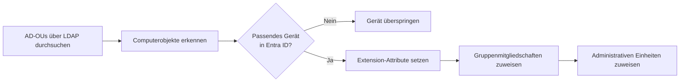

<p align="center">
  
</p>

# HybridDeviceTagger

[](https://buymeacoffee.com/andreaslmuz)
[](CHANGELOG.md)
[](https://github.com/anluca_microsoft/HybridDeviceTagger/tree/dev)
[](LICENSE)


HybridDeviceTagger schließt eine Informationslücke zwischen Active Directory und Microsoft Entra ID bei Microsoft-Entra-hybrid-joined Geräten. Im Active Directory lässt sich die Position eines Computerobjekts anhand seines Distinguished Name (DN) und damit seiner Organisationseinheit (OU) bestimmen. Anders als bei Benutzerobjekten wird der DN von Computerobjekten jedoch nicht nach Entra ID synchronisiert.

HybridDeviceTagger nutzt den DN eines Computerobjekts als Grundlage für konfigurierbare Regeln und überträgt die daraus abgeleitete Zuordnung nach Entra ID. Abhängig von der AD-OU kann er:

- `extensionAttribute1` bis `extensionAttribute15` setzen,
- das Gerät Entra-Sicherheitsgruppen hinzufügen und
- das Gerät normalen oder eingeschränkten administrativen Einheiten zuordnen.

## Inhaltsverzeichnis

- [Funktionsweise](#funktionsweise)
- [Installation](#installation)
- [Administration](#administration)
- [Azure-Betrieb](#azure-betrieb)
- [Problembehandlung](#problembehandlung)
- [Entwicklerdokumentation](#entwicklerdokumentation)
- [Lizenz](#lizenz)

## Funktionsweise

HybridDeviceTagger durchsucht die konfigurierten OUs im Active Directory über LDAP. Für jedes gefundene Computerobjekt prüft er, ob ein zugehöriges Geräteobjekt in Entra ID vorhanden ist. Bei einer Übereinstimmung werden die für die jeweilige OU konfigurierten Extension-Attribute sowie Mitgliedschaften in Entra-Sicherheitsgruppen und administrativen Einheiten angewendet.



## Installation

### Voraussetzungen

- PowerShell 7.2 oder neuer mit dem ActiveDirectory-Modul
- Azure CLI 2.60.0
- Eine Azure Subscription, in der der Installationsbenutzer Ressourcen bereitstellen, das vorhandene virtuelle Netzwerk einbinden und RBAC-Rollenzuweisungen erstellen darf
- DNS-Auflösung und Netzwerkzugriff der Function App auf die DNS-Namen aller betroffenen Forest-Domains über LDAPS auf Port 636 oder ersatzweise LDAP auf Port 389
- Ein vorhandenes virtuelles Netzwerk mit Subnetzen für die Function-Integration und den privaten Storage-Endpunkt
- Ein forestweit verwendbares AD-Servicekonto mit Leserechten auf die konfigurierten OUs in allen Domains und dem Recht, das eigene Kennwort zu ändern
- Die in der [Installationsanleitung](Deployment/README.md#required-permissions) beschriebenen Azure-, Entra- und Active-Directory-Berechtigungen

#### Berechtigungen für Regel- und Kennwortverwaltung

Regel- und Kennwortverwaltung werden durch Anwendungsrollen der Entra Enterprise Application für die HybridDeviceTagger Management API geschützt. Zusätzlich erhalten alle Principals mit der Azure-RBAC-Rolle `Owner` oder `Contributor` auf der Function App automatisch dieselben Rechte wie `HybridDeviceTagger.RuleAdministrator` und `HybridDeviceTagger.PasswordRotationAdministrator`. Das gilt auch für über Sicherheitsgruppen oder übergeordnete Scopes geerbte Zuweisungen.

| Verwaltungsaufgabe | Erforderliche Anwendungsrolle | Installer-Parameter |
| --- | --- | --- |
| Tagging-Regeln lesen, erstellen, ändern und löschen | `HybridDeviceTagger.RuleAdministrator` | `ManagementApiRuleAdministratorPrincipalObjectId` |
| Initiales AD-Kennwort einrichten, Rotationsstatus lesen und Kennwortrotation erzwingen | `HybridDeviceTagger.PasswordRotationAdministrator` | `ManagementApiPasswordRotationAdministratorPrincipalObjectId` |

Die Parameter akzeptieren die Entra Object IDs von Benutzern, Sicherheitsgruppen oder Service Principals. Für die dauerhafte Administration sollten Sicherheitsgruppen verwendet und nach dem Least-Privilege-Prinzip nur der jeweils benötigten Rolle zugewiesen werden:

```powershell
$installParameters = @{
    ManagementApiClientId = '<Client-ID der Management-API-App-Registrierung>'
    ManagementApiRuleAdministratorPrincipalObjectId = @(
        '<Object-ID der Regeladministratoren-Gruppe>'
    )
    ManagementApiPasswordRotationAdministratorPrincipalObjectId = @(
        '<Object-ID der Kennwortadministratoren-Gruppe>'
    )
}

./Deployment/Install-HybridDeviceTagger.ps1 @installParameters -ValidateOnly
```

Alternativ weist `ManagementApiAllowedPrincipalObjectId` einem Bootstrap-Principal alle fünf Management-API-Rollen zu. Diese breite Zuweisung eignet sich für Migration oder Ersteinrichtung, nicht für den dauerhaften Betrieb. Der ausführende Entra-Administrator benötigt zum Erstellen und Zuweisen der Anwendungsrollen eine ausreichend privilegierte Verzeichnisrolle, beispielsweise `Privileged Role Administrator` oder `Global Administrator`.

Kennwortadministratoren benötigen weder direkten Zugriff auf den Key Vault noch Azure-Ressourcenrollen. Sie rufen die geschützte API auf; die Function validiert das AD-Kennwort und greift anschließend mit ihrer Managed Identity auf den Key Vault zu. Nach einer neuen API-Anwendungsrollenzuweisung muss das Zugriffstoken durch eine erneute Anmeldung beziehungsweise einen neuen Aufruf von `Connect-HybridDeviceTagger` aktualisiert werden. Änderungen an Owner-/Contributor-Zuweisungen werden bei der nächsten API-Anfrage geprüft.

Die Function prüft Owner- und Contributor-Zuweisungen zur Laufzeit über Azure Resource Manager. Ihre Managed Identity erhält dafür ausschließlich die Rolle `Reader` auf der eigenen Function App. Andere Azure-RBAC-Rollen berechtigen nicht zur Management API; auch Owner und Contributor erhalten dadurch keine Tagging-Operator- oder Zertifikatsadministratorrechte.

#### Optional: vorhandener Key Vault

Ein bestehender Key Vault ist optional. Ist keiner vorhanden, erstellt das Setup einen neuen privaten Key Vault in der Ressourcengruppe der Function App. Soll ein bestehender Key Vault verwendet werden, fragt der Installer dessen Subscription, Ressourcengruppe und Namen ab.

### Schnellinstallation

Nach dem Entpacken des Installationspakets zunächst bei Azure anmelden:

```powershell
az login
```

Anschließend den Installer interaktiv in drei Schritten ausführen. Er fragt alle benötigten Werte ab und schlägt passende Standardwerte vor:

- **Azure-Ziel:** Subscription, Ressourcengruppe, Region sowie Namen für Function App und Storage Account
- **Netzwerk:** Subscription und Ressourcengruppe des vorhandenen VNet, VNet-Name, Function-Integrationssubnetz und separates Private-Endpoint-Subnetz
- **Key Vault:** Auswahl zwischen einem vorhandenen Vault und einem neuen privaten Vault; bei einem vorhandenen Vault zusätzlich Subscription, Ressourcengruppe und Name
- **Active Directory:** Forest-DNS-Name, optional ein bestimmter Domain Controller, UPN und Distinguished Name des Servicekontos sowie dessen Kennwort über einen geschützten Anmeldedialog
- **Erste Tagging-Regel:** Name, Beschreibung, Basis-DN der OU und Wert für `extensionAttribute1`
- **Management API:** Client-ID der vorhandenen Entra-App-Registrierung und die Objekt-ID des berechtigten Benutzers, der Gruppe oder des Service Principals

Ist LDAPS nicht verfügbar, fragt der Installer vor der Verwendung des abgesicherten LDAP-Fallbacks nach einer Bestätigung. Regeln mit eingeschränkten administrativen Einheiten erfordern ebenfalls eine ausdrückliche Freigabe. Vor der eigentlichen Installation zeigt der Installer eine Zusammenfassung und fordert eine abschließende Bestätigung an.

```powershell
./Deployment/Install-HybridDeviceTagger.ps1 -ValidateOnly
./Deployment/Install-HybridDeviceTagger.ps1 -WhatIf
./Deployment/Install-HybridDeviceTagger.ps1
```

`-ValidateOnly` prüft die Voraussetzungen ohne Änderungen. `-WhatIf` zeigt die geplanten Azure-Änderungen. Erst der dritte Aufruf führt die Installation nach Bestätigung aus.

Bei jedem der drei interaktiven Aufrufe werden die Angaben erneut abgefragt. Sollen dieselben Werte wiederverwendet werden, empfiehlt sich die unter **Erweiterte Installation** beschriebene Übergabe über ein PowerShell-Splat.

### Erweiterte Installation

Für automatisierte oder wiederholbare Installationen können alle Werte als Parameter oder PowerShell-Splat übergeben werden. Mit `-CreateKeyVault` wird ein neuer privater Key Vault in der Ziel-Ressourcengruppe erstellt; ohne diesen Schalter wird ein vorhandener Key Vault verwendet. `-CreateResourceGroup`, `-RegisterProviders`, `-ActiveDirectoryTrustedCertificatePath` und die rollenbezogenen Management-API-Parameter steuern weitere Installationsoptionen.

Ein vollständiges Parameterbeispiel sowie Details zu Berechtigungen, Netzwerk, Key Vault, Validierung und unbeaufsichtigter Ausführung stehen in der [erweiterten Installationsanleitung](Deployment/README.md#validation).

### Installation in Azure

Das Verzeichnis `Deployment` enthält ein idempotentes PowerShell-Installationsskript und die Bicep-Vorlagen für Azure Functions Flex Consumption (FC1), Storage, Log Analytics und Application Insights. VNet, Integrationssubnetz und Key Vault werden als vorhandene Ressourcen geprüft und referenziert, aber nicht erstellt oder verändert.

Beginnen Sie immer mit `-ValidateOnly`, danach mit `-WhatIf`, und führen Sie erst anschließend die Installation aus. Parameter, Voraussetzungen, Berechtigungen und ein vollständiges Beispiel stehen in [Deployment/README.md](Deployment/README.md).

## Administration

### Tagging-Regeln verwalten

Tagging-Regeln werden mit dem PowerShell-Modul `Deployment/HybridDeviceTagger.Management` verwaltet. Zuerst das Modul importieren und mit der Management API verbinden:

```powershell
Import-Module ./Deployment/HybridDeviceTagger.Management
Connect-HybridDeviceTagger
```

Eine Regel besteht aus folgenden Eigenschaften:

| Eigenschaft | Beschreibung |
| --- | --- |
| `name` | Eindeutiger, nicht zwischen Groß- und Kleinschreibung unterscheidender Regelname |
| `description` | Verständliche Beschreibung des Regelzwecks |
| `baseDn` | Vollständiger Domain-DN oder OU-Pfad, beispielsweise `OU=Kiosks,OU=Workstations` |
| `extensionAttributes` | Zu setzende Werte für `extensionAttribute1` bis `extensionAttribute15` |
| `entraGroupIds` | Object IDs statischer Entra-Sicherheitsgruppen |
| `administrativeUnitIds` | Object IDs normaler oder eingeschränkter administrativer Einheiten |

Jede Regel benötigt mindestens eine Aktion in `extensionAttributes`, `entraGroupIds` oder `administrativeUnitIds`. Nicht verwendete Zielarten werden als leere Hashtable beziehungsweise leeres Array angegeben.

#### Regeln anzeigen

```powershell
# Alle Regeln anzeigen
Get-HybridDeviceTaggerRule

# Eine bestimmte Regel anzeigen
Get-HybridDeviceTaggerRule -Name 'Kiosk devices'
```

#### Regel erstellen

Eine neue Regel wird als vollständige Hashtable angelegt. Mit `-WhatIf` lässt sich die Änderung vorab prüfen:

```powershell
$rule = @{
    name = 'Kiosk devices'
    description = 'Tags devices located in the kiosk OU.'
    baseDn = 'OU=Kiosks,OU=Workstations'
    extensionAttributes = @{
        extensionAttribute1 = 'Kiosk'
    }
    entraGroupIds = @()
    administrativeUnitIds = @()
}

Add-HybridDeviceTaggerRule -Rule $rule -WhatIf
Add-HybridDeviceTaggerRule -Rule $rule
```

#### Regel ändern

Zum Ändern wird die Regel vollständig mit demselben Namen erneut übergeben. Der Namensvergleich erfolgt ohne Beachtung der Groß- und Kleinschreibung; alle anderen Regeln bleiben unverändert:

```powershell
$updatedRule = @{
    name = 'Kiosk devices'
    description = 'Tags shared kiosk devices and assigns their security group.'
    baseDn = 'OU=Kiosks,OU=Workstations'
    extensionAttributes = @{
        extensionAttribute1 = 'Kiosk'
        extensionAttribute2 = 'Shared'
    }
    entraGroupIds = @(
        '<Entra-Gruppen-Object-ID>'
    )
    administrativeUnitIds = @()
}

Add-HybridDeviceTaggerRule -Rule $updatedRule -WhatIf
Add-HybridDeviceTaggerRule -Rule $updatedRule
```

#### Regel löschen

Eine Regel wird über ihren Namen entfernt. Der letzte verbliebene Regeleintrag kann nicht gelöscht werden:

```powershell
Remove-HybridDeviceTaggerRule -Name 'Kiosk devices' -WhatIf
Remove-HybridDeviceTaggerRule -Name 'Kiosk devices' -Confirm
```

Änderungen werden ohne Neustart der Function App wirksam. ETags schützen parallele Änderungen vor unbemerktem Überschreiben. Eine Konfiguration unterstützt maximal 100 Regeln; pro Regel sind bis zu 15 Extension Attributes und jeweils 50 eindeutige Gruppen- oder Administrative-Unit-IDs zulässig. Weitere Beispiele stehen in der [Installationsanleitung](Deployment/README.md#updating-tagging-rules-after-installation) und in der integrierten Hilfe:

```powershell
Get-Help Add-HybridDeviceTaggerRule -Full
Get-Help Remove-HybridDeviceTaggerRule -Full
```

### Erstmalige Einrichtung des AD-Kennworts

Das initiale Kennwort wird über die Entra-geschützte Function API eingerichtet. Der ausführende Benutzer benötigt dadurch keine Datenberechtigung auf dem Key Vault, sondern nur die API-Rolle `HybridDeviceTagger.PasswordRotationAdministrator`.

```powershell
Import-Module ./Deployment/HybridDeviceTagger.Management
Connect-HybridDeviceTagger
$password = Read-Host 'AD-Servicekonto-Kennwort' -AsSecureString
Initialize-HybridDeviceTaggerActiveDirectoryCredential -Password $password -Confirm
```

Die Function validiert das Kennwort durch einen AD-Bind und speichert es anschließend mit ihrer Managed Identity als Secret `hybrid-device-tagger-ad-password-current`. Ein bereits vorhandenes Current-Secret wird nicht überschrieben. `next` wird ausschließlich von der Rotation erstellt.

Das Laufzeitkonto bleibt reguläres Mitglied von `Domain Users`. Zusätzlich müssen auf dem Konto `SELF / Change Password` erlaubt und `User cannot change password` deaktiviert sein. Das Laufzeitkonto selbst benötigt weder administrative AD-Gruppen noch Reset-Password-Rechte; nur das getrennte Provisioning-Credential benötigt die Rechte zum Erstellen beziehungsweise Zurücksetzen.

Bei einer echten Installation kann der Installer das Servicekonto mit einem separaten AD-Provisioning-Credential vorbereiten. Fehlt das Konto, fragt er vor dem Erstellen und Aktivieren nach; ist es vorhanden, bietet er ein zufälliges komplexes Kennwort oder eine sichere manuelle Eingabe für den administrativen Reset an. Das Zielkennwort wird direkt als Current-Secret synchronisiert und nicht angezeigt. Der Installer bevorzugt LDAPS. Ist LDAPS nicht verfügbar und wurde der LDAP-Fallback ausdrücklich genehmigt, verwendet der Bootstrap das installierte Active-Directory-PowerShell-Modul über Active Directory Web Services gegen den konfigurierten Server. Nach Erstellung oder Reset bleibt **Benutzer muss Kennwort bei der nächsten Anmeldung ändern** deaktiviert. `-ValidateOnly` und `-WhatIf` verändern das AD-Konto nicht.

### PowerShell-Management-Modul

Das Modul `Deployment/HybridDeviceTagger.Management` stellt folgende Funktionen für die Entra-geschützte Management API bereit:

| Funktion | Beschreibung |
| --- | --- |
| `Connect-HybridDeviceTagger` | Baut mit der vorhandenen Azure-CLI-Anmeldung die Verbindung zur Management API auf. Mit `-ApiBaseUri` und `-ClientId` kann eine andere Bereitstellung gewählt werden; `-PassThru` gibt nicht vertrauliche Verbindungsinformationen zurück. |
| `Get-HybridDeviceTaggerRule` | Gibt alle wirksamen Tagging-Regeln oder mit `-Name` eine bestimmte Regel zurück. Der Namensvergleich erfolgt ohne Beachtung der Groß- und Kleinschreibung. |
| `Get-HybridDeviceTaggerLastRunStatus` | Zeigt Status, Invocation-ID, Zeitstempel, Ergebniszähler und bereinigte Fehlerinformationen des letzten geplanten oder manuell gestarteten Tagging-Laufs. |
| `Get-HybridDeviceTaggerPasswordRotationStatus` | Zeigt den Status der letzten Kennwortprüfung beziehungsweise Rotation und den Zeitpunkt der letzten tatsächlichen Kennwortänderung. Kennwörter werden nicht zurückgegeben. |
| `Get-HybridDeviceTaggerTrace` | Lädt den letzten JSONL-Trace und gibt jedes Ereignis als strukturiertes `HybridDeviceTagger.TraceEvent`-Objekt für Filterung, Auswahl oder Export in der Pipeline aus. |
| `Get-HybridDeviceTaggerTrustedCertificate` | Listet die Metadaten aller aktuell für neue LDAPS-Verbindungen vertrauenswürdigen Zertifikate auf. Zertifikatsdaten und private Schlüssel werden nicht ausgegeben. |
| `Add-HybridDeviceTaggerRule` | Fügt eine vollständige Regel hinzu oder ersetzt eine gleichnamige Regel. Akzeptiert über `-Rule` eine einzelne Regel oder ein Objekt mit einer `Rules`-Eigenschaft; alle übrigen Regeln bleiben erhalten. |
| `Add-HybridDeviceTaggerTrustedCertificate` | Fügt mit `-Path` ein öffentliches DER- oder PEM-Zertifikat als LDAPS-Vertrauensanker hinzu. Vorhandene Zertifikate bleiben erhalten, Dateien mit privatem Schlüssel werden abgelehnt. |
| `Remove-HybridDeviceTaggerRule` | Entfernt die mit `-Name` angegebene Regel. Die API verhindert, dass dadurch keine gültige Tagging-Regel mehr verbleibt. |
| `Remove-HybridDeviceTaggerTrustedCertificate` | Entfernt das mit `-CertificateThumbprint` angegebene Zertifikat. Der letzte verbliebene LDAPS-Vertrauensanker kann nicht gelöscht werden. |
| `Initialize-HybridDeviceTaggerActiveDirectoryCredential` | Validiert das mit `-Password` als `SecureString` übergebene initiale AD-Servicekonto-Kennwort und lässt es durch die Managed Identity der Function im Key Vault speichern. Ein vorhandenes Current-Secret wird nicht überschrieben. |
| `Invoke-HybridDeviceTagging` | Startet synchron denselben Geräteabgleich wie der Timer und gibt Invocation-ID sowie Gesamtergebnis zurück. Ein paralleler Tagging-Lauf führt zu einem Konflikt. |
| `Invoke-HybridDeviceTaggerPasswordRotation` | Erzwingt synchron eine Kennwortrotation unabhängig vom Kennwortalter. Prüfung des aktuellen Kennworts, LDAPS, Staging, Validierung und Promotion bleiben verpflichtend. |

Zuerst muss `Connect-HybridDeviceTagger` ausgeführt werden; alle weiteren Funktionen verwenden diese Verbindung und erneuern das Zugriffstoken bei Bedarf. Schreibende Funktionen unterstützen `-WhatIf`. Das Initialisieren des AD-Kennworts, das Entfernen von Regeln oder Zertifikaten und die erzwungene Kennwortrotation erfordern standardmäßig eine Bestätigung mit hoher Auswirkung. Ausführliche Syntax, Parameter und Beispiele zeigt die integrierte Hilfe, beispielsweise mit `Get-Help Invoke-HybridDeviceTaggerPasswordRotation -Full`.

## Azure-Betrieb

Die Function App muss aus ihrem virtuellen Netzwerk den konfigurierten Domain Controller sowie die über die Forest-CrossRefs ermittelten Domain-DNS-Namen auflösen und per LDAPS erreichen, beispielsweise über Site-to-Site-VPN oder ExpressRoute. Optional kann LDAP auf Port 389 als Fallback erreichbar sein. Legen Sie alle Werte aus der Konfiguration als Function-App-Settings an und aktivieren Sie Managed Identity. Weisen Sie deren Service Principal die drei beschriebenen Graph-App-Rollen sowie die Key-Vault- und Blob-Rechte zu. Für Geräte in eingeschränkten administrativen Einheiten benötigt die Managed Identity zusätzlich die vom Installer erzeugte Least-Privilege-Rolle direkt am jeweiligen RMAU-Scope.

Die Funktion markiert Geräte innerhalb der Ziel-OUs. Verlässt ein Computer alle konfigurierten Ziel-OUs, entfernt der nächste Lauf die noch unveränderten verwalteten Extension Attributes sowie die vom Tagger angelegten Gruppen-, AU- und RMAU-Mitgliedschaften.

## Problembehandlung

### Ablauf- und Fehlerprotokolle

Die Anwendung sendet strukturierte OpenTelemetry-Logs, Exceptions sowie HTTP-Abhängigkeiten an das mit der Function App verbundene Application Insights. In Azure öffnen Sie `func-hybriddevicetagger-appi` und anschließend **Überwachung > Protokolle**. Jede Timer-Ausführung schreibt Start, Ergebnis oder Fehler mit derselben `InvocationId`. Geräteupdates enthalten nur die Device-ID und die Namen geänderter Attribute; Attributwerte und Kennwörter werden nicht protokolliert.

Bei direkter Abfrage des verbundenen Log-Analytics-Workspace `func-hybriddevicetagger-law` heißen die entsprechenden Tabellen `AppTraces`, `AppExceptions`, `AppRequests` und `AppDependencies`. Die folgenden Kurzformen `traces`, `exceptions`, `requests` und `dependencies` gelten im Protokollbereich der Application-Insights-Ressource.

Letzte Abläufe und ihre Ergebnisfelder:

```kusto
traces
| where timestamp > ago(24h)
| where cloud_RoleName == "func-hybriddevicetagger"
| where message has_any ("Device tagging", "Tagging rule", "Password rotation")
| project timestamp, severityLevel, message, operation_Id, customDimensions
| order by timestamp desc
```

Fehler einschließlich Stacktrace:

```kusto
exceptions
| where timestamp > ago(7d)
| where cloud_RoleName == "func-hybriddevicetagger"
| project timestamp, type, outerMessage, innermostMessage, operation_Id, details
| order by timestamp desc
```

Fehlgeschlagene Aufrufe an Microsoft Graph oder Key Vault:

```kusto
dependencies
| where timestamp > ago(7d)
| where cloud_RoleName == "func-hybriddevicetagger" and success == false
| project timestamp, target, name, resultCode, duration, operation_Id
| order by timestamp desc
```

Mit einer `operation_Id` aus einem Treffer lässt sich eine komplette Ausführung korrelieren:

```kusto
union traces, exceptions, requests, dependencies
| where operation_Id == "OPERATION_ID_EINSETZEN"
| order by timestamp asc
```

### Installationsprotokoll

Jeder Aufruf von `Install-HybridDeviceTagger.ps1` ersetzt die Datei `HybridDeviceTagger-Install.log` im temporären Verzeichnis des aktuellen Benutzers. Das PowerShell-Transcript enthält die Konsolenausgaben aller Validierungs-, What-if-, AD-Vorbereitungs- und Installationsschritte und wird auch bei einem Fehler oder frühen Abbruch sauber geschlossen.

```powershell
$installerLog = Join-Path ([System.IO.Path]::GetTempPath()) 'HybridDeviceTagger-Install.log'
code $installerLog
```

Das Transcript kann Benutzer-, Geräte-, Ressourcen- und Verzeichnisnamen enthalten und muss daher vertraulich behandelt werden. Kennwörter werden vom Skript nicht ausgegeben und dürfen auch bei manueller Fehleranalyse nicht in die Konsole geschrieben werden.

### Trace des letzten Tagging-Laufs

Jeder Start von `DeviceTaggerFunction` ersetzt die Datei `device-tagger-last-run.jsonl` im privaten Blob-Container `run-traces`. Jeder Arbeitsschritt wird sofort als einzelne JSON-Zeile geschrieben. Dadurch bleibt bei einer normalen Exception oder einem Prozessabbruch der bis dahin geschriebene Ablauf erhalten. Die Datei enthält unter anderem UTC-Zeit, laufende Sequenznummer, Invocation-ID, Phase, Aktion, Ergebnis, Device- und Ziel-IDs sowie bei Fehlern Exception-Typ, Meldung und Stacktrace. Kennwörter, Tokens und Extension-Attributwerte werden nicht gespeichert; für Attributvergleiche enthält der Trace nur SHA-256-Fingerprints.

Die Datei ist bewusst als JSON Lines aufgebaut. Copilot kann einzelne Zeilen unabhängig analysieren, nach `invocationId`, `phase`, `action`, `outcome`, `deviceId` oder `targetId` filtern und den letzten erfolgreichen Schritt unmittelbar vor einem Fehler bestimmen. Da Device- und Entra-Objekt-IDs sowie Infrastrukturpfade enthalten sind, muss die Datei trotz fehlender Geheimnisse vertraulich behandelt werden.

### Trace exportieren und in VS Code öffnen

Zum Herunterladen benötigt das angemeldete Konto `Storage Blob Data Reader` oder eine höherwertige Datenrolle und Netzwerkzugriff auf den privaten Blob-Endpunkt:

```powershell
az storage blob download `
	--account-name '<storage-account>' `
	--container-name 'run-traces' `
	--name 'device-tagger-last-run.jsonl' `
	--file '.\device-tagger-last-run.jsonl' `
	--auth-mode login

code '.\device-tagger-last-run.jsonl'
```

Der exportierte Trace kann anschließend direkt in VS Code geöffnet und Copilot zur Fehleranalyse übergeben werden.

## Entwicklerdokumentation

Ausführliche Informationen zur Architektur, Management API, Konfiguration, lokalen Entwicklung, Tests und Versionierung stehen in [DEVELOPER.md](DEVELOPER.md).

## Lizenz

Dieses Projekt ist unter der [Apache License 2.0](LICENSE) lizenziert.
