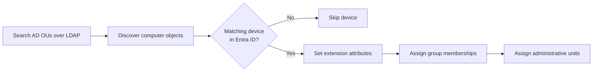
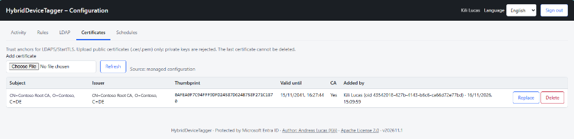
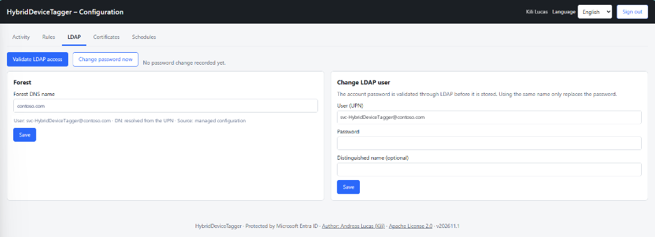

# HybridDeviceTagger

**English** | [Deutsch](README.de.md)

<p align="center"></p>
<p align="center"><strong>OU-based tagging of hybrid devices in Microsoft Entra ID</strong></p>
<p align="center"><a href="#versioning-and-release"></a> <a href="./LICENSE"></a>   </p>

---

<p align="center"><a href="https://buymeacoffee.com/andreaslmuz"></a></p>

<br>

## In This Article

<p align="center"><a href="#overview">Overview</a> &bull; <a href="#how-it-works">How it works</a> &bull; <a href="#installation">Installation</a> &bull; <a href="#administration">Administration</a> &bull; <a href="#troubleshooting">Troubleshooting</a></p>

## Overview

Implementing a Zero Trust strategy requires reliable assessment of both the user's identity and the source system being used. In Conditional Access policies, devices are commonly classified using extension attributes. This makes it possible, for example, to check whether a source system meets a defined security level.

This requires a device object in Microsoft Entra ID, such as a Microsoft Entra hybrid-joined computer. Assessment based solely on the source address is often insufficient.

In on-premises Active Directory, this classification can be represented by the directory structure and the organizational unit of a computer object. When computer objects are synchronized to Microsoft Entra ID, this information is lost because the distinguished name (DN), and therefore the OU assignment, is not transferred.

This is where HybridDeviceTagger comes in. It evaluates a computer object's location in Active Directory, applies configurable rules, and transfers the resulting security classification to Microsoft Entra ID. Depending on the distinguished name (DN), it can:

- Set `extensionAttribute1` through `extensionAttribute15`.
- Add the device to Entra security groups.
- Assign the device to regular or restricted management administrative units.

## How It Works

HybridDeviceTagger searches the configured OUs in Active Directory. For each computer object found in an OU, it checks whether a corresponding device object exists in Entra ID. If a match is found, the extension attributes and security-group and administrative-unit memberships configured for that OU are applied.



## Installation

HybridDeviceTagger can be installed:

- Interactively with the guided `Install.ps1` installer.
- Unattended from any CI/CD pipeline with the `Install-HybridDeviceTagger.ps1` installation engine.

### The Installation Package

All files needed for installation are in the [installationspackage](installationspackage) directory. A release package named `HybridDeviceTagger-<Version>.zip` contains this directory plus the precompiled Function, `version.json`, and the license:

Download the installation ZIP and its `.sha256` checksum from [GitHub Releases](https://github.com/Kili69/HybridDeviceTagger/releases/latest), not the automatically generated source archive. Releases are built and tested after a prepared `dev` pull request is merged into protected `main`; see [Creating a Release](DEVELOPER.md#creating-a-release).

| File | Purpose |
| --- | --- |
| `Install.ps1` | Guided installation. Prompts for all parameters, then runs validation, What-If, and installation in sequence. **Entry point for interactive installation.** |
| `Install-HybridDeviceTagger.ps1` | Installation engine. Called by `Install.ps1` and used directly with parameters for unattended installations and pipelines. |
| `main.bicep`, `key-vault-role-assignment.bicep` | Azure infrastructure as code |
| `function/HybridDeviceTagger.zip` | Precompiled Function App |
| `HybridDeviceTagger.Management/` | PowerShell module for post-installation operations |
| `version.json` | Package version, branch, and commit |
| `README.md` | English installation reference covering permissions, all engine parameters, and troubleshooting |

### Interactive Installation with Install.ps1

Guided installation is suitable for initial deployments, updates, test environments, and manually controlled changes. `Install.ps1` checks local prerequisites, prompts for all values with suggestions and format validation, validates the environment, and installs only after confirmation.

### Automated Installation with Install-HybridDeviceTagger.ps1

Automated installation is suitable for repeatable deployments, CI/CD pipelines, and scenarios where interactive input is not possible. `Install-HybridDeviceTagger.ps1` is called directly with all required parameters and performs validation, What-If, and installation.

#### Prerequisites

**Installation computer**

- PowerShell 7.2 or later
- Azure CLI 2.60.0 or later
- The extracted installation package, including `function/HybridDeviceTagger.zip`

**Azure**

- An Azure subscription with resource deployment permissions
- When using an existing Key Vault:
  - RBAC authorization, soft delete, and purge protection enabled
  - Permission for the installation user to create secrets and role assignments on the vault

**Network**

- An existing virtual network with two subnets:
  - An integration subnet (Flex Consumption) for the Function, delegated to `Microsoft.App/environments`, at least `/27`
  - A subnet for the private endpoints of Storage (Blob, Queue) and Key Vault
- DNS in the VNet:
  - Resolution of:
    - `privatelink.blob.core.windows.net`
    - `privatelink.queue.core.windows.net`
    - `privatelink.vaultcore.azure.net`
  - Resolution of the `_ldap._tcp.dc._msdcs` SRV records for all relevant forest domains
- Connectivity from the Function's VNet to:
  - Domain controllers over LDAPS (port 636) or LDAP with StartTLS (port 389)
  - CRL or OCSP endpoints of the CA that issued the DC certificates

##### What the Function Uses the VNet For

- **Integration subnet:** The Function uses this subnet for outbound connections to on-premises domain controllers.
- **Private endpoint subnet:** Hosts the private network addresses of the three Azure services that are accessible only internally:
  - **Blob Storage:** Function code package, rules, configuration, run logs, and locks preventing concurrent runs
  - **Queue Storage:** Queues for immediately requested runs ("Run tagging now", "Trigger password change")
  - **Key Vault:** Current and staged AD service-account passwords

Storage and Key Vault are therefore inaccessible from the internet; the Function accesses them exclusively through the private network.

**Active Directory**

- Root-CA certificate (`.cer`/`.pem`) for the domain-controller certificates
- An existing AD user account (service account); membership in Domain Users is sufficient

#### Running the Installation

Extract the installation package, open PowerShell 7 in the extracted directory, and sign in to Azure:

```powershell
az login
.\Install.ps1
```

- **Azure target:**
  - Subscription (default: current `az login` subscription)
  - Resource group (`rg-HybridDeviceTagger`, created if needed)
  - Region (`westeurope`)
  - Function App name (`func-hybriddevicetagger`)
  - Storage account
- **Network:**
  - Subscription, resource group, and name: these three values only locate the single VNet.
  - Integration subnet in that VNet, delegated to `Microsoft.App/environments`
  - Private endpoint subnet in that VNet
- **Key Vault:**
  - Choose a new private vault or an existing vault; for an existing vault, also specify its subscription and resource group; specify the name in both cases.
- **Management API:**
  - Optionally specify the app registration's client ID. If left empty, the installer automatically creates the single-tenant Entra app registration and enterprise application for an initial installation, or reuses the existing installation's registration during an update. Also specify the object ID of the user or group that receives all Management API roles (default: signed-in user).
- **Operations:**
  - Initial tagging interval in minutes (5–1440, default 15) and password-rotation interval in days (1–29, default 25)

Then select the action or pass it with `-Mode`:

| Selection | `-Mode` | Action |
| --- | --- | --- |
| **[1] Install or update** | `Install` | Validate without changes, optionally show Azure What-If, then install after confirmation. Recommended for initial installations and updates. |
| **[2] Validate only** | `Validate` | Check all prerequisites without changes |
| **[3] Show Azure What-If only** | `WhatIf` | Show planned Azure changes without making changes |

The **Install or update** process:

1. **Validation** without changes. Checks include resource providers and names, VNet and subnets, Key Vault, DNS, and the Bicep deployment. LDAPS or StartTLS, certificate chain, forest, and service account are checked only when AD parameters are supplied for pre-seeding. On failure, the process stops without changes.
2. **Azure What-If** (optional): Display the Azure resources to create or modify. An app registration intended for initial installation is planned but not yet created.
3. **`Start the installation now?` prompt:** Installation starts only after answering **y**.
4. **Installation summary** from the engine with all resources, roles, and permissions, followed by the final confirmation **Execute the installation plan shown above**.

#### Configuring Active Directory After Installation

Configuration takes place after installation in the [configuration portal](#configuration-portal) at `https://<function-app>.azurewebsites.net/api/portal`; access requires the **Owner** or **Contributor** role on the Function App. Complete these dependent steps in order:

1. **Upload the root certificate**
   - Open **Certificates** and, under **Add certificate**, select the public root-CA certificate (`.cer`, `.crt`, or `.pem`) that issued the domain-controller certificates.
   - The certificate is the trust anchor for LDAPS and StartTLS.

   <p align="center"></p>

2. **Configure the forest**
   - Open **LDAP**, enter the AD forest's DNS name in **Forest DNS name** (for example `contoso.com`), and select **Save**.

3. **Set the user and password**
   - In **LDAP**, under **Set LDAP user**, enter the service account's UPN (for example `svc-HybridDeviceTagger@contoso.com`) and current password.
   - **Validate LDAP access** checks connectivity to each domain controller.

   <p align="center"></p>

4. **Create rules**
   - In **Rules**, select **Add rule** to create a rule:
     - Name and description
     - OU **Base DN**, for example `OU=SessionHost,OU=Computers,OU=Tier-0,OU=Admin,DC=contoso,DC=com`
     - At least one action: an extension attribute with a value, an Entra security group, or an administrative unit
   - After saving, **Run tagging now** starts a run immediately; its result appears next to the button and in **Activity**.
   - For rule details, see [Managing Tagging Rules](#managing-tagging-rules).

   <p align="center"></p>

The same steps are available through the [PowerShell management module](installationspackage/HybridDeviceTagger.Management/README.md):

```powershell
Import-Module .\HybridDeviceTagger.Management
Connect-HybridDeviceTagger -ApiBaseUri 'https://<function-app>.azurewebsites.net/api/management' `
    -ClientId '<management-api-client-id>' -SkipValidation
Add-HybridDeviceTaggerTrustedCertificate -Path '.\Contoso-Root-CA.cer'
Set-HybridDeviceTaggerActiveDirectoryConfiguration -Domain 'contoso.com'
Set-HybridDeviceTaggerServiceAccount -Credential (Get-Credential 'svc-HybridDeviceTagger@contoso.com')
Add-HybridDeviceTaggerRule -Rule $rule
```

#### Unattended Installation

All values can be passed as parameters or a PowerShell splat and reused for validation, What-If, and installation.

```powershell
$parameters = @{
    SubscriptionId = '<Azure-Subscription-ID>'
    ResourceGroupName = 'rg-hybrid-device-tagger'
    Location = 'westeurope'
    FunctionAppName = 'func-hybrid-device-tagger'
    StorageAccountName = 'sthybriddevicetagger'
    CreateKeyVault = $true
    CreateResourceGroup = $true
    RegisterProviders = $true
    FunctionPackagePath = 'function/HybridDeviceTagger.zip'
    ActiveDirectoryForestDomain = '<AD-Forest-Domain>'
    ActiveDirectoryServer = '<AD-Server>'
    ActiveDirectoryTrustedCertificatePath = '<Path-to-Trusted-Certificate>'
    ADServiceAccount = '<AD-Service-Account>'
    ActiveDirectoryBindUserDistinguishedName = '<Bind-User-DN>'
    ADServiceAccountCredential = (Get-Credential '<AD User UPN>')
    SkipActiveDirectoryDirectoryChecks = $false

}

./installationspackage/Install-HybridDeviceTagger.ps1 @parameters -ValidateOnly
./installationspackage/Install-HybridDeviceTagger.ps1 @parameters -WhatIf
./installationspackage/Install-HybridDeviceTagger.ps1 @parameters
```

- `-CreateKeyVault` creates a new private Key Vault in the target resource group; without this switch, an existing Key Vault is used.
- `-CreateResourceGroup` creates a resource group if it does not already exist.
- `-RegisterProviders` registers the required Azure resource providers if they are not yet registered.

### Pipeline Installation

Pipeline installation uses the same installation engine in fully parameterized noninteractive mode. It is not tied to GitHub Actions, Azure DevOps, or any other pipeline system.

#### Prerequisites

- A runner with PowerShell 7.2 and Azure CLI
- .NET 8 SDK and a checkout with complete Git history including tags if the installation package is built in the pipeline; installation itself does not require the .NET SDK
- Noninteractive Azure sign-in, preferably through Workload Identity Federation; alternatively, use a service principal
- The same Azure, Entra, and network permissions as for guided installation
- Optionally, a protected pipeline secret for the existing AD service account if the AD connection is to be pre-seeded
- All required installer parameters set; the pipeline must not depend on interactive prompts

A pipeline-provider-hosted runner can be used only if it can securely reach the private DNS zones and, when AD credentials are supplied for pre-seeding, the domain controllers. Typical hybrid environments therefore require a self-hosted runner in the connected network.

#### Pipeline Process

A platform-neutral pipeline should use these stages:

1. **Build, tests, and package:** Use `scripts/Build-InstallationPackage.ps1` to run the tests, publish the Function, create `artifacts/HybridDeviceTagger-<Version>.zip`, and publish it as a pipeline artifact.
2. **Authenticate:** Sign Azure CLI in noninteractively with the pipeline identity.
3. **Validate:** Run the engine from the extracted package with all parameters, `-ValidateOnly`, and `-Force`.
4. **What-If:** Run the same parameter set with `-WhatIf` and `-Force`.
5. **Deploy:** After optional pipeline approval, run the same parameter set with `-Force`.
6. **Configure AD:** Without pre-seeding, configure the root certificate, forest domain, and service account as described in [Configuring Active Directory After Installation](#configuring-active-directory-after-installation).

```powershell
# Build stage (checkout with complete Git history)
./scripts/Build-InstallationPackage.ps1
# Output: artifacts/HybridDeviceTagger-<Version>.zip

# Deployment stage in the extracted pipeline artifact directory
$parameters = @{
    SubscriptionId = $env:HDT_SUBSCRIPTION_ID
    ResourceGroupName = $env:HDT_RESOURCE_GROUP
    # All other non-secret installer values from pipeline variables
}

# Optional AD connection pre-seeding; without this block, configure AD after installation
if ($env:HDT_AD_USERNAME) {
    $parameters.ActiveDirectoryForestDomain = $env:HDT_AD_FOREST_DOMAIN
    $parameters.ActiveDirectoryTrustedCertificatePath = $env:HDT_ROOT_CA_CERTIFICATE_PATH
    $securePassword = ConvertTo-SecureString $env:HDT_AD_PASSWORD -AsPlainText -Force
    $parameters.ADServiceAccountCredential = [pscredential]::new(
        $env:HDT_AD_USERNAME,
        $securePassword
    )
}

./Install-HybridDeviceTagger.ps1 @parameters -ValidateOnly -Force
./Install-HybridDeviceTagger.ps1 @parameters -WhatIf -Force
./Install-HybridDeviceTagger.ps1 @parameters -Force
```

Pipeline secrets must never be committed in parameter files or printed in logs. `-Force` disables all installer prompts and fails if required values are missing. On failure, the engine exits with code `1` so the pipeline detects the failure. The Linux-based Flex Consumption Function uses only TLS-protected LDAP connections: preferably LDAPS, with StartTLS as a fallback. `ActiveDirectoryTrustedCertificatePath` is optional and required only together with `ADServiceAccountCredential`. When supplied, the public root-CA certificate is imported into the Azure Function package; importing it only into the installation computer's certificate store is insufficient. Without this parameter, add the certificate after installation through the configuration portal or `Add-HybridDeviceTaggerTrustedCertificate`. Do not supply private keys. Use `-SkipCodeDeployment` to separate infrastructure and application deployment into different pipeline stages.

### Shared Configuration

Both installation methods use the same parameters and produce the same target configuration.

#### Key Vault

An existing Key Vault is optional. If none exists, setup creates a new private Key Vault in the Function App's resource group with `-CreateKeyVault` (in `Install.ps1`: answer **Yes** to the Key Vault question). This vault is dedicated to HybridDeviceTagger; the managed identity receives `Key Vault Secrets Officer` on the entire vault. Without this switch, an existing vault is referenced by subscription, resource group, and name.

In an existing, possibly shared Key Vault, the managed identity receives `Key Vault Secrets Officer` only on the two secrets `hybrid-device-tagger-ad-password-current` and `hybrid-device-tagger-ad-password-next`. Other secrets remain inaccessible to the Function. Because a secret-scoped role assignment requires an existing secret, the deployment creates missing secrets as unusable placeholders with content type `application/vnd.hybriddevicetagger.placeholder`. Placeholders are never used as credentials. The installation user therefore needs control-plane permissions to create secrets and role assignments on the existing vault.

The installation identity does not write the AD password to Key Vault. After installation, `Set-HybridDeviceTaggerServiceAccount` or the configuration portal sends it to the Entra-protected Management API; during pre-seeding, the installer sends it instead. The Function validates the password and stores it with its managed identity.

#### Permissions for Rule and Password Management

Rule and password management are protected by application roles on the Entra enterprise application for the HybridDeviceTagger Management API. Principals with the Azure RBAC `Owner` or `Contributor` role on the Function App additionally receive the same rights as `HybridDeviceTagger.RuleAdministrator` and `HybridDeviceTagger.PasswordRotationAdministrator` automatically. This also applies to assignments effective through security groups or inherited from parent scopes; assignments on child resources of the Function App, such as slots, do not count. Because the managed identity can modify memberships of any groups and administrative units, only Owners and Contributors may introduce new Entra groups or administrative units as rule targets; callers with only `RuleAdministrator` may reuse targets already referenced by rules and change attributes and filters.

| Management task | Required application role | Installer parameter |
| --- | --- | --- |
| Read, create, update, and delete tagging rules | `HybridDeviceTagger.RuleAdministrator` | `ManagementApiRuleAdministratorPrincipalObjectId` |
| Initialize the AD password, read rotation status, and force password rotation | `HybridDeviceTagger.PasswordRotationAdministrator` | `ManagementApiPasswordRotationAdministratorPrincipalObjectId` |

The parameters accept Entra object IDs of users, security groups, or service principals. For ongoing administration, use security groups and assign only the required role according to least privilege. Alternatively, `ManagementApiAllowedPrincipalObjectId` assigns all four Management API roles (`Reader`, `RuleAdministrator`, `TaggingOperator`, `PasswordRotationAdministrator`) to a bootstrap principal. This broad assignment is suitable only for migration or initial setup; `Install.ps1` uses it for the prompted principal.

Password administrators do not need direct Key Vault access. After a new API application-role assignment, the access token must be refreshed. The Function checks changes to Owner/Contributor assignments through Azure Resource Manager on the next API request. Other Azure RBAC roles do not authorize Management API access; Owners and Contributors may also start tagging runs but do not receive the Reader role.

#### Active Directory and Tagging Rules

The service account must be able to read the required computer objects across the forest and change its own password. Password changes use LDAPS exclusively. The service account, forest domain, and trust certificate are normally configured after installation.

The installer initially sets up only the application and creates no tagging rules.

#### Installing the PowerShell Management Module Later

The PowerShell module is not required to run the Azure Function. It is installed on administration workstations or pipeline runners used to manage rules, status information, and administrative actions.

Once the first version has been published to PSGallery, install the module for the current user under PowerShell 7.2 or later:

```powershell
Install-PSResource `
    -Name HybridDeviceTagger.Management `
    -Repository PSGallery `
    -Scope CurrentUser
```

If `Install-PSResource` is not available on the system, use PowerShellGet instead:

```powershell
Install-Module `
    -Name HybridDeviceTagger.Management `
    -Repository PSGallery `
    -Scope CurrentUser
```

Update an installed version with the command matching its installation method:

```powershell
Update-PSResource -Name HybridDeviceTagger.Management

# Alternative for an installation using Install-Module
Update-Module -Name HybridDeviceTagger.Management
```

Then import the module, check the installed version, and connect to the Management API:

```powershell
Import-Module HybridDeviceTagger.Management

Get-Module HybridDeviceTagger.Management -ListAvailable |
    Sort-Object Version -Descending |
    Select-Object -First 1 Name, Version, ModuleBase

az login
Connect-HybridDeviceTagger
Get-HybridDeviceTaggerRule
```

For a different deployment, specify its API URI and Entra client ID:

```powershell
Connect-HybridDeviceTagger `
    -ApiBaseUri 'https://example.azurewebsites.net/api/management' `
    -ClientId '00000000-0000-0000-0000-000000000000'
```

The signed-in user needs the Management API application role documented for the task or an effective Owner/Contributor assignment on the Function App. In isolated environments, the module shipped with the installation package can still be loaded with `Import-Module ./installationspackage/HybridDeviceTagger.Management` (in the extracted package: `Import-Module .\HybridDeviceTagger.Management`).

All parameters, permissions, and complete examples are documented in [installationspackage/README.md](installationspackage/README.md).

## Administration

### Configuration Portal

After installation, a configuration page is available at `https://<function-app>.azurewebsites.net/api/portal`. It is accessible only to users with the Azure **Owner** or **Contributor** role on the Function App, directly, through groups, or by inheritance. Management API roles such as `RuleAdministrator` are insufficient for this page. Sign-in uses Microsoft Entra ID (authorization code flow with PKCE, without a client secret or external scripts); role changes take effect within one minute.

| Section | Features |
| --- | --- |
| **Activity** | Activity log covering the last hour to 30 days. The view refreshes every minute and shows the current status. |
| **Rules** | Select and view a complete rule, including group and administrative-unit names; add, edit, and delete rules. **Run tagging now** starts a run immediately and displays its result. |
| **LDAP** | **Validate LDAP access** checks Active Directory access over LDAP. **Trigger password change** changes the user's password to a newly generated random password. |
| **Certificates** | View, add, replace, and delete LDAPS/StartTLS trust anchors |
| **Schedules** | Change the tagging interval (how often LDAP is queried, 5–1440 minutes) and password-rotation interval (1–29 days); effective from the next timer tick |

### Managing Tagging Rules

Manage tagging rules in the configuration portal or with the `installationspackage/HybridDeviceTagger.Management` PowerShell module. First import the module and connect to the Management API:

```powershell
Import-Module ./installationspackage/HybridDeviceTagger.Management
Connect-HybridDeviceTagger
```

A rule has the following properties:

| Property | Description |
| --- | --- |
| `name` | Unique, case-insensitive rule name |
| `description` | Human-readable description of the rule's purpose |
| `baseDn` | OU path for all forest domains or a full DN in a domain of the configured AD forest |
| `extensionAttributes` | Values to set for `extensionAttribute1` through `extensionAttribute15` |
| `entraGroupIds` | Object IDs of static Entra security groups |
| `administrativeUnitIds` | Object IDs of regular or restricted management administrative units |

Each rule requires at least one action in `extensionAttributes`, `entraGroupIds`, or `administrativeUnitIds`. Unused target types are represented by an empty hashtable or array.

Before saving a rule with a full domain DN, the Function reads domain cross-references from the forest configuration partition through the statically configured domain controller. The DNS domain derived from `DC=` must exactly match a published `dnsRoot`. External domains, similarly named domains, or suffix-only matches are rejected. OU paths without `DC=` are also securely bounded because the Function derives LDAP targets exclusively from the discovered forest domains. The same validation is repeated before every tagging run so that older saved rules or startup configuration cannot trigger an LDAP bind outside the forest.

#### Viewing Rules

```powershell
# Show all rules
Get-HybridDeviceTaggerRule

# Show a specific rule
Get-HybridDeviceTaggerRule -Name 'Kiosk devices'
```

#### Creating a Rule

Create a new rule as a complete hashtable. Use `-WhatIf` to preview the change:

```powershell
$rule = @{
    name = 'Kiosk devices'
    description = 'Tags devices located in the kiosk OU.'
    baseDn = 'OU=Kiosks,OU=Workstations'
    extensionAttributes = @{
        extensionAttribute1 = 'Kiosk'
    }
    entraGroupIds = @()
    administrativeUnitIds = @()
}

Add-HybridDeviceTaggerRule -Rule $rule -WhatIf
Add-HybridDeviceTaggerRule -Rule $rule
```

#### Updating a Rule

To update a rule, submit the complete rule again with the same name. Name matching is case-insensitive; all other rules remain unchanged:

```powershell
$updatedRule = @{
    name = 'Kiosk devices'
    description = 'Tags shared kiosk devices and assigns their security group.'
    baseDn = 'OU=Kiosks,OU=Workstations'
    extensionAttributes = @{
        extensionAttribute1 = 'Kiosk'
        extensionAttribute2 = 'Shared'
    }
    entraGroupIds = @(
        '<Entra-group-object-ID>'
    )
    administrativeUnitIds = @()
}

Add-HybridDeviceTaggerRule -Rule $updatedRule -WhatIf
Add-HybridDeviceTaggerRule -Rule $updatedRule
```

#### Deleting a Rule

Remove a rule by name. The last remaining rule cannot be deleted:

```powershell
Remove-HybridDeviceTaggerRule -Name 'Kiosk devices' -WhatIf
Remove-HybridDeviceTaggerRule -Name 'Kiosk devices' -Confirm
```

Changes take effect without restarting the Function App. ETags protect concurrent changes from silent overwrites. A configuration supports at most 100 rules; each rule allows up to 15 extension attributes and 50 unique group IDs and 50 unique administrative-unit IDs. More examples are available in the [installation guide](installationspackage/README.md#updating-tagging-rules-after-installation) and the built-in help:

```powershell
Get-Help Add-HybridDeviceTaggerRule -Full
Get-Help Remove-HybridDeviceTaggerRule -Full
```

### Initial AD Password Setup

`The Function App manages and regularly rotates the password. Manually setting or changing it is not required and will be overwritten by the Function App.`

The service account and initial password are configured after installation through the Entra-protected Function API; the executing user therefore needs no Key Vault data permission. Configure the forest domain and LDAP trust certificate first (see [Configuring Active Directory After Installation](#configuring-active-directory-after-installation)). Use `Set-HybridDeviceTaggerServiceAccount` or **LDAP** in the configuration portal; both require Owner/Contributor access to the Function App:

```powershell
Import-Module ./installationspackage/HybridDeviceTagger.Management
Connect-HybridDeviceTagger -SkipValidation
Set-HybridDeviceTaggerServiceAccount -Credential (Get-Credential 'svc-tagger@contoso.com') -Confirm
```

The Function validates the bind over LDAPS or StartTLS, stores the password as `hybrid-device-tagger-ad-password-current` with its managed identity, then saves the account. This replaces any existing account or password.

If the service account is already configured, for example through pre-seeding with `ADServiceAccount`, the password alone can instead be initialized with the `HybridDeviceTagger.PasswordRotationAdministrator` API role:

```powershell
$password = Read-Host 'AD service-account password' -AsSecureString
Initialize-HybridDeviceTaggerActiveDirectoryCredential -Password $password -Confirm
```

This replaces only a missing secret or a deployment-created placeholder; an existing real password is not overwritten, and the API returns HTTP `409`. Only rotation populates `next` with a real password.

The runtime account must exist before configuration and remains a regular member of `Domain Users`. The service account needs no additional Active Directory permissions.
The account must also allow `SELF / Change Password`, have `User cannot change password` disabled, and have **User must change password at next logon** disabled. The runtime account needs neither administrative AD groups nor Reset Password rights. The installer does not create the account or administratively reset its password. No Active Directory permissions are therefore required for the installer.

### Managing LDAPS Trust Anchors

After installation, manage LDAPS/StartTLS trust anchors in the configuration portal (**Certificates**) or with the management module. Function App Owners and Contributors can add, replace, for example during CA renewal, or delete certificates. Only the root certificate for the domain-controller certificates needs to be imported. The certificate chain is built automatically. Intermediate certificates must be downloadable over HTTP.

```powershell
Get-HybridDeviceTaggerTrustedCertificate
Add-HybridDeviceTaggerTrustedCertificate -Path '.\Contoso-Root-CA.cer' -Confirm
Remove-HybridDeviceTaggerTrustedCertificate -Thumbprint '<SHA-1-thumbprint>' -Confirm
```

Only valid public X.509 certificates in PEM or DER (`.cer`) format are accepted. Files with private keys, expired certificates, and duplicates are rejected. The last certificate cannot be deleted.

Alternatively, rerun installation with `-ActiveDirectoryTrustedCertificatePath` and a new certificate.

### PowerShell Management Module

The `installationspackage/HybridDeviceTagger.Management` module provides the following functions for managing HybridDeviceTagger.
[Module reference](installationspackage/HybridDeviceTagger.Management/README.md).

Install the module from PowerShell Gallery:

```powershell
Install-PSResource -Name HybridDeviceTagger.Management -Repository PSGallery
Import-Module HybridDeviceTagger.Management
```

| Function | Description |
| --- | --- |
| `Connect-HybridDeviceTagger` | Connects to the Management API using the existing Azure CLI sign-in. Use `-ApiBaseUri` and `-ClientId` for a different deployment; `-PassThru` returns non-confidential connection information. |
| `Get-HybridDeviceTaggerRule` | Returns all effective tagging rules, or a specific rule with `-Name`. Name matching is case-insensitive. |
| `Get-HybridDeviceTaggerLastRunStatus` | Shows the status, invocation ID, timestamp, result counters, and sanitized error information of the latest scheduled or manually requested tagging run. |
| `Get-HybridDeviceTaggerPasswordRotationStatus` | Shows the status of the latest password check or rotation and the timestamp of the last actual password change. Passwords are never returned. |
| `Get-HybridDeviceTaggerTrace` | Downloads the latest JSONL trace and returns each event as a structured `HybridDeviceTagger.TraceEvent` object for filtering, selection, or export in the pipeline. |
| `Add-HybridDeviceTaggerRule` | Adds a complete rule or replaces a rule with the same name. Accepts a single rule or an object with a `Rules` property through `-Rule`; all other rules are preserved. |
| `Remove-HybridDeviceTaggerRule` | Removes the named rule. The API prevents removal of the last valid tagging rule. |
| `Get-HybridDeviceTaggerActiveDirectoryConfiguration` | Reads the effective forest domain with ETag and source without contacting Active Directory. |
| `Set-HybridDeviceTaggerActiveDirectoryConfiguration` | Sets or corrects the forest DNS name with `-Domain`, even when the AD connection is broken. New forest connections use the saved change without a restart. Requires Owner/Contributor access. |
| `Get-HybridDeviceTaggerTrustedCertificate` | Lists LDAP trust anchors with thumbprint, subject, issuer, and validity. Requires Owner/Contributor access. |
| `Add-HybridDeviceTaggerTrustedCertificate` | Adds a public root-CA or self-signed DC certificate from `-Path` as a trust anchor. Files with private keys and expired certificates are rejected locally. Requires Owner/Contributor access. |
| `Remove-HybridDeviceTaggerTrustedCertificate` | Removes the trust anchor with the SHA-1 `-Thumbprint`; the last trust anchor cannot be removed. Requires Owner/Contributor access. |
| `Set-HybridDeviceTaggerServiceAccount` | Validates the bind over LDAPS or StartTLS with `-Credential` (UPN and password) and optional `-DistinguishedName`, stores the password in Key Vault through the managed identity, then saves the account. Replaces an existing account or password. Requires Owner/Contributor access. |
| `Initialize-HybridDeviceTaggerActiveDirectoryCredential` | Validates the initial password of the configured AD service account, passed as a `SecureString` through `-Password`, and stores it in Key Vault through the Function's managed identity. Only a missing secret or placeholder is replaced. |
| `Invoke-HybridDeviceTagging` | Queues the same device reconciliation as the timer for immediate execution and returns the invocation ID, `Queued` status, and status URI. With `-Wait`, waits for the run to finish and returns the final status; `-TimeoutSeconds` limits the wait time (default 1,800 seconds). An active tagging run causes a conflict. |
| `Invoke-HybridDeviceTaggerPasswordRotation` | Queues forced password rotation regardless of password age. Current-password validation, LDAPS, staging, validation, and promotion remain mandatory. `-Wait` and `-TimeoutSeconds` (default 600 seconds) work as above. |

Run `Connect-HybridDeviceTagger` first; all other functions reuse this connection and refresh the access token when needed. Write operations support `-WhatIf`. Setting the service account, adding and removing trust anchors, initializing the AD password, removing rules, and forcing password rotation require high-impact confirmation by default. The built-in help provides full syntax, parameters, and examples, for example `Get-Help Invoke-HybridDeviceTaggerPasswordRotation -Full`.

### Running Actions Asynchronously

Manual runs execute asynchronously. Failed requested runs are not retried automatically. If the operation is already running, the API returns HTTP `409`.

```powershell
$status = Invoke-HybridDeviceTagging -Wait -Confirm
$status | Format-List

Invoke-HybridDeviceTaggerPasswordRotation -WhatIf
Invoke-HybridDeviceTaggerPasswordRotation -Wait -Confirm
```

Without `-Wait`, query the status later with `Get-HybridDeviceTaggerLastRunStatus` or `Get-HybridDeviceTaggerPasswordRotationStatus`.

## Versioning and Release

The product version uses the format `<YYYY><MM>.<counter>`, for example `202611.3`. It is not maintained in files; [scripts/Get-ProductVersion.ps1](scripts/Get-ProductVersion.ps1) calculates it from Git tags on every build:

- If the current commit has a release tag named `v<YYYY><MM>.<counter>`, that is its version. Tagged commits never receive a branch suffix.
- Otherwise, the counter is the highest release counter of the current month plus one, or `1` for the first version of the month.
- Outside the `main` branch, the branch name is appended, for example `202611.1-dev`. Unsupported characters are replaced with `-`.

```powershell
./scripts/Get-ProductVersion.ps1            # e.g. 202611.1-dev
./scripts/Get-ProductVersion.ps1 -Detailed  # all components
```

Instructions for [building the installation package](DEVELOPER.md#building-the-installation-package), [creating a release](DEVELOPER.md#creating-a-release), and [commit conventions](DEVELOPER.md#commit-conventions) are in the developer documentation.

## Diagnostics

### Run and Error Logs

The application sends structured OpenTelemetry logs, exceptions, and HTTP dependencies to the Application Insights instance connected to the Function App. In Azure, open `func-hybriddevicetagger-appi`, then **Monitoring > Logs**. Each timer invocation records its start, result, or error with the same `InvocationId`. Device updates include only the device ID and names of changed attributes; attribute values and passwords are not logged.

When querying the connected Log Analytics workspace `func-hybriddevicetagger-law` directly, the corresponding tables are `AppTraces`, `AppExceptions`, `AppRequests`, and `AppDependencies`. The shorthand names `traces`, `exceptions`, `requests`, and `dependencies` below apply in the Application Insights resource's Logs view.

Latest runs and their result fields:

```kusto
traces
| where timestamp > ago(24h)
| where cloud_RoleName == "func-hybriddevicetagger"
| where message has_any ("Device tagging", "Tagging rule", "Password rotation")
| project timestamp, severityLevel, message, operation_Id, customDimensions
| order by timestamp desc
```

Errors including stack traces:

```kusto
exceptions
| where timestamp > ago(7d)
| where cloud_RoleName == "func-hybriddevicetagger"
| project timestamp, type, outerMessage, innermostMessage, operation_Id, details
| order by timestamp desc
```

Failed calls to Microsoft Graph or Key Vault:

```kusto
dependencies
| where timestamp > ago(7d)
| where cloud_RoleName == "func-hybriddevicetagger" and success == false
| project timestamp, target, name, resultCode, duration, operation_Id
| order by timestamp desc
```

Use an `operation_Id` from a result to correlate a complete invocation:

```kusto
union traces, exceptions, requests, dependencies
| where operation_Id == "INSERT_OPERATION_ID"
| order by timestamp asc
```

### Installation Log

Every invocation of `Install-HybridDeviceTagger.ps1`, including through `Install.ps1`, replaces `HybridDeviceTagger-Install.log` in the current user's temporary directory. The PowerShell transcript contains console output from all validation, What-If, and installation steps and is closed cleanly even on errors or early cancellation.

```powershell
$installerLog = Join-Path ([System.IO.Path]::GetTempPath()) 'HybridDeviceTagger-Install.log'
code $installerLog
```

The transcript can contain user, device, resource, and directory names and must therefore be treated as confidential. The script does not print passwords, and passwords must not be written to the console during manual troubleshooting either.

Information about the [latest tagging run trace](DEVELOPER.md#latest-tagging-run-trace) and [exporting and opening it in VS Code](DEVELOPER.md#exporting-the-trace-and-opening-it-in-vs-code) is in the developer documentation.

## Troubleshooting

If tagging or password rotation fails, first check the [run and error logs](#run-and-error-logs). In the configuration portal, use **LDAP** to test connectivity. The [latest tagging run trace](DEVELOPER.md#latest-tagging-run-trace) provides additional details about a tagging run.

### Known Issue: Service-Account Password No Longer Matches

If the password stored in the Function does not match the password in Active Directory, LDAP sign-in fails. Automatic password rotation cannot resolve the mismatch because it needs the current password.

1. Reset the service-account password in Active Directory using an authorized account. **User must change password at next logon** must remain disabled.
2. Then save the same password in the Function: open **LDAP** in the configuration portal and set the service account again with the new password. Alternatively, after connecting with the management module, run:

   ```powershell
   Set-HybridDeviceTaggerServiceAccount -Credential (Get-Credential 'svc-tagger@contoso.com') -Confirm
   ```

3. Then check LDAP connectivity in the portal and the next tagging run.

Setting the account again in the Function requires Owner/Contributor access to the Function App. Do not use `Initialize-HybridDeviceTaggerActiveDirectoryCredential` to correct an existing password: that command does not replace an already stored real password. During normal operation, the Function continues managing and rotating the password automatically.

### Known Issue: LDAPS Certificate Errors

Possible causes include an invalid root-CA certificate or an intermediate certificate that cannot be downloaded over HTTP. This prevents successful validation of the domain controller's certificate chain.

- **Invalid root-CA certificate:** Renew the root-CA certificate and, if necessary, the dependent domain-controller certificate chain. Then add the valid root certificate in the configuration portal under **Certificates** or through the [management module for LDAPS trust anchors](#managing-ldaps-trust-anchors).
- **Intermediate certificate unavailable:** Ensure that the HTTP addresses in the certificate's **Authority Information Access (AIA)** extension are reachable from the Function's network and serve the required intermediate certificates. In particular, check DNS resolution, firewall rules, and routing; reachability from the administration computer alone is insufficient.

After correcting the issue, test LDAP connectivity again. Do not disable certificate validation as a workaround.

## Developer Documentation

Detailed information about architecture, the Management API, configuration, local development, tests, and versioning is available in [DEVELOPER.md](DEVELOPER.md).

## License

This project is licensed under the [Apache License 2.0](LICENSE).
