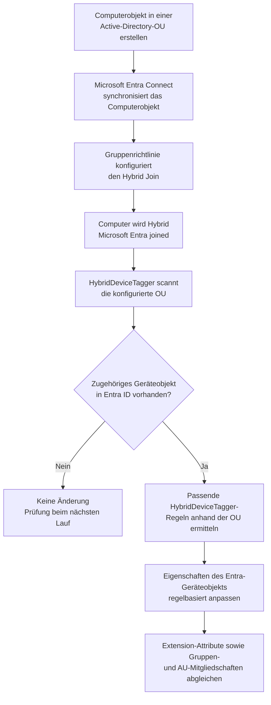

# HybridDeviceTagger

Microsoft Entra Connect kann Computerobjekte aus einem lokalen Active Directory mit Microsoft Entra ID synchronisieren. Die hierarchische Struktur des Active Directory wird dabei jedoch nicht übernommen. In Entra ID werden Geräteobjekte flach verwaltet und enthalten keine Information darüber, aus welcher Organisationseinheit (Organizational Unit, OU) sie stammen.

Im Active Directory lässt sich aus dem Distinguished Name (DN) eines Computers beispielsweise dessen administrativer  Tier-Level ableiten. In Entra ID muss eine vergleichbare Einordnung über Extension-Attribute, Gruppenmitgliedschaften oder administrative Einheiten erfolgen. Zwar können Gruppen mit Entra Connect synchronisiert werden, für gerätespezifische Extension-Attribute und Restricted Management Administrative Units (RMAUs) gibt es jedoch keine entsprechende automatische Zuordnung anhand der lokalen OU-Struktur.

## Ein Beispiel

Ein Windows-Server befindet sich im Active Directory in der OU `OU=Computers,OU=Tier 0,OU=Admin,DC=contoso,DC=com` und ist dadurch als Tier-0-System eingeordnet. Nach der Synchronisierung als Hybrid Microsoft Entra joined Gerät ist diese OU-Zugehörigkeit am Entra-Geräteobjekt nicht erkennbar.

Ohne Automatisierung müsste ein Entra-Administrator diese Einordnung manuell nachbilden. Dazu wären beispielsweise ein passendes Extension-Attribut für einen Gerätefilter in einer Conditional-Access-Richtlinie sowie Mitgliedschaften in einer Entra-Sicherheitsgruppe und einer RMAU zu pflegen.

## Die Lösung

HybridDeviceTagger überträgt diese Informationen automatisiert aus der lokalen AD-Struktur nach Microsoft Entra ID. Die Lösung durchsucht regelmäßig die konfigurierten OU-Teilbäume und ordnet lokale Computerobjekte anhand ihrer AD-`objectGUID` den zugehörigen Entra-Geräteobjekten mit derselben `deviceId` zu. Verarbeitet werden ausschließlich Geräte, die als Hybrid Microsoft Entra joined erkannt wurden.

Für jedes gefundene Gerät wertet HybridDeviceTagger die zum Distinguished Name passenden Regeln aus. Abhängig von diesen Regeln kann die Lösung:

- `extensionAttribute1` bis `extensionAttribute15` setzen, beispielsweise zur Verwendung in Conditional-Access-Gerätefiltern,
- das Gerät Entra-Sicherheitsgruppen hinzufügen und
- das Gerät normalen oder eingeschränkten administrativen Einheiten (RMAUs) zuweisen.

Wird ein Computer in eine andere OU verschoben oder trifft eine Regel nicht mehr zu, bereinigt HybridDeviceTagger die von ihm selbst verwalteten Extension-Attribute und Mitgliedschaften. Manuell geänderte Attribute sowie bereits zuvor vorhandene Mitgliedschaften bleiben dabei erhalten. Die Lösung bildet damit eine automatisierte Brücke zwischen der lokalen OU-Struktur und der cloudbasierten Geräteverwaltung in Entra ID.



## Voraussetzungen

### Azure und Active Directory

- Eine Azure Subscription, in der die benötigten Ressourcen bereitgestellt werden können
- Ein vorhandenes Azure Virtual Network (VNet) mit einer Netzwerkverbindung zum lokalen Active Directory, beispielsweise über Site-to-Site-VPN oder ExpressRoute
- Funktionierende DNS-Namensauflösung aus dem VNet zu allen Active-Directory-Domänen und Domain Controllern im Forest
- Erreichbarkeit jedes Domain Controllers im Active-Directory-Forest aus dem VNet über LDAP auf Port 389 und LDAPS auf Port 636
- Ein gültiges LDAPS-Serverzertifikat auf jedem Domain Controller im Active-Directory-Forest; die Zertifikatskette muss von der Function App als vertrauenswürdig validiert werden können
- Ein Active-Directory-Servicekonto mit Leserechten auf die konfigurierten OUs und Computerobjekte sowie dem Recht, das eigene Kennwort zu ändern
- Ein vorhandener Azure Key Vault zur sicheren Speicherung des Kennworts des AD-Servicekontos

Die Azure-Ressourcen für die Function App, den Storage Account, die Managed Identity und die Überwachung werden durch das Installationsskript bereitgestellt. Das VNet, die erforderlichen Subnetze und der Key Vault müssen bereits vorhanden sein. Die erforderlichen Azure-, Entra- und Active-Directory-Berechtigungen sind in der [Installationsanleitung](Deployment/README.md#required-permissions) beschrieben.

### Installationsrechner

Für die Installation mit `Deployment/Install-HybridDeviceTagger.ps1` werden benötigt:

- PowerShell 7
- Azure CLI 2.60.0 oder neuer
- .NET 8 SDK

Managed Identity authentifiziert den Zugriff auf Microsoft Graph und Azure Key Vault. Sie ersetzt keine LDAP-Anmeldedaten. Die Function liest das AD-Kennwort bei jedem Lauf direkt aus Key Vault, damit ein Versionswechsel sofort wirksam wird.

## Installation

Die Installation erfolgt mit `.\Deployment\Install-HybridDeviceTagger.ps1`. Das Skript führt die Prüfungen und die Bereitstellung in getrennten Schritten aus. Wird es ohne Installationsparameter aufgerufen, fragt es die benötigten Werte interaktiv ab.

### Schritt 1: Voraussetzungen validieren

Jede Installation beginnt mit einem reinen Validierungslauf:

```powershell
.\Deployment\Install-HybridDeviceTagger.ps1 -ValidateOnly
```

Der Installer zeigt Vorschlagswerte in eckigen Klammern an. Mit **Enter** wird der jeweilige Vorschlag übernommen. Pflichtwerte ohne Vorschlag müssen eingegeben werden. Nicht vorhandene oder ungeeignete Netzwerkressourcen werden unmittelbar gemeldet und erneut abgefragt.

Die interaktiven Abfragen erfolgen in dieser Reihenfolge:

| Nr. | Abfrage | Bedeutung und Prüfung |
| ---: | --- | --- |
| 1 | **Azure subscription ID** | Ziel-Subscription für die Function App. Vorgeschlagen wird die Subscription der aktuellen `az login`-Sitzung. Die Auswahl wird sofort aktiviert und validiert. |
| 2 | **Resource group name** | Resource Group für die durch den Installer verwalteten Ressourcen. Vorgabe ist `rg-HybridDeviceTagger`. Die Resource Group kann bei der späteren Installation optional erstellt werden. |
| 3 | **Azure location** | Azure-Region der Function App. Vorgabe ist `westeurope`; die Region muss Flex Consumption (FC1) unterstützen. |
| 4 | **Function App name** | Global eindeutiger Name der Function App. Der Vorschlag folgt dem Muster `func-devtagger-yyyyMMdd`. |
| 5 | **Storage account name** | Global eindeutiger Name des neuen Storage Accounts. Der Vorschlag wird aus dem Namen der Function App abgeleitet und an die Azure-Namensregeln angepasst. |
| 6 | **Virtual network subscription ID** | Subscription des vorhandenen VNets. Vorgeschlagen wird die Ziel-Subscription aus Abfrage 1; ein VNet in einer anderen Subscription desselben Entra-Tenants ist möglich. |
| 7 | **Virtual network resource group name** | Resource Group des vorhandenen VNets. Sie wird unmittelbar über Azure abgefragt und muss existieren. |
| 8 | **Virtual network name** | Name des vorhandenen VNets. Das VNet muss in derselben Azure-Region wie die Function App liegen. |
| 9 | **Flex Consumption integration subnet name** | Vorhandenes Subnetz für die VNet-Integration. Der Installer prüft unter anderem Größe, IPv4-Konfiguration, exklusive Delegierung an `Microsoft.App/environments` und das Fehlen von Service- und Private Endpoints. |
| 10 | **Private endpoint subnet name** | Vorhandenes, nicht delegiertes IPv4-Subnetz für den Storage Private Endpoint. Es muss sich vom Integrationssubnetz unterscheiden. |
| 11 | **Key Vault resource group name** | Resource Group des vorhandenen Key Vaults. Vorgeschlagen wird die Resource Group aus Abfrage 2. |
| 12 | **Key Vault name** | Name des vorhandenen Key Vaults. Der Vorschlag wird aus dem Function-App-Namen abgeleitet; der Key Vault wird nicht durch den Installer erstellt. |
| 13 | **Active Directory forest DNS name** | DNS-Name des AD-Forests. Wenn möglich, wird der Forest des angemeldeten Windows-Benutzers vorgeschlagen. Dieser Name dient standardmäßig auch als LDAP-/LDAPS-Endpunkt. |
| 14 | **Service Account** | UPN des AD-Servicekontos. Vorgeschlagen wird `HybridDeviceTagger@<Forest-DNS-Name>`. |
| 15 | **Active Directory bind user distinguished name** | Distinguished Name des Servicekontos. Diese Abfrage erscheint nur, wenn der Installer den DN nicht automatisch über den UPN ermitteln kann. |
| 16 | **Active Directory service-account password** | Das Kennwort wird in einem geschützten Anmeldedialog erfasst und ausschließlich für Bind-, Secret- und Lesetests verwendet. Es wird nicht im Installationsprotokoll ausgegeben. |
| 17 | **Management API Entra application (client) ID** | Client-ID der Entra-App-Registrierung, welche die Management API repräsentiert. Die Eingabe muss eine gültige GUID sein. |
| 18 | **Management API allowed Entra principal object ID** | Objekt-ID des zunächst zugelassenen Benutzers, der Gruppe oder des Service Principals. Kann der aktuell über Azure CLI angemeldete Entra-Benutzer ermittelt werden, verwendet der Installer dessen Objekt-ID automatisch und zeigt keine Abfrage an. |

Nach der Eingabe prüft der Installer zusätzlich Ressourcenanbieter, Ressourcennamen, Key-Vault-Sicherheit und das vorhandene Kennwort-Secret, DNS und LDAP/LDAPS, die Zertifikatskette, den Forest sowie die Anmeldung des Servicekontos. Ist LDAPS nicht erreichbar, wird ein LDAP-Fallback nur nach ausdrücklicher Zustimmung geprüft. Tagging-Regeln, Ziel-OUs, Gruppen, administrative Einheiten und RMAUs sind nicht Teil der Installation.

Dieser Aufruf nimmt keine Änderungen an Azure, Microsoft Entra ID oder Active Directory vor. Die abschließende Zusammenfassung nennt den Modus **Validation only (no changes)** und alle geprüften Bestandsressourcen.

Fehler müssen behoben werden, bevor mit dem nächsten Schritt fortgefahren wird.

### Schritt 2: AD-Servicekonto vorbereiten, falls erforderlich

Ist das vorgesehene AD-Servicekonto noch nicht vorhanden oder muss sein initiales Kennwort gesetzt werden, kann es getrennt von der Azure-Installation vorbereitet werden:

```powershell
.\Deployment\Install-HybridDeviceTagger.ps1 -PrepareActiveDirectoryAccountOnly
```

Im interaktiven Modus läuft die Vorbereitung so ab:

1. Der Installer fragt die Angaben zur Azure-Umgebung, zum vorhandenen Key Vault und zu Active Directory erneut ab. Fragen zur Management API entfallen.
2. Eine Zusammenfassung zeigt, welches AD-Servicekonto und welches Key-Vault-Secret geändert werden. Bestätigen Sie den Vorgang erst nach der Prüfung.
3. Geben Sie in der geschützten Anmeldeabfrage ein AD-Konto an, das Servicekonten erstellen oder deren Kennwort zurücksetzen darf.
4. Existiert das Servicekonto bereits, wählen Sie ein automatisch erzeugtes Kennwort oder geben ein neues Kennwort ein. Existiert das Servicekonto noch nicht, legt der Installer das Konto mit einem zufälligen Kennwort an.
5. Der Installer speichert das neue Kennwort im vorhandenen Key Vault und prüft anschließend, ob die Anmeldung mit dem Servicekonto funktioniert.

### Schritt 3: Azure-Änderungen prüfen (optional)

Nach erfolgreicher Validierung kann ein optionaler What-if-Lauf die geplanten Änderungen anzeigen, ohne sie anzuwenden:

```powershell
.\Deployment\Install-HybridDeviceTagger.ps1 -WhatIf
```

Die Ausgabe zeigt die zu erstellenden oder zu aktualisierenden Azure-Ressourcen sowie die referenzierten Bestandsressourcen. Dazu gehören insbesondere Function App, Flex-Consumption-Plan, Storage Account, Private Endpoint, Log Analytics, Application Insights, Managed Identity und die erforderlichen Rollenzuweisungen. VNet, Subnetze und Key Vault werden nur referenziert und nicht erstellt oder verändert.

### Schritt 4: Installation ausführen

Ist die Validierung aus Schritt 1 ohne Fehler abgeschlossen, kann die Installation ohne Modusschalter gestartet werden. Wurde der optionale What-if-Lauf ausgeführt, sollten dessen angezeigte Änderungen zuvor geprüft werden:

```powershell
.\Deployment\Install-HybridDeviceTagger.ps1
```

Der Validierungslauf aus Schritt 1 speichert die eingegebenen Werte nicht. Der Live-Lauf fragt deshalb die Abfragen 1 bis 18 aus Schritt 1 erneut in derselben Reihenfolge ab. Verwenden Sie dabei dieselben geprüften Werte. Dazu gehören das Azure-Ziel, VNet und Subnetze, Key Vault, AD-Forest und Servicekonto sowie die Entra-App- und Principal-IDs.

Während des Live-Laufs erscheinen anschließend folgende regulären oder bedingten Rückfragen:

| Abfrage | Wann erscheint sie? | Bedeutung und Auswahl |
| --- | --- | --- |
| **Active Directory service-account password** | Immer, wenn kein Kennwort als Parameter übergeben wurde | Ein geschützter Anmeldedialog fragt das aktuelle Kennwort des AD-Servicekontos ab. Es wird für LDAP-/LDAPS-, Lese- und Key-Vault-Prüfungen verwendet und weder angezeigt noch in das Installationsprotokoll geschrieben. Der Live-Lauf setzt dieses Kennwort nicht zurück. |
| **Approve unencrypted LDAP fallback?** | Nur wenn LDAPS nicht erreichbar ist | **Yes** erlaubt LDAP auf Port 389 mit Negotiate, Signierung und Verschlüsselung der LDAP-Sitzung. Die Kennwortrotation bleibt deaktiviert, bis LDAPS wieder verfügbar ist. **No** ist die Vorgabe und beendet die Installation ohne Bereitstellung. |
| **Installation summary / Execute the installation plan shown above** | Nach allen Prüfungen und vor der ersten Änderung | Die Zusammenfassung nennt Subscription, Resource Group, Region, alle zu erstellenden oder zu aktualisierenden Ressourcen, Rollen und Berechtigungen. **Yes** beziehungsweise **Yes to All** startet die Installation. **No** beziehungsweise **No to All** beendet sie, bevor Änderungen vorgenommen werden. |

Nach der zentralen Bestätigung führt das Skript die folgenden Schritte ohne weitere reguläre Rückfragen aus:

1. Fehlende Ressourcenanbieter registrieren, sofern der Lauf mit `-RegisterProviders` gestartet wurde.
2. Die Resource Group prüfen oder mit `-CreateResourceGroup` anlegen.
3. Das Bicep-Deployment nochmals validieren.
4. Die fünf Anwendungsrollen der Management API konfigurieren und den angegebenen Principals zuweisen.
5. Function App, Flex-Consumption-Plan, Storage Account, Private Endpoint und Monitoring-Ressourcen bereitstellen oder aktualisieren.
6. Der Managed Identity die benötigten Microsoft-Graph-Berechtigungen zuweisen.
7. Den Function-Code mit `dotnet publish` erstellen und in die Function App hochladen.

Bei Erfolg endet der Lauf mit `Installation completed for Function App '<Name>'`. Die Function ist dann vollständig bereitgestellt, bleibt ohne Regeln jedoch inaktiv: Tagging-Läufe greifen weder auf Ziel-OUs zu noch ändern oder bereinigen sie Entra-Geräte. Das Installationsskript ist idempotent und kann für spätere Aktualisierungen erneut mit denselben Schritten ausgeführt werden.

### Schritt 5: Entra-Konto berechtigen

Der Installer weist dem während der Installation angegebenen Bootstrap-Benutzer standardmäßig alle Rollen der Management API zu. Soll ein anderes Entra-Konto die Tagging-Regeln verwalten, benötigt dieses Konto die Anwendungsrolle `HybridDeviceTagger.RuleAdministrator`.

Die Rolle wird im Microsoft Entra Admin Center zugewiesen:

1. **Identität** > **Anwendungen** > **Unternehmensanwendungen** öffnen.
2. Die Enterprise Application der HybridDeviceTagger Management API auswählen.
3. **Benutzer und Gruppen** > **Benutzer/Gruppe hinzufügen** wählen.
4. Das Entra-Konto oder eine Sicherheitsgruppe auswählen.
5. Die Rolle `HybridDeviceTagger.RuleAdministrator` auswählen und die Zuweisung bestätigen.

Für die laufende Administration sollten nach Möglichkeit Sicherheitsgruppen statt einzelner Benutzer berechtigt werden. Rollen aus Azure RBAC auf einer Subscription oder Resource Group gewähren keinen Zugriff auf die Management API. Nach einer neuen Rollenzuweisung muss sich der Benutzer erneut mit `az login` anmelden, damit das Zugriffstoken die neue Rolle enthält.

### Schritt 6: HybridDeviceTagger konfigurieren

Nach der Installation werden die Tagging-Regeln über das PowerShell-Modul `HybridDeviceTagger.Management` erstellt. Melden Sie sich mit dem zuvor berechtigten Entra-Konto an, importieren Sie anschließend das Modul und verbinden Sie sich mit der bereitgestellten Function App:

```powershell
az login

Import-Module .\Deployment\HybridDeviceTagger.Management
Connect-HybridDeviceTagger `
    -ApiBaseUri 'https://<function-app-name>.azurewebsites.net/api/management'
```

Das Modul liest den benötigten Entra-Token-Scope automatisch über die REST API der jeweiligen Installation. Eine Client-ID muss im Modul weder angegeben noch gespeichert werden.

Eine Regel beschreibt, welche AD-Computer anhand ihrer OU ausgewählt werden und welche Eigenschaften ihre Entra-Geräteobjekte erhalten. Starten Sie die geführte Konfiguration ohne weitere Parameter:

```powershell
Add-HybridDeviceTaggerRule -Confirm
```

Das Cmdlet führt nacheinander durch diese Eingaben:

1. **Rule name**: eindeutiger Name der Regel.
2. **Rule description**: Beschreibung ihres Zwecks.
3. **Active Directory base DN**: Ziel-OU. Ein OU-Pfad ohne `DC=` wird in allen Domänen des Forests gesucht; ein vollständiger Distinguished Name gilt nur für die angegebene Domäne.
4. **Extension attribute name und value**: optional mehrere Werte von `extensionAttribute1` bis `extensionAttribute15`. Eine leere Attributnameneingabe beendet diesen Teil.
5. **Entra security-group object IDs**: optionale, kommagetrennte Object IDs der Entra-Sicherheitsgruppen.
6. **Administrative-unit object IDs**: optionale, kommagetrennte Object IDs normaler oder eingeschränkter administrativer Einheiten.

Jede Regel benötigt mindestens eine Aktion: ein Extension-Attribut, eine Gruppenmitgliedschaft oder eine administrative Einheit. Bleiben alle drei Bereiche leer, fragt das Cmdlet die Aktionen erneut ab. Durch `-Confirm` zeigt PowerShell vor dem Speichern das Ziel und die auszuführende Änderung zur Bestätigung an.

Lesen Sie das Ergebnis anschließend zur Kontrolle aus:

```powershell
Get-HybridDeviceTaggerRule -Name '<regelname>'
```

Weitere Regeln werden auf dieselbe Weise hinzugefügt. Existiert bereits eine Regel mit demselben Namen, ersetzt `Add-HybridDeviceTaggerRule` diese vollständig. Die Änderung wird beim nächsten Tagging-Lauf wirksam; ein Neustart der Function App ist nicht erforderlich.

Für Automatisierung oder wiederverwendbare Konfigurationen kann die Regel alternativ als PowerShell-Objekt übergeben werden. Mit `-WhatIf` lässt sich diese Variante vorab prüfen:

```powershell
$rule = @{
    name = 'Tier 0 workstations'
    description = 'Kennzeichnet administrative Tier-0-Arbeitsstationen.'
    baseDn = 'OU=Tier0,OU=Admin'
    extensionAttributes = @{
        extensionAttribute1 = 'PAW'
        extensionAttribute2 = 'Tier0'
    }
    entraGroupIds = @('<object-id-der-entra-sicherheitsgruppe>')
    administrativeUnitIds = @('<object-id-der-administrativen-einheit>')
}

Add-HybridDeviceTaggerRule -Rule $rule -WhatIf
Add-HybridDeviceTaggerRule -Rule $rule
```

Ausführliche Parameterbeispiele, Berechtigungen und Hinweise zur Fehleranalyse stehen in der [Installationsanleitung](Deployment/README.md).

## PowerShell-Modul: verfügbare Kommandos

Das Modul `HybridDeviceTagger.Management` verwaltet die bereitgestellte Function ausschließlich über deren Entra-geschützte REST API. Vor allen weiteren Kommandos muss einmal `Connect-HybridDeviceTagger` ausgeführt werden. Die Verbindung und das Zugriffstoken werden für die aktuelle PowerShell-Sitzung wiederverwendet und bei Bedarf automatisch erneuert.

Eine Übersicht der verfügbaren Kommandos liefert PowerShell direkt aus dem importierten Modul:

```powershell
Get-Command -Module HybridDeviceTagger.Management
Get-Help Connect-HybridDeviceTagger -Full
```

| Kommando | Zweck | Wichtige Parameter |
| --- | --- | --- |
| `Connect-HybridDeviceTagger` | Verbindet die aktuelle Sitzung über die bestehende `az login`-Anmeldung mit der Management API. | `-ApiBaseUri` wählt eine andere Installation. `-SkipValidation` überspringt den initialen API-Test. `-PassThru` gibt nicht vertrauliche Verbindungsinformationen zurück. |
| `Get-HybridDeviceTaggerRule` | Liest alle wirksamen Tagging-Regeln oder eine bestimmte Regel. | `-Name` filtert case-insensitiv nach dem eindeutigen Regelnamen. |
| `Add-HybridDeviceTaggerRule` | Erstellt eine neue Regel oder ersetzt eine vorhandene Regel mit demselben Namen vollständig. Ohne Parameter startet die geführte Eingabe. | `-Interactive` fordert den Dialog explizit an. `-Rule` übernimmt alternativ ein vollständiges PowerShell-Objekt oder Pipelineobjekt. Unterstützt `-WhatIf` und `-Confirm`. |
| `Remove-HybridDeviceTaggerRule` | Entfernt eine Regel. Die API verhindert, dass die letzte verbliebene Regel gelöscht wird. | `-Name` gibt die zu löschende Regel an. Unterstützt `-WhatIf` und `-Confirm`. |
| `Set-HybridDeviceTaggerRuleConfiguration` | Ersetzt den gesamten Regelsatz atomar. Nicht übergebene bisherige Regeln werden entfernt. | `-Rule` erwartet ein Array mit 1 bis 100 vollständigen Regeln. Unterstützt `-WhatIf` und `-Confirm`. |
| `Invoke-HybridDeviceTagging` | Startet unmittelbar denselben Geräteabgleich, den sonst der Timer ausführt. | Keine fachlichen Parameter. Unterstützt `-WhatIf` und `-Confirm`. Bei einem bereits laufenden Abgleich meldet die API einen Konflikt. |
| `Get-HybridDeviceTaggerLastRunStatus` | Zeigt Status, Invocation ID, Zeitstempel, Ergebniszähler und gegebenenfalls bereinigte Fehlerinformationen des letzten Tagging-Laufs. | Keine Parameter. |
| `Get-HybridDeviceTaggerTrace` | Lädt den letzten Tagging-Trace und gibt jede JSONL-Zeile als strukturiertes PowerShell-Objekt aus. | Keine Parameter. Die Ereignisse können mit `Where-Object`, `Select-Object` oder `Export-Csv` weiterverarbeitet werden. |
| `Invoke-HybridDeviceTaggerPasswordRotation` | Erzwingt eine sofortige Rotation des AD-Servicekonto-Kennworts. Nur die Altersgrenze wird übersprungen; LDAPS-, Credential- und Key-Vault-Prüfungen bleiben aktiv. | Keine fachlichen Parameter. Unterstützt `-WhatIf` und fordert wegen der tatsächlichen Kennwortänderung eine Bestätigung an. |
| `Get-HybridDeviceTaggerPasswordRotationStatus` | Zeigt den letzten Rotationsstatus und den Zeitpunkt der letzten tatsächlichen Kennwortänderung. | Keine Parameter. Kennwörter werden niemals zurückgegeben. |
| `Get-HybridDeviceTaggerTrustedCertificate` | Listet Metadaten aller aktuell für neue LDAPS-Verbindungen vertrauenswürdigen Zertifikate auf. | Keine Parameter. Zertifikatsinhalt und private Schlüssel werden nicht ausgegeben. |
| `Add-HybridDeviceTaggerTrustedCertificate` | Fügt ein öffentliches DER- oder PEM-Zertifikat als zusätzlichen LDAPS Trust Anchor hinzu. Bestehende Zertifikate bleiben erhalten. | `-Path` verweist auf die Zertifikatsdatei. Unterstützt Pipelineübergabe über die Eigenschaft `Path`, `-WhatIf` und `-Confirm`. |
| `Remove-HybridDeviceTaggerTrustedCertificate` | Entfernt einen LDAPS Trust Anchor. Das letzte Zertifikat kann nicht entfernt werden. | `-CertificateThumbprint` beziehungsweise der Alias `-Thumbprint` wählt das Zertifikat. Unterstützt Pipelineübergabe, `-WhatIf` und `-Confirm`. |

### Regeln verwalten

Der normale interaktive Ablauf erstellt Regeln einzeln. Vorhandene Regeln können anschließend gelesen oder entfernt werden:

```powershell
Add-HybridDeviceTaggerRule -Confirm
Get-HybridDeviceTaggerRule
Get-HybridDeviceTaggerRule -Name 'Tier 0 workstations' | Format-List
Remove-HybridDeviceTaggerRule -Name 'Tier 0 workstations' -WhatIf
```

`Set-HybridDeviceTaggerRuleConfiguration` ist für kontrollierte Massenänderungen gedacht. Das Kommando ersetzt immer den vollständigen Regelsatz. Deshalb sollte der aktuelle Zustand zuerst gelesen, lokal angepasst und die Änderung mit `-WhatIf` geprüft werden:

```powershell
$rules = @(Get-HybridDeviceTaggerRule)
Set-HybridDeviceTaggerRuleConfiguration -Rule $rules -WhatIf
Set-HybridDeviceTaggerRuleConfiguration -Rule $rules -Confirm
```

### Betrieb prüfen und Aktionen starten

Ein manueller Tagging-Lauf liefert die Invocation ID und seine Ergebniszähler zurück. Status und Trace können danach getrennt abgefragt werden:

```powershell
$result = Invoke-HybridDeviceTagging -Confirm
$result | Format-List

Get-HybridDeviceTaggerLastRunStatus | Format-List
Get-HybridDeviceTaggerTrace | Where-Object level -eq 'Error'
Get-HybridDeviceTaggerPasswordRotationStatus | Format-List
```

Die Kennwortrotation ändert das reale AD-Servicekonto-Kennwort und sollte zunächst mit `-WhatIf` geprüft werden:

```powershell
Invoke-HybridDeviceTaggerPasswordRotation -WhatIf
Invoke-HybridDeviceTaggerPasswordRotation -Confirm
```

### LDAPS-Zertifikate verwalten

Beim Zertifikatswechsel wird zuerst das neue Zertifikat hinzugefügt und erst nach erfolgreicher LDAPS-Prüfung das alte entfernt. Dadurch bleibt jederzeit mindestens ein Trust Anchor vorhanden:

```powershell
Add-HybridDeviceTaggerTrustedCertificate `
    -Path '.\contoso-root-ca.cer' `
    -Confirm

Get-HybridDeviceTaggerTrustedCertificate |
    Format-Table thumbprint, subject, notAfterUtc

Remove-HybridDeviceTaggerTrustedCertificate `
    -Thumbprint '00112233445566778899AABBCCDDEEFF00112233' `
    -Confirm
```

Ändernde Kommandos lesen vor dem Schreiben den aktuellen ETag und senden ihn an die API. Parallele Änderungen werden dadurch als Konflikt abgelehnt, statt unbemerkt überschrieben zu werden. `-WhatIf` zeigt die geplante Operation ohne Änderung; `-Confirm` fordert unmittelbar vor der Änderung eine Bestätigung an.

## Monitoring des HybridDeviceTagger

Der HybridDeviceTagger stellt drei sich ergänzende Beobachtungsebenen bereit:

| Ebene | Inhalt | Aufbewahrung und Verwendung |
| --- | --- | --- |
| Management API | Letzter Status von Geräte-Tagging und Kennwortrotation mit Zustand, Invocation ID, Zeitstempeln, Ergebniszählern und bereinigten Fehlerinformationen | Schneller Betriebscheck über das PowerShell-Modul |
| Ablauf-Trace | Strukturierter JSONL-Trace des letzten Geräte-Tagging-Laufs im privaten Blob-Container `run-traces` | Detaillierte Analyse der zuletzt ausgeführten Schritte; wird bei jedem neuen Lauf ersetzt |
| Application Insights | Historische OpenTelemetry-Logs, Exceptions, Requests und HTTP-Abhängigkeiten | Zeitreihen, Korrelation und Alarmierung; der bereitgestellte Log-Analytics-Workspace bewahrt Daten standardmäßig 30 Tage auf |

### Schneller Betriebscheck

Nach dem Verbinden zeigen die Statuskommandos, ob die letzte Ausführung `Running`, `Succeeded` oder `Failed` ist. Beim Tagging sind außerdem unter anderem erkannte, geänderte, unveränderte und nicht gefundene Geräte sowie hinzugefügte oder entfernte Mitgliedschaften sichtbar. Der Rotationsstatus enthält das Ergebnis der letzten Prüfung und den Zeitpunkt der letzten tatsächlichen Kennwortänderung, aber niemals das Kennwort selbst.

```powershell
Connect-HybridDeviceTagger

Get-HybridDeviceTaggerLastRunStatus | Format-List
Get-HybridDeviceTaggerPasswordRotationStatus | Format-List
Get-HybridDeviceTaggerTrace | Select-Object -Last 20
```

Für eine Fehleranalyse kann der letzte Trace gezielt gefiltert oder vollständig exportiert werden:

```powershell
Get-HybridDeviceTaggerTrace |
    Where-Object level -in 'Warning', 'Error' |
    Format-List

Get-HybridDeviceTaggerTrace |
    ConvertTo-Json -Depth 10 |
    Set-Content '.\device-tagger-last-run.json'
```

Die `InvocationId` verbindet Status, Trace und Application-Insights-Telemetrie derselben Ausführung. Ein Status `Running`, der deutlich länger als die übliche Laufzeit bestehen bleibt, ein Status `Failed` oder wiederholte Warnungen im Trace müssen untersucht werden.

### Application Insights und Log Analytics

Die Installation erstellt die workspacebasierte Application-Insights-Ressource `<Function-App-Name>-appi` und den verbundenen Log-Analytics-Workspace `<Function-App-Name>-law`. Die Function sendet strukturierte OpenTelemetry-Logs, Exceptions, Requests und HTTP-Abhängigkeiten, sobald `APPLICATIONINSIGHTS_CONNECTION_STRING` gesetzt ist. In Azure öffnen Sie die Application-Insights-Ressource und anschließend **Überwachung > Protokolle**.

Bei direkter Abfrage des Log-Analytics-Workspace heißen die Tabellen `AppTraces`, `AppExceptions`, `AppRequests` und `AppDependencies`. Die folgenden Kurzformen `traces`, `exceptions`, `requests` und `dependencies` gelten im Protokollbereich der Application-Insights-Ressource. Ersetzen Sie `<Function-App-Name>` in den Abfragen durch den Namen der bereitgestellten Function App.

Letzte Abläufe und ihre Ergebnisfelder:

```kusto
traces
| where timestamp > ago(24h)
| where cloud_RoleName == "<Function-App-Name>"
| where message has_any ("Device tagging", "Tagging rule", "Password rotation")
| project timestamp, severityLevel, message, operation_Id, customDimensions
| order by timestamp desc
```

Fehler einschließlich Stacktrace:

```kusto
exceptions
| where timestamp > ago(7d)
| where cloud_RoleName == "<Function-App-Name>"
| project timestamp, type, outerMessage, innermostMessage, operation_Id, details
| order by timestamp desc
```

Fehlgeschlagene Aufrufe an Microsoft Graph, Key Vault oder andere Abhängigkeiten:

```kusto
dependencies
| where timestamp > ago(7d)
| where cloud_RoleName == "<Function-App-Name>" and success == false
| project timestamp, target, name, resultCode, duration, operation_Id
| order by timestamp desc
```

Mit der `operation_Id` eines Treffers lässt sich die komplette Ausführung korrelieren:

```kusto
union traces, exceptions, requests, dependencies
| where operation_Id == "OPERATION_ID_EINSETZEN"
| order by timestamp asc
```

### Empfohlene Alarme

Die Installation erstellt derzeit keine Azure-Monitor-Alarmregeln. Für den produktiven Betrieb sollten mindestens folgende Log-Search-Alerts angelegt und an eine geeignete Action Group gebunden werden:

| Signal | Empfohlene Auslösung |
| --- | --- |
| Exceptions | Mindestens ein neuer Eintrag in `exceptions` für die Function App |
| Fehlgeschlagene Abhängigkeit | `success == false` in `dependencies`, insbesondere für Microsoft Graph und Key Vault |
| Ausbleibender Tagging-Lauf | Kein Logeintrag `Device tagging completed` innerhalb eines Zeitfensters, das größer als das konfigurierte `TaggingSchedule` ist |
| Fehlgeschlagene Kennwortrotation | Logeintrag `Password rotation check failed` |
| Aufgeschobene Kennwortrotation | Wiederholtes Ergebnis `DeferredNoSecureConnection`, da für die Rotation keine sichere LDAP-Verbindung verfügbar ist |

Eine mögliche Abfrage für einen ausgebliebenen erfolgreichen Tagging-Lauf bei einem 15-Minuten-Zeitplan ist:

```kusto
traces
| where timestamp > ago(45m)
| where cloud_RoleName == "<Function-App-Name>"
| where message startswith "Device tagging completed"
| summarize successfulRuns = count()
| where successfulRuns == 0
```

Das Alarmfenster muss an den tatsächlichen Zeitplan und die übliche Laufzeit angepasst werden. Geräteupdates protokollieren nur Geräte-IDs und die Namen geänderter Attribute. Attributwerte, Zugriffstoken und Kennwörter werden nicht protokolliert. Trace- und Telemetriedaten enthalten dennoch Verzeichnis- und Infrastrukturbezüge und müssen entsprechend geschützt werden.

## Erweiterte Installations- und Administrationsinformationen

### API-Rollen nach der Installation verwalten

Für Benutzer und Sicherheitsgruppen können Rollen im Entra Admin Center zugewiesen werden:

1. **Identität** > **Anwendungen** > **Unternehmensanwendungen** öffnen.
2. Die Enterprise Application der HybridDeviceTagger Management API auswählen.
3. **Benutzer und Gruppen** > **Benutzer/Gruppe hinzufügen** wählen.
4. Benutzer oder Sicherheitsgruppe und anschließend genau die benötigte Rolle auswählen.
5. Die Zuweisung bestätigen. Mehrere Rollen werden als einzelne Zuweisungen angelegt.

Für skriptbare Verwaltung und Service Principals kann Microsoft Graph PowerShell verwendet werden. Die ausführende Entra-Identität benötigt eine Rolle wie `Privileged Role Administrator` und muss den angeforderten Graph-Berechtigungen zustimmen können:

```powershell
Install-Module Microsoft.Graph.Authentication -Scope CurrentUser
Connect-MgGraph -Scopes 'Application.Read.All', 'AppRoleAssignment.ReadWrite.All'

$apiClientId = '<Application-(Client)-ID der Management API>'
$principalObjectId = '<Objekt-ID des Benutzers, der Gruppe oder des Service Principals>'
$roleValue = 'HybridDeviceTagger.CertificateAdministrator'

$api = Invoke-MgGraphRequest -Method GET -Uri (
    "https://graph.microsoft.com/v1.0/servicePrincipals?`$filter=appId eq '$apiClientId'&`$select=id,appRoles"
)
$apiServicePrincipal = @($api.value)[0]
$appRole = @($apiServicePrincipal.appRoles | Where-Object value -eq $roleValue)[0]

$assignmentUri = "https://graph.microsoft.com/v1.0/servicePrincipals/$($apiServicePrincipal.id)/appRoleAssignedTo"
$assignments = @(Invoke-MgGraphRequest -Method GET -Uri $assignmentUri).value
$assignment = @($assignments | Where-Object {
    $_.principalId -eq $principalObjectId -and $_.appRoleId -eq $appRole.id
})[0]

if (-not $assignment) {
    $assignment = Invoke-MgGraphRequest -Method POST -Uri $assignmentUri -Body (@{
        principalId = $principalObjectId
        resourceId = $apiServicePrincipal.id
        appRoleId = $appRole.id
    } | ConvertTo-Json)
}
```

Vorhandene Zuweisungen anzeigen und eine konkrete Zuweisung wieder entfernen:

```powershell
$assignments = @(Invoke-MgGraphRequest -Method GET -Uri $assignmentUri).value

$assignments |
    Where-Object principalId -eq $principalObjectId |
    Select-Object id, principalDisplayName, principalType, appRoleId

$assignmentToRemove = @($assignments | Where-Object {
    $_.principalId -eq $principalObjectId -and $_.appRoleId -eq $appRole.id
})[0]
if (-not $assignmentToRemove) {
    throw "The selected principal does not have role '$roleValue'."
}

Invoke-MgGraphRequest -Method DELETE -Uri (
    "$assignmentUri/$($assignmentToRemove.id)"
)
```

Nach einer Rollenänderung muss ein bereits ausgestelltes Zugriffstoken erneuert werden. Für das Management-Modul dazu die Verbindung neu aufbauen; bei einem weiterhin zwischengespeicherten Azure-CLI-Token ist eine erneute Anmeldung erforderlich:

```powershell
Disconnect-MgGraph
az logout
az login --tenant d89a354d-2bce-44ed-b802-8f8600689247
Connect-HybridDeviceTagger
```

`Assignment required` muss auf der Enterprise Application aktiviert bleiben. Azure-RBAC-Rollen auf Subscription oder Resource Group ersetzen keine dieser API-Anwendungsrollen.

### Erstmalige Einrichtung des AD-Kennworts

Vor dem ersten Start muss das bestehende Kennwort des Servicekontos einmalig als Secret `hybrid-device-tagger-ad-password-current` im Key Vault angelegt werden. `next` wird von der Rotation automatisch erstellt und darf nicht manuell als primäres Kennwort verwendet werden.

Die Managed Identity benötigt auf Secret-Ebene mindestens die Data Actions zum Lesen und Setzen von Secrets. `Key Vault Secrets User` reicht nicht aus, weil diese Rolle kein neues Secret setzen kann. Verwenden Sie eine eng begrenzte benutzerdefinierte Rolle oder, falls das organisatorisch nicht möglich ist, `Key Vault Secrets Officer`.

Das Laufzeitkonto bleibt reguläres Mitglied von `Domain Users`. Zusätzlich müssen auf dem Konto `SELF / Change Password` erlaubt und `User cannot change password` deaktiviert sein. Das Laufzeitkonto selbst benötigt weder administrative AD-Gruppen noch Reset-Password-Rechte; nur das getrennte Provisioning-Credential benötigt die Rechte zum Erstellen beziehungsweise Zurücksetzen.

Bei einer echten Installation kann der Installer das Servicekonto mit einem separaten AD-Provisioning-Credential vorbereiten. Fehlt das Konto, fragt er vor dem Erstellen und Aktivieren nach; ist es vorhanden, bietet er ein zufälliges komplexes Kennwort oder eine sichere manuelle Eingabe für den administrativen Reset an. Das Zielkennwort wird direkt als Current-Secret synchronisiert und nicht angezeigt. Der Installer bevorzugt LDAPS. Ist LDAPS nicht verfügbar und wurde der LDAP-Fallback ausdrücklich genehmigt, verwendet der Bootstrap das installierte Active-Directory-PowerShell-Modul über Active Directory Web Services gegen den konfigurierten Server. Nach Erstellung oder Reset bleibt **Benutzer muss Kennwort bei der nächsten Anmeldung ändern** deaktiviert. `-ValidateOnly` und `-WhatIf` verändern das AD-Konto nicht.

## Developer Information

### Nur für lokale Entwicklung

Azure Functions Core Tools v4 und Azurite werden nur benötigt, wenn die Function lokal entwickelt, gestartet oder getestet werden soll. Für die Installation mit dem bereitgestellten Installationsskript sind sie nicht erforderlich.

## Management REST API

Die Function App stellt eine Single-Tenant-Entra-geschützte Verwaltungs-API unter `/api/management` bereit. Nur `GET /api/management/authentication` ist öffentlich und liefert den nicht geheimen Token-Scope der jeweiligen Installation. Bei allen anderen Pfaden lehnt App Service Easy Auth nicht authentifizierte Aufrufe mit HTTP `401` ab. Die Function validiert zusätzlich den Principal Header und antwortet mit HTTP `403`, wenn keine für den Endpunkt zugelassene Entra-Anwendungsrolle enthalten ist. Für die Enterprise Application ist **Assignment required** aktiviert; zugelassen werden gezielt zugewiesene Benutzer, Sicherheitsgruppen oder Service Principals. Azure-Subscription-Rollen berechtigen nicht zum Aufruf dieser API. Es werden keine Function Keys oder Client Secrets benötigt.

| Methode und Pfad | Funktion | Erforderliche Rolle |
| --- | --- | --- |
| `GET /api/management/authentication` | Deployment-spezifischen Entra-Token-Scope lesen | keine |
| `GET /api/management/tagging-rules` | Aktuelle Regeln, ETag, Änderungszeit und Quelle lesen | `Reader` oder `RuleAdministrator` |
| `PUT /api/management/tagging-rules` | Den vollständigen validierten Regelsatz ersetzen | `RuleAdministrator` |
| `PUT /api/management/tagging-rules/{ruleName}` | Eine vollständige Regel hinzufügen oder case-insensitiv ersetzen | `RuleAdministrator` |
| `DELETE /api/management/tagging-rules/{ruleName}` | Eine Regel entfernen; mindestens eine Regel muss verbleiben | `RuleAdministrator` |
| `GET /api/management/status/device-tagging` | Status und Ergebniszähler des letzten Tagging-Laufs lesen | `Reader` oder `TaggingOperator` |
| `GET /api/management/status/password-rotation` | Status des letzten Checks und Zeitpunkt des letzten tatsächlichen Kennwortwechsels lesen | `Reader` oder `PasswordRotationAdministrator` |
| `GET /api/management/traces/device-tagging/latest` | Letzten JSONL-Trace als Download abrufen | `Reader` oder `TaggingOperator` |
| `POST /api/management/actions/device-tagging` | Einen Tagging-Lauf sofort ausführen | `TaggingOperator` |
| `POST /api/management/actions/password-rotation` | Das AD-Servicekonto-Kennwort sofort und unabhängig vom Alter sicher rotieren | `PasswordRotationAdministrator` |
| `GET /api/management/trusted-certificates` | Metadaten der aktuellen LDAPS-Vertrauenszertifikate lesen | `Reader` oder `CertificateAdministrator` |
| `POST /api/management/trusted-certificates` | Ein öffentliches DER-/PEM-Zertifikat hinzufügen | `CertificateAdministrator` |
| `DELETE /api/management/trusted-certificates/{thumbprint}` | Ein Zertifikat entfernen; mindestens eines muss verbleiben | `CertificateAdministrator` |

Die vollständigen Rollenwerte beginnen jeweils mit `HybridDeviceTagger.`, beispielsweise `HybridDeviceTagger.Reader`. Der Installer weist die bisherige Bootstrap-Liste standardmäßig allen fünf Rollen zu; für Least Privilege stehen fünf rollenbezogene Principal-Parameter zur Verfügung. Sicherheitsgruppen sind für die laufende Administration vorzuziehen.

Die API speichert dynamische Regeln als `tagging-configuration.json` im privaten Container `run-traces`. Solange die API noch keine Änderung gespeichert hat, verwendet sie `Tagging__RulesJson` als Fallback. Jeder Tagging-Lauf liest zu Beginn genau einen aktuellen Snapshot; ein Function-Restart ist nach Änderungen nicht erforderlich. ETags verhindern, dass parallele Änderungen unbemerkt überschrieben werden. Die vollständige OpenAPI-3.0-Spezifikation steht in [docs/management-api.openapi.yaml](docs/management-api.openapi.yaml).

Das Modul `Deployment/HybridDeviceTagger.Management` hält die mit `Connect-HybridDeviceTagger` aufgebaute REST-Verbindung für nachfolgende Cmdlets. Es verwendet die bestehende Anmeldung von `az login`; Subscription, Resource Group und ARM-Abfragen sind nicht erforderlich:

```powershell
Import-Module ./Deployment/HybridDeviceTagger.Management
Connect-HybridDeviceTagger
Get-HybridDeviceTaggerRule
Get-HybridDeviceTaggerLastRunStatus
Add-HybridDeviceTaggerRule -Rule $rule -WhatIf
Invoke-HybridDeviceTagging
Invoke-HybridDeviceTaggerPasswordRotation -Confirm
Get-HybridDeviceTaggerTrustedCertificate
Add-HybridDeviceTaggerTrustedCertificate -Path ./contoso-root-ca.cer
Remove-HybridDeviceTaggerTrustedCertificate -CertificateThumbprint $oldThumbprint -Confirm
```

`Invoke-HybridDeviceTaggerPasswordRotation` umgeht ausschließlich die Altersprüfung. Aktueller Bind, LDAPS, Staging, Validierung und Promotion bleiben verpflichtend. Beide Aktionen laufen synchron, schreiben denselben Status wie die Timer und antworten mit HTTP `409`, wenn die jeweilige Operation bereits läuft.

Die Leseoperationen stehen direkt im Modul zur Verfügung:

```powershell
Get-HybridDeviceTaggerRule
Get-HybridDeviceTaggerLastRunStatus | Format-List
Get-HybridDeviceTaggerPasswordRotationStatus | Format-List
Get-HybridDeviceTaggerTrace
```

`Get-HybridDeviceTaggerTrace` zeigt jedes Trace-Ereignis als eine logische Zeile im Format `<Zeit>,<Severity>,<Phase>,<Status>,<Action>,<Details>` an, liefert in der Pipeline aber vollständige `HybridDeviceTagger.TraceEvent`-Objekte. Dadurch funktionieren beispielsweise Zuweisung, `Where-Object`, `Select-Object`, `ConvertTo-Json` und `Export-Csv` ohne Informationsverlust.

Die Zertifikatsverwaltung speichert ausschließlich öffentliche DER-Daten im privaten Blob `run-traces/active-directory-trust-certificates.json`. Bis zur ersten API-Änderung dient das bei der Installation paketierte Zertifikat als Fallback. Jede neue LDAP-Verbindung verwendet den aktuellen Satz; doppelte Ergänzungen sind idempotent, parallele Änderungen ETag-geschützt und das Löschen des letzten Trust-Ankers ist gesperrt.

Das PowerShell-Modul ermittelt den Token-Scope automatisch über `GET /api/management/authentication`. Bei direkten REST-Aufrufen muss das Bearer-Token als Audience die konfigurierte API-App-ID oder `api://<client-id>` besitzen:

```powershell
$headers = @{ Authorization = "Bearer $accessToken" }
Invoke-RestMethod `
	-Uri 'https://func-hybriddevicetagger.azurewebsites.net/api/management/status/device-tagging' `
	-Headers $headers

Invoke-WebRequest `
	-Uri 'https://func-hybriddevicetagger.azurewebsites.net/api/management/traces/device-tagging/latest' `
	-Headers $headers `
	-OutFile '.\device-tagger-last-run.jsonl'
```

## Rotationsablauf

Die Rotation prüft das aktuelle Secret täglich und rotiert regulär ab einem Alter von 25 Tagen:

1. Neues zufälliges Kennwort als `next` in Key Vault speichern.
2. Eigenes AD-Kennwort über LDAPS mit einer kombinierten `unicodePwd`-Delete/Add-Operation ändern.
3. LDAP-Bind mit `next` validieren.
4. Das validierte Kennwort als neue Version von `current` speichern.

Wenn `current` nach einem unterbrochenen Lauf nicht mehr funktioniert, testet die Function zuerst `next` und übernimmt es bei Erfolg als `current`. Auch die Geräteabfrage verwendet diesen Fallback.

Kennwortänderungen über `unicodePwd` und die anschließende Validierung bleiben immer LDAPS-pflichtig. Ist eine Rotation fällig, aber LDAPS nicht verfügbar, wird sie mit `DeferredNoSecureConnection` ohne neues `next`-Secret und ohne Änderung in AD zurückgestellt. Der nächste geplante Lauf versucht die Rotation erneut.

## Lokal ausführen

1. `src/HybridDeviceTagger/local.settings.example.json` nach `src/HybridDeviceTagger/local.settings.json` übertragen und Domain Controller, Benutzer-DN sowie Vault-URI anpassen.
2. Azurite starten oder `AzureWebJobsStorage` auf eine Entwicklungs-Storage-Verbindung setzen.
3. Das bestehende AD-Kennwort als `current`-Secret im Key Vault anlegen.
4. Eine lokale Azure-Anmeldung mit Secret-Lese- und Schreibrechten bereitstellen, die über `DefaultAzureCredential` verwendet werden kann.
5. In `src/HybridDeviceTagger` den Befehl `func start` ausführen.

`local.settings.json` ist von Git ausgeschlossen. Zugangsdaten dürfen nicht in die Beispielkonfiguration oder das Repository eingetragen werden.

## Build und Tests

```powershell
dotnet build HybridDeviceTagger.sln --configuration Release
dotnet test HybridDeviceTagger.sln --configuration Release
```

Die Unit-Tests prüfen Geräteabgleich, Fälligkeit, reguläre Rotation, Recovery und Kennwortzusammensetzung.

Der GitHub-Actions-Workflow wird nur manuell über `workflow_dispatch` gestartet. Automatische Läufe bei Pushes und Pull Requests sind deaktiviert, weil die Enterprise-Richtlinie dieses privaten Repositorys keine GitHub-hosted Runner zulässt. Für automatische CI muss ein freigegebener Self-hosted Runner eingerichtet und im Workflow als `runs-on` eingetragen werden.

## Versionierung und Autor

Das Projekt verwendet die Produktversion `<major>.<minor>.<yyyyMMdd>.<counter>`, aktuell `0.1.20261005.1`. Der Zähler beginnt für jede Veröffentlichung am selben Datum bei `1` und wird bei weiteren Veröffentlichungen an diesem Tag erhöht. Die zentrale Definition steht in `Directory.Build.props` und wird als Paket- und Informational-Version in die Build-Ausgabe übernommen.

Vor jedem Commit müssen die Version in `Directory.Build.props` erhöht und ein datierter Abschnitt für exakt diese Version in [CHANGELOG.md](CHANGELOG.md) ergänzt werden. Das eingecheckte Prüfskript validiert beide Bedingungen gegen `HEAD`. Der Repository-Hook wird einmalig pro Clone aktiviert:

```powershell
git config core.hooksPath .githooks
```

Nach dem Staging kann dieselbe Prüfung manuell ausgeführt werden:

```powershell
pwsh -NoProfile -File scripts/Assert-CommitMetadata.ps1 -Staged
```

Da CLR-Assembly- und Dateiversionen nur Zahlenwerte bis `65534` je Segment unterstützen, bleiben diese separat kompatibel: `AssemblyVersion` ist `0.1.0.0`, `FileVersion` ist `0.1.0.2`. Ein Build- oder Releaseprozess kann die Produktversion ohne Dateiänderung setzen:

```powershell
dotnet build HybridDeviceTagger.sln --configuration Release `
	-p:VersionMajor=0 `
	-p:VersionMinor=1 `
	-p:VersionDate=20260904 `
	-p:VersionCounter=2
```

Autor und Ansprechpartner ist Andreas Lucas (aka Kili), `andreas.lucas@outlook.com`.

## Lizenz

Copyright 2026 Andreas Lucas.

Dieses Projekt ist unter der [Apache License 2.0](LICENSE) lizenziert.

## Code-Dokumentation

Eine englische Beschreibung der Architektur, Abläufe sowie der Verantwortlichkeiten und Zusammenarbeit aller Klassen steht in [DEVELOPER.md](DEVELOPER.md).

## Azure-Betrieb

Die Function App muss aus ihrem virtuellen Netzwerk den konfigurierten Domain Controller sowie die über die Forest-CrossRefs ermittelten Domain-DNS-Namen auflösen und per LDAPS erreichen, beispielsweise über Site-to-Site-VPN oder ExpressRoute. Optional kann LDAP auf Port 389 als Fallback erreichbar sein. Legen Sie alle Werte aus der Konfiguration als Function-App-Settings an und aktivieren Sie Managed Identity. Weisen Sie deren Service Principal die drei beschriebenen Graph-App-Rollen sowie die Key-Vault- und Blob-Rechte zu. Soll eine nach der Installation erstellte Regel Geräte in eingeschränkten administrativen Einheiten verwalten, muss ein Entra-Administrator der Managed Identity die dafür erforderliche Rolle separat am jeweiligen RMAU-Scope zuweisen.

Die Funktion markiert Geräte innerhalb der Ziel-OUs. Verlässt ein Computer alle konfigurierten Ziel-OUs, entfernt der nächste Lauf die noch unveränderten verwalteten Extension Attributes sowie die vom Tagger angelegten Gruppen-, AU- und RMAU-Mitgliedschaften.

## Troubleshooting

### Installation überprüfen

Nach der Bereitstellung sollten mindestens folgende Punkte kontrolliert werden:

- Die Function App wurde erfolgreich gestartet.
- Die Managed Identity besitzt Zugriff auf Storage, Key Vault und Microsoft Graph.
- Die Function App kann die Domain Controller über das VNet und DNS erreichen.
- Der erste Tagging-Lauf wird ohne Fehler abgeschlossen.
- Status und Ablauf-Trace können über die Management API beziehungsweise das PowerShell-Modul gelesen werden.

### Installationsprotokoll

Jeder Aufruf von `Install-HybridDeviceTagger.ps1` ersetzt die Datei `HybridDeviceTagger-Install.log` im temporären Verzeichnis des aktuellen Benutzers. Das PowerShell-Transcript enthält die Konsolenausgaben aller Validierungs-, What-if-, AD-Vorbereitungs- und Installationsschritte und wird auch bei einem Fehler oder frühen Abbruch sauber geschlossen.

```powershell
$installerLog = Join-Path ([System.IO.Path]::GetTempPath()) 'HybridDeviceTagger-Install.log'
code $installerLog
```

Das Transcript kann Benutzer-, Geräte-, Ressourcen- und Verzeichnisnamen enthalten und muss daher vertraulich behandelt werden. Kennwörter werden vom Skript nicht ausgegeben und dürfen auch bei manueller Fehleranalyse nicht in die Konsole geschrieben werden.

### Trace des letzten Tagging-Laufs

Jeder Start von `DeviceTaggerFunction` ersetzt die Datei `device-tagger-last-run.jsonl` im privaten Blob-Container `run-traces`. Jeder Arbeitsschritt wird sofort als einzelne JSON-Zeile geschrieben. Dadurch bleibt bei einer normalen Exception oder einem Prozessabbruch der bis dahin geschriebene Ablauf erhalten. Die Datei enthält unter anderem UTC-Zeit, laufende Sequenznummer, Invocation-ID, Phase, Aktion, Ergebnis, Device- und Ziel-IDs sowie bei Fehlern Exception-Typ, Meldung und Stacktrace. Kennwörter, Tokens und Extension-Attributwerte werden nicht gespeichert; für Attributvergleiche enthält der Trace nur SHA-256-Fingerprints.

Die Datei ist bewusst als JSON Lines aufgebaut. Copilot kann einzelne Zeilen unabhängig analysieren, nach `invocationId`, `phase`, `action`, `outcome`, `deviceId` oder `targetId` filtern und den letzten erfolgreichen Schritt unmittelbar vor einem Fehler bestimmen. Da Device- und Entra-Objekt-IDs sowie Infrastrukturpfade enthalten sind, muss die Datei trotz fehlender Geheimnisse vertraulich behandelt werden.

### Trace exportieren und in VS Code öffnen

Zum Herunterladen benötigt das angemeldete Konto `Storage Blob Data Reader` oder eine höherwertige Datenrolle und Netzwerkzugriff auf den privaten Blob-Endpunkt:

```powershell
az storage blob download `
	--account-name '<storage-account>' `
	--container-name 'run-traces' `
	--name 'device-tagger-last-run.jsonl' `
	--file '.\device-tagger-last-run.jsonl' `
	--auth-mode login

code '.\device-tagger-last-run.jsonl'
```

Der exportierte Trace kann anschließend direkt in VS Code geöffnet und Copilot zur Fehleranalyse übergeben werden.
