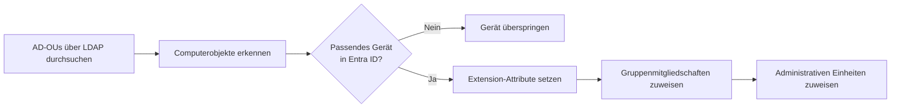

# HybridDeviceTagger

HybridDeviceTagger schließt eine Informationslücke zwischen Active Directory und Microsoft Entra ID bei Microsoft-Entra-hybrid-joined Geräten. Im Active Directory lässt sich die Position eines Computerobjekts anhand seines Distinguished Name (DN) und damit seiner Organisationseinheit (OU) bestimmen. Anders als bei Benutzerobjekten wird der DN von Computerobjekten jedoch nicht nach Entra ID synchronisiert.

HybridDeviceTagger nutzt den DN eines Computerobjekts als Grundlage für konfigurierbare Regeln und überträgt die daraus abgeleitete Zuordnung nach Entra ID. Abhängig von der AD-OU kann er:

- `extensionAttribute1` bis `extensionAttribute15` setzen,
- das Gerät Entra-Sicherheitsgruppen hinzufügen und
- das Gerät normalen oder eingeschränkten administrativen Einheiten zuordnen.

### Funktionsweise

HybridDeviceTagger durchsucht die konfigurierten OUs im Active Directory über LDAP. Für jedes gefundene Computerobjekt prüft er, ob ein zugehöriges Geräteobjekt in Entra ID vorhanden ist. Bei einer Übereinstimmung werden die für die jeweilige OU konfigurierten Extension-Attribute sowie Mitgliedschaften in Entra-Sicherheitsgruppen und administrativen Einheiten angewendet.



# Installation

## Voraussetzungen

- PowerShell 7.2 oder neuer mit dem ActiveDirectory-Modul
- Azure CLI 2.60.0
- Eine Azure Subscription, in der der Installationsbenutzer Ressourcen bereitstellen, das vorhandene virtuelle Netzwerk einbinden und RBAC-Rollenzuweisungen erstellen darf
- DNS-Auflösung und Netzwerkzugriff der Function App auf die DNS-Namen aller betroffenen Forest-Domains über LDAPS auf Port 636 oder ersatzweise LDAP auf Port 389
- Ein vorhandenes virtuelles Netzwerk mit Subnetzen für die Function-Integration und den privaten Storage-Endpunkt
- Ein forestweit verwendbares AD-Servicekonto mit Leserechten auf die konfigurierten OUs in allen Domains und dem Recht, das eigene Kennwort zu ändern
- Die in der [Installationsanleitung](Deployment/README.md#required-permissions) beschriebenen Azure-, Entra- und Active-Directory-Berechtigungen

### Optional

Ein bestehender Key Vault ist optional. Ist keiner vorhanden, erstellt das Setup einen neuen privaten Key Vault in der Ressourcengruppe der Function App. Soll ein bestehender Key Vault verwendet werden, fragt der Installer dessen Subscription, Ressourcengruppe und Namen ab.

## Quick Install

Nach dem Entpacken des Installationspakets zunächst bei Azure anmelden:

```powershell
az login
```

Anschließend den Installer interaktiv in drei Schritten ausführen. Er fragt alle benötigten Werte ab und schlägt passende Standardwerte vor:

- **Azure-Ziel:** Subscription, Ressourcengruppe, Region sowie Namen für Function App und Storage Account
- **Netzwerk:** Subscription und Ressourcengruppe des vorhandenen VNet, VNet-Name, Function-Integrationssubnetz und separates Private-Endpoint-Subnetz
- **Key Vault:** Auswahl zwischen einem vorhandenen Vault und einem neuen privaten Vault; bei einem vorhandenen Vault zusätzlich Subscription, Ressourcengruppe und Name
- **Active Directory:** Forest-DNS-Name, optional ein bestimmter Domain Controller, UPN und Distinguished Name des Servicekontos sowie dessen Kennwort über einen geschützten Anmeldedialog
- **Erste Tagging-Regel:** Name, Beschreibung, Basis-DN der OU und Wert für `extensionAttribute1`
- **Management API:** Client-ID der vorhandenen Entra-App-Registrierung und die Objekt-ID des berechtigten Benutzers, der Gruppe oder des Service Principals

Ist LDAPS nicht verfügbar, fragt der Installer vor der Verwendung des abgesicherten LDAP-Fallbacks nach einer Bestätigung. Regeln mit eingeschränkten administrativen Einheiten erfordern ebenfalls eine ausdrückliche Freigabe. Vor der eigentlichen Installation zeigt der Installer eine Zusammenfassung und fordert eine abschließende Bestätigung an.

```powershell
./Deployment/Install-HybridDeviceTagger.ps1 -ValidateOnly
./Deployment/Install-HybridDeviceTagger.ps1 -WhatIf
./Deployment/Install-HybridDeviceTagger.ps1
```

`-ValidateOnly` prüft die Voraussetzungen ohne Änderungen. `-WhatIf` zeigt die geplanten Azure-Änderungen. Erst der dritte Aufruf führt die Installation nach Bestätigung aus.

Bei jedem der drei interaktiven Aufrufe werden die Angaben erneut abgefragt. Sollen dieselben Werte wiederverwendet werden, empfiehlt sich die unter **Advanced Installation** beschriebene Übergabe über ein PowerShell-Splat.

## Advanced Installation

Für automatisierte oder wiederholbare Installationen können alle Werte als Parameter oder PowerShell-Splat übergeben werden. Mit `-CreateKeyVault` wird ein neuer privater Key Vault in der Ziel-Ressourcengruppe erstellt; ohne diesen Schalter wird ein vorhandener Key Vault verwendet. `-CreateResourceGroup`, `-RegisterProviders`, `-ActiveDirectoryTrustedCertificatePath` und die rollenbezogenen Management-API-Parameter steuern weitere Installationsoptionen.

Ein vollständiges Parameterbeispiel sowie Details zu Berechtigungen, Netzwerk, Key Vault, Validierung und unbeaufsichtigter Ausführung stehen in der [erweiterten Installationsanleitung](Deployment/README.md#validation).

## Installation in Azure

Das Verzeichnis `Deployment` enthält ein idempotentes PowerShell-Installationsskript und die Bicep-Vorlagen für Azure Functions Flex Consumption (FC1), Storage, Log Analytics und Application Insights. VNet, Integrationssubnetz und Key Vault werden als vorhandene Ressourcen geprüft und referenziert, aber nicht erstellt oder verändert.

Beginnen Sie immer mit `-ValidateOnly`, danach mit `-WhatIf`, und führen Sie erst anschließend die Installation aus. Parameter, Voraussetzungen, Berechtigungen und ein vollständiges Beispiel stehen in [Deployment/README.md](Deployment/README.md).

## Tagging-Regeln nach der Installation ändern

Für die Verwaltung wird das PowerShell-Modul `Deployment/HybridDeviceTagger.Management` verwendet:

| Befehl | Funktion |
| --- | --- |
| `Import-Module ./Deployment/HybridDeviceTagger.Management` | Management-Modul laden |
| `Connect-HybridDeviceTagger` | Mit der bestehenden Anmeldung von `az login` verbinden |
| `Get-HybridDeviceTaggerRule` | Vorhandene Tagging-Regeln anzeigen |
| `Add-HybridDeviceTaggerRule -Rule $rule` | Eine einzelne Regel hinzufügen oder ändern |
| `Add-HybridDeviceTaggerRule -Rule $configuration` | Alle Regeln aus der Eigenschaft `Rules` des übergebenen Objekts hinzufügen oder ändern |
| `Remove-HybridDeviceTaggerRule -Name '<Regelname>'` | Eine Regel entfernen |

```powershell
Import-Module ./Deployment/HybridDeviceTagger.Management
Connect-HybridDeviceTagger
Get-HybridDeviceTaggerRule

$configuration = @{ Rules = @($rule1, $rule2) }
Add-HybridDeviceTaggerRule -Rule $configuration -WhatIf
Add-HybridDeviceTaggerRule -Rule $configuration
```

Vor Änderungen kann der jeweilige Befehl mit `-WhatIf` geprüft werden. Vollständige Beispiele stehen in der [Installationsanleitung](Deployment/README.md#updating-tagging-rules-after-installation) und in der integrierten Hilfe, beispielsweise mit `Get-Help Add-HybridDeviceTaggerRule -Full`.

## Erstmalige Einrichtung des AD-Kennworts

Das initiale Kennwort wird über die Entra-geschützte Function API eingerichtet. Der ausführende Benutzer benötigt dadurch keine Datenberechtigung auf dem Key Vault, sondern nur die API-Rolle `HybridDeviceTagger.PasswordRotationAdministrator`.

```powershell
Import-Module ./Deployment/HybridDeviceTagger.Management
Connect-HybridDeviceTagger
$password = Read-Host 'AD-Servicekonto-Kennwort' -AsSecureString
Initialize-HybridDeviceTaggerActiveDirectoryCredential -Password $password -Confirm
```

Die Function validiert das Kennwort durch einen AD-Bind und speichert es anschließend mit ihrer Managed Identity als Secret `hybrid-device-tagger-ad-password-current`. Ein bereits vorhandenes Current-Secret wird nicht überschrieben. `next` wird ausschließlich von der Rotation erstellt.

Das Laufzeitkonto bleibt reguläres Mitglied von `Domain Users`. Zusätzlich müssen auf dem Konto `SELF / Change Password` erlaubt und `User cannot change password` deaktiviert sein. Das Laufzeitkonto selbst benötigt weder administrative AD-Gruppen noch Reset-Password-Rechte; nur das getrennte Provisioning-Credential benötigt die Rechte zum Erstellen beziehungsweise Zurücksetzen.

Bei einer echten Installation kann der Installer das Servicekonto mit einem separaten AD-Provisioning-Credential vorbereiten. Fehlt das Konto, fragt er vor dem Erstellen und Aktivieren nach; ist es vorhanden, bietet er ein zufälliges komplexes Kennwort oder eine sichere manuelle Eingabe für den administrativen Reset an. Das Zielkennwort wird direkt als Current-Secret synchronisiert und nicht angezeigt. Der Installer bevorzugt LDAPS. Ist LDAPS nicht verfügbar und wurde der LDAP-Fallback ausdrücklich genehmigt, verwendet der Bootstrap das installierte Active-Directory-PowerShell-Modul über Active Directory Web Services gegen den konfigurierten Server. Nach Erstellung oder Reset bleibt **Benutzer muss Kennwort bei der nächsten Anmeldung ändern** deaktiviert. `-ValidateOnly` und `-WhatIf` verändern das AD-Konto nicht.

## PowerShell-Management-Modul

Das Modul `Deployment/HybridDeviceTagger.Management` stellt folgende Funktionen für die Entra-geschützte Management API bereit:

| Funktion | Beschreibung |
| --- | --- |
| `Connect-HybridDeviceTagger` | Baut mit der vorhandenen Azure-CLI-Anmeldung die Verbindung zur Management API auf. Mit `-ApiBaseUri` und `-ClientId` kann eine andere Bereitstellung gewählt werden; `-PassThru` gibt nicht vertrauliche Verbindungsinformationen zurück. |
| `Get-HybridDeviceTaggerRule` | Gibt alle wirksamen Tagging-Regeln oder mit `-Name` eine bestimmte Regel zurück. Der Namensvergleich erfolgt ohne Beachtung der Groß- und Kleinschreibung. |
| `Get-HybridDeviceTaggerLastRunStatus` | Zeigt Status, Invocation-ID, Zeitstempel, Ergebniszähler und bereinigte Fehlerinformationen des letzten geplanten oder manuell gestarteten Tagging-Laufs. |
| `Get-HybridDeviceTaggerPasswordRotationStatus` | Zeigt den Status der letzten Kennwortprüfung beziehungsweise Rotation und den Zeitpunkt der letzten tatsächlichen Kennwortänderung. Kennwörter werden nicht zurückgegeben. |
| `Get-HybridDeviceTaggerTrace` | Lädt den letzten JSONL-Trace und gibt jedes Ereignis als strukturiertes `HybridDeviceTagger.TraceEvent`-Objekt für Filterung, Auswahl oder Export in der Pipeline aus. |
| `Get-HybridDeviceTaggerTrustedCertificate` | Listet die Metadaten aller aktuell für neue LDAPS-Verbindungen vertrauenswürdigen Zertifikate auf. Zertifikatsdaten und private Schlüssel werden nicht ausgegeben. |
| `Add-HybridDeviceTaggerRule` | Fügt eine vollständige Regel hinzu oder ersetzt eine gleichnamige Regel. Akzeptiert über `-Rule` eine einzelne Regel oder ein Objekt mit einer `Rules`-Eigenschaft; alle übrigen Regeln bleiben erhalten. |
| `Add-HybridDeviceTaggerTrustedCertificate` | Fügt mit `-Path` ein öffentliches DER- oder PEM-Zertifikat als LDAPS-Vertrauensanker hinzu. Vorhandene Zertifikate bleiben erhalten, Dateien mit privatem Schlüssel werden abgelehnt. |
| `Remove-HybridDeviceTaggerRule` | Entfernt die mit `-Name` angegebene Regel. Die API verhindert, dass dadurch keine gültige Tagging-Regel mehr verbleibt. |
| `Remove-HybridDeviceTaggerTrustedCertificate` | Entfernt das mit `-CertificateThumbprint` angegebene Zertifikat. Der letzte verbliebene LDAPS-Vertrauensanker kann nicht gelöscht werden. |
| `Initialize-HybridDeviceTaggerActiveDirectoryCredential` | Validiert das mit `-Password` als `SecureString` übergebene initiale AD-Servicekonto-Kennwort und lässt es durch die Managed Identity der Function im Key Vault speichern. Ein vorhandenes Current-Secret wird nicht überschrieben. |
| `Invoke-HybridDeviceTagging` | Startet synchron denselben Geräteabgleich wie der Timer und gibt Invocation-ID sowie Gesamtergebnis zurück. Ein paralleler Tagging-Lauf führt zu einem Konflikt. |
| `Invoke-HybridDeviceTaggerPasswordRotation` | Erzwingt synchron eine Kennwortrotation unabhängig vom Kennwortalter. Prüfung des aktuellen Kennworts, LDAPS, Staging, Validierung und Promotion bleiben verpflichtend. |

Zuerst muss `Connect-HybridDeviceTagger` ausgeführt werden; alle weiteren Funktionen verwenden diese Verbindung und erneuern das Zugriffstoken bei Bedarf. Schreibende Funktionen unterstützen `-WhatIf`. Das Initialisieren des AD-Kennworts, das Entfernen von Regeln oder Zertifikaten und die erzwungene Kennwortrotation erfordern standardmäßig eine Bestätigung mit hoher Auswirkung. Ausführliche Syntax, Parameter und Beispiele zeigt die integrierte Hilfe, beispielsweise mit `Get-Help Invoke-HybridDeviceTaggerPasswordRotation -Full`.

## Azure-Betrieb

Die Function App muss aus ihrem virtuellen Netzwerk den konfigurierten Domain Controller sowie die über die Forest-CrossRefs ermittelten Domain-DNS-Namen auflösen und per LDAPS erreichen, beispielsweise über Site-to-Site-VPN oder ExpressRoute. Optional kann LDAP auf Port 389 als Fallback erreichbar sein. Legen Sie alle Werte aus der Konfiguration als Function-App-Settings an und aktivieren Sie Managed Identity. Weisen Sie deren Service Principal die drei beschriebenen Graph-App-Rollen sowie die Key-Vault- und Blob-Rechte zu. Für Geräte in eingeschränkten administrativen Einheiten benötigt die Managed Identity zusätzlich die vom Installer erzeugte Least-Privilege-Rolle direkt am jeweiligen RMAU-Scope.

### Ablauf- und Fehlerprotokolle

Die Anwendung sendet strukturierte OpenTelemetry-Logs, Exceptions sowie HTTP-Abhängigkeiten an das mit der Function App verbundene Application Insights. In Azure öffnen Sie `func-hybriddevicetagger-appi` und anschließend **Überwachung > Protokolle**. Jede Timer-Ausführung schreibt Start, Ergebnis oder Fehler mit derselben `InvocationId`. Geräteupdates enthalten nur die Device-ID und die Namen geänderter Attribute; Attributwerte und Kennwörter werden nicht protokolliert.

Bei direkter Abfrage des verbundenen Log-Analytics-Workspace `func-hybriddevicetagger-law` heißen die entsprechenden Tabellen `AppTraces`, `AppExceptions`, `AppRequests` und `AppDependencies`. Die folgenden Kurzformen `traces`, `exceptions`, `requests` und `dependencies` gelten im Protokollbereich der Application-Insights-Ressource.

Letzte Abläufe und ihre Ergebnisfelder:

```kusto
traces
| where timestamp > ago(24h)
| where cloud_RoleName == "func-hybriddevicetagger"
| where message has_any ("Device tagging", "Tagging rule", "Password rotation")
| project timestamp, severityLevel, message, operation_Id, customDimensions
| order by timestamp desc
```

Fehler einschließlich Stacktrace:

```kusto
exceptions
| where timestamp > ago(7d)
| where cloud_RoleName == "func-hybriddevicetagger"
| project timestamp, type, outerMessage, innermostMessage, operation_Id, details
| order by timestamp desc
```

Fehlgeschlagene Aufrufe an Microsoft Graph oder Key Vault:

```kusto
dependencies
| where timestamp > ago(7d)
| where cloud_RoleName == "func-hybriddevicetagger" and success == false
| project timestamp, target, name, resultCode, duration, operation_Id
| order by timestamp desc
```

Mit einer `operation_Id` aus einem Treffer lässt sich eine komplette Ausführung korrelieren:

```kusto
union traces, exceptions, requests, dependencies
| where operation_Id == "OPERATION_ID_EINSETZEN"
| order by timestamp asc
```

Die Funktion markiert Geräte innerhalb der Ziel-OUs. Verlässt ein Computer alle konfigurierten Ziel-OUs, entfernt der nächste Lauf die noch unveränderten verwalteten Extension Attributes sowie die vom Tagger angelegten Gruppen-, AU- und RMAU-Mitgliedschaften.

## Troubleshooting

### Installationsprotokoll

Jeder Aufruf von `Install-HybridDeviceTagger.ps1` ersetzt die Datei `HybridDeviceTagger-Install.log` im temporären Verzeichnis des aktuellen Benutzers. Das PowerShell-Transcript enthält die Konsolenausgaben aller Validierungs-, What-if-, AD-Vorbereitungs- und Installationsschritte und wird auch bei einem Fehler oder frühen Abbruch sauber geschlossen.

```powershell
$installerLog = Join-Path ([System.IO.Path]::GetTempPath()) 'HybridDeviceTagger-Install.log'
code $installerLog
```

Das Transcript kann Benutzer-, Geräte-, Ressourcen- und Verzeichnisnamen enthalten und muss daher vertraulich behandelt werden. Kennwörter werden vom Skript nicht ausgegeben und dürfen auch bei manueller Fehleranalyse nicht in die Konsole geschrieben werden.

### Trace des letzten Tagging-Laufs

Jeder Start von `DeviceTaggerFunction` ersetzt die Datei `device-tagger-last-run.jsonl` im privaten Blob-Container `run-traces`. Jeder Arbeitsschritt wird sofort als einzelne JSON-Zeile geschrieben. Dadurch bleibt bei einer normalen Exception oder einem Prozessabbruch der bis dahin geschriebene Ablauf erhalten. Die Datei enthält unter anderem UTC-Zeit, laufende Sequenznummer, Invocation-ID, Phase, Aktion, Ergebnis, Device- und Ziel-IDs sowie bei Fehlern Exception-Typ, Meldung und Stacktrace. Kennwörter, Tokens und Extension-Attributwerte werden nicht gespeichert; für Attributvergleiche enthält der Trace nur SHA-256-Fingerprints.

Die Datei ist bewusst als JSON Lines aufgebaut. Copilot kann einzelne Zeilen unabhängig analysieren, nach `invocationId`, `phase`, `action`, `outcome`, `deviceId` oder `targetId` filtern und den letzten erfolgreichen Schritt unmittelbar vor einem Fehler bestimmen. Da Device- und Entra-Objekt-IDs sowie Infrastrukturpfade enthalten sind, muss die Datei trotz fehlender Geheimnisse vertraulich behandelt werden.

### Trace exportieren und in VS Code öffnen

Zum Herunterladen benötigt das angemeldete Konto `Storage Blob Data Reader` oder eine höherwertige Datenrolle und Netzwerkzugriff auf den privaten Blob-Endpunkt:

```powershell
az storage blob download `
	--account-name '<storage-account>' `
	--container-name 'run-traces' `
	--name 'device-tagger-last-run.jsonl' `
	--file '.\device-tagger-last-run.jsonl' `
	--auth-mode login

code '.\device-tagger-last-run.jsonl'
```

Der exportierte Trace kann anschließend direkt in VS Code geöffnet und Copilot zur Fehleranalyse übergeben werden.

## Developer information

### Code-Dokumentation

Eine englische Beschreibung der Architektur, Abläufe sowie der Verantwortlichkeiten und Zusammenarbeit aller Klassen steht in [CODE_DOCUMENTATION.md](CODE_DOCUMENTATION.md).

### Management REST API

Die Function App stellt eine Single-Tenant-Entra-geschützte Verwaltungs-API unter `/api/management` bereit. App Service Easy Auth lehnt nicht authentifizierte Aufrufe mit HTTP `401` ab. Die Function validiert zusätzlich den Principal Header und antwortet mit HTTP `403`, wenn keine für den Endpunkt zugelassene Entra-Anwendungsrolle enthalten ist. Für die Enterprise Application ist **Assignment required** aktiviert; zugelassen werden gezielt zugewiesene Benutzer, Sicherheitsgruppen oder Service Principals. Azure-Subscription-Rollen berechtigen nicht zum Aufruf dieser API. Es werden keine Function Keys oder Client Secrets benötigt.

| Methode und Pfad | Funktion | Erforderliche Rolle |
| --- | --- | --- |
| `GET /api/management/tagging-rules` | Aktuelle Regeln, ETag, Änderungszeit und Quelle lesen | `Reader` oder `RuleAdministrator` |
| `PUT /api/management/tagging-rules` | Den vollständigen validierten Regelsatz ersetzen | `RuleAdministrator` |
| `PUT /api/management/tagging-rules/{ruleName}` | Eine vollständige Regel hinzufügen oder case-insensitiv ersetzen | `RuleAdministrator` |
| `DELETE /api/management/tagging-rules/{ruleName}` | Eine Regel entfernen; mindestens eine Regel muss verbleiben | `RuleAdministrator` |
| `GET /api/management/status/device-tagging` | Status und Ergebniszähler des letzten Tagging-Laufs lesen | `Reader` oder `TaggingOperator` |
| `GET /api/management/status/password-rotation` | Status des letzten Checks und Zeitpunkt des letzten tatsächlichen Kennwortwechsels lesen | `Reader` oder `PasswordRotationAdministrator` |
| `GET /api/management/traces/device-tagging/latest` | Letzten JSONL-Trace als Download abrufen | `Reader` oder `TaggingOperator` |
| `POST /api/management/actions/device-tagging` | Einen Tagging-Lauf sofort ausführen | `TaggingOperator` |
| `POST /api/management/actions/password-rotation` | Das AD-Servicekonto-Kennwort sofort und unabhängig vom Alter sicher rotieren | `PasswordRotationAdministrator` |
| `POST /api/management/actions/initialize-ad-credential` | Initiales AD-Servicekonto-Kennwort validieren und über die Managed Identity im Key Vault speichern | `PasswordRotationAdministrator` |
| `GET /api/management/trusted-certificates` | Metadaten der aktuellen LDAPS-Vertrauenszertifikate lesen | `Reader` oder `CertificateAdministrator` |
| `POST /api/management/trusted-certificates` | Ein öffentliches DER-/PEM-Zertifikat hinzufügen | `CertificateAdministrator` |
| `DELETE /api/management/trusted-certificates/{thumbprint}` | Ein Zertifikat entfernen; mindestens eines muss verbleiben | `CertificateAdministrator` |

Die vollständigen Rollenwerte beginnen jeweils mit `HybridDeviceTagger.`, beispielsweise `HybridDeviceTagger.Reader`. Der Installer weist die bisherige Bootstrap-Liste standardmäßig allen fünf Rollen zu; für Least Privilege stehen fünf rollenbezogene Principal-Parameter zur Verfügung. Sicherheitsgruppen sind für die laufende Administration vorzuziehen.

#### API-Rollen nach der Installation verwalten

Für Benutzer und Sicherheitsgruppen können Rollen im Entra Admin Center zugewiesen werden:

1. **Identität** > **Anwendungen** > **Unternehmensanwendungen** öffnen.
2. Die Enterprise Application der HybridDeviceTagger Management API auswählen.
3. **Benutzer und Gruppen** > **Benutzer/Gruppe hinzufügen** wählen.
4. Benutzer oder Sicherheitsgruppe und anschließend genau die benötigte Rolle auswählen.
5. Die Zuweisung bestätigen. Mehrere Rollen werden als einzelne Zuweisungen angelegt.

Für skriptbare Verwaltung und Service Principals kann Microsoft Graph PowerShell verwendet werden. Die ausführende Entra-Identität benötigt eine Rolle wie `Privileged Role Administrator` und muss den angeforderten Graph-Berechtigungen zustimmen können:

```powershell
Install-Module Microsoft.Graph.Authentication -Scope CurrentUser
Connect-MgGraph -Scopes 'Application.Read.All', 'AppRoleAssignment.ReadWrite.All'

$apiClientId = '5e324803-5aed-4e5d-b49f-a4bfceddcda8'
$principalObjectId = '<Objekt-ID des Benutzers, der Gruppe oder des Service Principals>'
$roleValue = 'HybridDeviceTagger.CertificateAdministrator'

$api = Invoke-MgGraphRequest -Method GET -Uri (
	"https://graph.microsoft.com/v1.0/servicePrincipals?`$filter=appId eq '$apiClientId'&`$select=id,appRoles"
)
$apiServicePrincipal = @($api.value)[0]
$appRole = @($apiServicePrincipal.appRoles | Where-Object value -eq $roleValue)[0]

$assignmentUri = "https://graph.microsoft.com/v1.0/servicePrincipals/$($apiServicePrincipal.id)/appRoleAssignedTo"
$assignments = @(Invoke-MgGraphRequest -Method GET -Uri $assignmentUri).value
$assignment = @($assignments | Where-Object {
	$_.principalId -eq $principalObjectId -and $_.appRoleId -eq $appRole.id
})[0]

if (-not $assignment) {
	$assignment = Invoke-MgGraphRequest -Method POST -Uri $assignmentUri -Body (@{
		principalId = $principalObjectId
		resourceId = $apiServicePrincipal.id
		appRoleId = $appRole.id
	} | ConvertTo-Json)
}
```

Vorhandene Zuweisungen anzeigen und eine konkrete Zuweisung wieder entfernen:

```powershell
$assignments = @(Invoke-MgGraphRequest -Method GET -Uri $assignmentUri).value

$assignments |
	Where-Object principalId -eq $principalObjectId |
	Select-Object id, principalDisplayName, principalType, appRoleId

$assignmentToRemove = @($assignments | Where-Object {
	$_.principalId -eq $principalObjectId -and $_.appRoleId -eq $appRole.id
})[0]
if (-not $assignmentToRemove) {
	throw "The selected principal does not have role '$roleValue'."
}

Invoke-MgGraphRequest -Method DELETE -Uri (
	"$assignmentUri/$($assignmentToRemove.id)"
)
```

Nach einer Rollenänderung muss ein bereits ausgestelltes Zugriffstoken erneuert werden. Für das Management-Modul dazu die Verbindung neu aufbauen; bei einem weiterhin zwischengespeicherten Azure-CLI-Token ist eine erneute Anmeldung erforderlich:

```powershell
Disconnect-MgGraph
az logout
az login --tenant d89a354d-2bce-44ed-b802-8f8600689247
Connect-HybridDeviceTagger
```

`Assignment required` muss auf der Enterprise Application aktiviert bleiben. Azure-RBAC-Rollen auf Subscription oder Resource Group ersetzen keine dieser API-Anwendungsrollen.

Die API speichert dynamische Regeln als `tagging-configuration.json` im privaten Container `run-traces`. Solange die API noch keine Änderung gespeichert hat, verwendet sie `Tagging__RulesJson` als Fallback. Jeder Tagging-Lauf liest zu Beginn genau einen aktuellen Snapshot; ein Function-Restart ist nach Änderungen nicht erforderlich. ETags verhindern, dass parallele Änderungen unbemerkt überschrieben werden. Die vollständige OpenAPI-3.0-Spezifikation steht in [docs/management-api.openapi.yaml](docs/management-api.openapi.yaml).

Das Modul `Deployment/HybridDeviceTagger.Management` hält die mit `Connect-HybridDeviceTagger` aufgebaute REST-Verbindung für nachfolgende Cmdlets. Es verwendet die bestehende Anmeldung von `az login`; Subscription, Resource Group und ARM-Abfragen sind nicht erforderlich:

```powershell
Import-Module ./Deployment/HybridDeviceTagger.Management
Connect-HybridDeviceTagger
Get-HybridDeviceTaggerRule
Get-HybridDeviceTaggerLastRunStatus
Add-HybridDeviceTaggerRule -Rule $rule -WhatIf
Invoke-HybridDeviceTagging
Invoke-HybridDeviceTaggerPasswordRotation -Confirm
Get-HybridDeviceTaggerTrustedCertificate
Add-HybridDeviceTaggerTrustedCertificate -Path ./contoso-root-ca.cer
Remove-HybridDeviceTaggerTrustedCertificate -CertificateThumbprint $oldThumbprint -Confirm
```

`Invoke-HybridDeviceTaggerPasswordRotation` umgeht ausschließlich die Altersprüfung. Aktueller Bind, LDAPS, Staging, Validierung und Promotion bleiben verpflichtend. Beide Aktionen laufen synchron, schreiben denselben Status wie die Timer und antworten mit HTTP `409`, wenn die jeweilige Operation bereits läuft.

Die Leseoperationen stehen direkt im Modul zur Verfügung:

```powershell
Get-HybridDeviceTaggerRule
Get-HybridDeviceTaggerLastRunStatus | Format-List
Get-HybridDeviceTaggerPasswordRotationStatus | Format-List
Get-HybridDeviceTaggerTrace
```

`Get-HybridDeviceTaggerTrace` zeigt jedes Trace-Ereignis als eine logische Zeile im Format `<Zeit>,<Severity>,<Phase>,<Status>,<Action>,<Details>` an, liefert in der Pipeline aber vollständige `HybridDeviceTagger.TraceEvent`-Objekte. Dadurch funktionieren beispielsweise Zuweisung, `Where-Object`, `Select-Object`, `ConvertTo-Json` und `Export-Csv` ohne Informationsverlust.

Die Zertifikatsverwaltung speichert ausschließlich öffentliche DER-Daten im privaten Blob `run-traces/active-directory-trust-certificates.json`. Bis zur ersten API-Änderung dient das bei der Installation paketierte Zertifikat als Fallback. Jede neue LDAP-Verbindung verwendet den aktuellen Satz; doppelte Ergänzungen sind idempotent, parallele Änderungen ETag-geschützt und das Löschen des letzten Trust-Ankers ist gesperrt.

Ein Bearer-Token muss als Audience die konfigurierte API-App-ID oder `api://<client-id>` besitzen:

```powershell
$headers = @{ Authorization = "Bearer $accessToken" }
Invoke-RestMethod `
	-Uri 'https://func-hybriddevicetagger.azurewebsites.net/api/management/status/device-tagging' `
	-Headers $headers

Invoke-WebRequest `
	-Uri 'https://func-hybriddevicetagger.azurewebsites.net/api/management/traces/device-tagging/latest' `
	-Headers $headers `
	-OutFile '.\device-tagger-last-run.jsonl'
```

### Rotationsablauf

Die Rotation prüft das aktuelle Secret täglich und rotiert regulär ab einem Alter von 25 Tagen:

1. Neues zufälliges Kennwort als `next` in Key Vault speichern.
2. Eigenes AD-Kennwort über LDAPS mit einer kombinierten `unicodePwd`-Delete/Add-Operation ändern.
3. LDAP-Bind mit `next` validieren.
4. Das validierte Kennwort als neue Version von `current` speichern.

Wenn `current` nach einem unterbrochenen Lauf nicht mehr funktioniert, testet die Function zuerst `next` und übernimmt es bei Erfolg als `current`. Auch die Geräteabfrage verwendet diesen Fallback.

Kennwortänderungen über `unicodePwd` und die anschließende Validierung bleiben immer LDAPS-pflichtig. Ist eine Rotation fällig, aber LDAPS nicht verfügbar, wird sie mit `DeferredNoSecureConnection` ohne neues `next`-Secret und ohne Änderung in AD zurückgestellt. Der nächste geplante Lauf versucht die Rotation erneut.

### Konfiguration

| App Setting | Beschreibung | Vorgabe |
| --- | --- | --- |
| `TaggingSchedule` | NCRONTAB-Ausdruck mit Sekundenfeld | `0 */15 * * * *` |
| `PasswordRotationSchedule` | Tägliche Rotationsprüfung, standardmäßig 02:30 UTC | `0 30 2 * * *` |
| `ActiveDirectory__Server` | DNS-Name eines Domain Controllers im Forest | muss angepasst werden |
| `ActiveDirectory__Port` | LDAP-Port | `636` |
| `ActiveDirectory__UseSsl` | LDAPS aktivieren | `true` |
| `ActiveDirectory__AllowLdapFallback` | Bei nicht verfügbarem LDAPS Lese- und Bindzugriffe über LDAP erlauben | `false`; der Installer ermittelt den Wert |
| `ActiveDirectory__LdapFallbackPort` | Port für den signierten und versiegelten LDAP-Negotiate-Fallback | `389` |
| `ActiveDirectory__TrustedCertificatePath` | Optionaler Pfad zu einem privaten Root-CA- oder selbstsignierten Lab-Zertifikat für LDAPS | leer; Installer paketiert das Zertifikat als PEM |
| `ActiveDirectory__BindUsername` | UPN des Servicekontos | `svc-HybridDeviceTagger@bloedgelaber.de` |
| `ActiveDirectory__BindUserDistinguishedName` | DN des Servicekontos für `unicodePwd` | muss angepasst werden |
| `ActiveDirectory__PageSize` | LDAP-Seitengröße | `500` |
| `KeyVault__VaultUri` | URI des Key Vaults | muss angepasst werden |
| `KeyVault__CurrentPasswordSecretName` | Aktuell verwendetes Kennwort | `hybrid-device-tagger-ad-password-current` |
| `KeyVault__NextPasswordSecretName` | Staging- und Recovery-Kennwort | `hybrid-device-tagger-ad-password-next` |
| `PasswordRotation__RotateAfterDays` | Alter bei regulärer Rotation | `25` |
| `PasswordRotation__PasswordLength` | Länge des generierten Kennworts | `40` |
| `PasswordRotation__SecretExpiryDays` | Ablauf einer Secret-Version | `35` |
| `Tagging__Rules__<n>__Name` | Eindeutiger, case-insensitiver Regelname für Verwaltung und Logs | erforderlich |
| `Tagging__Rules__<n>__Description` | Lesbare Beschreibung des Zwecks | erforderlich |
| `Tagging__Rules__<n>__BaseDn` | OU-only-Pfad für alle Forest-Domains oder vollständiger domainspezifischer DN | erforderlich |
| `Tagging__Rules__<n>__ExtensionAttributes__extensionAttribute<m>` | Zielwert für Attribut 1 bis 15 | optional |
| `Tagging__Rules__<n>__EntraGroupIds__<m>` | Object ID einer statischen Entra-Sicherheitsgruppe | optional, maximal 50 |
| `Tagging__Rules__<n>__AdministrativeUnitIds__<m>` | Object ID einer normalen oder eingeschränkten administrativen Einheit | optional, maximal 50 |

Jede Regel benötigt mindestens eine Aktion aus diesen drei Zielarten. Die Mitgliedschaftsziele aller passenden Regeln werden vereinigt. HybridDeviceTagger speichert verwaltete Extension-Attribute mit ihrem zuletzt gesetzten Wert sowie ausschließlich selbst erzeugte Mitgliedschaften im privaten Blob-Container `membership-ledger`. Verlässt ein Computer alle konfigurierten Ziel-OUs oder entfällt eine Aktion aus allen passenden Regeln, entfernt die Function die noch unveränderten verwalteten Attribute und ihre eigenen Gruppen-, AU- und RMAU-Mitgliedschaften. Zwischenzeitlich manuell geänderte Attribute sowie bereits vorher manuell oder durch andere Systeme vorhandene Mitgliedschaften werden nicht entfernt.

Primär verwendet das Servicekonto Basic Bind über LDAPS. Der Installer prüft LDAPS zuerst. Bei erfolgreichem Bind wird `AllowLdapFallback` zwingend auf `false` gesetzt und LDAPS bleibt Pflicht. Ist LDAPS wegen eines Verbindungs-, TLS- oder Verfügbarkeitsfehlers nicht erreichbar, erklärt der Installer den Fallback und fragt, ob LDAP verwendet werden darf. Erst nach ausdrücklicher Zustimmung werden Geräteabfragen und Credential-Tests über LDAP mit Negotiate-Authentifizierung, LDAP Signing und Sealing ermöglicht. Ungültige Anmeldedaten lösen keinen Fallback aus. Der Fallback verwendet zwar kein TLS, schützt Bind und LDAP-Verkehr aber über die ausgehandelte SASL-Sicherheitsschicht.

Für private PKIs kann der Installer mit `-ActiveDirectoryTrustedCertificatePath` ein öffentliches Root-CA-Zertifikat im DER- oder PEM-Format übernehmen. Für einen Lab-DC darf dies auch dessen direkt selbstsigniertes Serverzertifikat sein. Das validierte Zertifikat wird ohne privaten Schlüssel als PEM in das Function-Paket geschrieben. Die Anwendung akzeptiert nur Zertifikate, die eine gültige Kette zu diesem Trust Anchor, die EKU Server Authentication und den DNS-Namen des LDAP-Ziels besitzen.

Beispiel für lokale App Settings:

```text
Tagging__Rules__0__Name=Tier 0 workstations
Tagging__Rules__0__Description=Tags privileged administrative workstations.
Tagging__Rules__0__BaseDn=OU=Tier0,OU=Admin
Tagging__Rules__0__ExtensionAttributes__extensionAttribute1=PAW
Tagging__Rules__0__ExtensionAttributes__extensionAttribute2=Tier0
Tagging__Rules__1__Name=Tier 1 servers
Tagging__Rules__1__Description=Tags server devices as Tier 1.
Tagging__Rules__1__BaseDn=OU=Server
Tagging__Rules__1__ExtensionAttributes__extensionAttribute2=Tier1
```

Enthält `BaseDn` nur OU-Komponenten, beispielsweise `OU=Tier0,OU=Admin`, liest die Function die Domain-CrossRefs aus der Forest-Konfigurationspartition und sucht diesen OU-Pfad in jeder Domain. Eine Domain, in der der Pfad nicht existiert, wird übersprungen; existiert er in keiner Domain, schlägt die Regel fehl. Ein vollständiger DN wie `OU=Tier0,OU=Admin,DC=child,DC=example,DC=com` begrenzt die Regel dagegen auf genau diese Domain.

Jede konkrete OU wird mit LDAP `SearchScope.Subtree` durchsucht und erfasst damit Computer direkt in der Basis-OU und in allen darunterliegenden OUs. Regeln dürfen sich überlappen; Zuweisungen unterschiedlicher Attribute werden für ein Gerät zusammengeführt. Weisen überlappende Regeln demselben Attribut unterschiedliche Werte zu, wird der Lauf mit einem Konfigurationsfehler beendet, statt einen reihenfolgeabhängigen Wert zu schreiben.

### Lokal ausführen

1. `src/HybridDeviceTagger/local.settings.example.json` nach `src/HybridDeviceTagger/local.settings.json` übertragen und Domain Controller, Benutzer-DN sowie Vault-URI anpassen.
2. Azurite starten oder `AzureWebJobsStorage` auf eine Entwicklungs-Storage-Verbindung setzen.
3. Das bestehende AD-Kennwort als `current`-Secret im Key Vault anlegen.
4. Eine lokale Azure-Anmeldung mit Secret-Lese- und Schreibrechten bereitstellen, die über `DefaultAzureCredential` verwendet werden kann.
5. In `src/HybridDeviceTagger` den Befehl `func start` ausführen.

`local.settings.json` ist von Git ausgeschlossen. Zugangsdaten dürfen nicht in die Beispielkonfiguration oder das Repository eingetragen werden.

### Build und Tests

```powershell
dotnet build HybridDeviceTagger.sln --configuration Release
dotnet test HybridDeviceTagger.sln --configuration Release
```

Die Unit-Tests prüfen Geräteabgleich, Fälligkeit, reguläre Rotation, Recovery und Kennwortzusammensetzung.

Der GitHub-Actions-Workflow wird nur manuell über `workflow_dispatch` gestartet. Automatische Läufe bei Pushes und Pull Requests sind deaktiviert, weil die Enterprise-Richtlinie dieses privaten Repositorys keine GitHub-hosted Runner zulässt. Für automatische CI muss ein freigegebener Self-hosted Runner eingerichtet und im Workflow als `runs-on` eingetragen werden.

### Versionierung und Autor

Das Projekt verwendet die Produktversion `<major>.<minor>.<yyyyMMdd>.<counter>`, aktuell `0.1.20260917.1`. Der Zähler beginnt für jede Veröffentlichung am selben Datum bei `1` und wird bei weiteren Veröffentlichungen an diesem Tag erhöht. Die zentrale Definition steht in `Directory.Build.props` und wird als Paket- und Informational-Version in die Build-Ausgabe übernommen.

Vor jedem Commit müssen die Version in `Directory.Build.props` erhöht und ein datierter Abschnitt für exakt diese Version in [CHANGELOG.md](CHANGELOG.md) ergänzt werden. Das eingecheckte Prüfskript validiert beide Bedingungen gegen `HEAD`. Der Repository-Hook wird einmalig pro Clone aktiviert:

```powershell
git config core.hooksPath .githooks
```

Nach dem Staging kann dieselbe Prüfung manuell ausgeführt werden:

```powershell
pwsh -NoProfile -File scripts/Assert-CommitMetadata.ps1 -Staged
```

Da CLR-Assembly- und Dateiversionen nur Zahlenwerte bis `65534` je Segment unterstützen, bleiben diese separat kompatibel: `AssemblyVersion` ist `0.1.0.0`, `FileVersion` ist `0.1.0.1`. Ein Build- oder Releaseprozess kann die Produktversion ohne Dateiänderung setzen:

```powershell
dotnet build HybridDeviceTagger.sln --configuration Release `
	-p:VersionMajor=0 `
	-p:VersionMinor=1 `
	-p:VersionDate=20260904 `
	-p:VersionCounter=2
```

Autor und Ansprechpartner ist Andreas Lucas (aka Kili), `andreas.lucas@microsoft.com`.

### Entwicklungsvoraussetzungen

- .NET 8 SDK zum Bauen, Testen und Erzeugen des Installationspakets
- Azure Functions Core Tools v4 zum lokalen Starten der Function App
- Azure Storage oder lokal Azurite für den Timer Trigger

Das vollständige Installationspaket wird mit folgendem Befehl unter `artifacts` erzeugt:

```powershell
pwsh -NoProfile -File scripts/New-InstallationPackage.ps1
```

Vorkonfiguriert sind:

- Regeln: mehrere OU-Teilbäume mit jeweils einem oder mehreren Extension-Attributen
- Geräteabgleich: alle 15 Minuten
- Kennwortprüfung: täglich; Rotation nach 25 Tagen